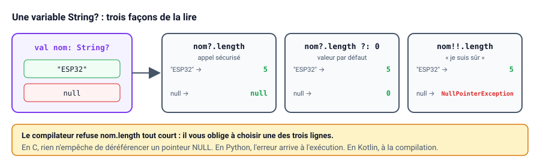
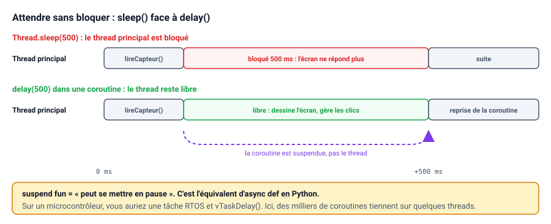

# Aide mémoire Kotlin (depuis le C / C++ ou Python)

Vous connaissez le C, le C++ ou Python et vous découvrez Kotlin ? Cet aide-mémoire reprend les bases du langage en partant de ce que vous connaissez déjà. Il ne remplace pas la documentation officielle, mais il vous permettra de lire et d'écrire du code Kotlin rapidement.

::: tip Comment lire cette page
Chaque notion suit le même schéma :

- un tableau de correspondance, toujours dans le même ordre : **C / C++**, puis **Python**, puis **Kotlin** ;
- le code Kotlin complet, à tester ;
- quand Python a un piège ou une habitude qui ne fonctionne plus en Kotlin, un encadré « Depuis Python ».

Kotlin emprunte au C sa rigueur (typage statique, compilation) et à Python sa concision (inférence de types, lambdas, chaînes formatées). Vous retrouverez donc des repères des deux côtés.
:::

::: details Sommaire
[[toc]]
:::

## Tester sans rien installer

Pour essayer les exemples de cette page, pas besoin d'Android Studio : le [Kotlin Playground](https://play.kotlinlang.org/) exécute votre code directement dans le navigateur.

```kotlin
fun main() {
    println("Hello, World!")
}
```

| C / C++ | Python | Kotlin |
|---|---|---|
| `int main() { ... return 0; }` | Code au niveau du module, ou `if __name__ == "__main__":` | `fun main() { ... }` |
| `printf("Hello\n");` | `print("Hello")` | `println("Hello")` |
| `;` en fin d'instruction | Rien | Rien (le `;` est facultatif) |
| Blocs entre `{ }` | Blocs par indentation et `:` | Blocs entre `{ }` |

Pas de `#include`, pas de `return 0`, pas de point-virgule en fin de ligne : `main` est le point d'entrée, comme en C.

## Ce qui change vraiment

Avant d'entrer dans la syntaxe, voici les grandes différences avec le C et Python :

| | C / C++ | Python | Kotlin |
|---|---|---|---|
| Exécution | Compilé en code machine | Interprété | Compilé en bytecode, exécuté par une machine virtuelle (la JVM, ou ART sur Android) |
| Typage | Statique, avec conversions implicites | Dynamique : les erreurs de type apparaissent à l'exécution | Statique et inféré : les erreurs de type apparaissent à la compilation |
| Mémoire | `malloc` / `free`, `new` / `delete` | Ramasse-miettes | Ramasse-miettes (*garbage collector*) |
| Pointeurs | Pointeurs et arithmétique de pointeurs | Références vers des objets | Références vers des objets |
| Valeur absente | `NULL` accepté partout | `None` accepté partout | `null` accepté seulement si le type l'autorise |
| Accès hors tableau | Comportement indéfini | Exception `IndexError` | Exception `ArrayIndexOutOfBoundsException` |
| Conversions numériques | Implicites (`int` vers `long`…) | Implicites (`int` vers `float`) | Aucune conversion implicite |
| Fichiers | `.h` / `.c` | Modules `.py`, `import` | Fichiers `.kt`, `import`, pas d'en-têtes |

::: tip Que se passe-t-il derrière ?
Le ramasse-miettes libère un objet quand plus aucune variable n'y fait référence. Vous n'avez donc jamais à « libérer » la mémoire, exactement comme en Python. En contrepartie, vous ne maîtrisez pas le moment exact de cette libération : sur mobile ou sur serveur, ce n'est pas un problème.
:::

::: info Depuis Python
Le plus gros changement est le typage statique. En Python, `x = 3` puis `x = "trois"` fonctionne. En Kotlin, une variable garde le type de sa première valeur : le compilateur refuse le programme avant même de le lancer. C'est plus contraignant au début, mais toute une famille d'erreurs disparaît.
:::

## Les variables

| C / C++ | Python | Kotlin |
|---|---|---|
| `const int vitesse = 42;` | `VITESSE = 42` (convention, rien n'empêche de la modifier) | `val vitesse = 42` |
| `int compteur = 0;` | `compteur = 0` | `var compteur = 0` |
| `double tension = 3.3;` | `tension: float = 3.3` (annotation facultative) | `val tension: Double = 3.3` |
| `#define MAX_RETRY 3` | `MAX_RETRY = 3` | `const val MAX_RETRY = 3` |

```kotlin
val vitesse = 42          // Non modifiable (équivalent d'une variable const)
var compteur = 0          // Modifiable
compteur += 1

val tension: Double = 3.3 // Type explicite (optionnel si la valeur suffit)
```

- `val` : la référence ne peut pas être réaffectée. C'est le choix par défaut, on n'utilise `var` que si la valeur doit changer.
- Le type est **déduit** de la valeur (inférence). On peut l'écrire après `:` si on veut être explicite.
- Pour une vraie constante connue à la compilation (l'équivalent d'un `#define`), on utilise `const val` au niveau du fichier :

```kotlin
const val MAX_RETRY = 3
```

::: info Depuis Python
L'annotation de type s'écrit au même endroit qu'en Python (`nom: Type`). La différence : en Kotlin, elle est vérifiée par le compilateur, alors qu'en Python elle n'est qu'une indication.
:::

## Les types de base

| C | Python | Kotlin | Taille en Kotlin |
|---|---|---|---|
| `int8_t` / `uint8_t` | `int` | `Byte` / `UByte` | 8 bits |
| `int16_t` / `uint16_t` | `int` | `Short` / `UShort` | 16 bits |
| `int32_t` / `uint32_t` | `int` | `Int` / `UInt` | 32 bits |
| `int64_t` / `uint64_t` | `int` | `Long` / `ULong` | 64 bits |
| `float` / `double` | `float` (64 bits) | `Float` / `Double` | 32 / 64 bits |
| `bool` | `bool` | `Boolean` | |
| `char` | `str` de longueur 1 | `Char` | 16 bits (Unicode) |
| `char*` | `str` | `String` | |

```kotlin
val a: Int = 10
val b: Long = a.toLong()     // Conversion explicite obligatoire
val c = 3_000_000L           // Suffixe L pour un Long, _ pour la lisibilité
val d = 0xFF                 // Hexadécimal
val e = 0b1010               // Binaire
val f = 255u                 // Non signé (UInt)
val code = 'A'.code          // 65 : un Char n'est pas un nombre, il faut demander son code
```

::: warning Attention
`val x: Long = a` ne compile pas si `a` est un `Int`. Kotlin refuse toutes les conversions implicites : c'est volontaire, pour éviter les pertes de données silencieuses.
:::

::: info Depuis Python
En Python, un `int` n'a pas de limite de taille. En Kotlin, comme en C, chaque type entier a une taille fixe et **déborde** sans prévenir : `Int.MAX_VALUE + 1` donne `-2147483648`. Choisissez `Long` dès que les valeurs peuvent dépasser 2 milliards (horodatages en millisecondes, par exemple). Autre différence : `7 / 2` vaut `3` en Kotlin (division entière entre deux `Int`), alors qu'il vaut `3.5` en Python.
:::

## Les chaînes de caractères

| C | Python | Kotlin |
|---|---|---|
| `sprintf(buf, "Carte %s", nom)` | `f"Carte {nom}"` | `"Carte $nom"` |
| `sprintf(buf, "%d mV", t * 1000)` | `f"{t * 1000} mV"` | `"${t * 1000} mV"` |
| `strlen(nom)` | `len(nom)` | `nom.length` |
| `strcmp(a, b) == 0` | `a == b` | `a == b` |

```kotlin
val nom = "ESP32"
val message = "Carte $nom, tension ${tension * 1000} mV"   // Équivalent de sprintf
val longueur = nom.length

if (nom == "ESP32") { /* ... */ }   // Comparaison du contenu, pas de strcmp
```

- `$variable` ou `${expression}` dans une chaîne remplace `printf` / `sprintf`. C'est l'équivalent direct des f-strings de Python.
- `==` compare le **contenu** des chaînes. Pas besoin de `strcmp`.
- Une `String` n'est pas modifiable : chaque modification crée une nouvelle chaîne.

## La nullabilité : la fin des pointeurs NULL

C'est **la** différence la plus importante avec le C. Pas de panique, le principe est simple : par défaut, une variable ne peut pas valoir `null`. Pour l'autoriser, on ajoute `?` au type.

```kotlin
var nom: String = "ESP32"
nom = null                 // Erreur de compilation

var peripherique: String? = null   // Autorisé grâce au ?
```

Pour utiliser une variable « nullable », le compilateur vous oblige à gérer le cas `null` :

```kotlin
val taille = peripherique?.length        // null si peripherique est null, sinon sa longueur
val tailleOuZero = peripherique?.length ?: 0   // Valeur par défaut si null (opérateur « Elvis »)

if (peripherique != null) {
    println(peripherique.length)         // Ici, Kotlin sait que ce n'est pas null
}

val forcee = peripherique!!.length       // « Je suis sûr que ce n'est pas null » : plante sinon
```

| Kotlin | Rôle | Équivalent C | Équivalent Python |
|---|---|---|---|
| `String?` | Type qui accepte `null` | Tout pointeur | `str \| None` (indication non vérifiée) |
| `p?.length` | Appel sécurisé : renvoie `null` au lieu de planter | `p ? p->len : NULL` | `len(p) if p is not None else None` |
| `p ?: defaut` | Valeur par défaut si `null` | `p ? p : defaut` | `p if p is not None else defaut` |
| `p!!.length` | Force l'accès, lève une exception si `null` | Déréférencer sans vérifier | `len(p)` sans vérifier |



::: tip Bonne pratique
Évitez `!!`. S'il apparaît souvent dans votre code, c'est que le type devrait probablement être non nullable.
:::

::: info Depuis Python
L'habitude `valeur = p or defaut` ne se transpose pas : en Python, `or` remplace aussi `0`, `""` ou une liste vide. L'opérateur `?:` de Kotlin ne remplace **que** `null`. `0 ?: 5` vaut donc `0`.
:::

## Les conditions

| C / C++ | Python | Kotlin |
|---|---|---|
| `cond ? a : b` | `a if cond else b` | `if (cond) a else b` |
| `switch (x) { case 0: ... break; }` | `match x:` / `case 0:` (Python 3.10) | `when (x) { 0 -> ... }` |
| `x >= 3 && x <= 9` | `3 <= x <= 9` | `x in 3..9` |
| `&&`, `\|\|`, `!` | `and`, `or`, `not` | `&&`, `\|\|`, `!` |

`if` est une **expression** : il renvoie une valeur. C'est ce qui remplace l'opérateur ternaire, qui n'existe pas en Kotlin.

```kotlin
val etat = if (tension > 3.0) "OK" else "Faible"   // Équivalent de (cond ? a : b)
```

`when` remplace `switch`, en beaucoup plus puissant (pas de `break`, pas de « fall-through ») :

```kotlin
val libelle = when (code) {
    0 -> "Succès"
    1, 2 -> "Avertissement"
    in 3..9 -> "Erreur"
    else -> "Inconnu"
}
```

`when` peut aussi s'utiliser sans argument, comme une suite de `if / else if` :

```kotlin
when {
    temperature > 80 -> println("Surchauffe")
    temperature < -20 -> println("Trop froid")
    else -> println("Normal")
}
```

## Les boucles

| C | Python | Kotlin |
|---|---|---|
| `for (int i = 0; i < 10; i++)` | `for i in range(10):` | `for (i in 0 until 10)` |
| `for (int i = 0; i <= 10; i++)` | `for i in range(11):` | `for (i in 0..10)` |
| `for (int i = 10; i >= 0; i--)` | `for i in range(10, -1, -1):` | `for (i in 10 downTo 0)` |
| `for (int i = 0; i < 10; i += 2)` | `for i in range(0, 10, 2):` | `for (i in 0 until 10 step 2)` |
| Boucle sur un tableau avec un index | `for m in mesures:` | `for (m in mesures)` |
| | `for i, m in enumerate(mesures):` | `for ((i, m) in mesures.withIndex())` |

```kotlin
for (i in 0 until 10) { }        // for (int i = 0; i < 10; i++)
for (i in 0..10) { }             // De 0 à 10 inclus
for (i in 10 downTo 0) { }       // Décroissant
for (i in 0 until 10 step 2) { } // De 2 en 2

for (mesure in mesures) { }      // Parcours direct d'une collection
for ((index, mesure) in mesures.withIndex()) { }   // Avec l'index

while (compteur < 10) { compteur++ }
```

## Les fonctions

| C | Python | Kotlin |
|---|---|---|
| `int additionner(int a, int b)` | `def additionner(a: int, b: int) -> int:` | `fun additionner(a: Int, b: Int): Int` |
| `void afficher(void)` | `def afficher() -> None:` | `fun afficher()` (renvoie `Unit`) |
| Pas de paramètres par défaut en C | `def connecter(adresse, timeout_ms=5000):` | `fun connecter(adresse: String, timeoutMs: Int = 5000)` |
| | `connecter("AA:BB", retry=5)` | `connecter("AA:BB", retry = 5)` |

```kotlin
fun additionner(a: Int, b: Int): Int {
    return a + b
}

// Version courte quand le corps est une seule expression
fun multiplier(a: Int, b: Int) = a * b

// Paramètres par défaut et nommés (pas de surcharge à écrire)
fun connecter(adresse: String, timeoutMs: Int = 5000, retry: Int = 3) { }

connecter("AA:BB:CC:DD:EE:FF")
connecter("AA:BB:CC:DD:EE:FF", retry = 5)
```

- Le type de retour est **après** les paramètres. Une fonction qui ne renvoie rien a le type `Unit` (l'équivalent de `void`), qu'on n'écrit pas.
- Les paramètres sont **non modifiables** dans la fonction (ce sont des `val`).
- Une fonction peut exister seule dans un fichier, sans classe autour, comme en Python.
- Les paramètres par défaut et nommés fonctionnent comme en Python. Seule différence de style : Kotlin écrit les noms en `camelCase` (`timeoutMs`), Python en `snake_case` (`timeout_ms`).

## Les tableaux et les collections

| C | Python | Kotlin |
|---|---|---|
| `uint8_t buffer[20] = {0};` | `bytearray(20)` | `ByteArray(20)` |
| `int valeurs[] = {1, 2, 3};` | `[1, 2, 3]` | `intArrayOf(1, 2, 3)` (taille fixe) |
| `sizeof(t) / sizeof(t[0])` | `len(valeurs)` | `valeurs.size` |
| | `(3.2, 3.3, 3.1)` (tuple, non modifiable) | `listOf(3.2, 3.3, 3.1)` |
| | `[]` puis `append()` | `mutableListOf<Double>()` puis `add()` |
| | `{1: "LED", 2: "Bouton"}` | `mapOf(1 to "LED", 2 to "Bouton")` |

```kotlin
val buffer = ByteArray(20)            // Équivalent de uint8_t buffer[20], initialisé à 0
val valeurs = intArrayOf(1, 2, 3)     // Tableau d'entiers de taille fixe
println(valeurs.size)                 // La taille est connue, pas de sizeof

val mesures = listOf(3.2, 3.3, 3.1)              // Liste non modifiable
val historique = mutableListOf<Double>()         // Liste modifiable (taille dynamique)
historique.add(3.4)

val noms = mapOf(1 to "LED", 2 to "Bouton")      // Dictionnaire clé / valeur
println(noms[1])                                 // "LED"
```

Les collections ont des fonctions qui remplacent la plupart des boucles. Elles jouent le rôle des compréhensions de liste de Python :

| Python | Kotlin |
|---|---|
| `sum(mesures) / len(mesures)` | `mesures.average()` |
| `[m for m in mesures if m > 3.2]` | `mesures.filter { it > 3.2 }` |
| `[int(m * 1000) for m in mesures]` | `mesures.map { (it * 1000).toInt() }` |
| `max(mesures, default=None)` | `mesures.maxOrNull()` |

```kotlin
val moyenne = mesures.average()
val hautes = mesures.filter { it > 3.2 }         // Garde les éléments qui respectent la condition
val enMv = mesures.map { (it * 1000).toInt() }   // Transforme chaque élément
val max = mesures.maxOrNull()
```

::: tip it ?
Dans une lambda à un seul paramètre, `it` désigne ce paramètre. `mesures.filter { it > 3.2 }` est la version courte de `mesures.filter { m -> m > 3.2 }`.
:::

## Les lambdas : des pointeurs de fonction, en mieux

En C, vous passeriez un pointeur de fonction pour un *callback*. En Python, une fonction ou une `lambda`. En Kotlin, on passe une **lambda** :

| C | Python | Kotlin |
|---|---|---|
| `void (*on_trouve)(const char*)` | `Callable[[str], None]` | `(String) -> Unit` |
| `scanner(&afficher);` | `scanner(lambda nom: print(nom))` | `scanner { nom -> println(nom) }` |

```kotlin
fun scanner(onTrouve: (String) -> Unit) {
    onTrouve("ESP32-LED")
}

scanner { nom -> println("Périphérique trouvé : $nom") }
```

- `(String) -> Unit` est le type « fonction qui prend une `String` et ne renvoie rien ».
- Quand la lambda est le dernier paramètre, on l'écrit **après** les parenthèses. C'est cette syntaxe que vous verrez partout dans Compose.
- Contrairement aux `lambda` de Python, limitées à une seule expression, une lambda Kotlin peut contenir plusieurs lignes. La valeur de la dernière ligne est renvoyée.

## Les classes

| C++ | Python | Kotlin |
|---|---|---|
| `class Capteur { ... };` + constructeur | `class Capteur:` + `def __init__(self, nom, seuil):` | `class Capteur(val nom: String, var seuil: Int)` |
| `this->seuil` | `self.seuil` | `seuil` (ou `this.seuil`) |
| `new Capteur("T", 80)` | `Capteur("T", 80)` | `Capteur("T", 80)` |
| `struct Mesure { ... };` | `@dataclass class Mesure:` | `data class Mesure(...)` |
| `enum Etat { ... };` | `class Etat(Enum):` | `enum class Etat { ... }` |
| Classe abstraite pure | `ABC` ou `Protocol` | `interface` |
| Variable globale, singleton | Variable au niveau du module | `object` |

```kotlin
class Capteur(val nom: String, var seuil: Int) {   // Constructeur et propriétés en une ligne
    fun estDeclenche(valeur: Int) = valeur > seuil
}

val capteur = Capteur("Température", 80)   // Pas de new
capteur.seuil = 90
println(capteur.estDeclenche(85))
```

- Pas de `new`, pas de destructeur : le ramasse-miettes s'en charge.
- Pas de `self` à écrire : les méthodes accèdent directement aux propriétés.
- Les propriétés déclarées dans le constructeur (`val` / `var`) sont directement des attributs.
- Tout est `public` par défaut. Les autres visibilités : `private`, `protected`, `internal` (visible dans le module).

### Les data class : vos structures

Pour regrouper des données, l'équivalent d'une `struct` est la `data class` :

```kotlin
data class Mesure(val capteur: String, val valeur: Double, val horodatage: Long)

val m1 = Mesure("T1", 21.5, 1_700_000_000)
val m2 = m1.copy(valeur = 22.0)      // Copie en changeant un seul champ
println(m1)                          // Mesure(capteur=T1, valeur=21.5, horodatage=1700000000)
println(m1 == m2)                    // Compare le contenu : false
```

Kotlin génère pour vous l'affichage, la comparaison et la copie. C'est le même service que `@dataclass` en Python ; `copy(valeur = 22.0)` correspond à `dataclasses.replace(m1, valeur=22.0)`.

### Les énumérations et les classes scellées

```kotlin
enum class EtatBle { DECONNECTE, CONNEXION, CONNECTE }
```

Une `sealed class` est une enum dont chaque cas peut porter ses propres données. Elle est parfaite pour représenter une machine à états :

```kotlin
sealed class Etat {
    object Deconnecte : Etat()
    object Connexion : Etat()
    data class Connecte(val adresse: String) : Etat()
    data class Erreur(val code: Int) : Etat()
}

fun afficher(etat: Etat) = when (etat) {
    is Etat.Deconnecte -> "Déconnecté"
    is Etat.Connexion -> "Connexion…"
    is Etat.Connecte -> "Connecté à ${etat.adresse}"
    is Etat.Erreur -> "Erreur ${etat.code}"
}   // Pas de else : le compilateur vérifie que tous les cas sont traités
```

::: info Depuis Python
Le `when` sur une `sealed class` ressemble au `match` de Python 3.10. La différence est que Kotlin vérifie à la compilation que tous les cas sont traités : si vous ajoutez un état, chaque `when` qui l'oublie devient une erreur.
:::

### Interfaces, héritage et objets uniques

```kotlin
interface Transport {
    fun envoyer(trame: ByteArray)
}

class TransportBle : Transport {
    override fun envoyer(trame: ByteArray) { /* ... */ }
}

object Configuration {            // Instance unique (singleton), remplace les variables globales
    const val VERSION = "1.0"
}
```

Une classe ne peut être héritée que si elle est déclarée `open`. Il n'y a pas de membres `static` : on utilise un `object` (ou un `companion object` à l'intérieur d'une classe).

## Les fonctions d'extension

Kotlin permet d'**ajouter une fonction à un type existant**, sans le modifier :

```kotlin
fun ByteArray.toHex() = joinToString(" ") { "%02X".format(it) }

val trame = byteArrayOf(0x01, 0x2A, 0xFF.toByte())
println(trame.toHex())   // "01 2A FF"
```

Vous en croiserez beaucoup : c'est très utilisé dans les bibliothèques Android et Ktor. Python ne permet pas d'ajouter une méthode à un type intégré comme `bytes` : il faut écrire une fonction séparée (même si, pour cet exemple précis, `trame.hex(" ")` existe déjà).

## Les opérations bit à bit

C et Python partagent les mêmes symboles. Kotlin, lui, utilise des mots.

| C | Python | Kotlin |
|---|---|---|
| `a & b` | `a & b` | `a and b` |
| `a \| b` | `a \| b` | `a or b` |
| `a ^ b` | `a ^ b` | `a xor b` |
| `~a` | `~a` | `a.inv()` |
| `a << 2` | `a << 2` | `a shl 2` |
| `a >> 2` | `a >> 2` | `a shr 2` (signé) / `a ushr 2` (non signé) |

```kotlin
val registre = 0b1010_0000
val bit7 = (registre shr 7) and 1          // Lire le bit 7
val avecBit0 = registre or 0x01            // Mettre le bit 0 à 1
```

::: warning Le piège du Byte signé
Un `Byte` est **signé** (de -128 à 127), comme un `int8_t`. Avant de l'utiliser comme un octet non signé, il faut le convertir et masquer :

```kotlin
val octet: Byte = 0xC8.toByte()   // Vaut -56
val valeur = octet.toInt() and 0xFF   // Vaut 200
```

C'est l'erreur la plus fréquente quand on décode une trame reçue en BLE. Elle surprend surtout en venant de Python, où chaque élément de `bytes` est déjà un entier de 0 à 255.
:::

### Décoder une trame

```kotlin
// Trame de 4 octets : [id][état][valeur poids fort][valeur poids faible]
fun decoder(trame: ByteArray): Mesure? {
    if (trame.size < 4) return null
    val id = trame[0].toInt() and 0xFF
    val valeur = ((trame[2].toInt() and 0xFF) shl 8) or (trame[3].toInt() and 0xFF)
    return Mesure("Capteur $id", valeur / 100.0, System.currentTimeMillis())
}
```

| Étape | C | Python | Kotlin |
|---|---|---|---|
| Lire un octet non signé | `trame[0]` (`uint8_t`) | `trame[0]` | `trame[0].toInt() and 0xFF` |
| Assembler deux octets (gros-boutiste) | `(t[2] << 8) \| t[3]` | `int.from_bytes(t[2:4], "big")` | `((t[2].toInt() and 0xFF) shl 8) or (t[3].toInt() and 0xFF)` |

## Les exceptions

| C++ | Python | Kotlin |
|---|---|---|
| `try { } catch (const std::exception& e) { }` | `try:` / `except ValueError as e:` | `try { } catch (e: NumberFormatException) { }` |
| | `finally:` | `finally { }` |
| `throw std::runtime_error("...")` | `raise ValueError("...")` | `throw IllegalStateException("...")` |
| RAII | `with open("log.txt") as f:` | `File("log.txt").bufferedReader().use { f -> }` |

```kotlin
try {
    val n = "abc".toInt()
} catch (e: NumberFormatException) {
    println("Pas un nombre : ${e.message}")
} finally {
    // Toujours exécuté
}

val n = "abc".toIntOrNull() ?: 0   // Souvent plus simple : une variante qui renvoie null
```

Pour une ressource à fermer (fichier, connexion), `use { }` la ferme automatiquement à la sortie du bloc, comme le RAII en C++ ou le `with` de Python :

```kotlin
File("log.txt").bufferedReader().use { lecteur ->
    println(lecteur.readLine())
}
```

## Les coroutines : la concurrence sans threads

Sur Android, le thread principal dessine l'interface : il ne doit **jamais** être bloqué (pas de `sleep`, pas d'attente réseau). Les coroutines permettent d'écrire du code asynchrone de façon séquentielle.

```kotlin
suspend fun lireCapteur(): Double {
    delay(500)          // Attend sans bloquer le thread (contrairement à sleep)
    return 21.5
}

// Dans un ViewModel Android
viewModelScope.launch {
    val valeur = lireCapteur()   // Le code « attend » ici, sans bloquer l'interface
    println(valeur)
}
```



| Embarqué / C | Python (`asyncio`) | Kotlin |
|---|---|---|
| Tâche RTOS, thread | `asyncio.create_task(...)` | Coroutine (`launch`), beaucoup plus légère qu'un thread : on peut en lancer des milliers |
| `vTaskDelay`, `sleep` | `await asyncio.sleep(0.5)` | `delay(500)` |
| Fonction bloquante | `async def` | `suspend fun` : peut se mettre en pause sans bloquer le thread |
| File de messages | Générateur asynchrone, `asyncio.Queue` | `Flow` / `StateFlow` : un flux de valeurs qu'on observe |

::: tip Que se passe-t-il derrière ?
Une fonction `suspend` peut se mettre en pause (par exemple en attendant une réponse réseau) et libérer le thread pour d'autres tâches. Quand le résultat arrive, elle reprend là où elle s'était arrêtée. Le mot-clé `suspend` indique simplement qu'elle ne peut être appelée que depuis une coroutine.
:::

::: info Depuis Python
`suspend fun` correspond à `async def`, mais il n'y a pas de `await` en Kotlin : l'appel d'une fonction `suspend` s'écrit comme un appel normal (`val valeur = lireCapteur()`). Le compilateur sait qu'il s'agit d'un point de pause.
:::

## Pour s'entraîner

C'est à vous de jouer ! Je vous laisse ouvrir le [Kotlin Playground](https://play.kotlinlang.org/) et écrire une fonction `analyser` qui prend une liste de tensions (`List<Double>`, en volts) et renvoie une `data class Rapport` contenant :

- le nombre de mesures ;
- la tension moyenne ;
- la liste des tensions inférieures à 3.0 V, converties en millivolts (`Int`).

Si la liste est vide, la fonction renvoie `null`.

::: tip Point de contrôle
Avec `listOf(3.3, 2.9, 3.1, 2.7)`, vous devez obtenir 4 mesures, une moyenne de 3.0 et les valeurs `[2900, 2700]`.
:::

::: details Voir l'une des solutions possibles (Python puis Kotlin)

Pour comparer, voici la version Python :

```python
from dataclasses import dataclass

@dataclass
class Rapport:
    nombre: int
    moyenne: float
    faibles_mv: list[int]

def analyser(tensions: list[float]) -> Rapport | None:
    if not tensions:
        return None
    return Rapport(
        nombre=len(tensions),
        moyenne=sum(tensions) / len(tensions),
        faibles_mv=[int(t * 1000) for t in tensions if t < 3.0],
    )
```

Et la version Kotlin :

```kotlin
data class Rapport(val nombre: Int, val moyenne: Double, val faiblesMv: List<Int>)

fun analyser(tensions: List<Double>): Rapport? {
    if (tensions.isEmpty()) return null
    return Rapport(
        nombre = tensions.size,
        moyenne = tensions.average(),
        faiblesMv = tensions.filter { it < 3.0 }.map { (it * 1000).toInt() }
    )
}

fun main() {
    println(analyser(listOf(3.3, 2.9, 3.1, 2.7)))
    println(analyser(emptyList()) ?: "Aucune mesure")
}
```

:::

## Pour aller plus loin

- [La documentation officielle de Kotlin](https://kotlinlang.org/docs/home.html)
- [Kotlin Koans](https://play.kotlinlang.org/koans/overview) : des petits exercices progressifs, directement dans le navigateur
- [Le cours Kotlin Multiplateforme](/tp/android/compose-multiplateforme/introduction.md)
- [Créer des API avec Kotlin](/tp/ktor/decouverte.md) : le même langage, côté serveur

👋 Si vous avez des questions, n'hésitez pas.
