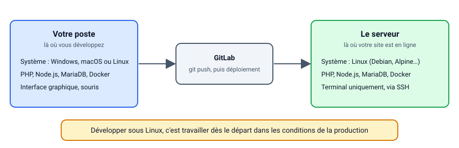
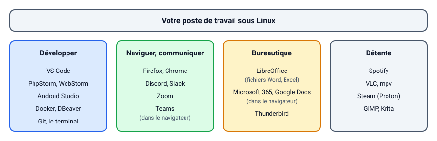
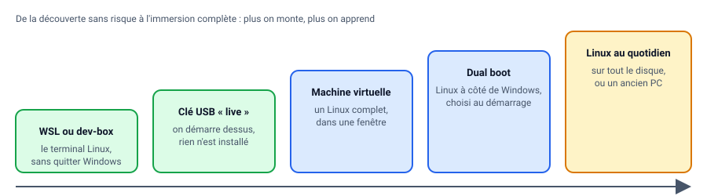
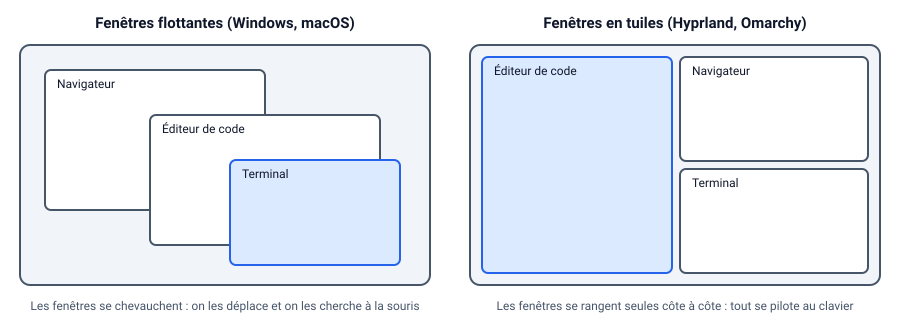

# L'outillage du développeur

Préparer son environnement de développement est une étape essentielle pour tout développeur web. Selon votre système d'exploitation, les étapes peuvent varier légèrement.

Dans ce support, vous trouverez les instructions pour configurer un environnement de développement web sous Windows, Linux et macOS.

## Global

Pour coder vous aurez besoin d'un éditeur de texte ou d'un IDE. Voici quelques recommandations populaires :

- [Visual Studio Code](https://code.visualstudio.com/) - Un éditeur de code léger et puissant, avec de nombreuses extensions pour le développement web.
  - Extensions recommandées :
    - [PHP Intelephense](https://marketplace.visualstudio.com/items?itemName=bmewburn.vscode-intelephense-client) - Fournit l'autocomplétion, la vérification de syntaxe et d'autres fonctionnalités pour PHP.
    - [PHP Namespace Resolver](https://marketplace.visualstudio.com/items?itemName=MehediDracula.php-namespace-resolver) - Aide à gérer les namespaces en PHP.
    - [Prettier - Code formatter](https://marketplace.visualstudio.com/items?itemName=esbenp.prettier-vscode) - Un formateur de code pour divers langages, y compris JavaScript, HTML et CSS.
    - [Tailwind CSS IntelliSense](https://marketplace.visualstudio.com/items?itemName=bradlc.vscode-tailwindcss) - Fournit l'autocomplétion et la documentation pour Tailwind CSS.
- [WebStorm](https://www.jetbrains.com/webstorm/) - Un IDE complet pour le développement web, avec des fonctionnalités avancées.
- [PHPStorm](https://www.jetbrains.com/phpstorm/) - Un IDE dédié au développement PHP, avec des outils intégrés pour le débogage et les tests.
- [NeoVim](https://neovim.io/) - Un éditeur de texte moderne basé sur Vim, très personnalisable et extensible. Très puissant une fois maîtrisé.

## Windows

::: tip Windows ? Solution WSL !

WSL permet d'obtenir un environnement Linux directement sous Windows, idéal pour le développement.

Un bon point de départ est **Alpine** avec l'ensemble des éléments nécessaires au développement web.  

Il s’agit d’un fork de **AlpineWSL**, enrichi de nombreux outils déjà installés :

<https://github.com/c4software/AlpineWSL-web/releases>

Après installation (**décompression** et lancement de `Alpine.exe`), vous disposez d’un terminal Linux avec les outils suivants préinstallés :

- PHP  
- Composer  
- Node.js et npm  
- Python  
- Git  
- Vim  

Vous avez ainsi un environnement Linux complet, léger et prêt à l’emploi, comprenant les principaux langages et outils du développement web (PHP, Node.js, Python, Composer, Git, Vim, etc.).

**PS :** `apk` est le gestionnaire de paquets

:::

👋 Si vous avez fait le choix de WSL, pas besoin de faire la suite.

Pour commencer à développer sous Windows, il est recommandé d'installer un environnement comprenant les outils essentiels comme un serveur web, un interpréteur de langage (PHP, Node.js, Python...), et un gestionnaire de paquets.

- [Installation du VCRedist](https://github.com/abbodi1406/vcredist/releases).
- [Installation de Wamp](https://wampserver.aviatechno.net/).
- Installer Wamp, et vérifier que celui-ci fonctionne correctement.
- Gitbash : [Téléchargement](https://git-scm.com/download/win) et installation.

### Installer un gestionnaire de paquets

- [Composer pour PHP](https://getcomposer.org/Composer-Setup.exe)
- [npm pour Node.js](https://nodejs.org/)
- Vérifiez que la commande est bien disponible dans un nouveau terminal (`composer`, `npm`, etc.).

## Linux

### Pourquoi Linux sur votre poste de travail ?

Linux, ce n'est pas seulement pour les serveurs : c'est aussi un excellent système pour votre ordinateur de tous les jours, celui sur lequel vous codez, suivez les cours, faites vos recherches et vos rendus. Vous pouvez tout à fait suivre les cours sous Windows ou macOS, mais si vous hésitez à franchir le pas, voici quelques arguments :

- **Un poste pensé pour développer.** Git, Docker, PHP, Node.js, Python, SSH : tout s'installe en une commande, sans assistant d'installation ni variable `PATH` à modifier à la main. Docker y fonctionne nativement, sans machine virtuelle cachée qui ralentit tout.
- **Un système qui vous appartient.** Pas de publicité dans le menu Démarrer, pas de compte en ligne obligatoire, pas de mise à jour qui redémarre l'ordinateur en plein TP : c'est vous qui décidez quand mettre à jour, quoi installer, et à quoi ressemble votre bureau.
- **Rapide, même sur une machine modeste.** Linux démarre vite et consomme peu : un vieux portable trop lent sous Windows retrouve une seconde jeunesse, et votre machine récente garde toute sa puissance pour vos outils.
- **Le terminal devient un allié.** Sous Linux, on finit naturellement par l'utiliser au quotidien, et on y gagne énormément de temps (rechercher un fichier, renommer en masse, lancer un projet).
- **Rien n'est caché.** La configuration est dans des fichiers texte, que vous pouvez lire, modifier, versionner avec Git. Quand quelque chose ne fonctionne pas, le message d'erreur et les logs sont accessibles.
- **Le même système que vos serveurs.** L'immense majorité des serveurs web fonctionne sous Linux : votre site PHP, votre API, vos conteneurs Docker seront hébergés sur une Debian, une Ubuntu ou une Alpine. Développer sur le même système que la production, c'est moins de surprises au moment de la mise en ligne (droits sur les fichiers, majuscules dans les noms de fichiers, etc.).
- **C'est libre et gratuit.**



### Au quotidien, ça donne quoi ?

La question que tout le monde se pose : « Est-ce que je vais retrouver mes logiciels ? ». Pour l'essentiel, oui :



- **Pour développer**, tout est là : VS Code, les IDE JetBrains (PhpStorm, WebStorm), Android Studio, Docker, DBeaver, et bien sûr le terminal.
- **Pour naviguer et communiquer** : Firefox, Chrome, Discord, Slack. Zoom a son application, Teams fonctionne dans le navigateur.
- **Pour la bureautique** : LibreOffice ouvre et enregistre les fichiers Word et Excel ; Microsoft 365 et Google Docs fonctionnent dans le navigateur.
- **Pour la détente** : Spotify, VLC, et une grande partie des jeux Steam grâce à Proton.

Il reste quelques absents, à connaître avant de se lancer : la suite Adobe (Photoshop, Premiere ; Figma, GIMP, Krita ou DaVinci Resolve peuvent les remplacer selon l'usage) et certains jeux en ligne dont l'anti-triche refuse Linux. Si vous en dépendez, le dual boot (voir plus bas) garde Windows sous la main.

### Changer de système pour progresser

Changer de système d'exploitation est, à mon avis, l'un des meilleurs moyens de progresser techniquement. Et ce n'est pas tant pour Linux lui-même que pour ce que le changement vous oblige à faire.

Sur le système que vous utilisez depuis toujours, tout fonctionne « tout seul » : vous ne vous demandez jamais où sont rangés les fichiers, comment un programme démarre, ce qu'est un processus, un port ou un droit d'accès. En changeant d'environnement, vous perdez vos automatismes, et c'est précisément ce qui vous fait apprendre :

- vous découvrez comment un système est **organisé** (l'arborescence, les utilisateurs, les droits, les services) ;
- vous apprenez à **lire une documentation** et un message d'erreur, plutôt qu'à cliquer jusqu'à ce que ça marche ;
- vous développez votre capacité à **chercher et résoudre un problème** par vous-même, la compétence la plus utile d'un développeur (et le cœur du BTS SIO) ;
- vous comprenez enfin ce que les autres systèmes faisaient pour vous en coulisses, et vous devenez plus à l'aise **partout**, y compris sous Windows.

Les premières semaines sont un peu inconfortables, c'est normal et c'est le signe que vous apprenez. Pas de panique, il n'est pas nécessaire de tout casser pour essayer :

- démarrez une distribution depuis une **clé USB** (« live USB ») pour la tester sans rien installer ;
- installez-la dans une **machine virtuelle** (VirtualBox, VMware) ;
- installez-la **à côté** de Windows (« dual boot »), ou sur un **ancien ordinateur**.



::: tip Et sous Windows ?
WSL vous donne déjà un vrai Linux en ligne de commande (voir [la section Windows](#windows)). C'est une excellente première étape pour prendre en main le terminal, avant peut-être de passer à un Linux complet.
:::

### Quelle distribution choisir ?

Une distribution, c'est Linux accompagné d'un ensemble de logiciels, d'un gestionnaire de paquets et d'une interface. Pour débuter :

- [Ubuntu](https://ubuntu.com/download/desktop) ou [Linux Mint](https://linuxmint.com/) : simples, très répandues, avec énormément d'aide en ligne ;
- [Fedora](https://fedoraproject.org/workstation/) : moderne, très propre, proche de ce qu'on trouve en entreprise (Red Hat) ;
- [Debian](https://www.debian.org/) : la distribution des serveurs, que vous retrouverez dans les TP serveur.

### Omarchy, pour aller plus loin

Vous êtes curieux et prêt à sortir de votre zone de confort ? Regardez du côté d'[Omarchy](https://omarchy.org/).

Omarchy est une configuration complète de Linux pensée **pour les développeurs**, créée par David Heinemeier Hansson (le créateur du framework Ruby on Rails). Elle repose sur :

- **[Arch Linux](https://archlinux.org/)**, une distribution « rolling release » : les logiciels sont toujours à jour, sans grosse mise à jour tous les deux ans ;
- **[Hyprland](https://hyprland.org/)**, un gestionnaire de fenêtres en **tuiles** : les fenêtres se rangent automatiquement côte à côte, sans chevauchement, et tout se pilote au clavier ;
- une sélection d'outils de développement déjà installés et configurés : un terminal moderne, Neovim, Git et [lazygit](https://github.com/jesseduffield/lazygit), Docker, [mise](https://mise.jdx.dev/) pour installer les langages (PHP, Node.js, Python, etc.) dans la version de votre choix.

La différence la plus visible au premier démarrage, c'est la gestion des fenêtres :



Pourquoi c'est intéressant pour progresser :

- **le clavier d'abord** : une fois les raccourcis en tête (un menu au clavier les rappelle), vous passez d'une fenêtre, d'un espace de travail ou d'une application à l'autre sans toucher la souris. Vous gagnez énormément de temps ;
- **tout est configurable en fichiers texte** (dans `~/.config`) : vous comprenez comment fonctionne chaque brique, et vous pouvez versionner votre configuration avec Git ;
- **c'est un environnement de développeur dès l'installation** : pas d'après-midi passé à installer vos outils.

::: warning Ce qu'il faut savoir avant de se lancer
- Omarchy s'installe à partir de son propre fichier ISO et **prend tout le disque** : sauvegardez vos données, ou utilisez une machine (ou un disque) dédiée.
- C'est une distribution exigeante : la prise en main demande quelques jours, et il faudra parfois lire [le manuel](https://learn.omacom.io/2/the-omarchy-manual) ou chercher une solution. C'est justement là que vous progresserez.
- Si vous débutez complètement sous Linux, commencez plutôt par une Ubuntu ou une Fedora, puis revenez à Omarchy quand vous serez à l'aise.
:::

### Installer les outils

Sous Linux, il suffit d'installer les langages et outils nécessaires via le gestionnaire de paquets de votre distribution (ex : `apt`, `dnf`, `pacman`, etc.). Exemple pour installer PHP, Node.js et Python sous Debian/Ubuntu :

```bash
sudo apt install php nodejs npm git vim
```

Et sous Arch Linux (donc Omarchy) :

```bash
sudo pacman -S php nodejs npm git vim
```

Pour installer Composer (pour PHP) :

```bash
curl -sS https://getcomposer.org/installer | php
sudo mv composer.phar /usr/local/bin/composer
sudo chmod +x /usr/local/bin/composer
```

::: tip La dev-box, sur n'importe quel système
Vous ne voulez rien installer sur votre machine ? [La dev-box](/cheatsheets/dev-box/) vous donne un environnement Linux complet (Arch Linux, comme Omarchy) dans un conteneur Docker, identique sous Windows, macOS et Linux. Un bon moyen de goûter à Linux sans changer de système.
:::

## macOS

Sous macOS, la commande `brew` permet d'installer facilement les outils nécessaires :

- Installer [Homebrew](https://brew.sh/) si ce n'est pas déjà fait.
- Installer les langages et outils nécessaires :

```bash
brew install php node git vim
```
