# Sécurité des applications WEB

## Risques et menaces

Par [Valentin Brosseau](https://github.com/c4software) / [@c4software](http://twitter.com/c4software)

---

## Pour vous, la sécurité c’est quoi ?

---

## Des découvertes de failles tous les jours !

---

### Des exemples en tête ?

---

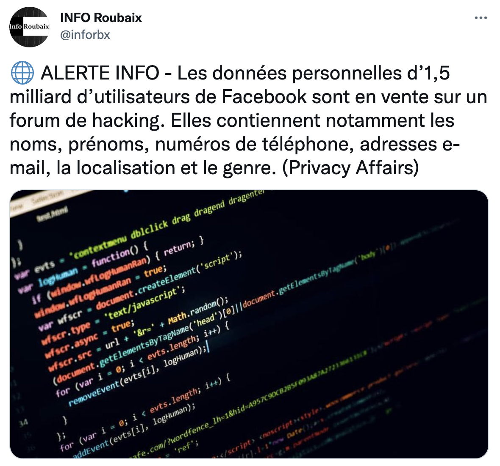

---

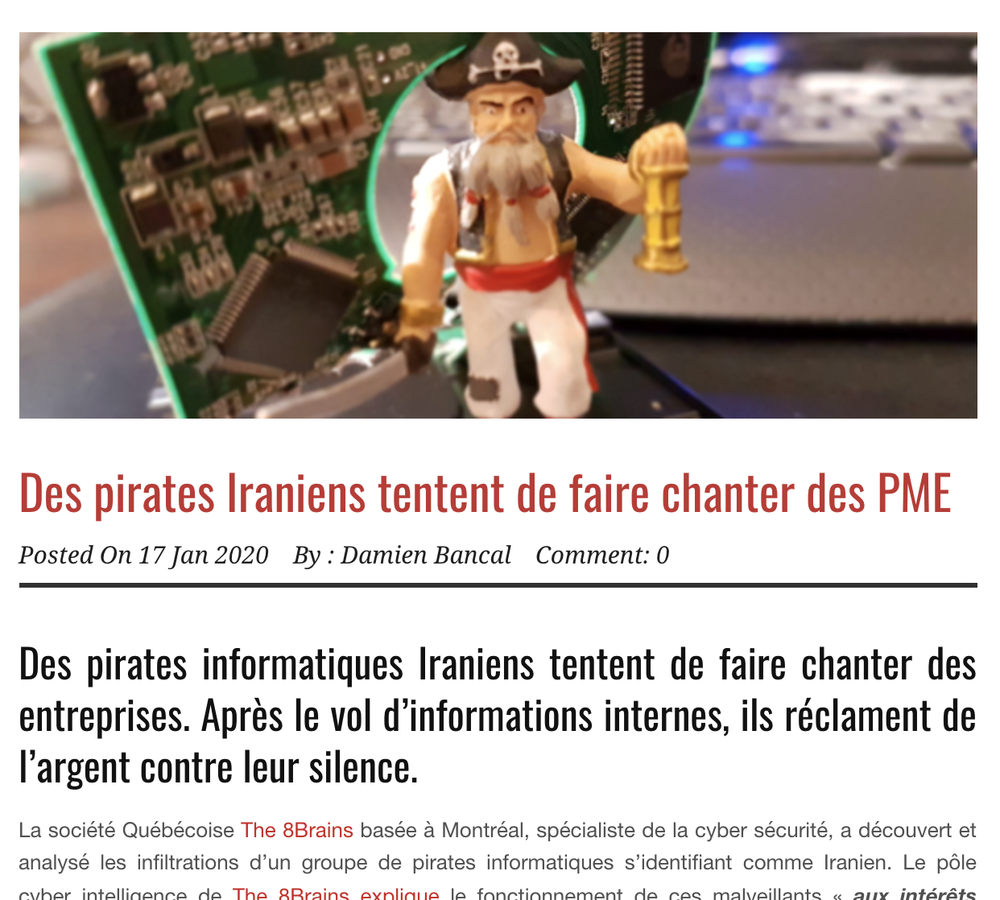

---

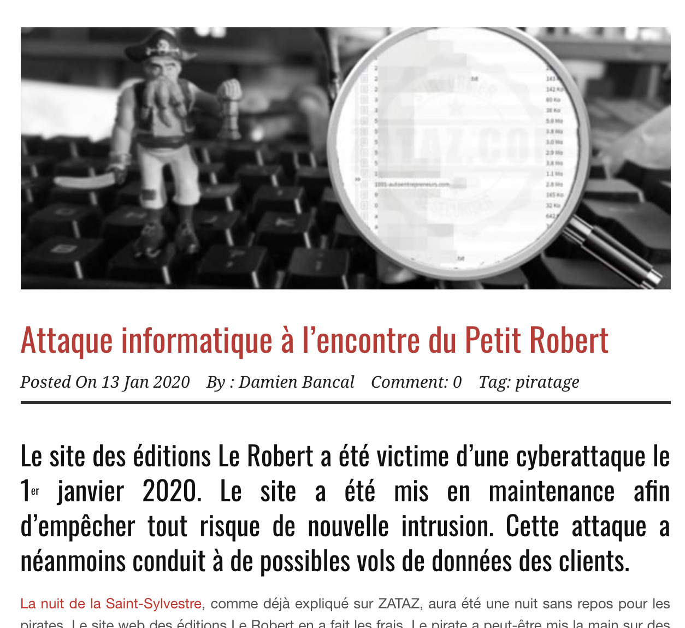

---

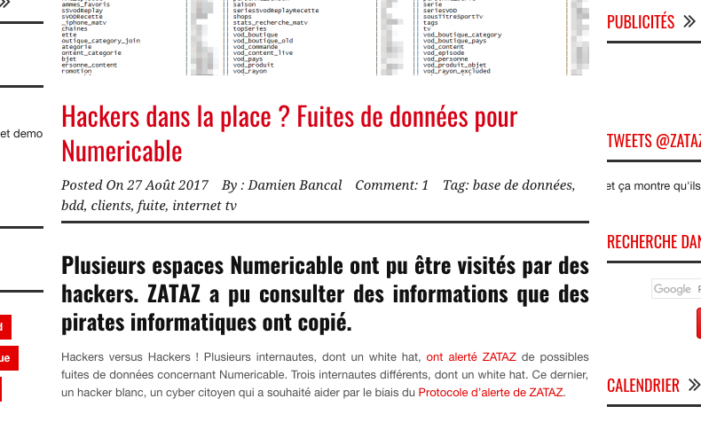

---

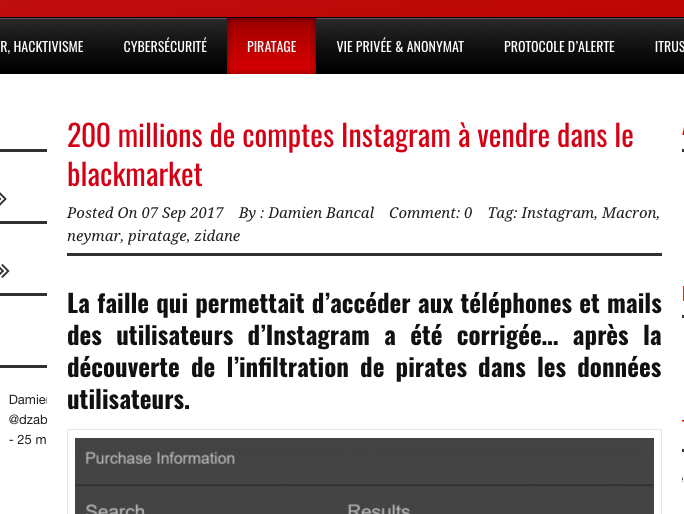

---

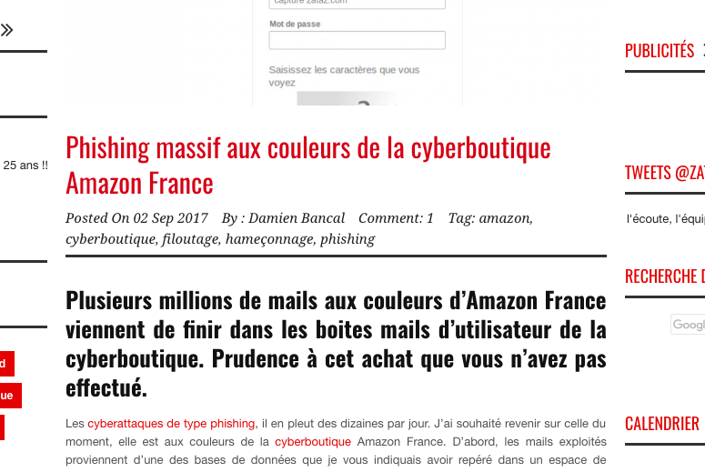

---

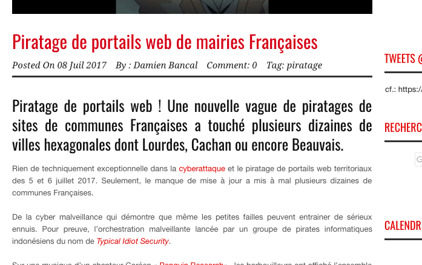

---

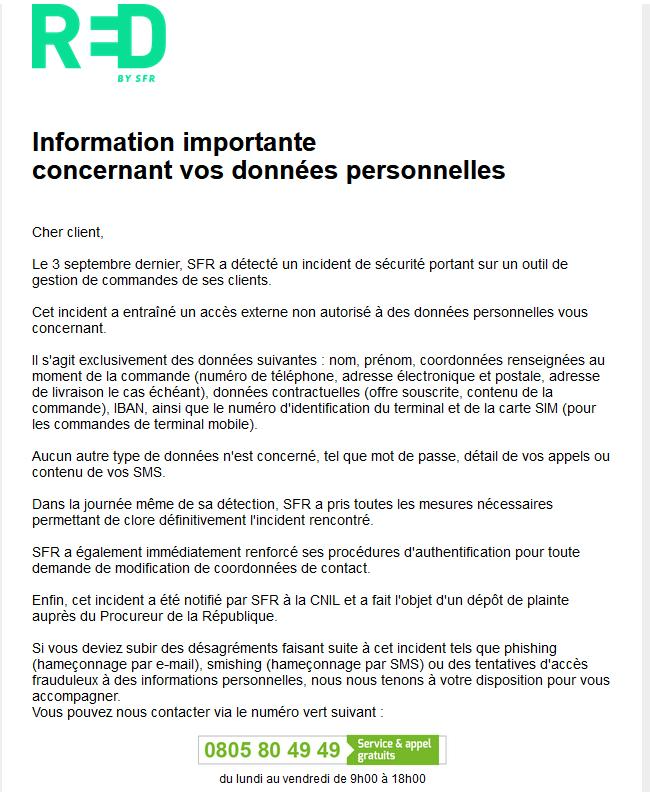

---

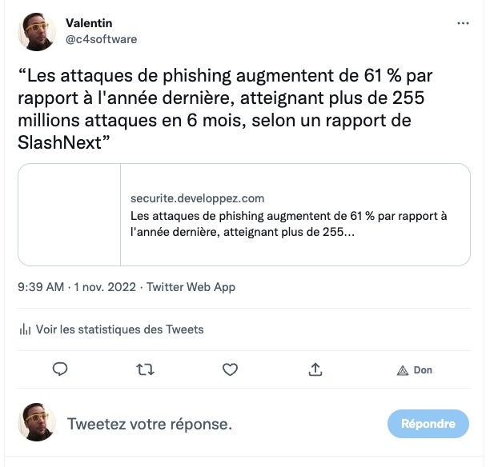

---

[Top50 du nombre de vulnérabilités par le nombre de produits des marques](https://www.cvedetails.com/top-50-vendors.php)

---

### Comment se tenir à jour ?

#### Prévenir plutôt que guérir…

---

### Des sites à surveiller

- [CISA (anciennement US-CERT)](https://www.cisa.gov/)
- [The Hacker News](https://thehackernews.com/)
- [Zataz](https://www.zataz.com/)
- [Reddit NetSec](https://www.reddit.com/r/netsec/)
- [Next INpact](https://www.nextinpact.com/) (~payant)
- [CERT-FR (ANSSI)](https://www.cert.ssi.gouv.fr/)
- Google Actu

Vous en avez d’autres en tête ?

---

### 3 Grandes catégories de risques

- **Confidentialité** : Risque de divulgation d’informations sensibles (ex. fuite de données personnelles).
- **Intégrité** : Risque de modification non autorisée de données ou de code (ex. injection SQL, XSS).
- **Disponibilité** : Risque de rendre un service indisponible (ex. attaque DDoS, ransomware).

---

### Le prix de la sécurité

- Impact fonctionnel
- Limitation de l'expérience utilisateur (UX)
- Impact financier
- Impact réputationnel

---

### Les facteurs d'exposition

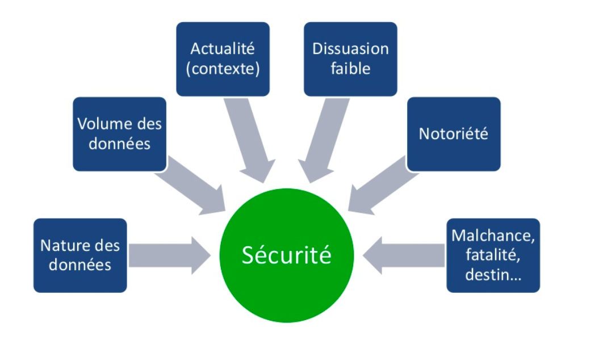

---

#### La sécurité informatique dans une application c'est un « équilibre »

Entre protection et utilisabilité

---

### L'insécurité a un coût

À votre avis ?

---

# 4,45 millions de dollars

Coût moyen mondial d'une violation de données en 2023 selon IBM Security

Source : Cost Of Data Breach - IBM Security 2023

---

### Un exemple… Facebook

---

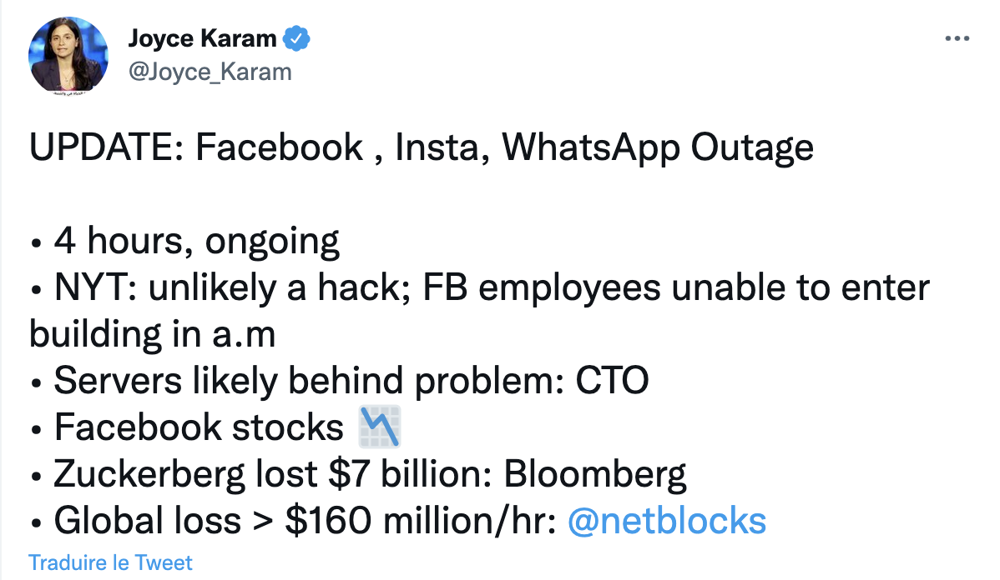

---

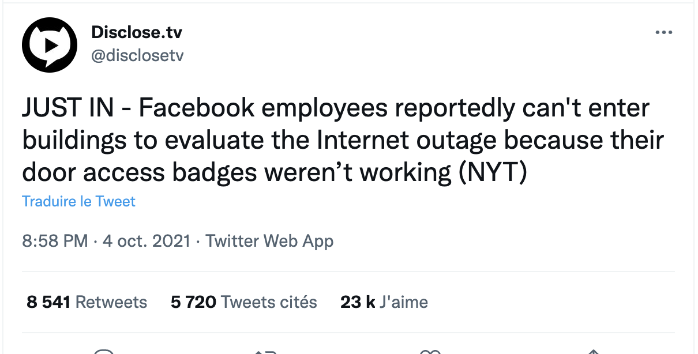

---

### Un impact qui peut être globalisé

[https://twitter.com/awlnx/status/1445073290708533258?s=09](https://twitter.com/awlnx/status/1445073290708533258?s=09)

---

### Et si je ne fais rien !?

- Volontaire !
- Involontaire ?

---

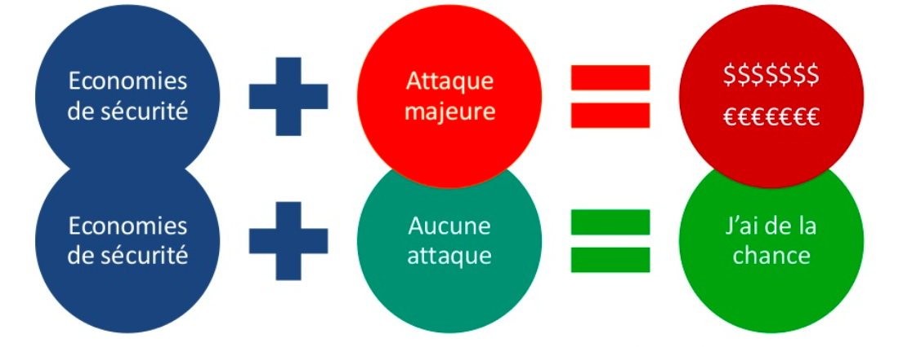

---

### Une petite histoire d'imprimante…

---

### Intégrer la sécurité à toutes les étapes

La sécurité c’est un état d’esprit à intégrer.

C’est aussi votre métier

- Réseau ?
- Développeur ?
- À votre avis ? Qui doit travailler la sécurité ?

---

### Les deux !

---

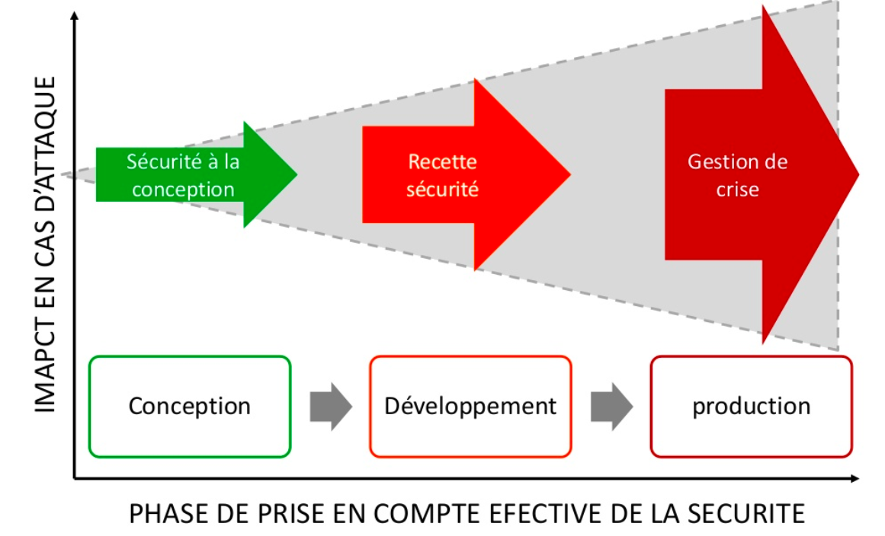

---

### Améliorer la sécurité

- Dès la conception
- Comprendre et avoir en tête les règles

---

## Les grandes catégories à connaître

- Les mots de passe (multi-facteurs, complexité, hashage).
- Les failles dans le code (injections, XSS, CSRF, etc.).
- Les failles dans les configurations (serveur, application, etc.).
- Le social engineering (le maillon faible, l'humain).

---

## Assurer la qualité

S'assurer une qualité continue du code

- 10 règles à connaitre (OWASP).
- Des tests unitaires.
- Une analyse automatique du code (SonarQube).

---

## L'authentification, un point clé

- **Mots de passe** : Complexité, hachage, salage.
- **Authentification à plusieurs facteurs** : Double authentification, biométrie, OTP.
- **Sécurisation des mots de passe** : Bcrypt, Argon2, Scrypt.
- **Sécurisation des sessions** : JWT, Cookies sécurisés.
- **Authentification unique** : OAuth, OpenID (SSO, Single Sign-On).

---

## SSO (Single Sign-On) : Authentification unique. Est un risque potentiel.

À votre avis pourquoi ?

---

## SSO (Single Sign-On) : Authentification unique. Est un risque potentiel.

Risques :

- Accès à plusieurs services avec un seul compte.
- Un seul compte à pirater pour accéder à plusieurs services.

Solution :

- Double authentification (2FA, MFA).

---

## 10 grandes catégories

- **Injection** ;
- **Violation de Gestion d’Authentification et de Session** ;
- **Cross-Site Scripting (XSS)** ;
- **Références directes non sécurisées à un objet** ;
- **Mauvaise configuration Sécurité** ;
- **Exposition de données sensibles** ;
- **Manque de contrôle d’accès au niveau fonctionnel** ;
- **Falsification de requête intersite (CSRF)** ;
- **Utilisation de composants avec des vulnérabilités connues** ;
- **Redirections et Renvois non validés**.

---

<fieldset>
  <legend>Le risque, la multiplication des failles</legend>
  <p>
  Plus vous avez de failles, plus vous avez de risques. C'est là que la sécurité devient un enjeu majeur. Car plus le nombre de failles est important, plus <b>la surface d'attaque</b> est grande.
  </p>
</fieldset>

---

## L'IA génère du code… et des failles ?

À votre avis, quels risques ?

---

## L'IA et la sécurité : les risques

- Beaucoup de code produit, donc des revues plus longues.
- Une confiance aveugle dans le code proposé.
- Des failles classiques : injection SQL, XSS, secrets en dur.
- Des dépendances obsolètes, voire inventées (*slopsquatting*).

---

## L'IA et la sécurité : les bonnes pratiques

- Relire le code de l'IA comme celui d'un développeur débutant.
- Donner des consignes de sécurité dans le prompt.
- Centraliser les règles de l'équipe dans un fichier `AGENTS.md`, lu automatiquement par les agents IA.
- Garder les outils automatiques (SonarQube, Dependabot).

---

## Un bon prompt ne remplace pas la revue de code

**Vous restez responsable du code que vous poussez.**

---

### Open Web Application Security Project (OWASP)

#### Les dix risques par ordre de dangerosité

---

### Le Top10 Web

---

### Un changement récent

- La version 2025 vient d'être publiée (fin 2025).
- La précédente datait de 2021.
- Beaucoup de ressources citent encore la version 2021.
- Les codes changent, les concepts restent.

---

- A01:2025-Contrôles d'accès défaillants (inclut le SSRF) ;
- A02:2025-Mauvaise configuration de sécurité ;
- A03:2025-Défaillances de la chaîne d'approvisionnement logicielle ;
- A04:2025-Défaillances cryptographiques ;
- A05:2025-Injection ;
- A06:2025-Conception non sécurisée ;
- A07:2025-Défaillances d'authentification ;
- A08:2025-Manque d'intégrité des données et du logiciel ;
- A09:2025-Carence de journalisation et d'alerte ;
- A10:2025-Mauvaise gestion des conditions exceptionnelles ;

---

### Analyse d'une situation

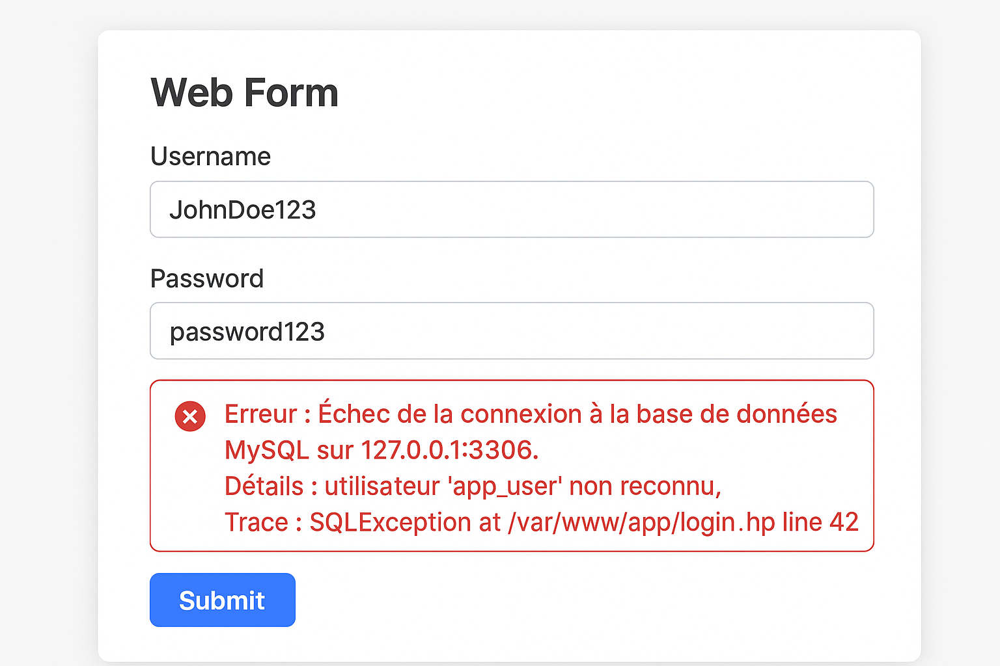

---

### L'injection

Risque d’injection SQL, Shell...

---

### La défaillance cryptographique

Risque de casser / usurper une authentification ou une session. Comprend notamment le vol de session ou la récupération de mots de passe.

- Données sensibles en clair.
- Mots de passe en clair.
- Mots de passe mal hachés.

---

### Conception non sécurisée / Exposition de données sensibles

Conception d'une application sans prise en compte de la sécurité.

- Données en clair.
- Manque de contrôle d'accès.
- Manque de contrôle de saisie.
- Absence d'anti-bots (captcha).
- Utilisation d'une question secrète.
- Réservation de place sans acompte.

---

### Mauvaise configuration de la sécurité

Manque de validation des types de paramètres, accès trop facile aux ressources non accessibles au public (cloud), configuration incomplète ou trop permissive, messages d'erreurs trop détaillés.

- Accès à des ressources non publiques.
- Messages d'erreurs trop détaillés.
- Filtrage absent ou incomplet (filter_input, strip_tags, htmlspecialchars, htmlentities, etc.).
- En-têtes de sécurité manquants (CSP, HSTS, X-Frame-Options, etc.).
- Services inutiles activés.

---

### Utilisation de composants avec des vulnérabilités connues

Utilisation de composants tiers vulnérables.

- CMS non à jour.
- Librairies non à jour.
- Apache non à jour.
- PHP non à jour.
- MySQL non à jour.

---

### Défaillances de la chaîne d'approvisionnement logicielle

Nouvelle catégorie 2025, qui élargit les composants vulnérables :

- Dépendances compromises (npm, composer, pip…).
- Outils de build et pipelines CI/CD.
- Chaîne de distribution du logiciel.

Nous y reviendrons : les Supply Chain Attacks.

---

### Défaillances d'authentification

Les applications n’exécutent pas de manière correcte les fonctions liées à la gestion des sessions ou à l’authentification des utilisateurs

- Absence de double authentification.
- Absence de règles de mots de passe (complexité, durée de vie, longueur, etc).
- Mot de passe par défaut (admin/admin, root/root).
- Utilisation d'id dans l'url (session hijacking).

---

### Manque d’intégrité des données et du logiciel

Cette catégorie englobe les codes et infrastructures qui ne sont pas protégés contre les violations d’intégrité.

- Absence de vérification de l'intégrité des données (validation d'une mise à jour).
- Absence de vérification de l'intégrité du logiciel (signature, hashage, etc).

---

### Absence de logs serveur et de surveillance

Absence de logs serveur et de surveillance des activités de l’application.

- Absence de logs serveur.
- Absence de logs applicatifs.
- Manque de supervision.

---

**L'observabilité** est un concept qui permet de mesurer et d'analyser le comportement d'un système. On parlera de **traçabilité**, de logs, de monitoring, de métriques, etc.

La **traçabilité** est un élément clé de la sécurité. Elle permet de savoir qui a fait quoi, quand et comment.

---

### Falsification de requête côté serveur (SSRF)

Elle permet à un hacker d’inciter l’application côté serveur à envoyer des requêtes à un endroit non prévu.

- Absence de vérification de l'origine de la requête.
- Absence de vérification de l'origine de l'utilisateur.

Depuis 2025, le SSRF fait partie de A01 (contrôles d'accès défaillants).

---

### Mauvaise gestion des conditions exceptionnelles

Nouvelle catégorie 2025 : que se passe-t-il quand ça se passe mal ?

- Exceptions non traitées.
- « Fail open » : le système laisse passer en cas d'erreur.
- Messages d'erreur qui révèlent des informations internes.

---

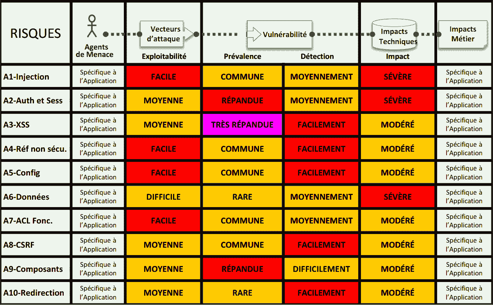

---

L'objectif est souvent de ralentir l'attaquant. Afin de le décourager.

---

#### Avec OWASP on parle de

### Vulnérabilité, et non de risque

---

### Mais, une faille c’est quoi ?

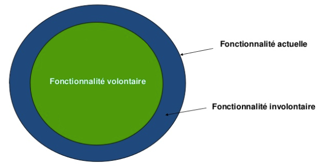

---

### Les types de failles

- L’humain (Social Engineering)
- D'accès (physique)
- Applicatif (Hack)
- L’argent (à quel montant une personne vous donne l’information ?)

---

### Le Social Engineering

Les gens sont souvent trop confiants.

[Exemple SECTF à la DefCon](https://www.youtube.com/watch?v=-FSLaHKoCNE)

[Call Recreation (@5min, @11min30)](https://share.vidyard.com/watch/i46XF6N6rpR9KMaorihFQw)

---

### Les outils autour d’OWASP

- [OWASP Juice Shop (Formation, JavaScript)](https://owasp.org/www-project-juice-shop/)
- [WebGoat (Formation, Java)](https://owasp.org/www-project-webgoat/)
- [ZAP - Zed Attack Proxy (audit ; a quitté la fondation OWASP en 2023)](https://www.zaproxy.org/)
- [OWASP Testing Guide (Guide de test de sécurité)](https://owasp.org/www-project-web-security-testing-guide/)
- [OWASP Code Review Guide (Méthode d'audit de code)](https://owasp.org/www-project-code-review-guide/)
- [OWASP Dependency-Check (Vérification des composants vulnérables)](https://owasp.org/www-project-dependency-check/)

---

### Supply Chain Attacks

#### Attaque ciblant les dépendances logicielles

---

Les dépendances logicielles sont partout dans nos applications (nuget, composer, npm, pip, etc.), mais également sur nos serveurs (apt, yum, docker, etc).

---

### Exemple d'attaque

- Une dépendance est compromise (par un attaquant ou un développeur malveillant).
- Un malware est injecté dans la dépendance.
- Le malware est distribué via la dépendance.
- Le malware s'exécute sur les systèmes des utilisateurs de la dépendance (serveur ou poste de travail en fonction du type de dépendance).

---

### OWASP un classement qui évolue

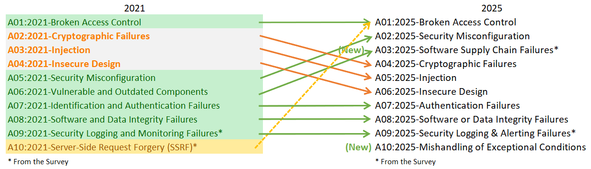

[Source](https://owasp.org/Top10/2025/)

---

### On connait les failles

#### Comment on les corrige ?

---

## Les failles

OWASP donne la liste des grandes catégories de failles. Entrons dans le détail technique.

---

### A01 : Contrôles d'accès défaillants

```php
// http://exemple.com/facture.php?id=42
// Et si je remplace 42 par 43 ?
$stmt = $pdo->prepare("SELECT * FROM facture WHERE id = ?");
$stmt->execute([$_GET["id"]]);
```

---

### Correction

```php
// La facture doit appartenir à l'utilisateur connecté
$stmt = $pdo->prepare("SELECT * FROM facture WHERE id = ? AND client_id = ?");
$stmt->execute([$_GET["id"], $_SESSION["client_id"]]);
```

---

### A01 : Falsification de requête intersite (CSRF)

```html
<!-- Un site tiers peut envoyer le même formulaire -->
<form method="post" action="supprimer-compte.php">
    <button>Supprimer mon compte</button>
</form>
```

---

### Correction

```php
// Génération (à l'affichage du formulaire)
$_SESSION['token'] = bin2hex(random_bytes(32));
```

```html
<input type="hidden" name="token" value="<?= $_SESSION['token'] ?>">
```

```php
// Vérification (à la réception du formulaire)
if (!hash_equals($_SESSION['token'], $_POST['token'] ?? '')) {
    die("Requête invalide.");
}
```

---

### A01 : Redirections non validées

```php
// http://www.shop-vdt.com/login.php?goto=evil.com/login
header("Location: " . $_GET['goto']);
```

[En vidéo](https://www.youtube.com/watch?v=ibFs8FZxzu4)

---

### Correction

```php
// Uniquement des destinations connues
$whitelist = ['accueil', 'compte', 'panier'];

if (in_array($_GET['goto'], $whitelist)) {
    header("Location: index.php?page=" . $_GET['goto']);
}
```

---

### A02 : Mauvaise configuration de sécurité

```apache
# Apache : la liste des fichiers est visible par tous
Options +Indexes
```

```ini
; PHP : les erreurs détaillées sont affichées aux visiteurs
display_errors = On
```

---

### Correction

```apache
Options -Indexes
```

```ini
display_errors = Off
log_errors = On
```

---

### A03 : Chaîne d'approvisionnement logicielle

```bash
# composer.lock ignoré, dernières versions installées sans contrôle
composer update
```

---

### Correction

```bash
# composer.lock versionné : les mêmes versions partout
composer install

# Recherche des vulnérabilités connues
composer audit
```

---

### A04 : Défaillances cryptographiques

```php
// MD5 est beaucoup trop rapide à casser
$hash = md5($_POST['password']);
```

---

### Correction

```php
// À l'inscription
$hash = password_hash($_POST['password'], PASSWORD_DEFAULT);

// À la connexion
password_verify($_POST['password'], $hash);
```

---

### A05 : Injection SQL

```php
// http://exemple.com/liste?id=' OR '1'='1
$sql = "SELECT * FROM client WHERE id='" . $_GET["id"] . "'";
$result = $pdo->query($sql);
```

---

### Correction

```php
$stmt = $pdo->prepare("SELECT * FROM client WHERE id = ?");
$stmt->execute([$_GET["id"]]);
```

---

### A05 : Cross-Site Scripting (XSS)

```php
// nom = <script>alert('XSS')</script>
echo "Bonjour " . $_POST['nom'];
```

---

### Correction

```php
echo "Bonjour " . htmlspecialchars($_POST['nom'], ENT_QUOTES, 'UTF-8');
```

---

### A06 : Conception non sécurisée

```php
// Peu de réponses possibles : facile à deviner
if ($_POST['reponse'] == $user['couleur_preferee']) {
    resetPassword($user);
}
```

---

### Correction

```php
// Un lien unique et temporaire, envoyé par mail
$token = bin2hex(random_bytes(32));
saveResetToken($user, hash('sha256', $token), time() + 3600);
sendResetMail($user, $token);
```

---

### A07 : Défaillances d'authentification

```php
// Aucune limite : des milliers d'essais possibles
if (password_verify($_POST['password'], $user['password'])) {
    $_SESSION['user_id'] = $user['id'];
}
```

---

### Correction

```php
if (tooManyAttempts($user)) {
    die("Compte temporairement bloqué.");
}

if (password_verify($_POST['password'], $user['password'])) {
    session_regenerate_id(true); // Nouvel identifiant de session
    $_SESSION['user_id'] = $user['id'];
}
```

---

### A08 : Manque d'intégrité des données et du logiciel

```html
<!-- Et si le fichier est modifié sur le CDN ? -->
<script src="https://cdn.exemple.com/lib.js"></script>
```

---

### Correction

```html
<!-- Le navigateur vérifie l'empreinte du fichier -->
<script src="https://cdn.exemple.com/lib.js"
        integrity="sha384-..."
        crossorigin="anonymous"></script>
```

---

### A09 : Carence de journalisation et d'alerte

```php
if (!password_verify($_POST['password'], $user['password'])) {
    // Personne n'est au courant de la tentative
    return false;
}
```

---

### Correction

```php
if (!password_verify($_POST['password'], $user['password'])) {
    $ip = $_SERVER['REMOTE_ADDR'];
    error_log("Échec de connexion : compte {$user['id']}, IP $ip");
    return false;
}
```

---

### A10 : Mauvaise gestion des conditions exceptionnelles

```php
try {
    $isAdmin = checkAdmin($user);
} catch (Exception $e) {
    // Une erreur et tout le monde devient admin
    $isAdmin = true;
}
```

---

### Correction

```php
try {
    $isAdmin = checkAdmin($user);
} catch (Exception $e) {
    // En cas d'erreur, on refuse l'accès
    error_log($e->getMessage());
    $isAdmin = false;
}
```

---

### La gestion des secrets

::: danger Ne jamais écrire en dur
Les clés API, mots de passe de BDD, tokens et certificats ne doivent **jamais** figurer dans le code source.
:::

- **Variables d'environnement** : Utiliser un fichier `.env` en local (hors git) et des variables d'environnement sur le serveur.
- **Ne pas versionner** : Ajouter `.env` au `.gitignore`. Un secret commité est un secret exposé.
- **Rotation** : Changer régulièrement les mots de passe et clés API en cas de fuite.

---

```php
// Mauvais
$apiKey = "sk-1234567890abcdef";

// Bon
$apiKey = getenv('API_KEY');
```

---

#### Vérifier avant de commit

Utilisez des outils comme **GitLeaks** ou **TruffleHog** pour scanner l'historique Git.

---

### Sécuriser les API et les tokens

- **JWT** : Ne stockez jamais d'informations sensibles dans le payload (Base64). Signez-le avec une clé forte et définissez une expiration courte.
- **Rate Limiting** : Protégez vos endpoints d'authentification et d'API contre le brute-force.
- **CORS** : Ne laissez jamais `Access-Control-Allow-Origin: *` sur une API privée.
- **Ne jamais passer de secrets en GET** : Les paramètres d'URL restent dans l'historique du navigateur et les logs serveur.

---

```php
// ❌ Token dans l'URL
// https://api.exemple.com/user?token=eyJhbGci...

// Token dans le header Authorization
$token = str_replace('Bearer ', '', $headers['Authorization'] ?? '');
```

---

#### Stocker un JWT

`localStorage` (risque XSS)  
Cookie `HttpOnly` + `Secure` + `SameSite`

---

### Les headers de sécurité HTTP

Premier rempart côté navigateur, ils se configurent côté serveur.

| Header | Rôle |
|---|---|
| `Content-Security-Policy` (CSP) | Empêche l'exécution de scripts inline et limite les sources de contenu. |
| `Strict-Transport-Security` (HSTS) | Force le navigateur à n'utiliser que HTTPS. |
| `X-Frame-Options` | Empêche le clickjacking (`DENY`, `SAMEORIGIN`). |
| `X-Content-Type-Options` | Empêche le navigateur de deviner le type MIME (`nosniff`). |

---

```php
header("Content-Security-Policy: default-src 'self'; script-src 'self'");
header("Strict-Transport-Security: max-age=31536000; includeSubDomains");
header("X-Frame-Options: DENY");
header("X-Content-Type-Options: nosniff");
header("Referrer-Policy: strict-origin-when-cross-origin");
```

---

### Les cookies sécurisés

Quand vous posez un cookie de session :

- `HttpOnly` : Empêche JavaScript d'y accéder (protection XSS).
- `Secure` : N'envoie le cookie que sur HTTPS.
- `SameSite=Strict` (ou `Lax`) : Protège contre le CSRF.

---

```php
setcookie('session', $token, [
    'expires' => time() + 3600,
    'path' => '/',
    'secure' => true,
    'httponly' => true,
    'samesite' => 'Strict'
]);
```

---

### DevSecOps et CI/CD sécurisé

Intégrer la sécurité dès la phase de développement (_shift-left_).

- **SAST** : SonarQube, Semgrep, CodeQL (analyse statique du code).
- **SCA** : Snyk, Dependabot, OWASP Dependency-Check (dépendances vulnérables).
- **Scan de secrets** : GitLeaks, TruffleHog dans la pipeline.
- **Tests sécurité** : ZAP en mode headless pour détecter les régressions.

---

```yaml
# Exemple conceptuel de pipeline CI
stages:
  - build
  - test
  - security

sast:
  stage: security
  script:
    - sonar-scanner

dependency_check:
  stage: security
  script:
    - dependency-check.sh --project MonApp --scan .

secret_detection:
  stage: security
  script:
    - gitleaks detect --source .
```

---

#### Pre-commit hook

Bloquer les secrets **avant même la CI** :

```bash
# .git/hooks/pre-commit
gitleaks protect --staged
```

---

Un instant ✋

---

🔐 L'authentification 🔐

---

Crypter ≠ Hasher

---

Quelle est la différence ?

---

- Crypter => Réversible (comme Canal+).
- Hasher => Non réversible (comme le steak haché).

---

## Zoom sur les mots de passe

- Un mot de passe ne doit jamais être stocké en clair.
- Un mot de passe doit être haché (non réversible).
- Un mot de passe doit être salé (ajout d’une chaîne aléatoire).
- Un mot de passe seul n'est souvent pas suffisant (Double authentification).

---

## Principes de base

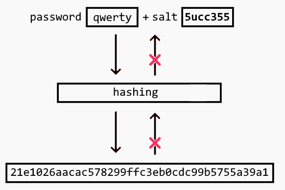

---

## Le sel

- Unique pour chaque utilisateur.
- Stocké avec le hash.
- Deux mots de passe identiques donnent deux hash différents.

---

## Le bcrypt

- Intègre le sel automatiquement.
- Intègre un coût (nombre d'itérations) configurable.
- Utilise Blowfish comme algorithme de base (pas SHA-256).
- Alternatives modernes : Argon2, Scrypt.

---

<fieldset>
  <legend>Les mots de passe</legend>
  <p>
    Un mot de passe ne doit jamais être stocké en clair. Il doit être haché (non réversible) et salé (ajout d'une chaîne aléatoire).
  </p>

  <p>
    Le sel doit être unique pour chaque utilisateur (recommandation actuelle). Celui-ci doit être stocké avec le hash et sera utilisé pour vérifier le mot de passe.
  </p>

  <p>
    Le bcrypt est un algorithme de hachage qui intègre le sel, le coût et utilise Blowfish. Argon2 est recommandé comme alternative moderne (gagnant du Password Hashing Competition 2015).
  </p>
</fieldset>

---

## L'authentification forte

- MFA (Multi-Factor Authentication)
- 2FA (Two-Factor Authentication)
- OTP (One-Time Password)

---

## Plusieurs formes d'authentification

- **Mémorielle** qui représente une chose que l'intéressé connaît (**un secret**),
- **Matérielle** qui se réfère à quelque chose qu'il possède (**un objet**),
- **Corporelle** qui utilise un trait physique de l'utilisateur (**une biométrie**).

---

## La double authentification

- **Mot de passe :** chaîne de caractères, chiffres, symboles.
- **Application :** OTP (One Time Password) : SMS, Google Authenticator, Authy, Yubikey.
- **Objet physique :** U2F (Universal 2nd Factor) : Clé USB, Yubikey.
- **Biométrie :** Empreinte digitale, Reconnaissance faciale.

---

- Permet de sécuriser les mots de passe en ajoutant une couche de sécurité supplémentaire.
- Via un secret partagé entre la personne **physique** et le site.

---

## Étape 2 : Le réseau

---

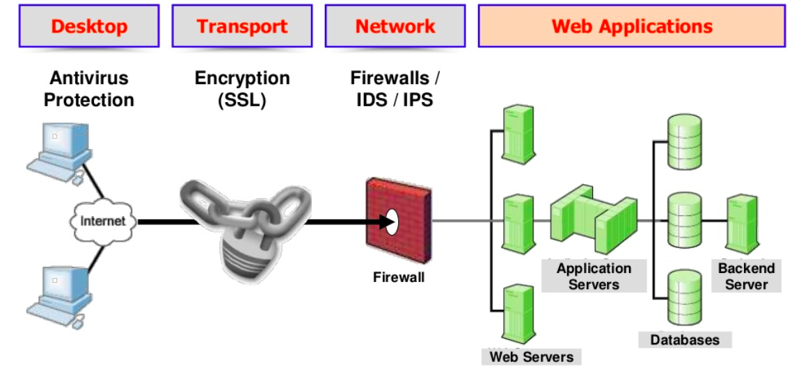

---

### IPS (Intrusion Prevention System)

- Bloque **automatiquement** les attaques
- Non fiable à 100%
- Peu discret

---

### IDS (Intrusion Detection System)

- Analyse
- Repère
- Avertit

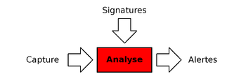

---

### Comment réduire le risque ?

- Sensibilisations / Formations continues
- Revue de code (peer review, code review)
- Tests d'intrusions (pentests)
- Sécurité lors du recrutement
- Sécurité dès la conception du projet (Security by Design)
- Suivi des bonnes pratiques (ex. OWASP)
- Analyse statique du code (SAST)
- Analyse dynamique du code (DAST)
- Gestion des dépendances et CVE

---

### Pourquoi il faut se battre (en interne) ?

- Résistance au changement
- ERP / CMS
- La sécurité est vue comme un frein, pas une fonctionnalité
- Déni de la réalité
- Multitude de librairies
- Développement externe (presta, stagiaires …)

---

### Se former

#### En continu

- [Le Hack](https://lehack.org/fr) / [Hack In Paris](https://hackinparis.com/)
- [OWASP Top 10](https://owasp.org/www-project-top-ten/)
- [ANSSI](https://www.ssi.gouv.fr/)
- Internet (blogs, forums, newsletters)
- Certifications (OSCP, CEH, CompTIA Security+)
- Appliquer les bonnes pratiques tout le temps !

---

#### Vous êtes la première ligne d’informations

Par deux, collecter une actualité récente « sur un problème de sécurité ».


Lien : [https://forms.gle/zXBhF61uKxtHh6Ma7](https://forms.gle/zXBhF61uKxtHh6Ma7)

---

### Des questions ?
