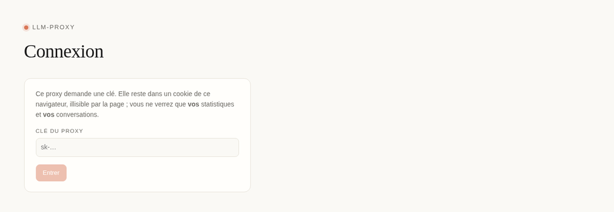

# Le développement agentique : monter son propre proxy

::: details Sommaire
[[toc]]
:::

::: tip TP bonus
Ce TP est pour les étudiants en avance. Il n'est pas nécessaire pour la suite, mais il vous fait passer de l'autre côté : jusqu'ici vous utilisiez le proxy de la classe, cette fois c'est vous qui le faites tourner.
:::

Dans [le TP sur l'utilisation](./utilisation.md#brancher-un-modele), vous avez branché OpenCode sur plusieurs fournisseurs : NVIDIA, AMD, le proxy de la classe. Et dans [le TP sur les limites](./limites.md#cout-et-quotas), vous avez vu que les offres gratuites ont toutes leurs règles : 40 requêtes par minute ici, 20 là, un accès qui s'arrête au bout de 30 jours ailleurs.

Résultat : chaque fournisseur a **son adresse, sa clé et ses noms de modèles**, et chaque agent (OpenCode, pi, Claude Code…) doit tous les connaître. Le jour où l'accès AMD expire, il faut tout reconfigurer.

C'est exactement le problème que règle [llm-proxy](https://github.com/c4software/llm-proxy), le proxy que votre enseignant fait tourner pour la classe. Dans ce TP, vous allez monter **le vôtre**, sur votre machine, avec deux fournisseurs gratuits derrière (NVIDIA et AMD), puis deux autres qui valent le détour : OpenCode Go et OpenRouter.

## Prérequis

- Les TP [principe](./principe.md) et [utilisation](./utilisation.md) : la boucle d'un agent, OpenCode et son `opencode.json`.
- **Docker** et **Docker Compose** sur votre machine (`docker compose version`). Revoir [le cours Docker](/cours/docker.md) si besoin.
- Environ 5 Go d'espace disque libre : la construction de l'image prend plusieurs minutes la première fois.
- `git`, `curl` et `jq`.
- Un compte **NVIDIA** avec sa clé (voir [le TP sur l'utilisation](./utilisation.md#nvidia)), et un compte **AMD AI Developer Program** (nous le créons plus bas).
- Facultatif : un abonnement **OpenCode Go** et un compte **OpenRouter**, pour la partie qui leur est consacrée.

## Objectifs

À la fin de ce TP vous saurez :

- expliquer à quoi sert un proxy devant des fournisseurs de modèles ;
- obtenir une clé d'API chez NVIDIA, AMD (Token Lab), OpenCode Go et OpenRouter, et comparer leurs limites ;
- déployer llm-proxy avec Docker Compose ;
- déclarer des fournisseurs compatibles OpenAI dans `data/config.toml`, sans jamais y écrire une clé ;
- protéger le proxy par une clé et vérifier qu'il refuse les autres ;
- y brancher OpenCode et suivre votre consommation dans le tableau de bord.

## Le principe

Voici ce que vous allez construire :

![À gauche, vos agents (OpenCode avec son opencode.json, curl pour vérifier, le navigateur pour le tableau de bord /ui) envoient leurs requêtes avec la clé du proxy à llm-proxy, sur http://localhost:8000. Le proxy tourne sur votre machine avec Docker Compose ; il lit ses réglages dans data/config.toml (tables proxy, backends.nvidia et backends.amd) et ses secrets dans .env (PROXY_API_KEY, NVIDIA_API_KEY, AMD_API_KEY). Il vérifie la clé du proxy, lit le préfixe du modèle, remplace la clé par celle du fournisseur et envoie la requête à NVIDIA (integrate.api.nvidia.com, clé nvapi-, environ 40 requêtes par minute) pour les modèles nvidia/…, ou à AMD Token Lab (api.tokenlab.amd.com, clé tl-, 30 jours, 20 requêtes par minute) pour les modèles amd/…](./res/proxy_installation.svg)

Il y a **trois clés** dans ce schéma, et c'est tout l'intérêt :

- la **clé du proxy** : la seule que vos agents connaissent ;
- la clé **NVIDIA** (`nvapi-…`) et la clé **AMD** (`tl-…`) : elles restent sur la machine du proxy, dans un fichier `.env`, et ne sont jamais données à un agent.

Le proxy choisit le fournisseur grâce au **préfixe du nom de modèle** : `amd/Gemma-4-31B-IT` part chez AMD, qui reçoit `Gemma-4-31B-IT`. Vous l'avez vu côté client dans [le TP sur le principe](./principe.md#trois-api-pour-la-meme-chose) ; cette fois, c'est vous qui écrivez la table de routage.

::: details Question : pourquoi ne pas simplement mettre la clé NVIDIA dans `opencode.json` ?
Pour un seul agent sur une seule machine, ça marcherait (avec `{env:NVIDIA_API_KEY}`, jamais la clé en clair). Mais :

- chaque agent (OpenCode, pi, Claude Code, Codex) doit connaître chaque fournisseur, avec sa propre syntaxe ;
- Claude Code parle l'API Anthropic et Codex l'API Responses : ils ne savent pas parler directement à NVIDIA ou à AMD, le proxy fait la traduction ;
- changer de fournisseur, c'est modifier tous les clients au lieu d'une ligne dans le proxy ;
- et si vous voulez partager l'accès (avec un binôme, avec une classe), donner sa clé NVIDIA revient à donner son compte. Avec le proxy, chacun a sa clé, que vous pouvez retirer sans toucher au reste.
:::

## Obtenir les clés des fournisseurs

### NVIDIA

Vous l'avez normalement déjà fait dans [le TP sur l'utilisation](./utilisation.md#nvidia) : un compte sur [build.nvidia.com](https://build.nvidia.com/), un numéro de téléphone vérifié, et une clé qui commence par `nvapi-`. Le point d'accès est `https://integrate.api.nvidia.com/v1`, compatible OpenAI.

### AMD (Token Lab)

AMD donne un accès gratuit à son API d'inférence, **Token Lab**, aux membres de son programme développeurs. Les modèles tournent sur des cartes AMD, et il n'y a ni carte bancaire ni demande de crédits à faire :

1. inscrivez-vous (gratuitement) au [AMD AI Developer Program](https://developer.amd.com/ai-developer-program/) ;
2. dans votre espace membre, ouvrez **Member Perks**, puis **Cloud Credits**, et descendez jusqu'à **Token Lab** ;
3. créez votre clé d'API : elle commence par `tl-`.

Le point d'accès est `https://api.tokenlab.amd.com/v1`, lui aussi **compatible OpenAI**. On y trouve par exemple `Gemma-4-31B-IT`, `DeepSeek-V4.1-Flash` ou `Qwen3.8-27B`.

::: warning Un accès limité dans le temps
Relevé le 14 novembre 2026 : une clé Token Lab donne **30 jours** d'accès (prolongeables une fois de 15 jours), un budget de **points** (chaque million de tokens en coûte une fraction, selon le modèle) et **20 requêtes par minute**. Ces conditions changent souvent : vérifiez-les sur [la page du programme](https://developer.amd.com/ai-developer-program/) au moment de vous inscrire. C'est justement une bonne raison de passer par un proxy : quand l'accès expire, vous retirez une table de la configuration, et vos agents ne voient rien d'autre que des modèles en moins.
:::

Avant d'aller plus loin, vérifiez que chaque clé marche **directement**, sans proxy :

```bash
export NVIDIA_API_KEY="nvapi-…"
export AMD_API_KEY="tl-…"

curl -s -H "Authorization: Bearer $NVIDIA_API_KEY" https://integrate.api.nvidia.com/v1/models | jq -r '.data[].id' | head -5
curl -s -H "Authorization: Bearer $AMD_API_KEY" https://api.tokenlab.amd.com/v1/models | jq -r '.data[].id'
```

::: tip Point de contrôle
Les deux commandes affichent une liste de modèles. Si l'une d'elles répond par une erreur, inutile d'aller plus loin : le proxy ne fera pas mieux que la clé qu'on lui donne.
:::

## Installer llm-proxy

### Récupérer le projet

```bash
git clone https://github.com/c4software/llm-proxy.git
cd llm-proxy
```

Le projet contient un `docker-compose.yml` avec deux services : le proxy (`albert-proxy`, du nom du premier fournisseur pour lequel il a été écrit) et SearXNG, un moteur de recherche qui ne sert qu'aux outils de recherche web (nous ne les utilisons pas ici).

### Les secrets : le fichier `.env`

Toutes les clés vont dans un fichier `.env`, à la racine du projet. Partez de l'exemple fourni :

```bash
cp .env.example .env
```

Puis générez une clé pour **votre** proxy (n'importe quelle chaîne longue et aléatoire fait l'affaire) et un secret pour SearXNG :

```bash
python3 -c "import uuid; print(uuid.uuid4())"
openssl rand -hex 32
```

Complétez `.env` (les autres lignes restent vides) :

```ini
PROXY_API_KEY=la-cle-generee-par-python
NVIDIA_API_KEY=nvapi-…
AMD_API_KEY=tl-…
SEARXNG_SECRET=la-valeur-generee-par-openssl
```

::: danger Le .env ne quitte jamais votre machine
Vérifiez qu'il est bien ignoré par Git :

```bash
git check-ignore -v .env
```

La commande doit afficher la ligne du `.gitignore` qui l'ignore. Une clé NVIDIA ou AMD poussée sur GitLab, c'est votre compte utilisé par n'importe qui, et des robots parcourent les dépôts publics à la recherche de ce genre de clé en quelques minutes.
:::

### Les réglages : `data/config.toml`

Toute la configuration du proxy tient dans un seul fichier, `data/config.toml`. Au premier démarrage, s'il n'existe pas, le proxy le crée à partir d'un exemple très complet (`data/config.example.toml`, à lire pour votre culture). Nous allons plutôt écrire le nôtre, réduit à l'essentiel, **avant** le premier démarrage :

```toml
# data/config.toml

[proxy]
# Les clés acceptées par le proxy. Une liste vide = proxy ouvert à tous !
api_keys = ["${PROXY_API_KEY}"]

# Le nom de la table est le préfixe des modèles : nvidia/…
[backends.nvidia]
url = "https://integrate.api.nvidia.com"
api_key = "${NVIDIA_API_KEY}"

# … et amd/…
[backends.amd]
url = "https://api.tokenlab.amd.com"
api_key = "${AMD_API_KEY}"
```

Quelques remarques :

- `${NVIDIA_API_KEY}` est remplacé au démarrage par la variable d'environnement du même nom : le fichier ne contient **aucun secret**.
- L'`url` s'écrit **sans** `/v1` : le proxy ajoute lui-même le chemin demandé par le client (`/v1/models`, `/v1/chat/completions`…).
- Tout le reste prend sa valeur par défaut, décrite dans [la documentation de la configuration](https://github.com/c4software/llm-proxy/blob/master/docs/configuration.md).

::: details Question : que se passerait-il avec `api_keys = []` ?
Le proxy serait **ouvert** : n'importe qui capable de joindre votre machine sur le port 8000 (un camarade sur le même Wi-Fi, par exemple) pourrait utiliser vos clés NVIDIA et AMD, sans même les connaître. C'est le piège classique d'un proxy : il transforme une clé secrète en un service accessible à tous. D'où la première ligne de notre configuration.
:::

### Transmettre les clés au conteneur

Dernier piège : le `.env` est lu par Docker Compose, mais une variable n'arrive dans le conteneur **que si le service la demande** dans sa section `environment:`. Le `docker-compose.yml` du projet transmet `PROXY_API_KEY`, mais il ne connaît ni NVIDIA ni AMD.

On ne modifie pas le fichier du projet (il serait écrasé à la prochaine mise à jour) : on ajoute un `docker-compose.override.yml`, que Docker Compose fusionne automatiquement avec le premier, et que le projet ignore déjà dans Git :

```yaml
# docker-compose.override.yml
services:
  albert-proxy:
    environment:
      NVIDIA_API_KEY: "${NVIDIA_API_KEY}"
      AMD_API_KEY: "${AMD_API_KEY}"
```

Vérifiez la fusion (attention, cette commande affiche les clés en clair, ne la faites pas en partageant votre écran) :

```bash
docker compose config | grep -A6 "environment:"
```

## Démarrer le proxy

```bash
docker compose up -d --build
```

La première fois, la construction de l'image prend plusieurs minutes (le proxy embarque de quoi faire tourner du code dans le navigateur pour son chat). Les fois suivantes, le démarrage est immédiat.

Regardez ensuite le journal du proxy :

```bash
docker compose logs albert-proxy | grep -E "backend|auth"
```

```
INFO backend nvidia (fallback sans modèle) → https://integrate.api.nvidia.com | sans quota, contacté à la demande | clé : injectée
INFO backend amd → https://api.tokenlab.amd.com | sans quota, contacté à la demande | clé : injectée
INFO auth proxy ACTIVE : 1 clé(s) acceptée(s), /healthz exempté
```

Trois choses à vérifier : les deux backends sont là, chacun avec `clé : injectée`, et l'authentification est **active**.

::: details Le conteneur redémarre en boucle avec « unable to open database file » ?
Le proxy écrit dans le dossier `data/` de votre machine, sous l'identité `PUID:PGID` du `.env` (1000 par défaut, le premier utilisateur d'une machine Linux). Si ce n'est pas votre identifiant (`id -u`), corrigez `PUID` et `PGID`. Avec Docker **rootless**, votre utilisateur correspond à `root` dans le conteneur : mettez `PUID=0` et `PGID=0`.
:::

## Vérifier avec curl

Comme pour le proxy de la classe, l'adresse et la clé vont dans des variables d'environnement. Reprenez **les mêmes noms** que dans le TP précédent : votre `opencode.json` marchera sans changement.

```bash
export LLM_PROXY_URL="http://localhost:8000"
export LLM_PROXY_API_KEY="la-cle-du-proxy"   # la valeur de PROXY_API_KEY
```

Puis, trois essais :

```bash
# 1. le catalogue, avec la clé
curl -s -H "Authorization: Bearer $LLM_PROXY_API_KEY" "$LLM_PROXY_URL/v1/models" | jq -r '.data[].id'

# 2. le même, sans la clé
curl -s "$LLM_PROXY_URL/v1/models" | jq -r .error.type

# 3. une vraie question, à un modèle AMD
curl -s "$LLM_PROXY_URL/v1/chat/completions" \
  -H "Authorization: Bearer $LLM_PROXY_API_KEY" \
  -H "Content-Type: application/json" \
  -d '{"model": "amd/Gemma-4-31B-IT", "messages": [{"role": "user", "content": "Réponds uniquement par le mot OK."}]}' \
  | jq -r '.choices[0].message.content'
```


Le catalogue réunit **les deux fournisseurs**, chacun sous son préfixe. Remarquez `nvidia/nvidia/nemotron-…` : le premier `nvidia/` est le nom de **votre** table, le second fait partie du nom du modèle chez NVIDIA (qui sert aussi des modèles `qwen/…` ou `deepseek-ai/…`).

::: tip Point de contrôle
Vous obtenez la liste des modèles avec la clé, `invalid_api_key` sans, et `OK` à la troisième commande. Essayez aussi la troisième avec un modèle NVIDIA.
:::

::: details Question : que se passe-t-il si vous oubliez une variable dans `docker-compose.override.yml` ?
Faites l'essai : retirez la ligne `AMD_API_KEY`, puis `docker compose up -d` (le service est recréé avec le nouvel environnement). Trois indices :

- au démarrage, le journal prévient : `variables d'environnement absentes ou vides […] : AMD_API_KEY (une clé dans .env doit AUSSI être transmise au conteneur […])` ;
- les modèles `amd/…` disparaissent de `/v1/models` : sans clé, AMD refuse de donner son catalogue ;
- une question à `amd/Gemma-4-31B-IT` répond `upstream_auth_error` : c'est **AMD** qui a refusé la clé du proxy, pas le proxy qui a refusé la vôtre.

Et avec un préfixe inconnu (`"model": "mistral/x"`), le proxy répond `unknown_backend_prefix` en rappelant les préfixes qu'il connaît. Remettez la ligne avant de continuer.
:::

## Brancher OpenCode

Rien à réécrire : l'`opencode.json` du [TP précédent](./utilisation.md#le-proxy-de-la-classe) lit déjà `LLM_PROXY_URL` et `LLM_PROXY_API_KEY`. Il suffit d'y déclarer les modèles de **votre** proxy, par exemple un modèle de chaque fournisseur :

```json
{
  "$schema": "https://opencode.ai/config.json",
  "model": "llmproxy/amd/Gemma-4-31B-IT",
  "providers": {
    "llmproxy": {
      "name": "Mon llm-proxy",
      "package": "@opencode/ai/providers/openai-compatible",
      "settings": {
        "baseURL": "{env:LLM_PROXY_URL}/v1",
        "apiKey": "{env:LLM_PROXY_API_KEY}"
      },
      "models": {
        "amd/Gemma-4-31B-IT": {
          "name": "Gemma 4 31B (AMD)",
          "capabilities": { "tools": true, "input": ["text"], "output": ["text"] },
          "limit": { "context": 131072, "output": 8192 }
        },
        "nvidia/nvidia/nemotron-3.5-lightning-30b-a3b": {
          "name": "Nemotron 3.5 Lightning (NVIDIA)",
          "capabilities": { "tools": true, "input": ["text"], "output": ["text"] },
          "limit": { "context": 32768, "output": 4096 }
        }
      }
    }
  }
}
```

Puis, dans un dossier de travail :

```bash
opencode models | grep llmproxy
opencode run "Réponds uniquement par le mot OK."
opencode run --model llmproxy/nvidia/nvidia/nemotron-3.5-lightning-30b-a3b "Réponds uniquement par le mot OK."
```

```
> build · amd/Gemma-4-31B-IT
OK
> build · nvidia/nvidia/nemotron-3.5-lightning-30b-a3b
OK
```

Passer d'AMD à NVIDIA, c'est changer de modèle dans `/models`. Et le jour où l'accès AMD expire, vous changez la ligne `"model"`, sans toucher à aucune clé.

::: tip Que se passe-t-il derrière ?
Pour chaque requête d'OpenCode, le proxy :

1. vérifie l'en-tête `Authorization: Bearer <clé du proxy>` ;
2. lit le modèle demandé, `amd/Gemma-4-31B-IT`, et trouve la table `[backends.amd]` ;
3. retire le préfixe : AMD reçoit `"model": "Gemma-4-31B-IT"` ;
4. **remplace** l'en-tête `Authorization` par la clé AMD, puis envoie la requête à `https://api.tokenlab.amd.com/v1/chat/completions` ;
5. relaie la réponse à OpenCode, en notant au passage la date, le modèle, le nombre de tokens et la durée (jamais le contenu).

Votre clé de proxy ne part jamais chez AMD, et la clé AMD ne part jamais chez OpenCode.
:::

## Ajouter OpenCode Go et OpenRouter

NVIDIA et AMD ne sont pas les seuls fournisseurs intéressants. Deux autres méritent leur place derrière votre proxy, et ils montrent tout l'intérêt de la méthode : **une table de plus dans `config.toml`, une variable de plus dans `.env`**, et vos agents n'ont rien à changer.

| | NVIDIA | AMD Token Lab | OpenCode Go | OpenRouter |
|---|---|---|---|---|
| Prix | gratuit | gratuit | 10 $ par mois | modèles `:free` gratuits |
| Limite | environ 40 requêtes / min | 20 requêtes / min, 30 jours | un budget en dollars par modèle | 20 requêtes / min, 50 par jour |
| Point fort | les modèles Nemotron | sans carte bancaire | une trentaine de modèles récents | des centaines de modèles, une seule clé |

### OpenCode Go

[OpenCode Go](https://opencode.ai/docs/go/) est l'abonnement d'OpenCode : **10 $ par mois** pour une trentaine de modèles récents (GLM, Kimi, DeepSeek, Qwen, MiniMax…), choisis pour coder. Ce n'est pas gratuit, mais c'est l'un des moyens les moins chers d'utiliser de bons modèles avec un agent, et la plupart d'entre eux ne gardent **aucune donnée** (0 jour de conservation, pas d'entraînement, d'après la page de l'offre relevée le 14 novembre 2026).

Les limites sont exprimées en **dollars par modèle** : chaque modèle a un budget mensuel, dont au plus 20 % sur 5 heures et 50 % sur une semaine. Un modèle épuisé n'empêche pas d'utiliser les autres.

Pour la clé : connectez-vous à la [console d'OpenCode](https://opencode.ai/console), abonnez-vous à Go, puis copiez votre clé d'API. Le point d'accès compatible OpenAI est `https://opencode.ai/inference/go/openai/v1`. Dans `config.toml` :

```toml
[backends.go]
url = "https://opencode.ai/inference/go/openai"
api_key = "${OPENCODE_GO_API_KEY}"
```

Les modèles apparaissent alors sous le préfixe `go/` : `go/glm-5.3-flash`, `go/kimi-k3`, `go/deepseek-v4.1-flash`…

::: warning Un en-tête de session obligatoire
OpenCode Go refuse une requête qui n'a pas d'en-tête `x-opencode-session` (erreur `MissingSessionID`) : il s'en sert pour garder une même conversation sur le même serveur. OpenCode l'envoie de lui-même à chaque requête, et le proxy relaie les en-têtes du client : à travers le proxy, **OpenCode fonctionne sans rien changer**. Avec curl, en revanche, ajoutez-le vous-même :

```bash
curl -s "$LLM_PROXY_URL/v1/chat/completions" \
  -H "Authorization: Bearer $LLM_PROXY_API_KEY" \
  -H "x-opencode-session: essai-curl" \
  -H "Content-Type: application/json" \
  -d '{"model": "go/glm-5.3-flash", "messages": [{"role": "user", "content": "Réponds uniquement par le mot OK."}]}' \
  | jq -r '.choices[0].message.content'
```
:::

::: danger Un abonnement personnel
OpenCode Go est un abonnement **individuel** (l'offre Go Teams existe pour les équipes, avec une limite par membre). Gardez-le pour vous : pas de clé de binôme sur un proxy qui utilise votre abonnement Go.
:::

### OpenRouter

[OpenRouter](https://openrouter.ai/) est lui-même… un proxy : une seule clé et une seule adresse pour des centaines de modèles de dizaines d'éditeurs. Beaucoup sont payants, mais une partie est **gratuite** : leur nom se termine par `:free`.

Pour la clé : créez un compte sur [openrouter.ai](https://openrouter.ai/), puis une clé dans **Keys** (elle commence par `sk-or-`). Le point d'accès est `https://openrouter.ai/api/v1`, compatible OpenAI :

```toml
[backends.openrouter]
url = "https://openrouter.ai/api"
api_key = "${OPENROUTER_API_KEY}"
```

Les modèles gratuits s'écrivent alors `openrouter/<éditeur>/<modèle>:free`, par exemple `openrouter/nvidia/nemotron-3.5-lightning:free` ou `openrouter/google/gemma-4-31b-it:free`. Pour les lister :

```bash
curl -s -H "Authorization: Bearer $LLM_PROXY_API_KEY" "$LLM_PROXY_URL/v1/models" | jq -r '.data[].id' | grep ':free'
```

::: warning Les limites des modèles gratuits
D'après [la documentation d'OpenRouter](https://openrouter.ai/docs/api/reference/limits) (relevée le 14 novembre 2026), les modèles `:free` sont limités à **20 requêtes par minute** et **50 requêtes par jour** ; la limite passe à 1 000 par jour une fois que vous avez acheté au moins 10 crédits (environ 10 $). Pour un agent, qui fait une requête par tour de boucle, 50 par jour, c'est une petite tâche. Au-delà, OpenRouter répond `429`.

Deux autres précautions :

- le catalogue du proxy liste **aussi les modèles payants** d'OpenRouter : sans crédits sur le compte, ils répondent par une erreur, mais vérifiez toujours le `:free` à la fin du nom ;
- certains modèles gratuits ne sont proposés que si vous acceptez, dans les réglages de confidentialité d'OpenRouter, que vos échanges puissent être conservés ou servir à l'entraînement. Relisez [ce qui part chez un tiers](./limites.md#vos-donnees-partent-chez-un-tiers) avant de cocher la case.
:::

### Les brancher

Comme pour NVIDIA et AMD : les clés dans `.env`, transmises au conteneur par l'override.

```ini
# .env
OPENCODE_GO_API_KEY=…
OPENROUTER_API_KEY=sk-or-…
```

```yaml
# docker-compose.override.yml
services:
  albert-proxy:
    environment:
      NVIDIA_API_KEY: "${NVIDIA_API_KEY}"
      AMD_API_KEY: "${AMD_API_KEY}"
      OPENCODE_GO_API_KEY: "${OPENCODE_GO_API_KEY}"
      OPENROUTER_API_KEY: "${OPENROUTER_API_KEY}"
```

Puis `docker compose up -d` et un coup d'œil au journal : quatre lignes `backend … clé : injectée`. Ajoutez enfin les modèles voulus dans votre `opencode.json` (`go/glm-5.3-flash`, `openrouter/nvidia/nemotron-3.5-lightning:free`…), exactement comme les autres.

::: tip Point de contrôle
Votre proxy sert maintenant quatre fournisseurs derrière une seule adresse et une seule clé. Vérifiez avec `/v1/models` que les préfixes `nvidia/`, `amd/`, `go/` et `openrouter/` sont tous là, puis posez la question « OK » à un modèle de chacun (avec l'en-tête `x-opencode-session` pour `go/`).
:::

::: details Question : quel fournisseur choisir pour quelle tâche ?
Il n'y a pas de réponse unique, mais quelques repères :

- pour **apprendre et expérimenter**, les offres gratuites (NVIDIA, AMD, OpenRouter `:free`) suffisent, à condition d'accepter leurs limites et de lire leurs conditions sur les données ;
- pour **une session de travail longue** avec un agent (des centaines de requêtes), les 50 requêtes par jour d'OpenRouter ou les 30 jours d'AMD ne suffisent pas : c'est là qu'un abonnement comme Go prend son sens ;
- pour du code **qui ne doit pas sortir**, aucun de ces fournisseurs : un modèle qui tourne sur votre propre machine, derrière le même proxy.

Et c'est tout l'intérêt du proxy : changer d'avis ne coûte qu'un changement de nom de modèle.
:::

## Le tableau de bord

llm-proxy a sa propre interface web. Ouvrez [http://localhost:8000/ui](http://localhost:8000/ui) dans votre navigateur.

::: details Comment les captures de cette partie ont-elles été faites ?
Pour ne pas consommer de quota, elles ont été prises avec des **backends simulés**, qui imitent les catalogues de NVIDIA, d'AMD, d'OpenCode Go et d'OpenRouter et répondent par une phrase écrite à l'avance (ou « OK »). Le proxy, son interface, la configuration, les requêtes d'OpenCode et de curl et les compteurs sont réels. Les chiffres de votre tableau de bord seront donc différents, mais pas les ordres de grandeur.
:::

### Se connecter

La page demande une clé : donnez celle du proxy (la valeur de `PROXY_API_KEY`).



La clé n'est jamais mise dans l'adresse de la page : elle est vérifiée une fois, puis le navigateur garde une session qui n'en contient qu'un condensé. Et chaque clé ne voit que **ses** statistiques : c'est ce qui permet de donner une clé à chacun sans montrer la consommation des autres.

### Les statistiques

Après quelques requêtes avec OpenCode et curl, la vue **Statistiques** ressemble à ceci :

![Le tableau de bord de llm-proxy, vue Statistiques : 34 requêtes, 50 134 tokens (50 066 en entrée, 68 en sortie), 8 modèles actifs répartis entre amd (12 requêtes), go (12), nvidia (2) et openrouter (8), 0 erreur ; le graphique du trafic empilé par modèle, la répartition des tokens, et le tableau par modèle : amd/DeepSeek-V4.1-Flash, 6 requêtes faites avec curl, 39 tokens en moyenne ; amd/Gemma-4-31B-IT, 4 requêtes d'OpenCode, 2 974 tokens en moyenne ; go/glm-5.3-flash, go/kimi-k3, nvidia/nvidia/nemotron-3.5-lightning-30b-a3b et les modèles openrouter/…:free](./res/proxy_tableau_de_bord.png)

Je vous laisse observer le tableau **Par modèle**, puis répondre :

1. Les requêtes faites avec curl coûtent quelques dizaines de tokens. Combien coûte, en moyenne, une requête d'OpenCode, pour la même question « Réponds uniquement par le mot OK. » ?
2. D'où vient la différence ?
3. Avec 20 requêtes par minute chez AMD, combien de tours de boucle un agent peut-il faire par minute ? Est-ce que ça suffit pour la tâche du [TP sur l'utilisation](./utilisation.md) ? Et avec les 50 requêtes **par jour** d'OpenRouter ?

::: details Voir les réponses
1. Autour de **3 000 tokens** d'entrée par requête dans notre capture (`Moy./req` de `amd/Gemma-4-31B-IT`, que seul OpenCode a utilisé), contre une quarantaine pour curl (`amd/DeepSeek-V4.1-Flash`).
2. OpenCode envoie, **à chaque requête**, son prompt système et la description de tous ses outils (lire, écrire, exécuter…), avant même votre question. Vous l'avez vu dans [le TP sur le principe](./principe.md) : le contexte d'un agent n'est jamais vide.
3. 20 tours de boucle par minute au maximum, une lecture de fichier ou un lancement de tests par tour. Pour une tâche qui demande 30 à 50 tours, comptez plusieurs minutes, et des erreurs `429` si l'agent va plus vite que la limite. Le proxy relaie ces erreurs ; c'est l'agent qui attend et réessaie. Avec 50 requêtes par jour, une seule tâche de ce genre épuise la journée.
:::

### Le chat

Le tableau de bord a aussi un **chat**, pour discuter avec n'importe quel modèle du proxy sans installer d'agent. Il est désactivé par défaut, parce qu'il dépense des tokens au nom de la clé connectée. Pour l'ouvrir, ajoutez dans `data/config.toml` :

```toml
[ui]
chat = true
```

puis `docker compose restart albert-proxy`. Choisissez un modèle en haut, et posez votre question :


Sous chaque réponse, le chat affiche le modèle, les tokens consommés et la durée : de quoi comparer les fournisseurs sur une même question. Les conversations sont gardées par le proxy, dans `data/` (sauf en mode **Incognito**).

::: warning Ce que voit l'administrateur
Dans votre proxy, c'est vous l'administrateur : les conversations du chat sont dans une base SQLite de `data/`, sur votre disque. Sur le proxy de la classe, c'est le serveur de votre enseignant. Même règle que pour les agents : rien de personnel ni de secret dans une conversation.
:::

### La configuration

L'onglet **Configuration → Proxy** présente toute la configuration en vigueur, section par section. Par exemple, les quatre fournisseurs que vous avez déclarés :


Et la section **.env** liste les variables que votre configuration attend, sans jamais afficher leur valeur :


::: tip Que se passe-t-il derrière ?
Cette page **n'écrit rien** sur le proxy : elle part de la configuration en vigueur, vous laisse la modifier, la vérifier (bouton **Vérifier**, qui détecte une faute de frappe dans un nom de réglage), puis **télécharger** le nouveau `config.toml`. C'est à vous de remplacer `data/config.toml` et de redémarrer. Un choix de sécurité : une page web capable de réécrire la configuration d'un serveur serait une belle cible.
:::

## Pour aller plus loin

### Partager le proxy avec un binôme

`api_keys` est une **liste** : une clé par personne. Ajoutez une variable `BINOME_API_KEY` dans `.env` (avec une nouvelle clé générée), transmettez-la dans `docker-compose.override.yml`, puis :

```toml
[proxy]
api_keys = ["${PROXY_API_KEY}", "${BINOME_API_KEY}"]
```

Chaque clé a ses propres statistiques dans le tableau de bord, et retirer la clé de votre binôme ne change rien pour vous.

Dans le tableau de bord, la section **Accès** de **Configuration → Proxy** fait la même chose : **Ajouter une clé** donne une ligne de plus (le nom de la variable, la valeur restant dans le `.env`), puis **Télécharger config.toml**.


Mais vous partagez alors **vos** limites : 20 requêtes par minute chez AMD pour deux agents. Pour qu'un agent qui boucle ne prenne pas tout, le proxy propose un **partage équitable** : une part de tokens par heure et par clé, au-delà de laquelle les requêtes attendent leur tour (rien n'est refusé). C'est ce que fait le proxy de la classe :

```toml
[fair_share]
# Tokens (entrée + sortie) par heure glissante et par clé. 0 = aucune limite.
tokens_per_hour = 200000
```


Voir [la documentation du partage équitable](https://github.com/c4software/llm-proxy/blob/master/docs/tableau-de-bord.md#partage-équitable).

::: warning Lisez les conditions des fournisseurs
Votre clé NVIDIA ou AMD est attachée à **votre** compte : c'est vous qui répondez de ce qui passe par elle. Avant de la partager, même à travers un proxy, lisez les conditions d'utilisation du fournisseur. Et ne publiez jamais votre proxy sur Internet : un proxy ouvert, ou mal protégé, c'est une clé offerte à tout le monde.
:::

### Encore d'autres fournisseurs

Tout fournisseur **compatible OpenAI** se branche de la même façon, avec une table `[backends.<nom>]` : un modèle qui tourne sur votre propre PC avec [llama.cpp](https://github.com/ggml-org/llama.cpp) ou [Ollama](https://ollama.com/), l'API Albert de l'État, une autre offre gratuite… Pour un serveur qui tourne sur votre machine hôte, l'adresse vue depuis le conteneur est `http://host.docker.internal:<port>` (sous Linux, ajoutez `extra_hosts: ["host.docker.internal:host-gateway"]` au service dans l'override).

### Les autres agents

Le proxy parle aussi l'API Anthropic (Claude Code) et l'API Responses (Codex), en les traduisant. Elles sont désactivées dans notre configuration minimale : voir `[anthropic]` et `[responses]` dans `data/config.example.toml`. L'onglet **Configuration → Clients** du tableau de bord génère ensuite la configuration de Claude Code, de Codex ou de pi.

## Arrêter et nettoyer

```bash
docker compose down        # arrête le proxy ; data/ (configuration et statistiques) est gardé
docker compose up -d       # le relance, sans reconstruire
```

Pensez aussi à **révoquer** vos clés NVIDIA et AMD sur leurs sites quand vous n'en avez plus besoin : une clé qui ne sert plus est une clé qui peut encore fuir.

## Conclusion

Dans ce TP bonus, vous avez changé de côté :

- un proxy met **plusieurs fournisseurs derrière une seule adresse** (NVIDIA, AMD, OpenCode Go, OpenRouter…), et le préfixe du modèle choisit le fournisseur ;
- chaque offre a ses limites (requêtes par minute, par jour, durée, budget) et ses conditions sur vos données : à comparer avant de choisir ;
- les clés des fournisseurs restent dans un `.env` ignoré par Git, la configuration ne contient que des `${VAR}`, et une variable n'entre dans un conteneur que si le service la demande ;
- un proxy sans `api_keys` est ouvert à tous : c'est la première ligne à écrire ;
- vos agents ne connaissent qu'une adresse et une clé, et changer de fournisseur ne les concerne plus ;
- le tableau de bord donne les statistiques de chaque clé, un chat pour essayer les modèles, et la configuration complète (sans jamais l'écrire lui-même) ;
- le tableau de bord montre ce que coûte vraiment un agent : des milliers de tokens par tour, avant même votre question.

C'est, en plus grand (comptes, une clé par étudiant, partage équitable), ce que fait le proxy de la classe. Vous savez maintenant ce que voit son administrateur, et ce qu'il ne voit pas : relisez [ce que le proxy ne protège pas](./limites.md#vos-donnees-partent-chez-un-tiers) avec ce nouvel œil.

👋 Si vous avez des questions, n'hésitez pas.
