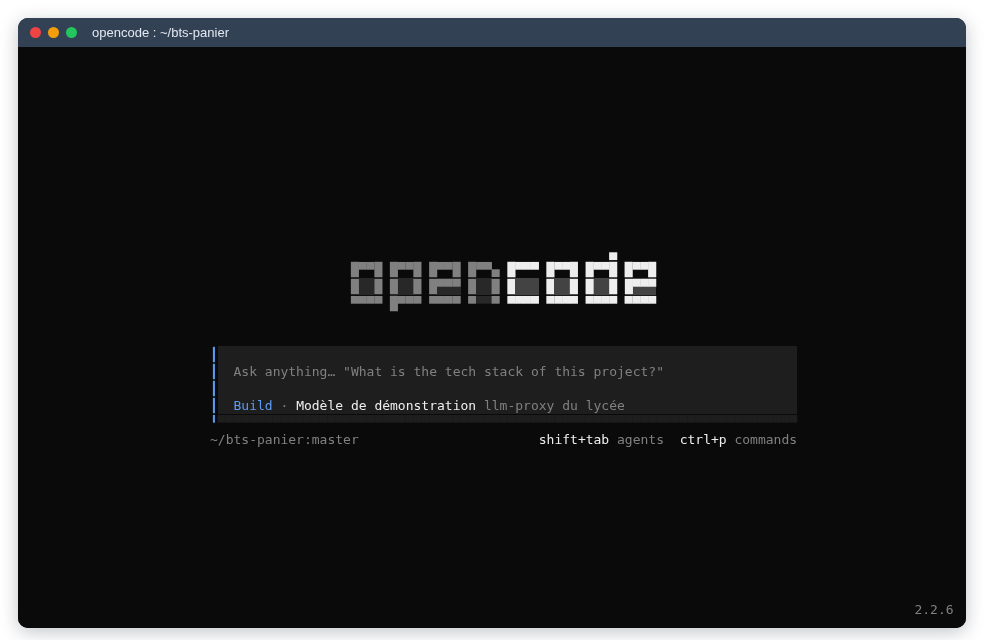
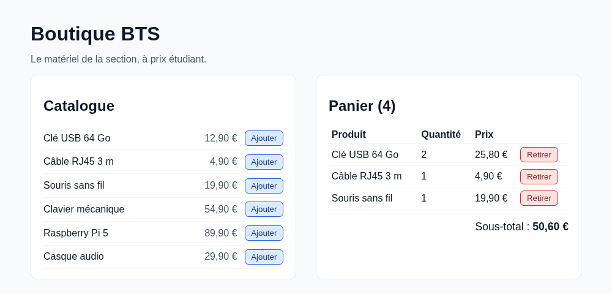

# Le développement agentique : utiliser un agent

::: details Sommaire
[[toc]]
:::

Dans [le TP précédent](./principe.md), vous avez démonté un agent : un modèle dans une boucle, des outils, un contexte qui grossit à chaque tour. Place à la pratique. Dans ce TP, vous allez installer **OpenCode**, le brancher sur un modèle (gratuit, ou celui du proxy de la classe), puis lui confier une vraie tâche sur un petit projet : ajouter les frais de livraison et les codes promo à une boutique en ligne, **avec les tests**.

Le but n'est pas que l'agent travaille à votre place, mais d'apprendre à **le piloter** : lui donner une tâche précise, valider son plan, relire tout ce qu'il écrit, vérifier que ça marche, et rester capable d'expliquer chaque ligne.

## Prérequis

- Le [TP sur le principe](./principe.md) : la boucle, les outils, les tokens.
- Git : `git init`, `git add`, `git commit`, `git diff`, `git restore`.
- **Node.js 22** ou plus récent (`node --version`) : le projet de départ est en JavaScript, sans aucune dépendance à installer.
- De préférence, la [dev-box](/cheatsheets/dev-box/) : tout y est déjà.

## Objectifs

À la fin de ce TP vous saurez :

- installer OpenCode et vérifier sa version ;
- le brancher sur les modèles gratuits d'OpenCode, sur NVIDIA, ou sur un fournisseur compatible OpenAI comme le proxy de la classe, sans jamais écrire une clé en dur ;
- écrire un `AGENTS.md` utile pour un projet ;
- suivre une méthode de travail avec un agent : décrire, planifier, relire le diff, tester, commiter ;
- reprendre la main quand l'agent se trompe.

## Installer OpenCode

[OpenCode](https://opencode.ai/) est un agent de code Open Source, qui tourne dans le terminal. Nous le prenons comme exemple parce qu'il propose des **modèles gratuits** sans compte, et qu'il se branche sur à peu près n'importe quel fournisseur.

### Dans la dev-box

Rien à installer : la dev-box fournit déjà cinq agents, `opencode`, `claude` (Claude Code), `codex`, `pi` et `omp`. Chacun s'installe tout seul la première fois que vous le lancez. La commande `devbox agent` permet de choisir votre agent par défaut, de le lancer dans le dossier courant et de suivre votre consommation (voir [l'aide-mémoire de la dev-box](/cheatsheets/dev-box/#les-agents-de-code)).

### Ailleurs

Sur votre machine (Linux, macOS ou WSL), deux façons au choix :

```bash
# Le script officiel
curl -fsSL https://opencode.ai/v2/install | bash

# Ou avec npm (Node.js déjà installé)
npm install -g @opencode/cli
```

Vérifiez l'installation :

```bash
opencode --version
```

```
opencode v2.2.6
```

::: warning OpenCode 1 ou OpenCode 2 ?
OpenCode est passé à la version 2 à l'automne 2026, et le format de la configuration a changé (par exemple `providers` au lieu de `provider`, `permissions` au lieu de `permission`). Ce TP est écrit pour la **version 2**. Si `opencode --version` affiche `1.x`, mettez à jour (`opencode upgrade`) ; et quand vous cherchez de l'aide, vérifiez que la page concerne bien la V2 : la [documentation V2](https://opencode.ai/docs/) n'est pas la même que l'ancienne (`docs.opencode.ai`).
:::

Créez un dossier vide, placez-vous dedans et lancez `opencode` :



Les commandes à connaître :

| Commande ou touche | Effet |
|---|---|
| `/models` | choisir le modèle |
| `/connect` | enregistrer la clé d'un fournisseur |
| `/init` | générer ou améliorer le `AGENTS.md` du projet |
| <kbd>Shift</kbd>+<kbd>Tab</kbd> | changer d'agent : **Build** (il modifie) ou **Plan** (il lit et propose, sans modifier les fichiers) |
| <kbd>Ctrl</kbd>+<kbd>P</kbd> | la liste de toutes les commandes |
| `opencode run "…"` | une demande en une ligne, sans l'interface |

## Brancher un modèle

OpenCode ne fournit pas « son » modèle : il se branche sur un **fournisseur**. Voici les quatre que nous utilisons dans cette série :


### Les modèles gratuits d'OpenCode

C'est le plus simple : **il n'y a rien à faire**. Sans compte et sans clé, OpenCode propose une liste de modèles gratuits, dont le nom se termine par `free`. Pour les voir :

```bash
opencode models | grep free
```

```
opencode/beam-free
opencode/big-pickle
opencode/crouton-alpha-free
opencode/deepseek-v4.1-flash-free
opencode/flint-40b-free
opencode/glm-5.3-flash-free
opencode/mimo-v2.6-flash-free
opencode/nemotron-3.5-lightning-free
opencode/nemotron-3.5-super-vl-free
opencode/pulse-alpha-free
```

Cette liste change souvent : ces modèles sont gratuits **pour une durée limitée**, le temps pour leurs éditeurs de recueillir des retours. Choisissez-en un avec `/models`, ou pour une seule demande :

```bash
opencode run --model opencode/glm-5.3-flash-free "Réponds uniquement par le mot OK."
```

::: warning Gratuit, mais pas sans contrepartie
D'après [la page des modèles d'OpenCode](https://opencode.ai/docs/zen/#privacy) (relevée le 8 novembre 2026) : certains modèles gratuits ne gardent rien (GLM-5.3-Flash Free et DeepSeek V4.1 Flash Free, par exemple), d'autres **conservent vos échanges et peuvent s'en servir pour entraîner leur modèle** (Big Pickle, Iceman Free, Inkling 2 Small Free…), et certains ne sont pas disponibles dans l'Union européenne. Lisez la ligne du modèle avant de lui confier du code. Nous en reparlons dans [le TP sur les limites](./limites.md#vos-donnees-partent-chez-un-tiers).
:::

### NVIDIA

NVIDIA propose, sur [build.nvidia.com](https://build.nvidia.com/), un accès d'essai gratuit à de nombreux modèles, dont sa famille **Nemotron**. Il faut :

1. créer un compte NVIDIA sur [build.nvidia.com](https://build.nvidia.com/) ;
2. faire vérifier votre compte : NVIDIA demande un **numéro de téléphone** pour activer l'accès à l'API ;
3. générer une clé d'API (elle commence par `nvapi-`).

Le point d'accès est compatible OpenAI : `https://integrate.api.nvidia.com/v1`. OpenCode connaît déjà NVIDIA : donnez-lui la clé par `/connect` (cherchez « NVIDIA »), ou par une variable d'environnement, puis choisissez un modèle :

```bash
export NVIDIA_API_KEY="nvapi-…"
opencode models | grep nvidia/nvidia/nemotron
```

```
nvidia/nvidia/llama-3.1-nemotron-safety-guard-8b-v3
nvidia/nvidia/nemotron-3-nano-omni-30b-a3b-reasoning
nvidia/nvidia/nemotron-3-ultra-550b-a55b
nvidia/nvidia/nemotron-3.5-content-safety
nvidia/nvidia/nemotron-3.5-lightning-30b-a3b
nvidia/nvidia/nemotron-3.5-super-vl-120b-a12b
nvidia/nvidia/nemotron-voicechat
```

Pour coder, prenez un modèle de discussion, par exemple `nvidia/nvidia/nemotron-3.5-lightning-30b-a3b` (les `content-safety` ou `safety-guard` servent à filtrer des contenus, pas à écrire du code).

::: warning Une limite de débit
L'accès gratuit de NVIDIA est limité en **nombre de requêtes par minute** : la limite couramment constatée est de **40 requêtes par minute**. NVIDIA ne publie pas de chiffre officiel : elle dépend du modèle et de la charge, et vous pouvez la voir sur la page du modèle une fois connecté. Un agent fait une requête par tour de boucle : nous verrons dans [le TP sur les limites](./limites.md#cout-et-quotas) que 40 par minute, c'est vite atteint.
:::

### AMD

AMD soutient ce cours en mettant gratuitement des modèles à disposition des étudiants, dans le cadre de son [programme universitaire](https://www.amd.com/en/corporate/university-program.html). Votre enseignant vous indique comment y accéder.

Côté développeurs, le [programme AMD AI Developer](https://developer.amd.com/), gratuit et ouvert avec un compte AMD, annonce parmi ses avantages des crédits de calcul sur l'AMD Developer Cloud et un accès à une API d'inférence (Token Lab). Les modèles proposés, les quotas et les conditions évoluent : vérifiez-les sur la page du programme au moment de vous inscrire.

Si l'accès que l'on vous donne est **compatible OpenAI** (une adresse qui se termine par `/v1` et une clé), il se branche exactement comme le proxy de la classe, juste en dessous : mêmes réglages, avec vos propres variables (par exemple `AMD_BASE_URL` et `AMD_API_KEY`).

### Le proxy de la classe

Votre enseignant fait tourner [llm-proxy](https://github.com/c4software/llm-proxy) (voir [le TP précédent](./principe.md#trois-api-pour-la-meme-chose)) : une seule adresse, une clé par étudiant, et plusieurs fournisseurs derrière. Il vous donne :

- l'adresse du proxy ;
- votre clé ;
- le nom du ou des modèles à utiliser.

Première règle : **la clé ne va jamais dans un fichier du projet**. Elle finirait dans Git, puis sur GitLab, puis chez n'importe qui. Mettez-la dans une variable d'environnement, dans votre `~/.bashrc` (ou `~/.zshrc`), en dehors de tout dépôt :

```bash
export LLM_PROXY_URL="https://adresse-donnee-par-l-enseignant"
export LLM_PROXY_API_KEY="votre-cle"
```

Ouvrez un nouveau terminal, puis vérifiez que le proxy vous répond, et notez le nom exact des modèles :

```bash
curl -s -H "Authorization: Bearer $LLM_PROXY_API_KEY" "$LLM_PROXY_URL/v1/models" | jq -r '.data[].id'
```


Vous reconnaissez le **préfixe** de chaque modèle : c'est le nom du backend qui le sert. Sans la clé, le proxy refuse (`invalid_api_key`).

Ensuite, déclarez le proxy à OpenCode dans un fichier `opencode.json`, à la racine du projet (ou dans `~/.config/opencode/opencode.json` pour tous vos projets). Remplacez `nvidia/nvidia/nemotron-3.5-lightning-30b-a3b` par le modèle donné par votre enseignant, et la taille de contexte par la sienne :

```json
{
  "$schema": "https://opencode.ai/config.json",
  "model": "llmproxy/nvidia/nvidia/nemotron-3.5-lightning-30b-a3b",
  "providers": {
    "llmproxy": {
      "name": "llm-proxy de la classe",
      "package": "@opencode/ai/providers/openai-compatible",
      "settings": {
        "baseURL": "{env:LLM_PROXY_URL}/v1",
        "apiKey": "{env:LLM_PROXY_API_KEY}"
      },
      "models": {
        "nvidia/nvidia/nemotron-3.5-lightning-30b-a3b": {
          "name": "Nemotron 3.5 Lightning (proxy)",
          "capabilities": { "tools": true, "input": ["text"], "output": ["text"] },
          "limit": { "context": 32768, "output": 4096 }
        }
      }
    }
  }
}
```

- `llmproxy` est le nom que **vous** donnez au fournisseur ; le modèle s'écrit donc `llmproxy/<nom du modèle sur le proxy>`.
- `package` dit à OpenCode de parler Chat Completions, l'API la plus répandue.
- `{env:LLM_PROXY_URL}` est remplacé au démarrage par la variable d'environnement : le fichier ne contient **aucun secret** et peut être commité.
- `capabilities.tools` dit à OpenCode que le modèle sait appeler des outils. Un modèle qui ne le sait pas est inutilisable par un agent.

Vérifiez qu'OpenCode a bien compris (la clé y est masquée) :

```bash
opencode debug config
opencode models | grep llmproxy
```

```
            "baseURL": "https://adresse-donnee-par-l-enseignant/v1",
            "apiKey": "***"
llmproxy/nvidia/nvidia/nemotron-3.5-lightning-30b-a3b
```

::: tip Suivre sa consommation
Le proxy compte vos requêtes et vos tokens. Dans la dev-box, `devbox agent usage proxy` les affiche ; votre enseignant les voit aussi, dans le tableau de bord du proxy.
:::

::: details Et côté proxy, comment NVIDIA est-il branché ?
Pour votre culture (c'est le travail de l'enseignant) : dans llm-proxy, un fournisseur compatible OpenAI est une table de `data/config.toml`. Le nom de la table devient le préfixe des modèles :

```toml
[backends.nvidia]
url = "https://integrate.api.nvidia.com"
api_key = "${NVIDIA_API_KEY}"
```

La clé reste dans l'environnement du conteneur, jamais dans le TOML. Comme le `docker-compose.yml` du projet ne transmet que ses propres variables, on l'ajoute dans un `docker-compose.override.yml` :

```yaml
services:
  albert-proxy:
    environment:
      NVIDIA_API_KEY: "${NVIDIA_API_KEY}"
```

Au redémarrage, `GET /v1/models` du proxy liste les modèles de NVIDIA, préfixés par `nvidia/` : c'est la liste de la capture plus haut. Tous les étudiants passent alors par **la même clé NVIDIA**, et donc par la même limite de 40 requêtes par minute : c'est pour ça que le proxy offre un **partage équitable** (une part de tokens par heure et par étudiant), voir [sa documentation](https://github.com/c4software/llm-proxy/blob/main/docs/tableau-de-bord.md#partage-équitable).
:::

::: tip Point de contrôle
Avant de passer à la suite, vous devez avoir **au moins un modèle qui répond**. Lancez dans un dossier vide :

```bash
opencode run --model <votre-modèle> "Réponds uniquement par le mot OK."
```

et obtenez `OK`. Une erreur `401` : la clé est absente ou fausse (vérifiez `echo $LLM_PROXY_API_KEY`). Une erreur `429` : trop de requêtes, attendez une minute.
:::

## Le projet : la Boutique BTS

Votre terrain de jeu est une petite boutique en JavaScript, sans framework et sans dépendance : un catalogue, un panier, un sous-total, et des tests.

[Téléchargez le projet de départ](/demo/agentic/bts-panier.zip), décompressez-le, puis :

```bash
cd bts-panier
npm test     # 6 tests, tous verts
npm start    # http://localhost:3000
```



Avant de lancer le moindre agent, **lisez le code**. Il est court : `src/panier.js` (la logique), `public/app.js` (l'affichage), `test/panier.test.js` (les tests) et le `README.md`.

Questions :

- Pourquoi les prix sont-ils stockés en **centimes** (`1290`) et pas en euros (`12.90`) ?
- Qu'est-ce qui garantit, dans le code actuel, que l'on ne peut pas ajouter `-1` produit au panier ? Où est-ce testé ?

::: details Réponse
- Les nombres à virgule de JavaScript sont approximatifs : `0.1 + 0.2` vaut `0.30000000000000004`. Sur des prix, ces erreurs finissent par se voir (un total à `45.539999…`). En centimes, on ne manipule que des entiers, exacts.
- `addItem` lève une erreur si la quantité n'est pas un entier strictement positif (`Number.isInteger(quantity) && quantity > 0`). C'est testé par « une quantité nulle, négative ou décimale est refusée ».
:::

::: tip Pourquoi lire le code avant ?
Parce que c'est **vous** qui allez juger le travail de l'agent. Si vous ne savez pas comment le projet fonctionne, vous ne pourrez pas voir qu'il a cassé quelque chose, ni qu'il a ignoré une règle du projet.
:::

## La méthode

Un agent va vite. Trop vite pour que vous suiviez si vous le laissez faire. La méthode qui suit vous garde aux commandes, et elle vaut pour tous les agents :


### Un dépôt Git propre d'abord

Git est votre **filet de sécurité** : quoi que fasse l'agent, vous pourrez voir exactement ce qu'il a changé, et revenir en arrière.

```bash
git init
git add .
git commit -m "Point de départ"
```

Avant chaque demande à l'agent, `git status` doit être propre.

### Écrire le AGENTS.md

C'est à vous de jouer ! Écrivez un fichier `AGENTS.md` à la racine du projet. Il sera lu par l'agent au début de chaque session ([format AGENTS.md](https://agents.md/)). Il doit tenir en une vingtaine de lignes et dire ce que l'agent ne peut pas deviner :

- comment lancer les tests et le site ;
- les règles du projet (relisez la fin du `README.md`) ;
- ce qu'il ne doit pas faire (ajouter une dépendance, toucher à `server.js`…) ;
- comment vous voulez qu'il travaille (proposer un plan avant de modifier, par exemple).

::: tip Et /init ?
OpenCode sait générer ce fichier tout seul (`/init`). Essayez-le **après** avoir écrit le vôtre, dans une copie, et comparez : qu'a-t-il trouvé que vous aviez oublié ? Qu'a-t-il ajouté d'inutile ? Gardez le meilleur des deux, et commitez-le.
:::

### Décrire la tâche

Voici la fonctionnalité à faire ajouter par l'agent :

> **Livraison et codes promo.** La livraison coûte 4,90 € quand le sous-total est inférieur à 50 €, elle est offerte à partir de 50 €. Le client peut saisir un code promo : `BTS10` retire 10 % du sous-total, `LIVRAISON` offre la livraison. Un code inconnu affiche un message d'erreur. Le panier affiche le sous-total, la remise, la livraison et le total. Chaque règle est testée.

Une bonne demande à un agent ressemble à une bonne demande à un collègue : **le quoi, pas le comment**, avec des critères pour savoir quand c'est fini. Commencez par passer en agent **Plan** (<kbd>Shift</kbd>+<kbd>Tab</kbd>) : il lit le code et propose, sans modifier les fichiers. Écrivez votre demande, en lui demandant explicitement un plan.

Questions, avant de valider le plan :

- Le plan respecte-t-il les règles de votre `AGENTS.md` (centimes, logique dans `src/`, tests) ?
- La spécification ne dit pas tout. Par exemple : la livraison est-elle offerte quand le sous-total **avant** remise dépasse 50 €, ou **après** ? Le plan a-t-il tranché ? Est-ce le choix que vous voulez ?

::: details Réponse
La spécification est ambiguë sur ce point, et c'est fréquent. Un agent tranche presque toujours **sans le dire**. Avec un panier à 50,60 € et le code `BTS10`, le sous-total après remise passe à 45,54 € : selon le choix, la livraison est offerte ou coûte 4,90 €. Aucun des deux n'est « faux » ; c'est une décision métier, qui revient au client (ou à vous), pas à l'agent. Précisez-la dans votre demande, et faites-la tester.
:::

Quand le plan vous convient, repassez en agent **Build** et demandez-lui de réaliser **la première étape seulement**.


::: tip Que montre cette capture ?
Elle a été prise avec un **modèle de démonstration** au comportement écrit à l'avance (pour que la capture soit reproductible), branché sur OpenCode à travers llm-proxy. L'interface, les outils et la jauge sont réels : la lecture du fichier et `npm test` ont vraiment été exécutés. Remarquez la jauge en bas à droite : **6.6K (20 %)**, la part de la fenêtre de contexte déjà utilisée, après une seule demande.
:::

### Relire le diff

L'agent a fini une étape ? Avant toute chose :

```bash
git status
git diff
```

Lisez **chaque ligne**. Pour chaque fichier modifié, vous devez pouvoir répondre : pourquoi ce changement, et que se passerait-il sans lui ?

Questions :

- L'agent a-t-il modifié des fichiers que vous n'attendiez pas (`server.js`, `package.json`, un test existant) ?
- A-t-il ajouté une dépendance ?
- Les montants sont-ils toujours des entiers en centimes ? Comment est arrondie la remise de 10 % sur 1 290 centimes ?

Vous n'êtes pas d'accord ? Annulez et reformulez, plutôt que d'empiler les corrections :

```bash
git restore .        # annule les modifications des fichiers suivis
git clean -n         # liste les fichiers créés par l'agent (puis -f pour les supprimer)
```

### Tester

Lancez les tests **vous-même** :

```bash
npm test
```

Ne vous contentez pas du « tous les tests passent » de l'agent : ouvrez les nouveaux tests et vérifiez qu'ils testent vraiment les règles de la spécification. Un test qui ne peut pas échouer ne prouve rien. Petite expérience : changez volontairement le prix de la livraison dans le code (`490` en `590`), relancez `npm test`. Un test doit devenir rouge. Sinon, il manque un test.

Puis testez **à la main**, dans la page (`npm start`) : ajoutez des produits, essayez `BTS10`, `bts10`, `LIVRAISON`, un code inconnu, un panier vide.

Vous devez obtenir quelque chose qui ressemble à ceci (la présentation peut varier) :


Question :

- Sur cette capture, la livraison est offerte alors que le total après remise (45,54 €) est sous 50 €. Est-ce un bug ?

::: details Réponse
Ça dépend de la règle que vous avez choisie (voir la question sur le plan) : ici, la livraison est calculée sur le sous-total **avant** remise. Si c'est votre choix, il doit être écrit dans un test (avec un nom explicite) pour que personne ne le « corrige » par erreur. Si ce n'est pas votre choix, c'est un bug, et c'est exactement le genre d'erreur qu'un agent produit sans prévenir.
:::

### Commiter

Quand le diff est relu et que les tests passent :

```bash
git add .
git commit -m "Ajoute les frais de livraison"
```

Le message de commit, c'est **vous** qui l'écrivez : il dit ce que **vous** avez validé. Puis on recommence avec l'étape suivante du plan (les codes promo), jusqu'au bout.

::: tip Point de contrôle
À la fin de cette partie, vous avez :

- un `AGENTS.md` commité ;
- plusieurs commits, un par étape, que vous pouvez expliquer ligne par ligne ;
- des tests qui couvrent la livraison (sous et au-dessus de 50 €), chaque code promo et le code inconnu, et qui échouent si l'on casse une règle ;
- une page qui affiche sous-total, remise, livraison et total.
:::

## À vous de jouer

Deuxième fonctionnalité, en appliquant la méthode seul, du début à la fin :

> Dans le panier, chaque ligne a deux boutons **+** et **−** pour changer la quantité. La quantité d'un produit est limitée à 10 ; à 0, la ligne disparaît. Les règles sont testées.

Quelques consignes :

- commencez par une demande en agent **Plan**, et notez les questions que la spécification laisse ouvertes avant de valider ;
- un commit par étape, aucun commit sans `git diff` relu ;
- notez dans un fichier `JOURNAL.md` (que vous commitez aussi) chaque fois que vous avez refusé ou corrigé une proposition de l'agent, et pourquoi.

Le challenge, pour ceux qui ont fini : faites ajouter à l'agent un test sur `formatPrice` avec un montant **négatif** (`formatPrice(-50)`), lisez le résultat, et décidez s'il faut corriger la fonction ou interdire les montants négatifs.

## Conclusion

Dans ce TP, vous avez :

- installé OpenCode et vérifié sa version ;
- branché un modèle gratuit (OpenCode, NVIDIA ou AMD) ou le proxy de la classe, avec des variables d'environnement et sans aucun secret dans le projet ;
- écrit un `AGENTS.md` pour donner à l'agent les règles du projet ;
- suivi la méthode : décrire, planifier, relire chaque diff, tester, commiter ;
- vu qu'un agent tranche les ambiguïtés sans prévenir, et que c'est à vous de les repérer.

Pensez à pousser votre dépôt (avec son `AGENTS.md` et son `JOURNAL.md`). Dans [le dernier TP](./limites.md), nous regardons en face tout ce qui peut mal tourner : hallucinations, tests complaisants, coûts et quotas, données qui partent chez un tiers, injections de prompt et commandes destructrices.

👋 Si vous avez des questions, n'hésitez pas.
