# Android Compose et le BLE avec la librairie Nordic

::: details Sommaire
[[toc]]
:::

- [Slides Android BLE](/cours/android_ble.md)
- [Support Android : les écrans et les données](./android-avance.md)
- [Le même TP sans librairie](./android-ble.md)

## Introduction

Dans ce TP, nous allons piloter la « lampe connectée » (son émulateur, ou la carte ESP32 d'origine) depuis une application Compose. Cette fois-ci, nous n'allons pas utiliser directement les API Bluetooth d'Android : nous allons utiliser la [Kotlin BLE Library](https://github.com/NordicSemiconductor/Kotlin-BLE-Library) de Nordic Semiconductor.

Nordic est le fabricant des puces BLE que l'on retrouve dans une grande partie des objets connectés. Ils publient aussi les outils que vous utilisez déjà, comme nRF Connect. Leur librairie enveloppe les API Android et remplace les *callbacks* par des **coroutines** et des **Flow** : le code se lit dans l'ordre où les choses se passent.

À la fin de ce TP, votre application saura :

- scanner les appareils BLE autour du téléphone ;
- se connecter à **votre** lampe et trouver son service ;
- recevoir l'état de la LED et le nombre d'allumages par notification ;
- basculer la LED et renommer la carte.

Voici ce que nous allons construire :

<div style="display:flex;flex-wrap:wrap;gap:12px">
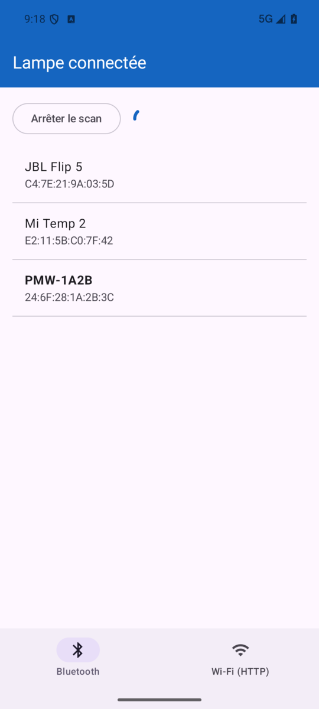
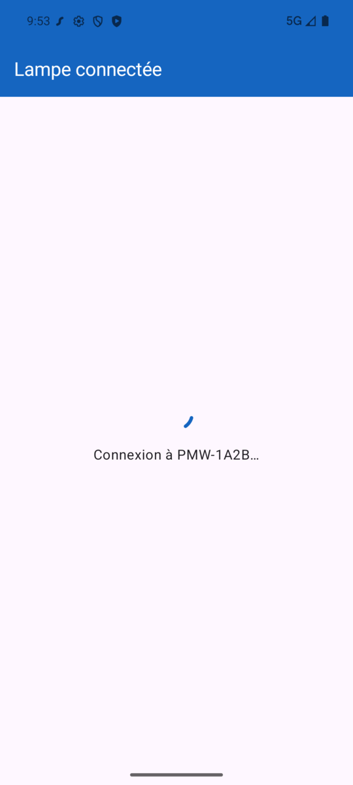
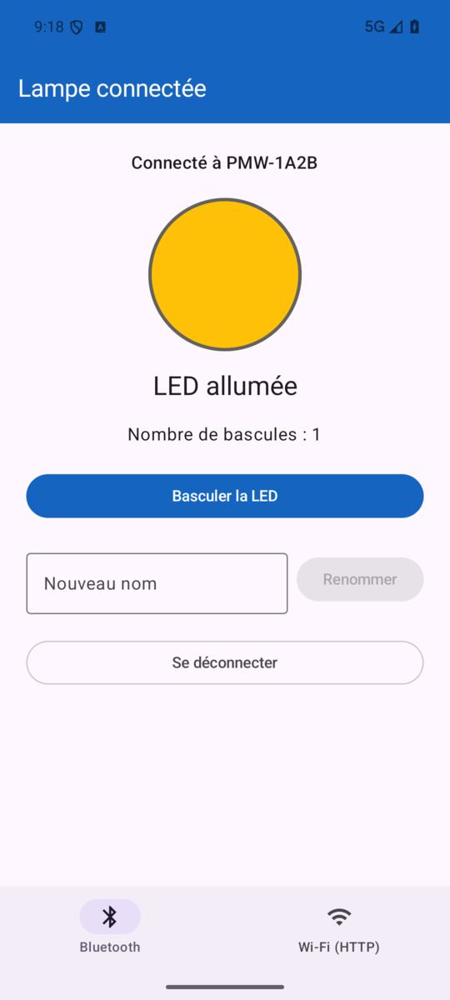
</div>

::: tip Sans librairie ou avec ?

Le TP [Android Compose et le BLE (sans librairie)](./android-ble.md) fait la même chose **sans librairie**, avec `BluetoothGatt` et ses callbacks. C'est la meilleure façon de comprendre ce qui se passe réellement : l'ordre des opérations, la découverte des services, le descripteur à écrire pour activer les notifications.

Ici, ces étapes sont toujours là, mais la librairie s'en charge. Le BLE ne change pas : mêmes UUID, mêmes caractéristiques, même lampe. Seule la façon d'attendre les réponses change.

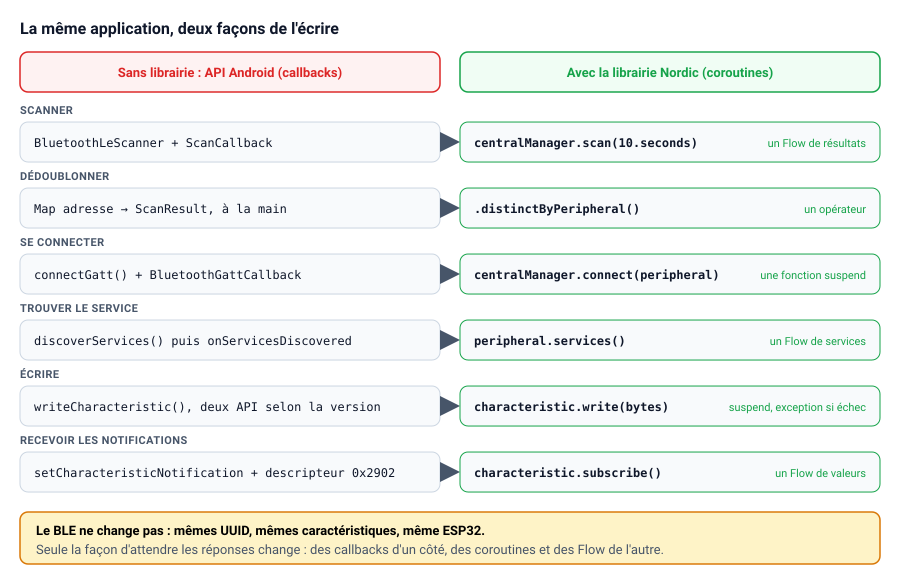

:::

## Les slides

Avant de commencer, voici une présentation rapide de la partie théorie de notre TP du jour : le BLE, GATT, les trois actions (lire, écrire, notifier) et le fonctionnement asynchrone.

<ClientOnly>
<SlidesDeck src="android_tp_ble" />
</ClientOnly>

Ces slides sont un condensé. Le support complet du cours est disponible ici : [Slides Android BLE](/cours/android_ble.md).

## Prérequis

- Avoir suivi [Les écrans et les données](./android-avance.md), en particulier le découpage MVVM et les `StateFlow`.
- Un **téléphone Android physique** : l'émulateur n'a pas de Bluetooth. (Pas de téléphone ? Lisez la partie [Tester sans téléphone](#tester-sans-telephone-le-mode-simule).)
- La lampe : son [émulateur](https://github.com/c4software/emulateur-lampe-ble) lancé sur un PC Linux (ou une carte ESP32), et l'application [nRF Connect](https://play.google.com/store/apps/details?id=no.nordicsemi.android.mcp) pour l'identifier.

## Le périphérique BLE

::: tip Lancer la lampe

La lampe de ce TP est un **émulateur** : un PC Linux qui se fait passer pour la lampe en Bluetooth. Il expose le même service et les mêmes caractéristiques que la carte ESP32 d'origine, et tout le code de ce TP fonctionne avec les deux.

```sh
git clone https://github.com/c4software/emulateur-lampe-ble.git
cd emulateur-lampe-ble
python3 -m venv .venv && .venv/bin/pip install -r requirements.txt
.venv/bin/python emulateur.py
```

Ouvrez ensuite le tableau de bord sur `http://localhost:8080/` : il montre la LED, le compteur, les téléphones connectés et tout ce que reçoit la lampe. Le bouton de la carte y est cliquable. Le [README de l'émulateur](https://github.com/c4software/emulateur-lampe-ble) détaille les options et le dépannage.

:::

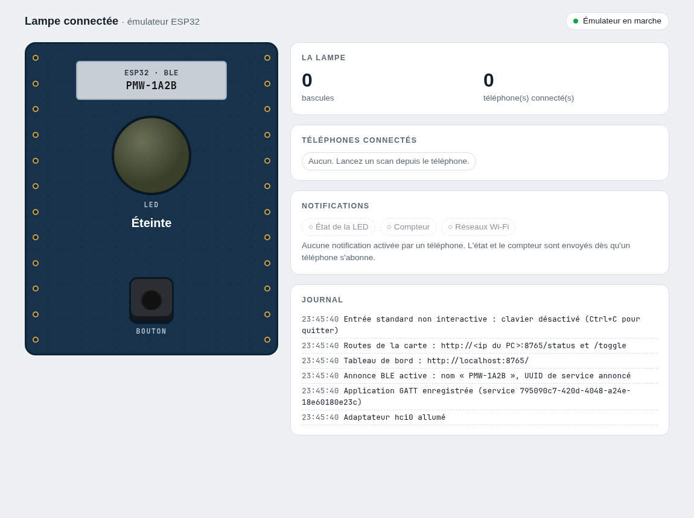

La lampe expose un service et quatre caractéristiques. Ce sont les mêmes que dans le TP sans librairie :

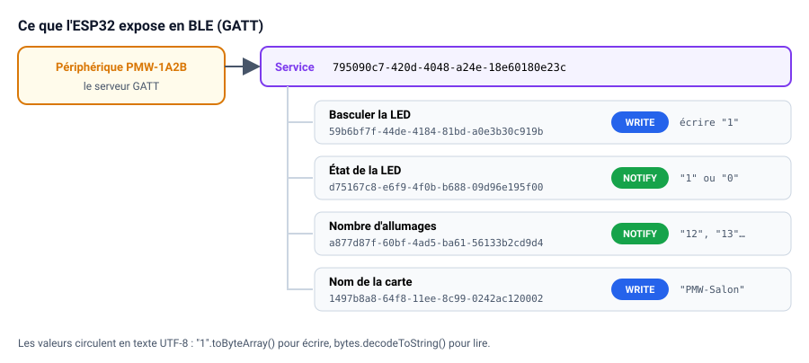

## Découvrir le périphérique avec nRF Connect

Pour commencer, nous allons utiliser l'application nRF Connect pour découvrir les services et les caractéristiques du périphérique.

1. Téléchargez l'application [nRF Connect](https://play.google.com/store/apps/details?id=no.nordicsemi.android.mcp) sur votre téléphone. (Disponible sur Android et iOS).
2. Ouvrez l'application et cliquez sur le bouton « Scan ».
3. Vous devriez voir des périphériques nommés `PMW-…`.
4. Cliquez sur un périphérique pour voir les services et les caractéristiques.

::: tip L'objectif : identifier **votre** périphérique

Plusieurs lampes `PMW-…` peuvent être allumées dans la salle. Avant de coder :

1. Connectez-vous à une lampe `PMW-…`.
2. Écrivez `1` (en texte) dans la caractéristique `59b6bf7f-…` : la LED de **votre** lampe doit changer d'état sur le tableau de bord.
3. Renommez votre lampe avec la caractéristique `1497b8a8-…` (par exemple `PMW-Valentin`).

Vous retrouverez ainsi votre lampe immédiatement dans votre application.

:::

Quand votre téléphone écrit sur la lampe, le tableau de bord le montre : le téléphone apparaît dans « Téléphones connectés », la LED s'allume, et le journal affiche l'écriture reçue (`b'1'`), la bascule, puis les notifications envoyées aux téléphones abonnés.

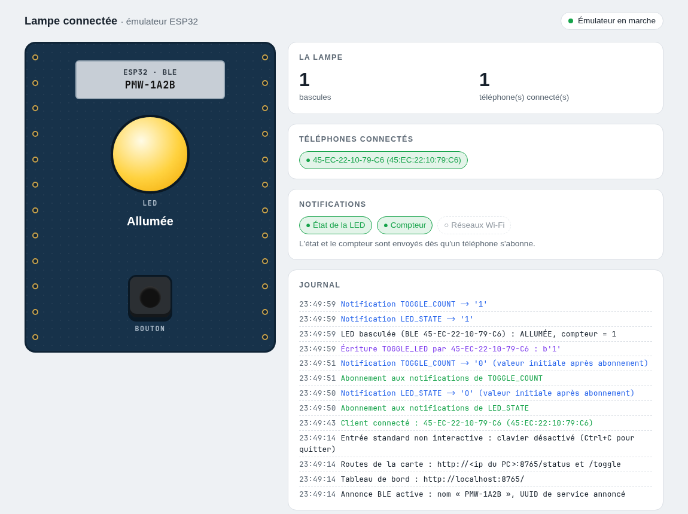

## L'implémentation sur Android

Pour l'implémentation nous avons plusieurs possibilités :

- Utiliser une librairie tierce.
- Utiliser les API Android.

Dans ce TP nous allons utiliser la librairie de Nordic. La version avec les API Android fait l'objet d'[un TP dédié](./android-ble.md).

::: danger Attention

Même si je vous fournis le code, l'idée ici pour vous va être de comprendre le fonctionnement et l'enchaînement des opérations. **Il est donc important de ne pas copier-coller bêtement le code que je vous donne.**

:::

Nous gardons le découpage MVVM : la vue affiche, le ViewModel décide, et lui seul parle à la librairie.

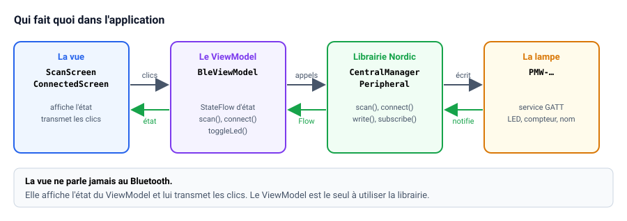

Le projet final ne contient que quelques fichiers :

| Fichier | Rôle |
|---|---|
| `ble/LampeGatt.kt` | Les UUID du service et des caractéristiques |
| `ble/CentralManagerFactory.kt` | La création du `CentralManager`, le point d'entrée de la librairie |
| `LampeViewModel.kt` | Toute la logique : scan, connexion, notifications, écriture |
| `MainActivity.kt` | Les permissions et le choix de l'écran à afficher |
| `ui/ScanScreen.kt`, `ui/ConnectingScreen.kt`, `ui/ConnectedScreen.kt` | Les écrans, sans aucune logique BLE |

### Voici les étapes que nous allons suivre :

- Ajouter la librairie
- Demander les permissions (Manifest + Code)
- Décrire la lampe (UUID) et créer le point d'entrée de la librairie
- Démarrer le Scan
- Se connecter et trouver le service
- Recevoir les notifications, écrire des données

::: tip Ceci est un préparatif au projet final

Dans le projet final, vous devrez implémenter ces étapes, mais aussi gérer les erreurs, les déconnexions, les timeouts, etc. Ce que vous faites ici est donc une étape préparatoire, plus vous vous approprierez ces étapes, plus vous serez à l'aise pour le projet final.

:::

### Le BLE sur Android : Une boîte à états

L'application passe par quelques états bien définis :

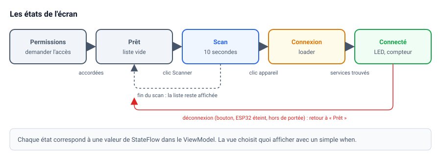

## Ajouter la librairie

Créez un nouveau projet **Empty Activity** dans Android Studio (ou repartez de votre projet du TP précédent).

Ajoutez les versions et les librairies dans `gradle/libs.versions.toml` :

```toml
[versions]
accompanist = "0.37.3"
nordicBle = "2.0.0-beta07"

[libraries]
accompanist-permissions = { module = "com.google.accompanist:accompanist-permissions", version.ref = "accompanist" }

# Kotlin BLE Library v2 (Nordic Semiconductor)
nordic-ble-client-android = { module = "no.nordicsemi.kotlin.ble:client-android", version.ref = "nordicBle" }
```

Puis dans `app/build.gradle.kts` :

```kotlin
dependencies {
    // Bibliothèque BLE de Nordic
    implementation(libs.nordic.ble.client.android)

    // Demande des permissions avec Compose
    implementation(libs.accompanist.permissions)

    // … les dépendances Compose déjà présentes
}
```

Une seule dépendance suffit pour la librairie : `client-android` apporte avec elle le scan, la connexion et les coroutines.

::: warning Une version récente de Kotlin

La version 2 de la librairie est compilée avec Kotlin 2.4. Si la synchronisation Gradle échoue avec un message parlant de *metadata* ou de version de Kotlin, mettez à jour la version de Kotlin (et du plugin Compose) dans `libs.versions.toml`. Le projet de référence utilise :

```toml
agp = "9.3.1"
kotlin = "2.4.10"
composeBom = "2026.09.00"
```

Le projet compile avec `compileSdk = 37` et `minSdk = 26`.

:::

::: tip Une librairie en version bêta

La version 2 de la librairie est une réécriture complète, en bêta au moment où ce TP est écrit. Nordic annonce que l'API ne devrait plus changer. Méfiez-vous en revanche des exemples trouvés en ligne : beaucoup utilisent encore la version 1, dont l'API (`BleScanner`, `ClientBleGatt`) est totalement différente.

:::

## Les permissions

Rien de nouveau ici : ce sont les mêmes permissions que dans le TP sans librairie. La librairie ne peut pas vous en dispenser, c'est Android qui les impose.

### Les permissions niveau AndroidManifest.xml

Dans `AndroidManifest.xml`, avant la balise `<application>` :

```xml
<!-- Android 11 (API 30) et moins : anciennes permissions + localisation obligatoire pour scanner -->
<uses-permission android:name="android.permission.BLUETOOTH" android:maxSdkVersion="30" />
<uses-permission android:name="android.permission.BLUETOOTH_ADMIN" android:maxSdkVersion="30" />
<uses-permission android:name="android.permission.ACCESS_FINE_LOCATION" android:maxSdkVersion="30" />

<!-- Android 12 (API 31) et plus : permissions dédiées au Bluetooth.
     neverForLocation : on promet de ne pas déduire la position de l'utilisateur du scan. -->
<uses-permission
    android:name="android.permission.BLUETOOTH_SCAN"
    android:usesPermissionFlags="neverForLocation"
    tools:targetApi="s" />
<uses-permission android:name="android.permission.BLUETOOTH_CONNECT" />

<uses-feature android:name="android.hardware.bluetooth_le" android:required="true" />
```

### Les permissions dans le code

La liste des permissions dépend de la version d'Android :

```kotlin
/** Permissions nécessaires au BLE, selon la version d'Android. */
private val permissionsBle: List<String> =
    if (Build.VERSION.SDK_INT >= Build.VERSION_CODES.S) {
        listOf(Manifest.permission.BLUETOOTH_SCAN, Manifest.permission.BLUETOOTH_CONNECT)
    } else {
        listOf(Manifest.permission.ACCESS_FINE_LOCATION)
    }
```

Nous l'utiliserons au moment d'assembler l'écran (dans la partie sur la connexion), avec `rememberMultiplePermissionsState(permissionsBle)`.

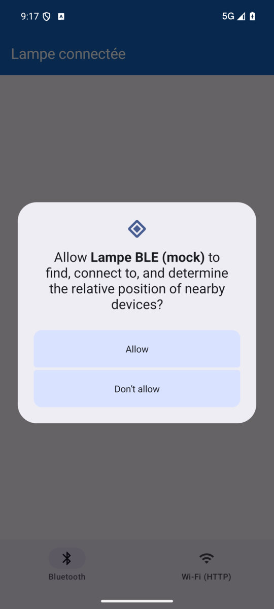

::: tip `neverForLocation` et la librairie

Gardez ce drapeau en tête : nous allons le redonner à la librairie au moment de créer le `CentralManager`. Il lui indique que, sur Android 12 et plus, le scan ne nécessite pas la localisation.

:::

## Les UUID de la lampe

Créez un package `ble`, puis un fichier `LampeGatt.kt` :

```kotlin
package fr.playmoweb.blenordic.ble

import kotlin.uuid.Uuid

/**
 * Description GATT de la lampe connectée (émulateur ou ESP32).
 *
 * Ces UUID doivent être identiques à ceux déclarés par la lampe.
 */
object LampeGatt {
    /** Service principal de la lampe. */
    val SERVICE: Uuid = Uuid.parse("795090c7-420d-4048-a24e-18e60180e23c")

    /** Écriture de "1" : bascule la LED (allumée ↔ éteinte). */
    val TOGGLE_LED: Uuid = Uuid.parse("59b6bf7f-44de-4184-81bd-a0e3b30c919b")

    /** Notification de l'état de la LED : "1" = allumée, "0" = éteinte. */
    val LED_STATE: Uuid = Uuid.parse("d75167c8-e6f9-4f0b-b688-09d96e195f00")

    /** Notification du nombre de bascules, sous forme de texte ("0", "1", "2"…). */
    val TOGGLE_COUNT: Uuid = Uuid.parse("a877d87f-60bf-4ad5-ba61-56133b2cd9d4")

    /** Écriture d'un nouveau nom pour la lampe (texte UTF-8). */
    val DEVICE_NAME: Uuid = Uuid.parse("1497b8a8-64f8-11ee-8c99-0242ac120002")

    /** Préfixe du nom annoncé par les lampes (ex. "PMW-1A2B"). */
    const val NAME_PREFIX = "PMW-"
}
```

::: warning `kotlin.uuid.Uuid`, pas `java.util.UUID`

La librairie utilise le type `Uuid` de Kotlin. Si Android Studio vous propose d'importer `java.util.UUID`, refusez : les comparaisons `it.uuid == LampeGatt.SERVICE` ne fonctionneraient plus.

:::

## Le point d'entrée de la librairie : le CentralManager

Toute la librairie part d'un objet : le `CentralManager`. C'est lui qui scanne et qui se connecte. (En BLE, le téléphone joue le rôle de *central*, la lampe celui de *périphérique*.)

Dans le package `ble`, créez `CentralManagerFactory.kt` :

```kotlin
package fr.playmoweb.blenordic.ble

import android.content.Context
import kotlinx.coroutines.CoroutineScope
import no.nordicsemi.kotlin.ble.client.android.CentralManager
import no.nordicsemi.kotlin.ble.client.android.native
import no.nordicsemi.kotlin.ble.environment.android.NativeAndroidEnvironment

/**
 * Variante "native" : crée un CentralManager qui utilise le vrai Bluetooth du téléphone.
 */
fun createCentralManager(context: Context, scope: CoroutineScope): CentralManager {
    // L'environnement donne accès à l'adaptateur Bluetooth du téléphone.
    // isNeverForLocationFlagSet = true car le manifeste déclare BLUETOOTH_SCAN avec "neverForLocation".
    val environment = NativeAndroidEnvironment.getInstance(context, isNeverForLocationFlagSet = true)
    return CentralManager.native(environment, scope)
}
```

Deux notions à retenir :

- **L'environnement** (`NativeAndroidEnvironment`) donne accès au vrai Bluetooth du téléphone. La librairie propose aussi un environnement **simulé**, que nous utiliserons à la fin du TP pour tester sans téléphone.
- **Le scope** : le `CentralManager` lance ses coroutines dans le scope qu'on lui donne. Nous lui passerons le `viewModelScope` : quand le ViewModel disparaît, tout s'arrête proprement.

## Le ViewModel

### Les états de l'application

Avant d'écrire la logique, décrivons ce que l'écran peut afficher : ce sont les états de la boîte à états vue plus haut. Créez `LampeViewModel.kt` et commencez par ces deux types :

```kotlin
/** Un appareil trouvé pendant le scan. */
data class Appareil(val nom: String, val adresse: String, val peripheral: Peripheral)

/** Les écrans possibles de l'application. */
sealed interface Ecran {
    data object Scan : Ecran
    data class Connexion(val nom: String) : Ecran
    data class Connecte(
        val nom: String,
        val ledAllumee: Boolean? = null, // null tant qu'aucune notification n'est reçue
        val compteur: Int? = null,
    ) : Ecran
}
```

::: tip Pourquoi une `sealed interface` ?

Une `sealed interface` liste **tous** les cas possibles. Quand la vue fera un `when (ecran)`, le compilateur vérifiera qu'aucun cas n'est oublié. C'est la machine à états du BLE, écrite en Kotlin. (Voir l'[aide-mémoire Kotlin](/cheatsheets/kotlin/) pour un rappel sur les classes scellées.)

:::

### La classe `LampeViewModel`

Puis la classe elle-même, avec ses `StateFlow` :

```kotlin
class LampeViewModel(application: Application) : AndroidViewModel(application) {

    // Point d'entrée de la bibliothèque Nordic : scan et connexion.
    private val centralManager: CentralManager = createCentralManager(application, viewModelScope)

    private val _ecran = MutableStateFlow<Ecran>(Ecran.Scan)
    val ecran: StateFlow<Ecran> = _ecran.asStateFlow()

    private val _appareils = MutableStateFlow<List<Appareil>>(emptyList())
    val appareils: StateFlow<List<Appareil>> = _appareils.asStateFlow()

    private val _scanEnCours = MutableStateFlow(false)
    val scanEnCours: StateFlow<Boolean> = _scanEnCours.asStateFlow()

    private val _erreur = MutableStateFlow<String?>(null)
    val erreur: StateFlow<String?> = _erreur.asStateFlow()

    private var scanJob: Job? = null
    private var connexionJob: Job? = null

    // Caractéristiques de la lampe connectée (trouvées après la découverte des services).
    private var peripheralConnecte: Peripheral? = null
    private var toggleLed: RemoteCharacteristic? = null
    private var deviceName: RemoteCharacteristic? = null

    override fun onCleared() {
        centralManager.close()
    }
}
```

Nous utilisons un `AndroidViewModel` plutôt qu'un `ViewModel` : il reçoit l'`Application`, dont la librairie a besoin comme `Context`.

## La logique du Scan dans le ViewModel

Avec la librairie, un scan est un **Flow** : chaque appareil trouvé est une nouvelle valeur. Le scan s'arrête tout seul au bout de la durée demandée, ou quand on annule la coroutine qui l'écoute.

Ajoutez ces deux méthodes au ViewModel :

```kotlin
fun demarrerScan() {
    _appareils.value = emptyList()
    _erreur.value = null
    scanJob = centralManager
        .scan(10.seconds) {
            // Décommenter pour ne garder que les lampes :
            // Name(Regex("${LampeGatt.NAME_PREFIX}.*"))
        }
        .distinctByPeripheral() // un seul résultat par appareil
        .onStart { _scanEnCours.value = true }
        .onEach { resultat ->
            val appareil = Appareil(
                nom = resultat.advertisingData.name ?: resultat.peripheral.name ?: "(sans nom)",
                adresse = resultat.peripheral.address,
                peripheral = resultat.peripheral,
            )
            _appareils.update { liste -> liste + appareil }
        }
        .catch { e -> _erreur.value = "Échec du scan : ${e.message}" }
        .onCompletion { _scanEnCours.value = false } // fin des 10 s ou arrêt manuel
        .launchIn(viewModelScope)
}

fun arreterScan() {
    scanJob?.cancel()
}
```

Lisez ce code de haut en bas, il raconte exactement ce qui se passe :

| Ligne | Ce qu'elle fait | Sans librairie |
|---|---|---|
| `.scan(10.seconds) { }` | Démarre le scan, avec un filtre facultatif | `startScan()` + `ScanCallback` + `delay()` + `stopScan()` |
| `.distinctByPeripheral()` | Ne garde que le premier résultat de chaque appareil | Une `Map` d'adresses, à gérer soi-même |
| `.onStart { }`, `.onCompletion { }` | Met à jour le loader au début et à la fin | Un `try / finally` autour du `delay()` |
| `.launchIn(viewModelScope)` | Lance la collecte ; `cancel()` l'arrête | Un `Job` et un `stopScan()` à ne pas oublier |

## La logique du Scan dans le Composable

L'écran ne fait qu'afficher ce qu'on lui donne, et remonter les clics. Créez `ui/ScanScreen.kt` :

```kotlin
@Composable
fun ScanScreen(
    appareils: List<Appareil>,
    scanEnCours: Boolean,
    erreur: String?,
    onScan: () -> Unit,
    onStop: () -> Unit,
    onClicAppareil: (Appareil) -> Unit,
) {
    Column(Modifier.fillMaxSize().padding(16.dp), verticalArrangement = Arrangement.spacedBy(12.dp)) {
        Row(verticalAlignment = Alignment.CenterVertically, horizontalArrangement = Arrangement.spacedBy(16.dp)) {
            if (scanEnCours) {
                OutlinedButton(onClick = onStop) { Text("Arrêter le scan") }
                CircularProgressIndicator(Modifier.size(28.dp))
            } else {
                Button(onClick = onScan) { Text("Scanner (10 s)") }
            }
        }
        if (erreur != null) {
            Text(erreur, color = MaterialTheme.colorScheme.error)
        }
        if (appareils.isEmpty()) {
            Text(
                if (scanEnCours) "Recherche des appareils…" else "Aucun appareil. Lancez un scan.",
                style = MaterialTheme.typography.bodyLarge,
                modifier = Modifier.padding(top = 24.dp),
            )
        }
        LazyColumn(Modifier.fillMaxWidth()) {
            items(appareils, key = { it.adresse }) { appareil ->
                val estUneLampe = appareil.nom.startsWith(LampeGatt.NAME_PREFIX)
                ListItem(
                    headlineContent = {
                        Text(appareil.nom, fontWeight = if (estUneLampe) FontWeight.Bold else FontWeight.Normal)
                    },
                    supportingContent = { Text(appareil.adresse) },
                    modifier = Modifier.clickable { onClicAppareil(appareil) },
                )
                HorizontalDivider()
            }
        }
    }
}
```

<div style="display:flex;flex-wrap:wrap;gap:12px">
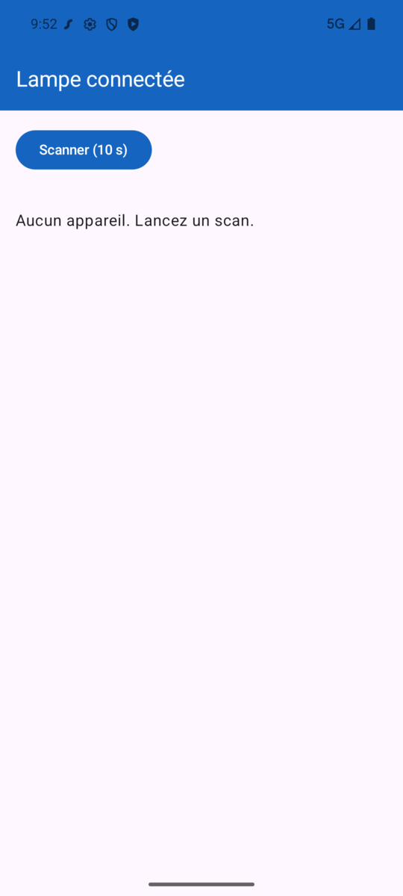

</div>

::: tip Point de contrôle

Pour l'instant, branchez simplement `ScanScreen` dans votre `MainActivity` (nous ferons mieux au moment de la connexion). Au clic sur « Scanner (10 s) », le loader tourne, les appareils apparaissent un à un, et votre lampe `PMW-…` est en gras. Au bout de 10 secondes, le loader disparaît tout seul.

:::

::: details Le filtre de scan

Le bloc entre accolades après `scan(10.seconds)` est un filtre. `Name(Regex("PMW-.*"))` ne garde que les appareils dont le nom commence par `PMW-`. Vous pouvez aussi filtrer sur l'UUID du service avec `ServiceUuid(LampeGatt.SERVICE)`, à condition que la lampe l'annonce dans ses données d'*advertising* (c'est le cas de l'émulateur).

Commencez sans filtre : voir tous les appareils de la salle aide à comprendre ce qu'est un scan.

:::

## La connexion à un périphérique

C'est ici que la librairie fait gagner le plus. Sans elle, la connexion se répartit entre `connectGatt()`, `onConnectionStateChange()`, `discoverServices()` et `onServicesDiscovered()`. Avec elle, ce sont quatre étapes qui se lisent dans l'ordre, dans une seule coroutine.

### Côté logique du ViewModel

Ajoutez cette méthode au ViewModel :

```kotlin
fun connecter(appareil: Appareil) {
    arreterScan()
    _erreur.value = null
    _ecran.value = Ecran.Connexion(appareil.nom)

    connexionJob = viewModelScope.launch {
        val peripheral = appareil.peripheral
        try {
            // 1. Connexion directe (échoue après le délai si l'appareil ne répond pas).
            centralManager.connect(
                peripheral = peripheral,
                options = CentralManager.ConnectionOptions.Direct(timeout = 10.seconds, retry = 2),
            )

            // 2. Découverte des services : on attend l'état "Discovered".
            val services = withTimeout(10.seconds) {
                peripheral.services(listOf(LampeGatt.SERVICE))
                    .filterIsInstance<RemoteServices.Discovered>()
                    .first()
                    .services
            }
            val service = services.firstOrNull { it.uuid == LampeGatt.SERVICE }
                ?: error("Service de la lampe introuvable : est-ce bien une lampe ?")

            // 3. Recherche des caractéristiques par UUID.
            fun caracteristique(uuid: kotlin.uuid.Uuid) =
                service.characteristics.firstOrNull { it.uuid == uuid }
                    ?: error("Caractéristique $uuid introuvable")

            toggleLed = caracteristique(LampeGatt.TOGGLE_LED)
            deviceName = caracteristique(LampeGatt.DEVICE_NAME)
            val ledState = caracteristique(LampeGatt.LED_STATE)
            val toggleCount = caracteristique(LampeGatt.TOGGLE_COUNT)

            peripheralConnecte = peripheral
            _ecran.value = Ecran.Connecte(nom = appareil.nom)

            // 4. Abonnement aux notifications : voir « Recevoir l'état de la LED ».

            // 5. On reste ici jusqu'à la déconnexion (volontaire ou perte de liaison).
            peripheral.state.first { it is ConnectionState.Disconnected }
        } catch (e: Exception) {
            _erreur.value = "Connexion impossible : ${e.message}"
            peripheral.disconnect()
        }
        // Retour à l'écran de scan.
        peripheralConnecte = null
        toggleLed = null
        deviceName = null
        _ecran.value = Ecran.Scan
        connexionJob?.cancel() // arrête aussi les abonnements
    }
}
```

Quelques points à observer :

- `connect()` est une fonction **suspend** : la ligne suivante ne s'exécute qu'une fois la connexion établie. En cas d'échec, elle lève une exception, rattrapée par le `catch`.
- `services()` ne renvoie pas une liste mais un **Flow d'états** : `Unknown`, `Discovering`, puis `Discovered` (ou `Failed`). Nous attendons le premier `Discovered` avec `filterIsInstance` et `first()`.
- `peripheral.state.first { it is ConnectionState.Disconnected }` « met en pause » la coroutine tant que la lampe est connectée. Quand elle se déconnecte, pour n'importe quelle raison, le code reprend et nous ramène à l'écran de scan.


### Côté interface

::: tip L'écran de connexion

`ui/ConnectingScreen.kt` est le plus simple des écrans :

```kotlin
@Composable
fun ConnectingScreen(nom: String) {
    Column(
        modifier = Modifier.fillMaxSize(),
        verticalArrangement = Arrangement.spacedBy(16.dp, Alignment.CenterVertically),
        horizontalAlignment = Alignment.CenterHorizontally,
    ) {
        CircularProgressIndicator()
        Text("Connexion à $nom…")
    }
}
```

:::

Toutes les pièces sont là. Dans `MainActivity.kt`, une fonction `LampeApp` demande les permissions, écoute les `StateFlow` du ViewModel, et choisit l'écran avec un `when` :

```kotlin
@OptIn(ExperimentalPermissionsApi::class, ExperimentalMaterial3Api::class)
@Composable
fun LampeApp(viewModel: LampeViewModel = viewModel()) {
    val permissions = rememberMultiplePermissionsState(permissionsBle)

    // Les StateFlow du ViewModel deviennent des états Compose.
    val ecran by viewModel.ecran.collectAsStateWithLifecycle()
    val appareils by viewModel.appareils.collectAsStateWithLifecycle()
    val scanEnCours by viewModel.scanEnCours.collectAsStateWithLifecycle()
    val erreur by viewModel.erreur.collectAsStateWithLifecycle()

    Scaffold(
        topBar = {
            TopAppBar(
                title = { Text("Lampe connectée") },
                colors = TopAppBarDefaults.topAppBarColors(
                    containerColor = MaterialTheme.colorScheme.primary,
                    titleContentColor = MaterialTheme.colorScheme.onPrimary,
                ),
            )
        },
    ) { padding ->
        Box(Modifier.padding(padding)) {
            if (!permissions.allPermissionsGranted) {
                PermissionsScreen(onDemander = { permissions.launchMultiplePermissionRequest() })
            } else {
                when (val e = ecran) {
                    Ecran.Scan -> ScanScreen(
                        appareils = appareils,
                        scanEnCours = scanEnCours,
                        erreur = erreur,
                        onScan = viewModel::demarrerScan,
                        onStop = viewModel::arreterScan,
                        onClicAppareil = viewModel::connecter,
                    )
                    is Ecran.Connexion -> ConnectingScreen(nom = e.nom)
                    is Ecran.Connecte -> ConnectedScreen(
                        etat = e,
                        erreur = erreur,
                        onBasculer = viewModel::basculerLed,
                        onRenommer = viewModel::renommer,
                        onDeconnecter = viewModel::deconnecter,
                    )
                }
            }
        }
    }
}
```

`viewModel::demarrerScan` est une **référence de fonction** : c'est l'équivalent court de `{ viewModel.demarrerScan() }`.

::: tip C'est à vous de jouer !

1. Créez `ui/PermissionsScreen.kt` : un titre, une phrase d'explication et un bouton « Autoriser » qui appelle `onDemander`.
2. Appelez `LampeApp()` dans le `setContent` de votre `MainActivity`.
3. Les méthodes `basculerLed`, `renommer` et `deconnecter`, ainsi que `ConnectedScreen`, n'existent pas encore : créez-les vides pour que le projet compile. Nous les remplissons dans la suite du TP.

:::

::: tip Point de contrôle

L'application demande les permissions, scanne, et un clic sur votre lampe affiche « Connexion à PMW-… » puis l'écran connecté (encore vide). En arrêtant l'émulateur de la lampe (Ctrl+C), l'application doit revenir d'elle-même à l'écran de scan.

:::

## Interagir avec le périphérique

### Recevoir l'état de la LED

La lampe **notifie** son état : c'est elle qui envoie un message à chaque changement, que la LED soit basculée en BLE, avec le bouton physique ou en HTTP. Avec la librairie, s'abonner à une notification donne un **Flow** de valeurs.

Remplacez le commentaire `// 4.` de la méthode `connecter` par :

```kotlin
// 4. Abonnement aux notifications (chaque flux tourne dans sa propre coroutine).
ledState.subscribe()
    .onEach { octets ->
        val allumee = octets.decodeToString() == "1"
        majConnecte { it.copy(ledAllumee = allumee) }
    }
    .launchIn(this)

toggleCount.subscribe()
    .onEach { octets ->
        val compteur = octets.decodeToString().toIntOrNull()
        majConnecte { it.copy(compteur = compteur) }
    }
    .launchIn(this)
```

Et ajoutez cette petite fonction utilitaire au ViewModel :

```kotlin
/** Modifie l'état de l'écran "connecté" (sans effet si on n'y est pas). */
private fun majConnecte(modification: (Ecran.Connecte) -> Ecran.Connecte) {
    _ecran.update { ecran -> if (ecran is Ecran.Connecte) modification(ecran) else ecran }
}
```

::: tip Que se passe-t-il derrière ?

Pour recevoir des notifications, un client BLE doit écrire `0x0001` dans un descripteur spécial de la caractéristique : le **CCCD** (UUID `0x2902`). Dans le TP sans librairie, c'est la méthode `enableNotify()` qui s'en charge, avec deux variantes selon la version d'Android.

`subscribe()` fait exactement la même chose, pour vous. Et quand la coroutine qui écoute le Flow est annulée, la librairie désactive la notification.

:::

::: warning `launchIn(this)` et non `launchIn(viewModelScope)`

`this` désigne ici la coroutine de connexion. Les abonnements en sont les « enfants » : quand la connexion se termine (`connexionJob?.cancel()`), ils s'arrêtent avec elle. Avec `viewModelScope`, ils survivraient à la déconnexion.

:::

#### L'écran connecté

Créez `ui/ConnectedScreen.kt`. Le cercle joue le rôle de l'ampoule : jaune si la LED est allumée, gris sinon.

```kotlin
@Composable
fun ConnectedScreen(
    etat: Ecran.Connecte,
    erreur: String?,
    onBasculer: () -> Unit,
    onRenommer: (String) -> Unit,
    onDeconnecter: () -> Unit,
) {
    var nouveauNom by remember { mutableStateOf("") }

    Column(
        modifier = Modifier.fillMaxSize().padding(24.dp),
        verticalArrangement = Arrangement.spacedBy(20.dp),
        horizontalAlignment = Alignment.CenterHorizontally,
    ) {
        Text("Connecté à ${etat.nom}", style = MaterialTheme.typography.titleMedium)

        // "Ampoule" : un disque jaune si la LED est allumée, gris sinon.
        val couleur = when (etat.ledAllumee) {
            true -> Color(0xFFFFC107)
            false -> Color(0xFFBDBDBD)
            null -> Color(0xFFEEEEEE)
        }
        Box(
            Modifier.size(140.dp).background(couleur, CircleShape).border(3.dp, Color(0xFF616161), CircleShape)
        )
        Text(
            when (etat.ledAllumee) {
                true -> "LED allumée"
                false -> "LED éteinte"
                null -> "État de la LED inconnu"
            },
            style = MaterialTheme.typography.headlineSmall,
        )
        Text("Nombre de bascules : ${etat.compteur ?: "?"}", style = MaterialTheme.typography.bodyLarge)

        Button(onClick = onBasculer, modifier = Modifier.fillMaxWidth()) { Text("Basculer la LED") }

        Row(verticalAlignment = Alignment.CenterVertically, horizontalArrangement = Arrangement.spacedBy(8.dp)) {
            OutlinedTextField(
                value = nouveauNom,
                onValueChange = { nouveauNom = it },
                label = { Text("Nouveau nom") },
                singleLine = true,
                modifier = Modifier.weight(1f),
            )
            Button(onClick = { onRenommer(nouveauNom) }, enabled = nouveauNom.isNotBlank()) { Text("Renommer") }
        }

        if (erreur != null) {
            Text(erreur, color = MaterialTheme.colorScheme.error)
        }

        OutlinedButton(onClick = onDeconnecter, modifier = Modifier.fillMaxWidth()) { Text("Se déconnecter") }
    }
}
```

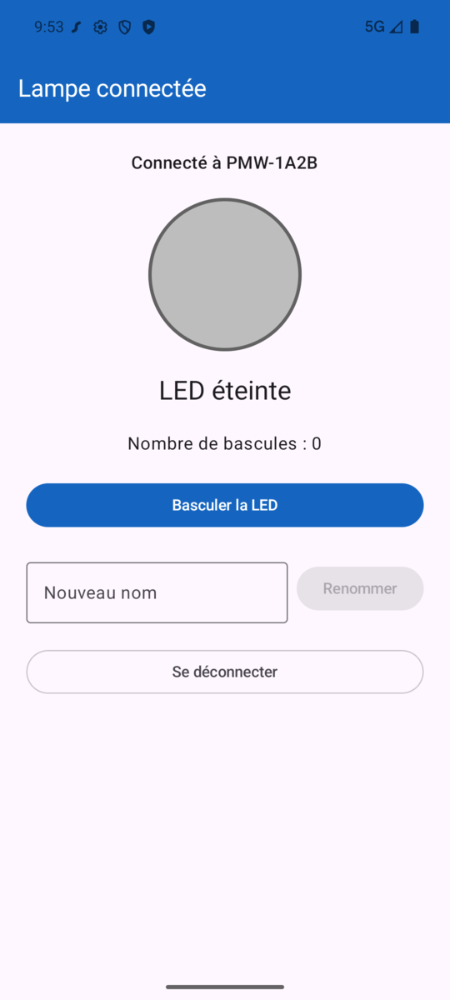

::: tip Point de contrôle

Connecté à votre lampe, appuyez sur le **bouton** de la lampe (sur le tableau de bord de l'émulateur) : le cercle doit passer au jaune et le compteur augmenter, sans toucher au téléphone.

Si l'écran affiche « État de la LED inconnu » juste après la connexion, c'est normal : ces caractéristiques ne se lisent pas, elles se notifient. L'état apparaît au premier changement.

Côté lampe, le tableau de bord de l'émulateur confirme l'abonnement : « État de la LED » et « Compteur » passent au vert dans « Notifications ».

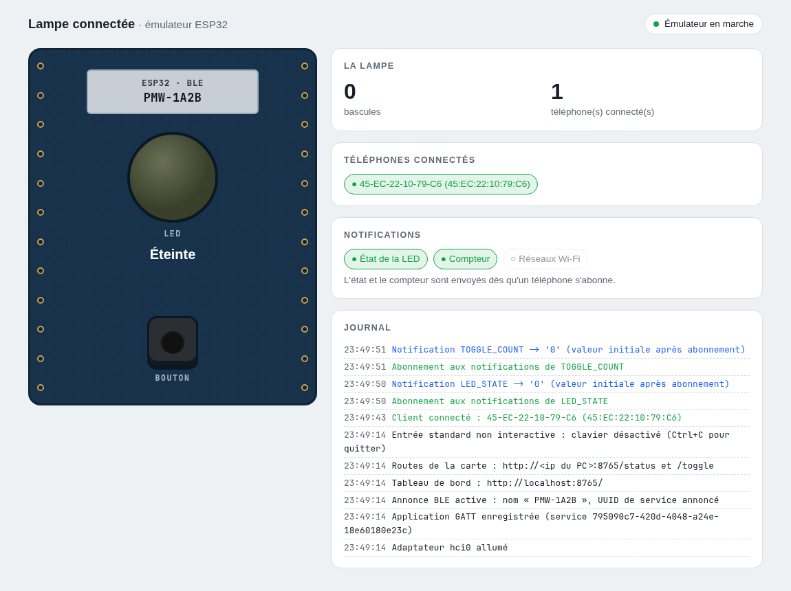

:::

### Basculer la LED

Écrire dans une caractéristique, c'est un appel à `write()`, une fonction suspend. Si elle se termine sans exception, la lampe a bien reçu la valeur.

```kotlin
fun basculerLed() {
    val caracteristique = toggleLed ?: return
    viewModelScope.launch {
        try {
            caracteristique.write("1".encodeToByteArray())
        } catch (e: Exception) {
            _erreur.value = "Écriture impossible : ${e.message}"
        }
    }
}
```

Remarquez ce que cette méthode **ne fait pas** : elle ne modifie pas `ledAllumee`. C'est la notification (voir « Recevoir l'état de la LED ») qui mettra l'écran à jour.

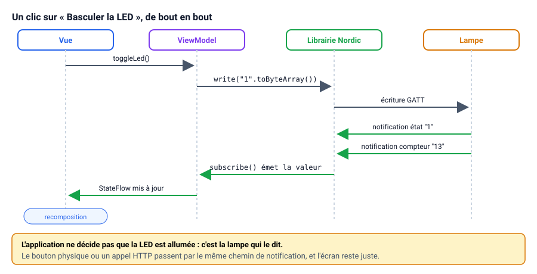


::: tip Point de contrôle

Un clic sur « Basculer la LED » allume la LED de **votre** carte, le cercle passe au jaune et le compteur augmente. Comparez avec la méthode `writeCharacteristic` du TP sans librairie : plus de `getService()`, plus de test sur la version d'Android.

:::

### Renommer et se déconnecter

C'est à vous de jouer ! Il reste deux méthodes à écrire dans le ViewModel :

- `renommer(nouveauNom: String)` : écrit le texte dans la caractéristique `DEVICE_NAME`. Elle ressemble beaucoup à `basculerLed`.
- `deconnecter()` : déconnecte le périphérique connecté. Cherchez la bonne méthode sur l'objet `Peripheral`.

Pour `deconnecter`, rappelez-vous de la connexion : la coroutine de connexion attend déjà la déconnexion. Vous n'avez **rien** d'autre à faire pour revenir à l'écran de scan.

::: details Voir l'une des solutions possibles

```kotlin
fun renommer(nouveauNom: String) {
    val caracteristique = deviceName ?: return
    viewModelScope.launch {
        try {
            caracteristique.write(nouveauNom.encodeToByteArray())
        } catch (e: Exception) {
            _erreur.value = "Renommage impossible : ${e.message}"
        }
    }
}

fun deconnecter() {
    val peripheral = peripheralConnecte ?: return
    viewModelScope.launch {
        peripheral.disconnect()
    }
}
```

:::

::: tip Point de contrôle

Renommez votre lampe, déconnectez-vous et relancez un scan : elle apparaît sous son nouveau nom. (Le nom est persistant : il survit à un redémarrage de la lampe.)

:::

## Tester sans téléphone : le mode simulé

L'émulateur de la lampe remplace la carte, mais il faut toujours un téléphone : l'émulateur Android n'a pas de Bluetooth. Sans téléphone, utilisez le mode simulé de la librairie, sur l'émulateur Android.


La librairie propose un **environnement simulé** : un `CentralManager` qui ne touche pas au Bluetooth et répond comme le ferait un vrai périphérique. C'est ce qui permet de faire tourner l'application sur l'émulateur, et c'est ainsi qu'ont été réalisées les captures de ce TP.

Le projet complet utilise deux **variantes** (*product flavors*) :

- `native` : le vrai Bluetooth, celle que vous utilisez avec la lampe ;
- `mock` : une lampe `PMW-1A2B` simulée, ainsi que deux autres appareils pour que le scan ressemble à celui d'une vraie salle.

Seul le fichier `ble/CentralManagerFactory.kt` diffère entre les deux. Tout le reste de l'application (ViewModel, écrans) ne sait pas s'il parle à une vraie lampe ou à une lampe simulée. C'est un bon exemple de l'intérêt d'avoir isolé la création du `CentralManager` dans une seule fonction.

```kotlin
// Variante "mock" : même signature que la variante native
fun createCentralManager(context: Context, scope: CoroutineScope): CentralManager =
    CentralManager.mock(scope = scope).apply {
        simulatePeripherals(
            listOf(
                MockLampe(scope).spec,
                MockAutresAppareils.enceinte(),
                MockAutresAppareils.capteur(),
            )
        )
    }
```

La lampe simulée (`MockLampe.kt`) reproduit le firmware : écrire `1` bascule la LED, puis notifie l'état et le compteur. Vous la trouverez dans le projet complet.

::: tip Pour qui ?

Le mode simulé est utile pour avancer sans matériel, pour écrire des tests, ou pour reproduire un cas difficile à obtenir avec une vraie lampe (une déconnexion au mauvais moment, par exemple). Dans Android Studio, la variante se choisit dans **Build > Select Build Variant** (`nativeDebug` ou `mockDebug`).

:::

[Télécharger le projet complet (variantes native et mock)](/demo/android/lampe-ble-nordic.zip)

## Avec ou sans librairie : le bilan

| | Sans librairie | Avec la librairie Nordic |
|---|---|---|
| Lignes de code BLE | Un `BluetoothLEManager` et son `GattCallback`, plus le ViewModel | Le ViewModel seul |
| Ordre des opérations | Réparti entre plusieurs callbacks | Lu de haut en bas, dans une coroutine |
| Versions d'Android | Deux API selon la version (`writeCharacteristic`, `writeDescriptor`) | Gérées par la librairie |
| Notifications | `setCharacteristicNotification` + écriture du CCCD | `subscribe()` |
| Erreurs | Codes de statut dans les callbacks | Exceptions, rattrapées par `try / catch` |
| Test sans matériel | Impossible | Environnement simulé |
| Ce qu'il faut comprendre | Tout | Les mêmes notions BLE : service, caractéristique, notification |

Le dernier point est le plus important : la librairie ne vous dispense pas de comprendre le BLE. Elle vous dispense d'en écrire la plomberie.

## Conclusion

Dans ce TP nous avons vu comment interagir avec un périphérique BLE grâce à la librairie de Nordic : scanner, nous connecter, recevoir des notifications et écrire des données. Les notions sont les mêmes que sans librairie ; c'est l'enchaînement des opérations qui devient plus simple à écrire.

D'autres actions sont possibles dans l'objet. Celles-ci seront à implémenter dans le projet final.

### Pour aller plus loin

- **Filtrer le scan** sur le préfixe `PMW-` (voir la logique du Scan), puis trier la liste par puissance du signal (`resultat.rssi`).
- **La liste des réseaux Wi-Fi** : la lampe expose aussi une caractéristique `10f83060-64f8-11ee-8c99-0242ac120002`. Abonnez-vous à ses notifications et affichez les réseaux reçus.
- **Se reconnecter automatiquement** : regardez `CentralManager.ConnectionOptions.AutoConnect` dans la [documentation de la librairie](https://nordicsemi.github.io/Kotlin-BLE-Library/html/index.html).
- **Comparer** avec le [TP sans librairie](./android-ble.md) : retrouvez, pour chaque étape de ce TP, le callback qui fait le même travail.

👋 Si vous avez des questions, n'hésitez pas.
