# Une API Ktor et ses clients (Android et Vue.js)

::: details Sommaire
[[toc]]
:::

Dans le [TP BLE avec la librairie Nordic](./android-ble-nordic.md), vous avez utilisé Ktor **côté client** : l'application interrogeait la lampe en HTTP sur deux routes, `/status` et `/toggle`. La lampe, elle, était fournie. Aujourd'hui, c'est vous qui écrivez le serveur.

Notre fil rouge : le **parc de lampadaires solaires** d'une commune. Chaque lampadaire a un numéro de série, un titre, une description, une photo, un statut (en service, en panne, en maintenance) et une date d'installation. Les données sont rangées sur un serveur, et deux clients différents les affichent :

- une **API** écrite en Kotlin avec [Ktor](https://ktor.io/), organisée en couches comme un projet professionnel, qui range ses données dans une base SQLite ;
- une **application Android** (Compose), qui liste les lampadaires, affiche le détail et permet d'en ajouter ;
- une **page web** (Vue.js 3), qui fait la même chose depuis le navigateur.

Voici ce que nous allons construire :

<div style="display:flex;flex-wrap:wrap;gap:12px;align-items:flex-start">
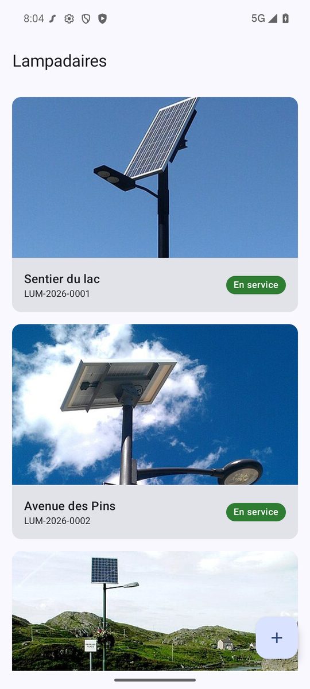
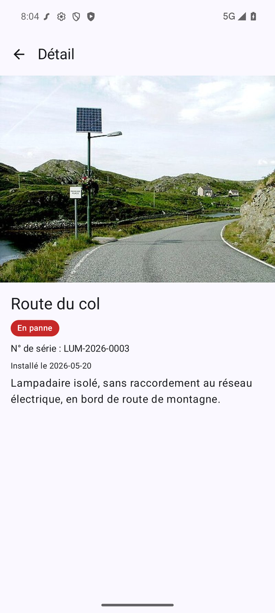
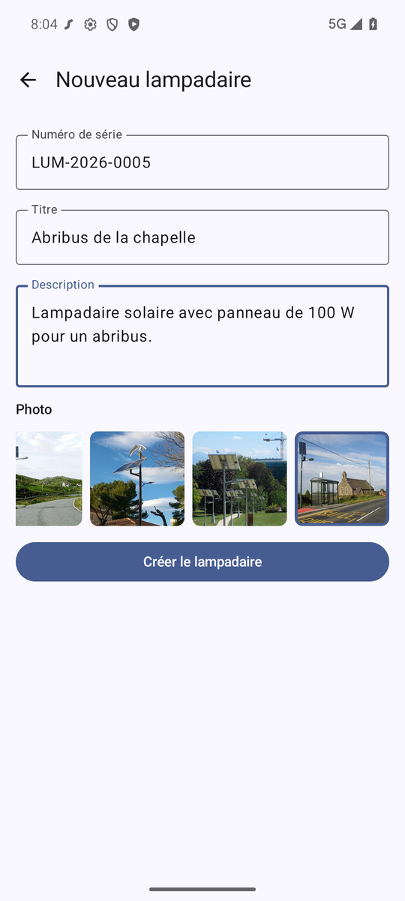
</div>

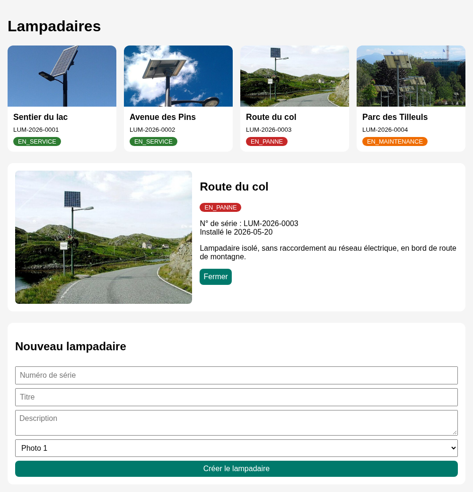

::: danger Un TP guidé… puis de moins en moins

Comme pour les TP Laravel, le début est **très guidé** : je vous donne le code et je l'explique. Petit à petit, je vous laisse de plus en plus de travail, jusqu'à une partie où vous n'aurez plus que la consigne.

Même quand le code est fourni, l'objectif est de comprendre l'enchaînement : **ne copiez-collez pas bêtement**, lisez chaque bloc avant de l'utiliser.

👋 Si vous avez des questions, n'hésitez pas.

:::

## Les slides

Avant de commencer, voici une présentation rapide de la partie théorie de notre TP du jour : l'API REST, l'organisation en couches, Ktor côté serveur et côté client, SQLite, curl, fetch et CORS.

<ClientOnly>
<SlidesDeck src="ktor_api_clients" />
</ClientOnly>

Dans ce TP, je vous invite à avoir en parallèle :

- [L'aide-mémoire Kotlin](/cheatsheets/kotlin/)
- [L'aide-mémoire API](/cheatsheets/api/)
- [Le support Android : les écrans et les données](./android-avance.md)

## Prérequis

- Avoir suivi [Les écrans et les données](./android-avance.md) (navigation, ViewModel, `StateFlow`). Le [TP BLE avec la librairie Nordic](./android-ble-nordic.md) est un plus : nous reprenons son organisation (écrans en machine à états, Ktor client).
- Savoir ce qu'est une API REST et les verbes HTTP. Au besoin, revoyez les [slides d'introduction aux API](/cours/introduction_api).
- Un poste avec :
  - [IntelliJ IDEA](https://www.jetbrains.com/idea/download/) (la version gratuite suffit) pour le serveur ;
  - Android Studio pour l'application ;
  - `curl` (déjà présent sous Linux, macOS et Windows 10 et plus).

Pour installer et vérifier tout cela pas à pas, suivez la page [Préparer son poste](/cheatsheets/poste-android/).

## Objectifs

À la fin de ce TP vous saurez :

- créer un projet Ktor avec le générateur ;
- organiser un serveur en couches : route, service, DAO ;
- stocker des données dans une base SQLite avec Exposed (l'ORM de JetBrains) ;
- écrire des routes `GET` et `POST` qui répondent en JSON, et servir des fichiers (les photos) ;
- tester une API avec `curl`, sans écrire de client ;
- consommer cette API depuis Android avec Ktor client : liste, détail, création ;
- afficher une image distante avec Coil ;
- consommer la même API depuis une page web avec `fetch` et Vue.js 3, et comprendre CORS.

## Le projet

Notre API proposera les routes suivantes :

| Méthode  | Chemin                  | Description                   |
| -------- | ----------------------- | ----------------------------- |
| `GET`    | `/v1/lampadaires`       | Lister les lampadaires        |
| `GET`    | `/v1/lampadaires/{id}`  | Obtenir un lampadaire         |
| `POST`   | `/v1/lampadaires`       | Ajouter un lampadaire         |
| `DELETE` | `/v1/lampadaires/{id}`  | Supprimer un lampadaire       |
| `GET`    | `/images/…`             | Les photos des lampadaires    |

Les trois premières routes seront écrites ensemble, la suppression sera pour vous. Un lampadaire, en JSON, ressemble à ceci :

```json
{
  "id": 3,
  "numeroSerie": "LUM-2026-0003",
  "titre": "Route du col",
  "description": "Lampadaire isolé, sans raccordement au réseau électrique, en bord de route de montagne.",
  "image": "/images/lampadaire-3.jpg",
  "statut": "EN_PANNE",
  "dateInstallation": "2026-05-20"
}
```

Le champ `image` ne contient pas la photo elle-même, mais son **chemin** sur le serveur. C'est l'application qui ira la télécharger au moment de l'afficher.

::: tip Pourquoi /v1 ?
Le préfixe `/v1` indique la **version** de l'API. Le jour où vous devrez changer le format des réponses, vous créerez une `/v2` sans casser les applications qui utilisent encore la `/v1`.
:::

Question :

- Pourquoi passer par un serveur ? L'application Android pourrait garder ses lampadaires dans une base locale, sur le téléphone.

::: details Réponse
Une base locale, c'est très bien… tant qu'un seul téléphone utilise les données. Avec un serveur :

- **les données sont partagées** : un lampadaire ajouté par un technicien apparaît sur le téléphone de tous ses collègues ;
- **plusieurs clients** peuvent utiliser les mêmes données : une application Android, une page web de supervision, un banc de test… sans dupliquer la logique ;
- **les données survivent** au téléphone (perdu, changé, réinitialisé).

C'est exactement ce que nous allons vérifier en fin de TP : la page Vue.js affiche les lampadaires ajoutés depuis Android.
:::

## Créer le projet Ktor

### Le générateur

JetBrains propose un générateur de projet en ligne : [start.ktor.io](https://start.ktor.io/settings).

- Dans le champ **Project artifact**, saisissez `cours.brosseau.api-lampadaires`.
- Laissez les réglages du bouton **Configure** par défaut (Gradle, Netty, configuration en YAML).
- Dans la liste des plugins, ajoutez **Content Negotiation** et **kotlinx.serialization** (bouton **Add** au survol de la ligne, ou recherchez-les avec le champ de recherche).

Les deux plugins choisis apparaissent en haut à droite de la liste :

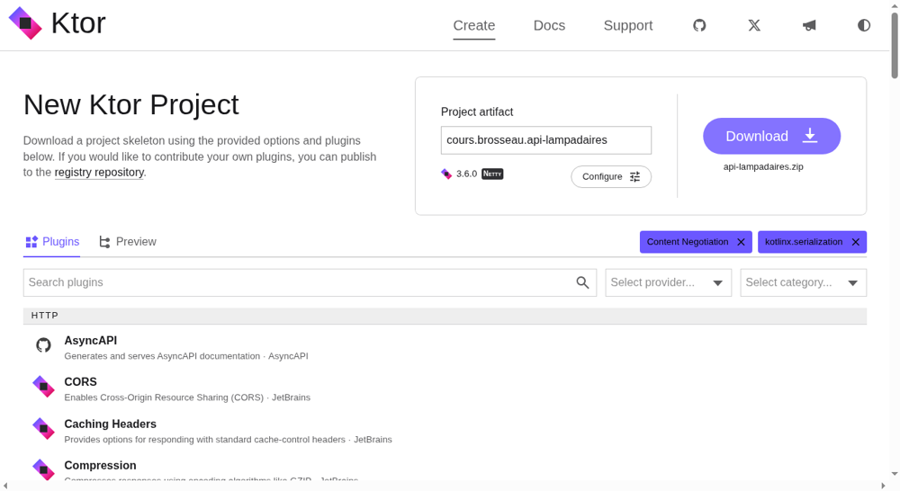

Cliquez sur **Download**, décompressez l'archive `api-lampadaires.zip`, puis ouvrez le dossier dans IntelliJ IDEA. Le premier chargement télécharge Gradle et les bibliothèques : il peut prendre quelques minutes.

::: details Le générateur ne retrouve pas les plugins ?
Ce lien ouvre le générateur avec le nom du projet et les deux plugins déjà choisis : [start.ktor.io (préconfiguré)](https://start.ktor.io/settings?name=api-lampadaires&website=brosseau.cours&artifact=cours.brosseau.api-lampadaires&plugins=io.ktor%2Fserver-content-negotiation,io.ktor%2Fserver-kotlinx-serialization). Vérifiez simplement que le champ **Project artifact** affiche bien `cours.brosseau.api-lampadaires` avant de télécharger (corrigez-le si besoin).
:::

Question :

- À quoi servent les deux plugins que nous avons ajoutés ?

::: details Réponse
- **kotlinx.serialization** sait transformer un objet Kotlin en JSON, et un JSON en objet Kotlin.
- **Content Negotiation** fait le lien avec Ktor : quand une route répond avec un objet, il choisit le bon format (ici JSON) et appelle la sérialisation. Même chose dans l'autre sens, quand le serveur reçoit du JSON.

Sans eux, nous devrions écrire le JSON nous-mêmes, à la main, dans des chaînes de caractères.
:::

### Faire un peu de ménage

Le générateur a créé un projet d'exemple. Les fichiers qui nous intéressent :

```text
api-lampadaires
├── build.gradle.kts            les dépendances du projet
├── gradle/libs.versions.toml   le catalogue des versions
└── src
    ├── main
    │   ├── kotlin
    │   │   ├── main.kt             le point d'entrée : démarre le serveur
    │   │   ├── Serialization.kt    installe Content Negotiation + JSON
    │   │   └── Routing.kt          les routes d'exemple
    │   └── resources
    │       ├── application.yaml    la configuration : le port, le module à charger
    │       └── logback.xml         l'affichage des logs
    └── test                        des tests d'exemple
```

Nous allons réorganiser ce code. Supprimez :

- les trois fichiers `main.kt`, `Serialization.kt` et `Routing.kt` du dossier `src/main/kotlin` ;
- le dossier `src/test` (nous ne ferons pas de tests automatisés dans ce TP).

Gardez tout le reste, en particulier `application.yaml` et `logback.xml`.

## L'organisation du projet

Plutôt que de tout écrire dans un seul fichier, nous allons découper le serveur en **couches**, chacune avec un rôle précis. C'est l'organisation que vous retrouverez dans la plupart des projets Ktor professionnels :

```text
src/main/kotlin/cours/brosseau
├── Application.kt                  le point d'entrée : installe les plugins et les routes
├── plugins/                        une fonction par brique technique
│   ├── Serialization.kt            installSerialization() : le JSON
│   └── DatabaseConnect.kt          databaseConnect() : la base de données
├── common/domain/
│   └── LampadaireDTOs.kt           les objets échangés avec les clients (en JSON)
├── database/
│   ├── LampadairesDatabase.kt      la connexion, la création des tables, les données de départ
│   └── tables/Lampadaires.kt       la table, décrite en Kotlin
└── domain/lampadaire/              tout ce qui concerne les lampadaires
    ├── LampadaireRoute.kt          les routes : la requête HTTP, la réponse
    ├── LampadaireService.kt        les règles métier
    └── LampadaireDao.kt            les requêtes vers la base
```

Le trajet d'une requête traverse les couches dans l'ordre :

```text
Client (curl, Android, Vue.js)
   │  GET /v1/lampadaires
   ▼
┌───────────────────────────────────────────────────────────────┐
│ Route    Reçoit la requête HTTP, appelle le service,          │
│          renvoie la réponse (JSON + code HTTP)                │
├───────────────────────────────────────────────────────────────┤
│ Service  Les règles métier (« un lampadaire neuf est en       │
│          service », « le numéro de série est obligatoire »)   │
├───────────────────────────────────────────────────────────────┤
│ DAO      Les requêtes vers la base de données                 │
├───────────────────────────────────────────────────────────────┤
│ Table    La description de la table en Kotlin (ORM)           │
└───────────────────────────────────────────────────────────────┘
   ▼
SQLite (fichier lampadaires.db)
```

La règle d'or : **chaque couche ne parle qu'à celle du dessous**. La route ne fait jamais de SQL, le DAO ne sait pas ce qu'est une requête HTTP.

Question :

- À votre avis, quel est l'intérêt de ce découpage ? Le code ne serait-il pas plus simple dans un seul fichier ?

::: details Réponse
Pour trois routes, un seul fichier serait effectivement plus court. Mais dès que l'API grossit (et une vraie API de gestion de lampadaires compte vite des dizaines de routes : tests, maintenances, bancs de test, ordres de fabrication…) :

- **on s'y retrouve** : un bug dans une requête SQL ? C'est dans le DAO. Une règle métier à changer ? C'est dans le service ;
- **on peut changer une couche sans toucher aux autres** : passer de SQLite à PostgreSQL ne concerne que la couche base de données ;
- **on peut tester chaque couche séparément**, par exemple tester le service avec un faux DAO, sans base de données.

C'est le même principe que le découpage MVVM que vous avez vu sur Android : la vue affiche, le ViewModel décide.
:::

## Le point d'entrée

### L'application

Le code source va dans `src/main/kotlin/cours/brosseau`. Créez ce dossier (le *package* `cours.brosseau`), puis le sous-package `plugins` avec le fichier `Serialization.kt` :

```kotlin
package cours.brosseau.plugins

import io.ktor.serialization.kotlinx.json.json
import io.ktor.server.application.Application
import io.ktor.server.application.install
import io.ktor.server.plugins.contentnegotiation.ContentNegotiation
import kotlinx.serialization.json.Json

fun Application.installSerialization() {
    install(ContentNegotiation) {
        json(Json { prettyPrint = true })
    }
}
```

`install(ContentNegotiation)` active la conversion automatique en JSON. `prettyPrint = true` rend le JSON lisible par un humain (avec des retours à la ligne et une indentation), bien pratique pour les tests.

Puis, dans `cours/brosseau`, le fichier `Application.kt` :

```kotlin
package cours.brosseau

import cours.brosseau.plugins.installSerialization
import io.ktor.server.application.Application
import io.ktor.server.netty.EngineMain
import io.ktor.server.response.respondText
import io.ktor.server.routing.get
import io.ktor.server.routing.routing

fun main(args: Array<String>): Unit = EngineMain.main(args)

/**
 * Le point d'entrée de l'application : chaque brique est installée par sa propre fonction.
 */
fun Application.module() {
    installSerialization()
    installRouter()
}

fun Application.installRouter() {
    routing {
        get("/") {
            call.respondText("L'API Lampadaires fonctionne !")
        }
    }
}
```

- `main` démarre le serveur Netty, qui lit `application.yaml` ;
- `module()` configure l'application, une brique à la fois. Pour l'instant : le JSON, puis les routes ;
- `installRouter()` déclare les routes. La syntaxe se lit presque comme une phrase : « dans le routage, pour un `GET` sur `/`, répondre ce texte ». `call` représente l'échange en cours : la requête reçue et la réponse à envoyer.

::: tip Une fonction d'extension
`fun Application.installSerialization()` est une **fonction d'extension** : elle ajoute une méthode `installSerialization()` à la classe `Application` de Ktor, sans la modifier. C'est ce qui permet d'écrire simplement `installSerialization()` dans `module()`. Nous allons utiliser ce principe pour chaque brique : un fichier, une fonction.
:::

Il reste à indiquer à Ktor quel module charger. Remplacez le contenu de `src/main/resources/application.yaml` :

```yaml
ktor:
  deployment:
    port: 8080
  application:
    modules:
      - cours.brosseau.ApplicationKt.module
```

::: tip ApplicationKt ?
En Kotlin, une fonction peut exister en dehors de toute classe. Le compilateur la range alors dans une classe générée qui porte le nom du fichier suivi de `Kt` : les fonctions du fichier `Application.kt` se retrouvent dans `ApplicationKt`.
:::

### Lancer le serveur

Dans un terminal, à la racine du projet :

```sh
./gradlew run
```

Sous Windows, dans PowerShell : `.\gradlew.bat run`. Vous pouvez aussi lancer la fonction `main` directement depuis IntelliJ, avec la flèche verte dans la marge du fichier `Application.kt`.

::: tip Point de contrôle
Les logs se terminent par `Responding at http://0.0.0.0:8080`. Ouvrez [http://localhost:8080](http://localhost:8080) dans votre navigateur : le message « L'API Lampadaires fonctionne ! » s'affiche.
:::

Arrêtez le serveur (`Ctrl + C`) : nous allons maintenant lui donner une base de données.

## La base de données SQLite

### Pourquoi SQLite ?

Pour ce TP, pas besoin d'un serveur MariaDB ou PostgreSQL : nous allons utiliser **SQLite**. Toute la base tient dans **un seul fichier** (`lampadaires.db`), créé automatiquement à la racine du projet. Rien à installer, rien à lancer.

C'est d'ailleurs la base de données la plus utilisée au monde : chaque téléphone Android en contient des dizaines.

Pour manipuler la base en Kotlin, nous allons utiliser [Exposed](https://www.jetbrains.com/exposed/), l'**ORM** de JetBrains. Comme Eloquent avec Laravel, il permet de décrire les tables et d'écrire les requêtes en Kotlin, sans écrire de SQL.

### Ajouter les librairies

Ouvrez `gradle/libs.versions.toml` et ajoutez Exposed et le pilote SQLite :

```toml
[versions]
# … les versions déjà présentes
exposed = "1.6.0"
sqlite = "3.54.1.0"

[libraries]
# … les librairies déjà présentes
exposed-core = { module = "org.jetbrains.exposed:exposed-core", version.ref = "exposed" }
exposed-jdbc = { module = "org.jetbrains.exposed:exposed-jdbc", version.ref = "exposed" }
sqlite-jdbc = { module = "org.xerial:sqlite-jdbc", version.ref = "sqlite" }
```

Puis, dans `build.gradle.kts`, ajoutez-les à la fin du bloc `dependencies` :

```kotlin
dependencies {
    // … les dépendances déjà présentes

    // La base de données : Exposed (l'ORM) et le pilote SQLite
    implementation(libs.exposed.core)
    implementation(libs.exposed.jdbc)
    implementation(libs.sqlite.jdbc)
}
```

IntelliJ vous propose de recharger le projet Gradle (une petite icône d'éléphant en haut à droite) : acceptez.

::: tip Pourquoi deux noms, `libs` et `ktorLibs` ?
Le générateur utilise deux catalogues de versions. `ktorLibs` est fourni par Ktor lui-même (toutes les briques de Ktor, dans la bonne version). `libs` est le vôtre, dans `gradle/libs.versions.toml` : c'est là que vous ajoutez les autres librairies.
:::

### Les objets échangés : les DTO

Commençons par décrire ce que l'API envoie et reçoit. Ces objets s'appellent des **DTO** (*Data Transfer Object*, objet de transfert de données). Créez `common/domain/LampadaireDTOs.kt` :

```kotlin
package cours.brosseau.common.domain

import kotlinx.serialization.Serializable

/**
 * Les états possibles d'un lampadaire.
 */
@Serializable
enum class StatutLampadaire { EN_SERVICE, EN_PANNE, EN_MAINTENANCE }

/**
 * Ce que le client envoie pour créer un lampadaire : ni id, ni statut, ni date, c'est le serveur qui s'en charge.
 */
@Serializable
data class CreateLampadaireDTO(
    val numeroSerie: String,
    val titre: String,
    val description: String,
    val image: String,
)

/**
 * Un lampadaire, tel que renvoyé par l'API (en JSON).
 */
@Serializable
data class LampadaireDTO(
    val id: Int,
    val numeroSerie: String,
    val titre: String,
    val description: String,
    val image: String,
    val statut: StatutLampadaire,
    val dateInstallation: String,
)
```

L'annotation `@Serializable` permet de transformer ces objets en JSON (et inversement). Le statut est une `enum` : il ne peut prendre que trois valeurs, et le JSON contiendra son nom (`"EN_PANNE"`).

Question :

- Pourquoi deux classes, `LampadaireDTO` et `CreateLampadaireDTO` ? Une seule ne suffirait-elle pas ?

::: details Réponse
Lors d'une création, le client ne connaît ni l'`id` (c'est la base qui le choisit), ni le statut, ni la date d'installation : c'est le serveur qui décide qu'un lampadaire neuf est « en service », installé aujourd'hui. Avec une seule classe, il faudrait envoyer un faux `id`, un faux statut et une fausse date… que le serveur devrait ignorer.

Deux classes, c'est un **contrat clair** : voilà ce que vous m'envoyez (`CreateLampadaireDTO`), voilà ce que je vous renvoie (`LampadaireDTO`).
:::

Les DTO sont le **contrat** entre le serveur et ses clients : l'application Android utilisera exactement les mêmes. C'est pour cela qu'ils sont rangés à part, dans `common` : dans un projet Kotlin Multiplatform, ce package devient un module partagé entre le serveur et les applications. Ici, nous le recopierons côté Android.

### La table

Créez `database/tables/Lampadaires.kt` :

```kotlin
package cours.brosseau.database.tables

import cours.brosseau.common.domain.StatutLampadaire
import org.jetbrains.exposed.v1.core.Table

/**
 * La table « lampadaires », décrite en Kotlin.
 */
object Lampadaires : Table("lampadaires") {
    val id = integer("id").autoIncrement()
    val numeroSerie = varchar("numero_serie", 20)
    val titre = varchar("titre", 100)
    val description = text("description")
    val image = varchar("image", 255)
    val statut = enumerationByName("statut", 20, StatutLampadaire::class)
    val dateInstallation = varchar("date_installation", 10)

    override val primaryKey = PrimaryKey(id)
}
```

C'est l'équivalent Kotlin d'un `CREATE TABLE` : chaque colonne, son nom en base et son type. `enumerationByName` stocke le statut sous forme de texte (`EN_SERVICE`…). Remarquez la convention : `numeroSerie` côté Kotlin, `numero_serie` côté base.

### La connexion et les données de départ

Créez `database/LampadairesDatabase.kt` :

```kotlin
package cours.brosseau.database

import cours.brosseau.common.domain.StatutLampadaire
import cours.brosseau.database.tables.Lampadaires
import org.jetbrains.exposed.v1.jdbc.Database
import org.jetbrains.exposed.v1.jdbc.SchemaUtils
import org.jetbrains.exposed.v1.jdbc.insert
import org.jetbrains.exposed.v1.jdbc.selectAll
import org.jetbrains.exposed.v1.jdbc.transactions.transaction

/**
 * La connexion à la base SQLite, la création des tables et les données de départ.
 */
object LampadairesDatabase {

    fun connect() {
        // La base est un simple fichier, créé à la racine du projet s'il n'existe pas
        Database.connect("jdbc:sqlite:lampadaires.db", driver = "org.sqlite.JDBC")

        transaction {
            // Crée la table si elle n'existe pas encore
            SchemaUtils.create(Lampadaires)

            // Quelques lampadaires de départ, uniquement si la table est vide
            if (Lampadaires.selectAll().empty()) {
                ajouterLampadaire("LUM-2026-0001", "Sentier du lac", "Lampadaire solaire autonome qui éclaire le sentier piéton le long du lac.", "/images/lampadaire-1.jpg", StatutLampadaire.EN_SERVICE, "2026-03-12")
                ajouterLampadaire("LUM-2026-0002", "Avenue des Pins", "Lampadaire solaire à tête ronde, panneau orienté plein sud.", "/images/lampadaire-2.jpg", StatutLampadaire.EN_SERVICE, "2026-04-02")
                ajouterLampadaire("LUM-2026-0003", "Route du col", "Lampadaire isolé, sans raccordement au réseau électrique, en bord de route de montagne.", "/images/lampadaire-3.jpg", StatutLampadaire.EN_PANNE, "2026-05-20")
                ajouterLampadaire("LUM-2026-0004", "Parc des Tilleuls", "Série de lampadaires solaires le long de l'allée centrale du parc.", "/images/lampadaire-5.jpg", StatutLampadaire.EN_MAINTENANCE, "2026-06-08")
            }
        }
    }

    private fun ajouterLampadaire(
        numeroSerie: String,
        titre: String,
        description: String,
        image: String,
        statut: StatutLampadaire,
        dateInstallation: String,
    ) {
        Lampadaires.insert {
            it[Lampadaires.numeroSerie] = numeroSerie
            it[Lampadaires.titre] = titre
            it[Lampadaires.description] = description
            it[Lampadaires.image] = image
            it[Lampadaires.statut] = statut
            it[Lampadaires.dateInstallation] = dateInstallation
        }
    }
}
```

- `Database.connect(…)` indique à Exposed où se trouve la base : le fichier `lampadaires.db` ;
- `transaction { … }` : toutes les requêtes Exposed se font dans une transaction ;
- `SchemaUtils.create(Lampadaires)` crée la table si elle n'existe pas (et ne fait rien sinon) ;
- les quatre `ajouterLampadaire(…)` remplissent la table au premier lancement, pour avoir des données à afficher.

Puis le plugin qui appelle cette connexion au démarrage, `plugins/DatabaseConnect.kt` :

```kotlin
package cours.brosseau.plugins

import cours.brosseau.database.LampadairesDatabase
import io.ktor.server.application.Application

fun Application.databaseConnect() {
    LampadairesDatabase.connect()
}
```

Enfin, dans `Application.kt`, ajoutez l'appel **en premier** dans `module()` (sans oublier l'import `cours.brosseau.plugins.databaseConnect`) :

```kotlin
fun Application.module() {
    databaseConnect()
    installSerialization()
    installRouter()
}
```

::: tip Et les migrations ?
Avec Laravel, la structure de la base évolue par des migrations. Ici, `SchemaUtils.create` se contente de créer la table si elle manque : c'est suffisant pour démarrer, mais il ne sait pas faire évoluer une table existante. Pour un vrai projet, on utilise un outil de migrations (Flyway), c'est ce que fait le TP [Créer des API avec Kotlin](/tp/ktor/decouverte.md).
:::

Relancez le serveur (`./gradlew run`).

::: tip Point de contrôle
Le serveur démarre sans erreur et un fichier `lampadaires.db` est apparu à la racine du projet. Si vous avez un outil SQLite (DBeaver, l'extension SQLite de VS Code…), ouvrez-le : la table `lampadaires` contient les quatre lampadaires de départ.
:::

Pensez à ajouter `lampadaires.db` dans votre `.gitignore` : la base est recréée automatiquement, elle n'a rien à faire dans Git.

## Les photos

Les lampadaires de départ font référence à des photos (`/images/lampadaire-1.jpg`…). C'est notre serveur qui va les fournir.

Téléchargez les photos : [lampadaires-images.zip](/demo/ktor/lampadaires-images.zip). Décompressez l'archive dans `src/main/resources` : vous obtenez un dossier `src/main/resources/images` avec six photos et le fichier `CREDITS.md` (les photos viennent de Wikimedia Commons, sous licence libre, et leurs auteurs doivent être cités).

Dans `installRouter()`, ajoutez une ligne juste après la route `/` (import `io.ktor.server.http.content.staticResources`) :

```kotlin
// Les photos des lampadaires : les fichiers du dossier src/main/resources/images
staticResources("/images", "images")
```

`staticResources` sert tels quels les fichiers d'un dossier des ressources : une requête sur `/images/lampadaire-1.jpg` renvoie le fichier `images/lampadaire-1.jpg`. Pas besoin d'écrire une route par fichier.

::: tip Point de contrôle
Relancez le serveur, puis ouvrez [http://localhost:8080/images/lampadaire-3.jpg](http://localhost:8080/images/lampadaire-3.jpg) : la photo du lampadaire de la route du col s'affiche.
:::

## Les lampadaires, couche par couche

### Le DAO : les requêtes

Le **DAO** (*Data Access Object*, objet d'accès aux données) regroupe les requêtes vers la base. Créez le package `domain.lampadaire`, puis `LampadaireDao.kt` :

```kotlin
package cours.brosseau.domain.lampadaire

import cours.brosseau.common.domain.CreateLampadaireDTO
import cours.brosseau.common.domain.LampadaireDTO
import cours.brosseau.common.domain.StatutLampadaire
import cours.brosseau.database.tables.Lampadaires
import org.jetbrains.exposed.v1.core.ResultRow
import org.jetbrains.exposed.v1.core.eq
import org.jetbrains.exposed.v1.jdbc.insert
import org.jetbrains.exposed.v1.jdbc.selectAll
import org.jetbrains.exposed.v1.jdbc.transactions.transaction

/**
 * Les requêtes sur la table des lampadaires.
 */
interface LampadaireDao {
    fun getAll(): List<LampadaireDTO>
    fun getById(id: Int): LampadaireDTO?
    fun create(dto: CreateLampadaireDTO, statut: StatutLampadaire, dateInstallation: String): LampadaireDTO
}

/**
 * L'implémentation avec Exposed (la base SQLite).
 */
class ExposedLampadaireDao : LampadaireDao {

    override fun getAll(): List<LampadaireDTO> = transaction {
        Lampadaires.selectAll().map { it.toLampadaireDTO() }
    }

    override fun getById(id: Int): LampadaireDTO? = transaction {
        Lampadaires.selectAll()
            .where { Lampadaires.id eq id }
            .map { it.toLampadaireDTO() }
            .singleOrNull()
    }

    override fun create(dto: CreateLampadaireDTO, statut: StatutLampadaire, dateInstallation: String): LampadaireDTO = transaction {
        val id = Lampadaires.insert {
            it[numeroSerie] = dto.numeroSerie
            it[titre] = dto.titre
            it[description] = dto.description
            it[image] = dto.image
            it[Lampadaires.statut] = statut
            it[Lampadaires.dateInstallation] = dateInstallation
        } get Lampadaires.id

        Lampadaires.selectAll()
            .where { Lampadaires.id eq id }
            .map { it.toLampadaireDTO() }
            .single()
    }

    /**
     * Transforme une ligne de la table en objet LampadaireDTO.
     */
    private fun ResultRow.toLampadaireDTO() = LampadaireDTO(
        id = this[Lampadaires.id],
        numeroSerie = this[Lampadaires.numeroSerie],
        titre = this[Lampadaires.titre],
        description = this[Lampadaires.description],
        image = this[Lampadaires.image],
        statut = this[Lampadaires.statut],
        dateInstallation = this[Lampadaires.dateInstallation],
    )
}
```

Les requêtes se lisent comme du SQL :

- `Lampadaires.selectAll()` correspond à un `SELECT * FROM lampadaires` ;
- `.where { Lampadaires.id eq id }` ajoute la condition `WHERE id = …` ;
- `.singleOrNull()` renvoie le lampadaire trouvé, ou `null` s'il n'y en a pas ;
- `Lampadaires.insert { … }` correspond à un `INSERT INTO lampadaires …`, et `get Lampadaires.id` récupère l'`id` choisi par la base ;
- `toLampadaireDTO()` transforme chaque ligne de la table (`ResultRow`) en objet `LampadaireDTO`.

Question :

- Pourquoi déclarer une `interface` `LampadaireDao`, puis une classe `ExposedLampadaireDao` qui l'implémente ? Une seule classe suffirait.

::: details Réponse
L'interface décrit **ce que** fait le DAO (lister, trouver, créer), la classe décrit **comment** (avec Exposed et SQLite). Le service ne connaît que l'interface.

Le jour où vous voudrez tester le service sans base de données, il suffira de lui donner une autre implémentation (un faux DAO qui garde les lampadaires dans une liste). Et si vous changez de base, seule la classe `ExposedLampadaireDao` est concernée.
:::

### Le service : les règles métier

`LampadaireService.kt`, dans le même package :

```kotlin
package cours.brosseau.domain.lampadaire

import cours.brosseau.common.domain.CreateLampadaireDTO
import cours.brosseau.common.domain.LampadaireDTO
import cours.brosseau.common.domain.StatutLampadaire
import java.time.LocalDate

/**
 * Les règles métier des lampadaires.
 */
class LampadaireService(private val lampadaireDao: LampadaireDao) {

    fun getAll(): List<LampadaireDTO> = lampadaireDao.getAll()

    fun getById(id: Int): LampadaireDTO? = lampadaireDao.getById(id)

    fun create(dto: CreateLampadaireDTO): LampadaireDTO {
        // Un lampadaire doit être identifiable : pas de numéro de série vide
        require(dto.numeroSerie.isNotBlank()) { "Le numéro de série est obligatoire" }

        // Un lampadaire neuf est en service, installé aujourd'hui
        return lampadaireDao.create(dto, StatutLampadaire.EN_SERVICE, LocalDate.now().toString())
    }
}
```

Pour la lecture, le service ne fait que transmettre au DAO. Pour la création, il applique les **règles métier** : il vérifie le numéro de série (`require` lève une `IllegalArgumentException` si la condition est fausse), puis décide du statut et de la date. Le DAO, lui, se contente d'enregistrer ce qu'on lui donne.

Remarquez aussi que le service **reçoit** son DAO dans son constructeur, il ne le crée pas lui-même. Nous verrons juste après qui s'en charge.

### La route : la requête HTTP

`LampadaireRoute.kt`, toujours dans le même package. Pour commencer, une seule route, la liste :

```kotlin
package cours.brosseau.domain.lampadaire

import cours.brosseau.common.domain.CreateLampadaireDTO
import io.ktor.http.HttpStatusCode
import io.ktor.server.request.receive
import io.ktor.server.response.respond
import io.ktor.server.routing.Route
import io.ktor.server.routing.get
import io.ktor.server.routing.post
import io.ktor.server.routing.route

/**
 * Les routes des lampadaires : elles reçoivent la requête HTTP, appellent le service et répondent.
 */
fun Route.lampadaireRoutes(path: String, lampadaireService: LampadaireService) {
    route(path) {
        // La liste des lampadaires
        get {
            call.respond(lampadaireService.getAll())
        }
    }
}
```

`route(path) { … }` regroupe toutes les routes qui commencent par le même chemin. `call.respond(…)` renvoie la liste : grâce à Content Negotiation, elle part en JSON. Quelques imports ne servent pas encore (`post`, `receive`…) : ils serviront juste après.

### Relier les couches

Il reste à créer les objets et à brancher les routes. Dans `Application.kt`, complétez `installRouter()` :

```kotlin
fun Application.installRouter() {
    // Les objets de l'application, créés une seule fois et reliés entre eux
    val lampadaireService = LampadaireService(ExposedLampadaireDao())

    routing {
        get("/") {
            call.respondText("L'API Lampadaires fonctionne !")
        }

        // Les photos des lampadaires : les fichiers du dossier src/main/resources/images
        staticResources("/images", "images")

        // Les routes de l'API, toutes préfixées par la version
        route("/v1") {
            lampadaireRoutes("/lampadaires", lampadaireService)
        }
    }
}
```

(Imports : `cours.brosseau.domain.lampadaire.ExposedLampadaireDao`, `cours.brosseau.domain.lampadaire.LampadaireService`, `cours.brosseau.domain.lampadaire.lampadaireRoutes` et `io.ktor.server.routing.route`.)

C'est ici que le DAO est créé, puis donné au service, lui-même donné aux routes. Chaque couche reçoit celle du dessous.

::: tip Et dans un vrai projet ?
Avec un seul service, créer les objets à la main est simple. Avec cinquante, on confie ce travail à un outil d'**injection de dépendances**, comme Koin : il crée les objets et les fournit là où on en a besoin. C'est ce que fait le TP [Créer des API avec Kotlin](/tp/ktor/decouverte.md).
:::

Relancez le serveur, puis ouvrez [http://localhost:8080/v1/lampadaires](http://localhost:8080/v1/lampadaires).

::: tip Point de contrôle
Le navigateur affiche un tableau JSON contenant les quatre lampadaires de départ.
:::

### Un lampadaire

Pour obtenir un seul lampadaire, l'`id` est passé **dans l'URL** : `/v1/lampadaires/3`. Dans `lampadaireRoutes`, ajoutez cette route juste après la liste (toujours dans le bloc `route(path)`) :

```kotlin
// Un lampadaire, à partir de son id
get("/{id}") {
    val id = call.parameters["id"]?.toIntOrNull()
    if (id == null) {
        call.respond(HttpStatusCode.BadRequest, "L'id doit être un nombre")
        return@get
    }

    val lampadaire = lampadaireService.getById(id)
    if (lampadaire == null) {
        call.respond(HttpStatusCode.NotFound, "Lampadaire introuvable")
    } else {
        call.respond(lampadaire)
    }
}
```

- `{id}` dans le chemin est un **paramètre** : sa valeur se lit avec `call.parameters["id"]` ;
- `toIntOrNull()` renvoie `null` si ce n'est pas un nombre (`/v1/lampadaires/abc`) ;
- la route ne fait que traduire : un `null` du service devient un code `404`.

Question :

- Pourquoi répondre avec un code `404` plutôt qu'avec un JSON vide ou un message en `200` ?

::: details Réponse
Le code HTTP est la **première** chose que le client regarde. `404 Not Found` signifie « cette ressource n'existe pas », pour n'importe quel client, dans n'importe quel langage. Le client n'a pas besoin de lire le contenu de la réponse pour savoir que quelque chose s'est mal passé.

Même logique pour `400 Bad Request` : la demande elle-même est incorrecte (`/v1/lampadaires/abc` n'a pas de sens).
:::

Relancez le serveur pour tester la nouvelle route.

::: tip Point de contrôle
[http://localhost:8080/v1/lampadaires/3](http://localhost:8080/v1/lampadaires/3) affiche le lampadaire de la route du col (en panne), [http://localhost:8080/v1/lampadaires/42](http://localhost:8080/v1/lampadaires/42) affiche « Lampadaire introuvable ».
:::

### Ajouter un lampadaire

Dernière route guidée : la création. Le client envoie un `CreateLampadaireDTO` en JSON, le serveur l'enregistre et renvoie le lampadaire complet (avec son `id`, son statut et sa date). Ajoutez :

```kotlin
// Créer un lampadaire
post {
    val dto = call.receive<CreateLampadaireDTO>()
    try {
        call.respond(HttpStatusCode.Created, lampadaireService.create(dto))
    } catch (e: IllegalArgumentException) {
        call.respond(HttpStatusCode.BadRequest, e.message ?: "Lampadaire invalide")
    }
}
```

- `call.receive<CreateLampadaireDTO>()` lit le JSON reçu et le transforme en objet : c'est Content Negotiation, dans l'autre sens ;
- le service applique ses règles : si le numéro de série est vide, son `require` lève une `IllegalArgumentException`, que la route traduit en `400 Bad Request` ;
- le code `201 Created` indique au client que la ressource a bien été créée.

::: tip Que se passe-t-il si le JSON est incomplet ?
Si le client oublie un champ (par exemple, pas de `description`), `call.receive` ne peut pas construire l'objet : Ktor répond automatiquement `400 Bad Request`, sans que la route aille plus loin. Le typage fait une partie de la validation pour vous.
:::

Relancez le serveur. Une requête `POST` ne se fait pas simplement depuis la barre d'adresse du navigateur : il nous faut un autre outil.

## Tester avec curl

`curl` est un client HTTP en ligne de commande. Il permet de tester une API **avant** d'écrire la moindre application : si quelque chose ne fonctionne pas plus tard dans Android, vous saurez que le problème ne vient pas du serveur.

Ouvrez un **second** terminal (le premier fait tourner le serveur) :

```sh
curl http://localhost:8080/v1/lampadaires
```

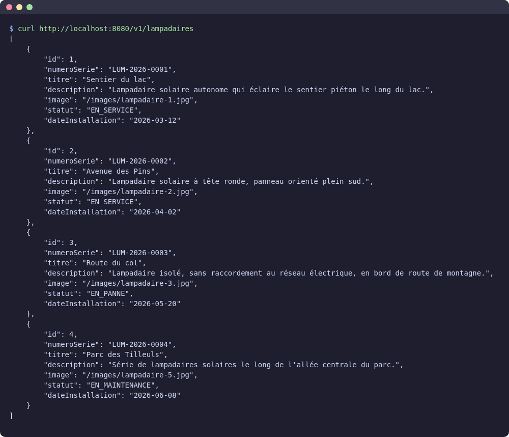

L'option `-i` affiche aussi le **code HTTP** et les en-têtes de la réponse :

```sh
curl -i http://localhost:8080/v1/lampadaires/3
curl -i http://localhost:8080/v1/lampadaires/42
```

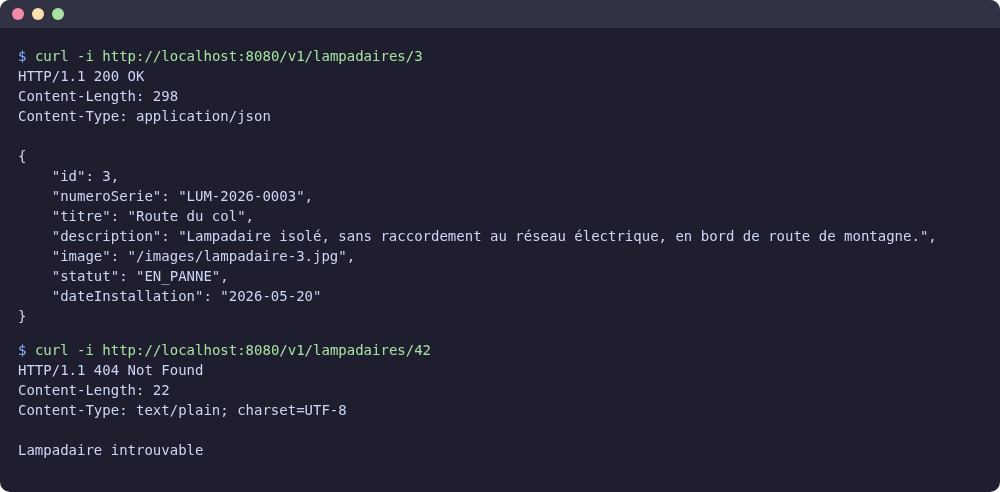

Et maintenant, la création. `-X POST` choisit le verbe, `-H` ajoute un en-tête (nous envoyons du JSON) et `-d` contient les données envoyées :

```sh
curl -i -X POST http://localhost:8080/v1/lampadaires -H "Content-Type: application/json" -d '{"numeroSerie": "LUM-2026-0005", "titre": "Abribus de la chapelle", "description": "Lampadaire solaire au-dessus de l’abribus, panneau de 100 W.", "image": "/images/lampadaire-6.jpg"}'
```

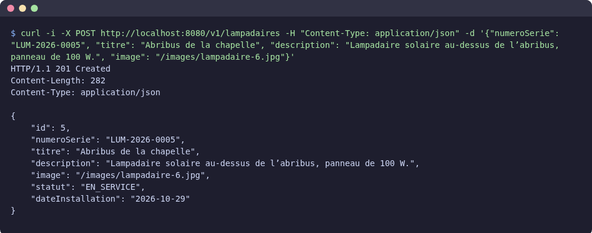

::: warning Sous Windows
Dans PowerShell, tapez `curl.exe` (et non `curl`, qui lance une autre commande). Les guillemets du JSON sont pénibles à écrire dans PowerShell : le plus simple est d'écrire le JSON dans un fichier `lampadaire.json`, puis de l'envoyer avec `-d "@lampadaire.json"`. Vous pouvez aussi utiliser le terminal **Git Bash**, où les commandes ci-dessus fonctionnent telles quelles.
:::

Vérifions maintenant que le lampadaire a bien été enregistré.

::: tip Point de contrôle
Après le `POST`, `curl http://localhost:8080/v1/lampadaires` affiche **cinq** lampadaires, dont l'abribus de la chapelle, en service, avec la date du jour. Arrêtez puis relancez le serveur : il est toujours là, puisqu'il est enregistré dans `lampadaires.db`.
:::

Testez aussi les cas d'erreur : un `POST` avec un numéro de série vide (`"numeroSerie": ""`), un `POST` sans le champ `description`, puis `curl -i http://localhost:8080/v1/lampadaires/abc`. Quels codes HTTP obtenez-vous ?

## Supprimer un lampadaire

Jusqu'ici je vous ai guidé pas à pas, en vous indiquant précisément quoi écrire et où. Pour cette route, vous n'avez plus que la consigne : le code est à vous, dans les trois couches.

Ajoutez la route `DELETE /v1/lampadaires/{id}` :

- si l'`id` n'est pas un nombre, elle répond `400 Bad Request` ;
- si le lampadaire n'existe pas, elle répond `404 Not Found` ;
- sinon, elle supprime le lampadaire et répond `204 No Content` (« c'est fait, je n'ai rien à vous renvoyer »).

Le résultat attendu :

```text
$ curl -i -X DELETE http://localhost:8080/v1/lampadaires/5
HTTP/1.1 204 No Content

$ curl -i -X DELETE http://localhost:8080/v1/lampadaires/5
HTTP/1.1 404 Not Found
Content-Length: 22
Content-Type: text/plain; charset=UTF-8

Lampadaire introuvable
```

::: details Besoin d'aide pour la suppression ?
Pas de code, seulement la procédure, couche par couche :

- **DAO** : une fonction `delete(id: Int): Int` dans l'interface, puis dans `ExposedLampadaireDao`. Dans une `transaction`, `Lampadaires.deleteWhere { Lampadaires.id eq id }` (import `org.jetbrains.exposed.v1.jdbc.deleteWhere`) supprime la ligne et renvoie le **nombre de lignes supprimées**.
- **Service** : une fonction `delete(id: Int): Boolean` qui renvoie `true` si le DAO a supprimé au moins une ligne.
- **Route** : `delete("/{id}") { … }` (import `io.ktor.server.routing.delete`, et `return@delete` pour sortir plus tôt). La lecture de l'`id` est identique à celle de `get("/{id}")`. Pour répondre sans contenu : `call.respond(HttpStatusCode.NoContent)`.
:::

Testez votre route avec `curl`, sans oublier les cas d'erreur (`/v1/lampadaires/abc`, un lampadaire déjà supprimé).

::: tip Vous êtes en avance ?
Ajoutez une route `PUT /v1/lampadaires/{id}/statut` qui change le statut d'un lampadaire (signaler une panne, la fin d'une maintenance…). Le client envoie un `UpdateStatutDTO(val statut: StatutLampadaire)`, et le DAO utilise `Lampadaires.update({ Lampadaires.id eq id }) { it[statut] = … }` (import `org.jetbrains.exposed.v1.jdbc.update`). Votre API est alors un CRUD complet : Create, Read, Update, Delete.
:::

Notre serveur est prêt. Laissez-le tourner : nous allons maintenant écrire son premier client.

::: details Votre serveur ne fonctionne pas ?
Pas de panique, vous pouvez repartir du serveur de référence (routes `GET` et `POST`, sans la suppression) : [Télécharger api-lampadaires](/demo/ktor/api-lampadaires-partie1.zip). Décompressez l'archive, ouvrez-la dans IntelliJ et lancez `./gradlew run`.
:::

## Le client Android

Changement de décor : direction Android Studio. Nous allons écrire une application qui consomme notre API, avec la même organisation que le [TP BLE avec la librairie Nordic](./android-ble-nordic.md) : des écrans en machine à états, un ViewModel par écran, et Ktor côté client pour les appels HTTP.

```text
cours.brosseau.lampadaires
├── MainActivity.kt            affiche LampadairesApp()
├── http/                      le client HTTP et les routes de l'API (Ktor)
├── model/                     les DTO et les états des écrans
└── ui/
    ├── LampadairesApp.kt      la navigation : liste, détail, création
    ├── liste/                 l'écran liste et son ViewModel
    ├── detail/                l'écran détail et son ViewModel
    ├── creation/              l'écran de création et son ViewModel
    ├── components/            les éléments communs : le loader, l'erreur, la carte, le badge de statut
    └── theme/                 le thème, créé par Android Studio
```

Comme dans le TP BLE, les écrans n'ont aucune logique réseau : ils affichent l'état que le ViewModel leur donne, et lui transmettent les clics.

### Créer le projet

Dans Android Studio, créez un nouveau projet de type **Empty Activity** :

- nom : `Lampadaires` ;
- package : `cours.brosseau.lampadaires` ;
- langage de configuration : Kotlin DSL (le choix par défaut).

Créez ensuite les packages `http`, `model` et, dans `ui` (à côté de `theme`), les sous-packages `liste`, `detail`, `creation` et `components`.

### Les librairies

Nous avons besoin de :

- **Ktor client**, pour appeler l'API (vous le connaissez depuis le TP BLE) ;
- **kotlinx.serialization**, pour transformer le JSON en objets ;
- **Coil**, pour afficher une image à partir de son URL ;
- la **navigation** Compose et les icônes Material.

Ajoutez-les dans `gradle/libs.versions.toml` :

```toml
[versions]
# … les versions déjà présentes
lifecycle = "2.10.0"
navigation = "2.10.2"
ktor = "3.6.1"
serialization = "1.12.0"
coil = "3.6.3"

[libraries]
# … les librairies déjà présentes
androidx-lifecycle-runtime-compose = { module = "androidx.lifecycle:lifecycle-runtime-compose", version.ref = "lifecycle" }
androidx-lifecycle-viewmodel-compose = { module = "androidx.lifecycle:lifecycle-viewmodel-compose", version.ref = "lifecycle" }
androidx-navigation-compose = { module = "androidx.navigation:navigation-compose", version.ref = "navigation" }
compose-material-icons-extended = { module = "androidx.compose.material:material-icons-extended" }
ktor-client-core = { module = "io.ktor:ktor-client-core", version.ref = "ktor" }
ktor-client-okhttp = { module = "io.ktor:ktor-client-okhttp", version.ref = "ktor" }
ktor-client-content-negotiation = { module = "io.ktor:ktor-client-content-negotiation", version.ref = "ktor" }
ktor-serialization-kotlinx-json = { module = "io.ktor:ktor-serialization-kotlinx-json", version.ref = "ktor" }
kotlinx-serialization-json = { module = "org.jetbrains.kotlinx:kotlinx-serialization-json", version.ref = "serialization" }
coil-compose = { module = "io.coil-kt.coil3:coil-compose", version.ref = "coil" }
coil-network-okhttp = { module = "io.coil-kt.coil3:coil-network-okhttp", version.ref = "coil" }

[plugins]
# … les plugins déjà présents
kotlin-serialization = { id = "org.jetbrains.kotlin.plugin.serialization", version.ref = "kotlin" }
```

::: danger Mettez à jour la version de Kotlin
Ktor 3.6 et kotlinx.serialization 1.12 sont compilés avec **Kotlin 2.4**. Or le modèle d'Android Studio crée le projet avec une version plus ancienne (2.2.10 au moment où ce TP est écrit). Sans mise à jour, la compilation échoue avec des erreurs du type *Module was compiled with an incompatible version of Kotlin. The binary version of its metadata is 2.4.0, expected version is 2.2.0*.

Dans le bloc `[versions]` de `libs.versions.toml`, remplacez la ligne `kotlin` :

```toml
kotlin = "2.4.10"
```

Le plugin Compose et le plugin de sérialisation utilisent cette même version (`version.ref = "kotlin"`) : une seule ligne à changer.
:::

Dans le `build.gradle.kts` à la racine du projet, déclarez le plugin de sérialisation :

```kotlin
plugins {
    // … les plugins déjà présents
    alias(libs.plugins.kotlin.serialization) apply false
}
```

Puis dans `app/build.gradle.kts` :

```kotlin
plugins {
    // … les plugins déjà présents
    alias(libs.plugins.kotlin.serialization)
}

dependencies {
    // … les dépendances déjà présentes

    // Ktor : le client HTTP et la conversion JSON
    implementation(libs.ktor.client.core)
    implementation(libs.ktor.client.okhttp)
    implementation(libs.ktor.client.content.negotiation)
    implementation(libs.ktor.serialization.kotlinx.json)
    implementation(libs.kotlinx.serialization.json)

    // Coil : afficher une image à partir de son URL
    implementation(libs.coil.compose)
    implementation(libs.coil.network.okhttp)

    implementation(libs.androidx.lifecycle.runtime.compose)
    implementation(libs.androidx.lifecycle.viewmodel.compose)
    implementation(libs.androidx.navigation.compose)
    implementation(libs.compose.material.icons.extended)
}
```

N'oubliez pas le **Sync** (le bandeau en haut de l'éditeur, ou l'icône de l'éléphant).

### L'adresse du serveur

L'adresse de l'API dépend de l'endroit où tourne l'application : nous la mettons dans `app/build.gradle.kts`, d'où elle arrive dans le code sous le nom `BuildConfig.API_URL`.

```kotlin
android {
    defaultConfig {
        // … la configuration déjà présente

        // Adresse de l'API Ktor. 10.0.2.2 est l'adresse du PC vu depuis l'émulateur Android.
        buildConfigField("String", "API_URL", "\"http://10.0.2.2:8080\"")
    }

    buildFeatures {
        compose = true
        buildConfig = true
    }
}
```

Question :

- Le serveur tourne sur votre PC, à l'adresse `http://localhost:8080`. Pourquoi ne pas écrire `localhost` dans l'application ?

::: details Réponse
`localhost` désigne toujours **la machine sur laquelle le code s'exécute**. Pour l'application, c'est donc le téléphone (ou l'émulateur)… sur lequel aucun serveur ne tourne.

- Sur l'**émulateur** Android, l'adresse spéciale `10.0.2.2` désigne le PC qui le fait tourner.
- Sur un **vrai téléphone**, il faut l'adresse IP du PC sur le réseau (`ip addr` sous Linux, `ipconfig` sous Windows), par exemple `http://192.168.1.27:8080`. Le téléphone et le PC doivent être sur le même réseau Wi-Fi, et le pare-feu du PC doit laisser passer le port `8080`.
:::

### Les permissions

Dans `AndroidManifest.xml`, l'application doit avoir le droit d'utiliser le réseau. Et comme notre serveur répond en HTTP simple (sans le « S » de HTTPS), il faut l'autoriser explicitement :

```xml
<uses-permission android:name="android.permission.INTERNET" />

<application
    android:usesCleartextTraffic="true"
    … >
```

C'est exactement ce que vous aviez fait pour la lampe dans le TP BLE.

### Les DTO

Côté application, un lampadaire est décrit par **les mêmes classes** que côté serveur (seul le package change). Créez `model/Lampadaire.kt` :

```kotlin
package cours.brosseau.lampadaires.model

import kotlinx.serialization.Serializable

/**
 * Les états possibles d'un lampadaire (mêmes valeurs que côté serveur).
 */
@Serializable
enum class StatutLampadaire { EN_SERVICE, EN_PANNE, EN_MAINTENANCE }

/**
 * Un lampadaire, tel que renvoyé par l'API.
 */
@Serializable
data class LampadaireDTO(
    val id: Int,
    val numeroSerie: String,
    val titre: String,
    val description: String,
    val image: String,
    val statut: StatutLampadaire,
    val dateInstallation: String,
)

/**
 * Ce que l'application envoie pour créer un lampadaire (POST /v1/lampadaires).
 */
@Serializable
data class CreateLampadaireDTO(
    val numeroSerie: String,
    val titre: String,
    val description: String,
    val image: String,
)
```

::: tip Le contrat entre le client et le serveur
Les noms des propriétés (`numeroSerie`, `titre`…) et les valeurs de l'`enum` doivent être **exactement** ceux du JSON envoyé par le serveur. Une faute de frappe d'un côté ou de l'autre, et la conversion échoue. C'est pour cela qu'une API se documente : c'est le contrat que les clients doivent respecter.
:::

### L'API

Comme dans le TP BLE, le client HTTP se crée dans une seule fonction : `http/HttpClientFactory.kt`.

```kotlin
package cours.brosseau.lampadaires.http

import io.ktor.client.HttpClient
import io.ktor.client.engine.okhttp.OkHttp
import io.ktor.client.plugins.HttpTimeout
import io.ktor.client.plugins.contentnegotiation.ContentNegotiation
import io.ktor.serialization.kotlinx.json.json
import kotlinx.serialization.json.Json

/**
 * Le client HTTP de l'application (moteur OkHttp).
 */
fun createHttpClient(): HttpClient = HttpClient(OkHttp) {
    // Une réponse 4xx ou 5xx (404, 400…) lève une exception, au lieu d'être lue comme un JSON valide
    expectSuccess = true

    // Les réponses JSON deviennent directement des objets Kotlin (et inversement)
    install(ContentNegotiation) {
        json(Json { ignoreUnknownKeys = true })
    }

    // Un serveur injoignable ne doit pas bloquer l'écran trop longtemps
    install(HttpTimeout) {
        requestTimeoutMillis = 5_000
    }
}
```

Vous reconnaissez le plugin `ContentNegotiation` : c'est le même principe que côté serveur, mais dans l'autre sens. `expectSuccess = true` est nouveau : sans lui, une réponse `404` serait lue comme une réponse normale, et la conversion du texte « Lampadaire introuvable » en objet échouerait avec un message incompréhensible.

Puis les routes de notre API, dans `http/LampadairesApi.kt` :

```kotlin
package cours.brosseau.lampadaires.http

import cours.brosseau.lampadaires.BuildConfig
import cours.brosseau.lampadaires.model.CreateLampadaireDTO
import cours.brosseau.lampadaires.model.LampadaireDTO
import io.ktor.client.HttpClient
import io.ktor.client.call.body
import io.ktor.client.request.get
import io.ktor.client.request.post
import io.ktor.client.request.setBody
import io.ktor.http.ContentType
import io.ktor.http.contentType

/**
 * Les routes de notre API Ktor.
 *
 * @param baseUrl l'adresse du serveur, définie dans build.gradle.kts (BuildConfig.API_URL)
 */
class LampadairesApi(private val client: HttpClient, private val baseUrl: String) {

    /** GET /v1/lampadaires : la liste complète. */
    suspend fun lampadaires(): List<LampadaireDTO> = client.get("$baseUrl/v1/lampadaires").body()

    /** GET /v1/lampadaires/{id} : un seul lampadaire. */
    suspend fun lampadaire(id: Int): LampadaireDTO = client.get("$baseUrl/v1/lampadaires/$id").body()

    /** POST /v1/lampadaires : crée un lampadaire et renvoie celui enregistré par le serveur. */
    suspend fun creer(nouveau: CreateLampadaireDTO): LampadaireDTO =
        client.post("$baseUrl/v1/lampadaires") {
            contentType(ContentType.Application.Json)
            setBody(nouveau)
        }.body()

    companion object {
        /** Une seule instance pour toute l'application, partagée par les ViewModels. */
        val instance = LampadairesApi(createHttpClient(), BuildConfig.API_URL)
    }
}

/**
 * L'adresse complète d'une photo : le serveur renvoie un chemin (/images/lampadaire-1.jpg), il faut y ajouter son adresse.
 */
fun urlImage(chemin: String): String = BuildConfig.API_URL + chemin
```

Chaque route de l'API devient une fonction `suspend` : l'appel attend la réponse du serveur sans bloquer l'interface. `.body()` transforme le JSON reçu en objet, et `setBody(…)` fait l'inverse pour la création. La fonction `urlImage` complète le chemin des photos avec l'adresse du serveur.

Question :

- Comparez la fonction `creer` avec la commande `curl` de création. Retrouvez, dans le code Kotlin, l'équivalent de `-X POST`, de `-H "Content-Type: application/json"` et de `-d`.

::: details Réponse
- `-X POST` : `client.post(…)` ;
- `-H "Content-Type: application/json"` : `contentType(ContentType.Application.Json)` ;
- `-d '{…}'` : `setBody(nouveau)`, l'objet étant transformé en JSON par Content Negotiation.

La requête envoyée est exactement la même. C'est tout l'intérêt d'avoir testé avec `curl` d'abord.
:::

Reste une question : où créer cette instance de `LampadairesApi` ? Les trois écrans en auront besoin.

::: tip Un singleton, pour la simplicité
Le `companion object` crée une seule instance de l'API pour toute l'application. C'est simple et suffisant ici. Dans un projet plus important, on confie plutôt ce travail à un outil d'**injection de dépendances** (comme Koin), exactement comme côté serveur.
:::

### L'écran liste

#### Les états de l'écran

L'écran liste est une machine à états, comme les écrans du TP BLE : en attente de la réponse, la liste est arrivée, ou le serveur ne répond pas. Créez `model/EcranListe.kt` :

```kotlin
package cours.brosseau.lampadaires.model

/**
 * La machine à états de l'écran liste.
 */
sealed interface EcranListe {
    /** Requête en cours (loader). */
    data object Chargement : EcranListe

    /** L'API a répondu. */
    data class Lampadaires(val lampadaires: List<LampadaireDTO>) : EcranListe

    /** L'API ne répond pas (serveur arrêté, mauvaise adresse…). */
    data class Erreur(val message: String) : EcranListe
}
```

#### Le ViewModel

`ui/liste/ListeViewModel.kt` :

```kotlin
package cours.brosseau.lampadaires.ui.liste

import androidx.lifecycle.ViewModel
import androidx.lifecycle.viewModelScope
import cours.brosseau.lampadaires.http.LampadairesApi
import cours.brosseau.lampadaires.model.EcranListe
import kotlinx.coroutines.flow.MutableStateFlow
import kotlinx.coroutines.flow.StateFlow
import kotlinx.coroutines.flow.asStateFlow
import kotlinx.coroutines.launch

/**
 * Le ViewModel de l'écran liste : il appelle GET /v1/lampadaires et expose l'état de l'écran.
 */
class ListeViewModel : ViewModel() {

    private val api = LampadairesApi.instance

    private val _ecran = MutableStateFlow<EcranListe>(EcranListe.Chargement)
    val ecran: StateFlow<EcranListe> = _ecran.asStateFlow()

    /** Charge (ou recharge) la liste des lampadaires. */
    fun charger() {
        viewModelScope.launch {
            _ecran.value = EcranListe.Chargement
            _ecran.value = try {
                EcranListe.Lampadaires(api.lampadaires())
            } catch (e: Exception) {
                EcranListe.Erreur("Le serveur ne répond pas : ${e.message}")
            }
        }
    }
}
```

La fonction `charger()` fait passer l'écran par ses états : d'abord `Chargement`, puis `Lampadaires` si l'API a répondu, ou `Erreur` si l'appel a échoué (serveur arrêté, mauvaise adresse, délai dépassé…).

#### Les composants communs

Quatre petits composants, dans `ui/components/`. Les deux premiers sont ceux du TP BLE, à peine modifiés.

`ui/components/Chargement.kt` :

```kotlin
package cours.brosseau.lampadaires.ui.components

import androidx.compose.foundation.layout.Arrangement
import androidx.compose.foundation.layout.Column
import androidx.compose.foundation.layout.fillMaxSize
import androidx.compose.material3.CircularProgressIndicator
import androidx.compose.material3.Text
import androidx.compose.runtime.Composable
import androidx.compose.ui.Alignment
import androidx.compose.ui.Modifier
import androidx.compose.ui.unit.dp

/** Un loader centré et son message. */
@Composable
fun Chargement(message: String) {
    Column(
        modifier = Modifier.fillMaxSize(),
        verticalArrangement = Arrangement.spacedBy(16.dp, Alignment.CenterVertically),
        horizontalAlignment = Alignment.CenterHorizontally,
    ) {
        CircularProgressIndicator()
        Text(message)
    }
}
```

`ui/components/MessageErreur.kt` :

```kotlin
package cours.brosseau.lampadaires.ui.components

import androidx.compose.foundation.layout.Arrangement
import androidx.compose.foundation.layout.Column
import androidx.compose.foundation.layout.fillMaxSize
import androidx.compose.foundation.layout.padding
import androidx.compose.material3.Button
import androidx.compose.material3.MaterialTheme
import androidx.compose.material3.Text
import androidx.compose.runtime.Composable
import androidx.compose.ui.Alignment
import androidx.compose.ui.Modifier
import androidx.compose.ui.text.style.TextAlign
import androidx.compose.ui.unit.dp

/** Une erreur centrée, avec un bouton pour réessayer. */
@Composable
fun MessageErreur(message: String, onReessayer: () -> Unit) {
    Column(
        modifier = Modifier.fillMaxSize().padding(24.dp),
        verticalArrangement = Arrangement.spacedBy(16.dp, Alignment.CenterVertically),
        horizontalAlignment = Alignment.CenterHorizontally,
    ) {
        Text(message, color = MaterialTheme.colorScheme.error, textAlign = TextAlign.Center)
        Button(onClick = onReessayer) { Text("Réessayer") }
    }
}
```

Le statut d'un lampadaire, sous forme de pastille colorée, `ui/components/BadgeStatut.kt` :

```kotlin
package cours.brosseau.lampadaires.ui.components

import androidx.compose.foundation.background
import androidx.compose.foundation.layout.padding
import androidx.compose.foundation.shape.RoundedCornerShape
import androidx.compose.material3.MaterialTheme
import androidx.compose.material3.Text
import androidx.compose.runtime.Composable
import androidx.compose.ui.Modifier
import androidx.compose.ui.graphics.Color
import androidx.compose.ui.unit.dp
import cours.brosseau.lampadaires.model.StatutLampadaire

/** Le statut d'un lampadaire : une pastille colorée et son libellé. */
@Composable
fun BadgeStatut(statut: StatutLampadaire) {
    val (libelle, couleur) = when (statut) {
        StatutLampadaire.EN_SERVICE -> "En service" to Color(0xFF2E7D32)
        StatutLampadaire.EN_PANNE -> "En panne" to Color(0xFFC62828)
        StatutLampadaire.EN_MAINTENANCE -> "En maintenance" to Color(0xFFEF6C00)
    }
    Text(
        text = libelle,
        color = Color.White,
        style = MaterialTheme.typography.labelMedium,
        modifier = Modifier
            .background(couleur, RoundedCornerShape(50))
            .padding(horizontal = 10.dp, vertical = 4.dp),
    )
}
```

Le `when` sur une `enum` est **exhaustif** : si un jour vous ajoutez un statut (`HORS_SERVICE`, par exemple), le compilateur vous obligera à lui donner un libellé et une couleur.

Et la carte d'un lampadaire, `ui/components/LampadaireCard.kt`. C'est ici qu'intervient **Coil**, avec son composant `AsyncImage` :

```kotlin
package cours.brosseau.lampadaires.ui.components

import androidx.compose.foundation.layout.Arrangement
import androidx.compose.foundation.layout.Column
import androidx.compose.foundation.layout.Row
import androidx.compose.foundation.layout.aspectRatio
import androidx.compose.foundation.layout.fillMaxWidth
import androidx.compose.foundation.layout.padding
import androidx.compose.material3.Card
import androidx.compose.material3.MaterialTheme
import androidx.compose.material3.Text
import androidx.compose.runtime.Composable
import androidx.compose.ui.Alignment
import androidx.compose.ui.Modifier
import androidx.compose.ui.layout.ContentScale
import androidx.compose.ui.unit.dp
import coil3.compose.AsyncImage
import cours.brosseau.lampadaires.http.urlImage
import cours.brosseau.lampadaires.model.LampadaireDTO

/** Un lampadaire dans la liste : la photo, le titre, le numéro de série et le statut. */
@Composable
fun LampadaireCard(lampadaire: LampadaireDTO, onClick: () -> Unit) {
    Card(onClick = onClick, modifier = Modifier.fillMaxWidth()) {
        AsyncImage(
            model = urlImage(lampadaire.image),
            contentDescription = lampadaire.titre,
            contentScale = ContentScale.Crop,
            modifier = Modifier.fillMaxWidth().aspectRatio(16f / 9f),
        )
        Row(
            modifier = Modifier.fillMaxWidth().padding(16.dp),
            horizontalArrangement = Arrangement.SpaceBetween,
            verticalAlignment = Alignment.CenterVertically,
        ) {
            Column {
                Text(lampadaire.titre, style = MaterialTheme.typography.titleMedium)
                Text(lampadaire.numeroSerie, style = MaterialTheme.typography.bodySmall)
            }
            BadgeStatut(lampadaire.statut)
        }
    }
}
```

`AsyncImage` reçoit l'URL de la photo (`http://10.0.2.2:8080/images/lampadaire-1.jpg`), la télécharge en arrière-plan, puis l'affiche. `ContentScale.Crop` remplit la zone en recadrant l'image, sans la déformer.

::: tip Que se passe-t-il derrière ?
Télécharger une image, c'est un appel réseau comme un autre : il ne doit pas bloquer l'interface. Coil s'en charge pour vous, et garde en plus les images en **cache** : en revenant sur la liste, elles s'affichent instantanément, sans être téléchargées une seconde fois.
:::

#### L'écran

`ui/liste/ListeScreen.kt` fait un `when` sur l'état : à chaque état, son composant.

```kotlin
package cours.brosseau.lampadaires.ui.liste

import androidx.compose.foundation.layout.Arrangement
import androidx.compose.foundation.layout.Box
import androidx.compose.foundation.layout.PaddingValues
import androidx.compose.foundation.layout.padding
import androidx.compose.foundation.lazy.LazyColumn
import androidx.compose.foundation.lazy.items
import androidx.compose.material.icons.Icons
import androidx.compose.material.icons.filled.Add
import androidx.compose.material3.ExperimentalMaterial3Api
import androidx.compose.material3.FloatingActionButton
import androidx.compose.material3.Icon
import androidx.compose.material3.Scaffold
import androidx.compose.material3.Text
import androidx.compose.material3.TopAppBar
import androidx.compose.runtime.Composable
import androidx.compose.runtime.LaunchedEffect
import androidx.compose.runtime.getValue
import androidx.compose.ui.Modifier
import androidx.compose.ui.unit.dp
import androidx.lifecycle.compose.collectAsStateWithLifecycle
import androidx.lifecycle.viewmodel.compose.viewModel
import cours.brosseau.lampadaires.model.EcranListe
import cours.brosseau.lampadaires.ui.components.Chargement
import cours.brosseau.lampadaires.ui.components.LampadaireCard
import cours.brosseau.lampadaires.ui.components.MessageErreur

/**
 * L'écran liste : une machine à états, à chaque état son composant.
 */
@OptIn(ExperimentalMaterial3Api::class)
@Composable
fun ListeScreen(
    onLampadaireClick: (Int) -> Unit,
    onAjouterClick: () -> Unit,
    viewModel: ListeViewModel = viewModel(),
) {
    val ecran by viewModel.ecran.collectAsStateWithLifecycle()

    // À chaque affichage de l'écran (y compris au retour de la création), on recharge la liste
    LaunchedEffect(Unit) {
        viewModel.charger()
    }

    Scaffold(
        topBar = { TopAppBar(title = { Text("Lampadaires") }) },
        floatingActionButton = {
            FloatingActionButton(onClick = onAjouterClick) {
                Icon(Icons.Filled.Add, contentDescription = "Ajouter un lampadaire")
            }
        },
    ) { padding ->
        Box(Modifier.padding(padding)) {
            when (val etat = ecran) {
                EcranListe.Chargement -> Chargement("Chargement des lampadaires…")
                is EcranListe.Erreur -> MessageErreur(etat.message, onReessayer = viewModel::charger)
                is EcranListe.Lampadaires -> LazyColumn(
                    // En bas, de la place pour que le bouton « + » ne cache pas le dernier lampadaire
                    contentPadding = PaddingValues(start = 16.dp, top = 16.dp, end = 16.dp, bottom = 88.dp),
                    verticalArrangement = Arrangement.spacedBy(16.dp),
                ) {
                    items(etat.lampadaires) { lampadaire ->
                        LampadaireCard(lampadaire, onClick = { onLampadaireClick(lampadaire.id) })
                    }
                }
            }
        }
    }
}
```

L'écran ne sait pas où vont les clics : il reçoit deux fonctions, `onLampadaireClick` et `onAjouterClick`, que la navigation lui fournira. Le bouton « + » (le `FloatingActionButton`) servira à la création.

Question :

- Pourquoi l'appel à `charger()` est-il dans un `LaunchedEffect` de l'écran, plutôt que dans le bloc `init` du ViewModel ?

::: details Réponse
Le ViewModel survit à la navigation : quand vous ouvrez l'écran de création puis revenez à la liste, c'est **le même** ViewModel. Un chargement dans `init` n'aurait lieu qu'une seule fois, et le lampadaire que vous venez d'ajouter n'apparaîtrait pas.

Le `LaunchedEffect(Unit)`, lui, s'exécute à chaque fois que l'écran entre dans la composition, donc aussi au retour de la création : la liste est rechargée et le nouveau lampadaire apparaît.
:::

### La navigation

Pour l'instant, un seul écran, mais nous en aurons trois. Préparons la navigation tout de suite, comme dans [Les écrans et les données](./android-avance.md). Créez `ui/LampadairesApp.kt` :

```kotlin
package cours.brosseau.lampadaires.ui

import androidx.compose.runtime.Composable
import androidx.navigation.compose.NavHost
import androidx.navigation.compose.composable
import androidx.navigation.compose.rememberNavController
import cours.brosseau.lampadaires.ui.liste.ListeScreen

/**
 * La navigation de l'application : la liste, le détail d'un lampadaire, la création.
 */
@Composable
fun LampadairesApp() {
    val navController = rememberNavController()

    NavHost(navController = navController, startDestination = "liste") {
        composable("liste") {
            ListeScreen(
                onLampadaireClick = { id -> navController.navigate("detail/$id") },
                onAjouterClick = { navController.navigate("creation") },
            )
        }
    }
}
```

Puis remplacez **tout** le contenu de `MainActivity.kt` (l'exemple créé par Android Studio n'a plus d'utilité) :

```kotlin
package cours.brosseau.lampadaires

import android.os.Bundle
import androidx.activity.ComponentActivity
import androidx.activity.compose.setContent
import androidx.activity.enableEdgeToEdge
import cours.brosseau.lampadaires.ui.LampadairesApp
import cours.brosseau.lampadaires.ui.theme.LampadairesTheme

class MainActivity : ComponentActivity() {
    override fun onCreate(savedInstanceState: Bundle?) {
        super.onCreate(savedInstanceState)
        enableEdgeToEdge()
        setContent {
            LampadairesTheme {
                LampadairesApp()
            }
        }
    }
}
```

Le thème `LampadairesTheme` a été créé par Android Studio, dans `ui/theme`, à partir du nom du projet.

Vérifiez que votre serveur Ktor tourne toujours, puis lancez l'application sur l'émulateur.

::: tip Point de contrôle
La liste des lampadaires s'affiche, avec leurs photos et leur statut. Ne cliquez pas encore sur un lampadaire ni sur le bouton « + » : les routes `detail` et `creation` n'existent pas encore dans le `NavHost`, et l'application s'arrêterait avec une erreur (`IllegalArgumentException` dans le Logcat).

<div style="display:flex;flex-wrap:wrap;gap:12px;align-items:flex-start">
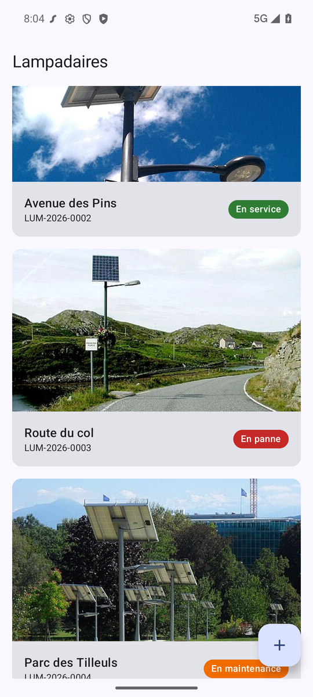
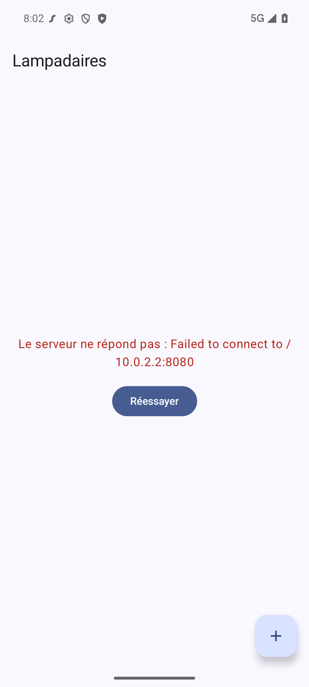
</div>

Arrêtez le serveur et relancez l'application : l'écran d'erreur s'affiche (à droite). Relancez le serveur, puis appuyez sur « Réessayer ».
:::

### Le détail d'un lampadaire

Au clic sur un lampadaire, l'application ouvre un second écran. Il ne reçoit que l'`id` du lampadaire, et demande le reste à l'API avec `GET /v1/lampadaires/{id}`.

C'est la même mécanique que pour la liste, avec un état, un ViewModel et un écran. Je vous donne les états et le ViewModel, l'écran est presque entièrement fourni.

`model/EcranDetail.kt` :

```kotlin
package cours.brosseau.lampadaires.model

/**
 * La machine à états de l'écran détail.
 */
sealed interface EcranDetail {
    data object Chargement : EcranDetail
    data class Detail(val lampadaire: LampadaireDTO) : EcranDetail
    data class Erreur(val message: String) : EcranDetail
}
```

`ui/detail/DetailViewModel.kt` :

```kotlin
package cours.brosseau.lampadaires.ui.detail

import androidx.lifecycle.ViewModel
import androidx.lifecycle.viewModelScope
import cours.brosseau.lampadaires.http.LampadairesApi
import cours.brosseau.lampadaires.model.EcranDetail
import kotlinx.coroutines.flow.MutableStateFlow
import kotlinx.coroutines.flow.StateFlow
import kotlinx.coroutines.flow.asStateFlow
import kotlinx.coroutines.launch

/**
 * Le ViewModel de l'écran détail : il appelle GET /v1/lampadaires/{id}.
 */
class DetailViewModel : ViewModel() {

    private val api = LampadairesApi.instance

    private val _ecran = MutableStateFlow<EcranDetail>(EcranDetail.Chargement)
    val ecran: StateFlow<EcranDetail> = _ecran.asStateFlow()

    fun charger(id: Int) {
        viewModelScope.launch {
            _ecran.value = EcranDetail.Chargement
            _ecran.value = try {
                EcranDetail.Detail(api.lampadaire(id))
            } catch (e: Exception) {
                EcranDetail.Erreur("Impossible de charger le lampadaire $id : ${e.message}")
            }
        }
    }
}
```

`ui/detail/DetailScreen.kt` :

```kotlin
package cours.brosseau.lampadaires.ui.detail

import androidx.compose.foundation.layout.Arrangement
import androidx.compose.foundation.layout.Box
import androidx.compose.foundation.layout.Column
import androidx.compose.foundation.layout.aspectRatio
import androidx.compose.foundation.layout.fillMaxWidth
import androidx.compose.foundation.layout.padding
import androidx.compose.foundation.rememberScrollState
import androidx.compose.foundation.verticalScroll
import androidx.compose.material.icons.Icons
import androidx.compose.material.icons.automirrored.filled.ArrowBack
import androidx.compose.material3.ExperimentalMaterial3Api
import androidx.compose.material3.Icon
import androidx.compose.material3.IconButton
import androidx.compose.material3.MaterialTheme
import androidx.compose.material3.Scaffold
import androidx.compose.material3.Text
import androidx.compose.material3.TopAppBar
import androidx.compose.runtime.Composable
import androidx.compose.runtime.LaunchedEffect
import androidx.compose.runtime.getValue
import androidx.compose.ui.Modifier
import androidx.compose.ui.layout.ContentScale
import androidx.compose.ui.unit.dp
import androidx.lifecycle.compose.collectAsStateWithLifecycle
import androidx.lifecycle.viewmodel.compose.viewModel
import coil3.compose.AsyncImage
import cours.brosseau.lampadaires.http.urlImage
import cours.brosseau.lampadaires.model.EcranDetail
import cours.brosseau.lampadaires.model.LampadaireDTO
import cours.brosseau.lampadaires.ui.components.BadgeStatut
import cours.brosseau.lampadaires.ui.components.Chargement
import cours.brosseau.lampadaires.ui.components.MessageErreur

/**
 * L'écran détail : il reçoit l'id du lampadaire et demande le reste à l'API.
 */
@OptIn(ExperimentalMaterial3Api::class)
@Composable
fun DetailScreen(id: Int, onRetour: () -> Unit, viewModel: DetailViewModel = viewModel()) {
    val ecran by viewModel.ecran.collectAsStateWithLifecycle()

    // L'appel réseau part dès que l'écran s'affiche (et si l'id change)
    LaunchedEffect(id) {
        viewModel.charger(id)
    }

    Scaffold(
        topBar = {
            TopAppBar(
                title = { Text("Détail") },
                navigationIcon = {
                    IconButton(onClick = onRetour) {
                        Icon(Icons.AutoMirrored.Filled.ArrowBack, contentDescription = "Retour")
                    }
                },
            )
        },
    ) { padding ->
        Box(Modifier.padding(padding)) {
            when (val etat = ecran) {
                EcranDetail.Chargement -> Chargement("Chargement du lampadaire…")
                is EcranDetail.Erreur -> MessageErreur(etat.message, onReessayer = { viewModel.charger(id) })
                is EcranDetail.Detail -> DetailLampadaire(etat.lampadaire)
            }
        }
    }
}

@Composable
private fun DetailLampadaire(lampadaire: LampadaireDTO) {
    // À vous : la photo (AsyncImage), le titre, le statut, le numéro de série, la date d'installation
    // et la description, dans une Column qui défile
}
```

À vous de compléter `DetailLampadaire` : la photo en grand en haut de l'écran, puis le titre, le statut (`BadgeStatut`), le numéro de série, la date (« Installé le … ») et la description. Inspirez-vous de `LampadaireCard`. Pour que l'écran puisse défiler si la description est longue, utilisez `Modifier.verticalScroll(rememberScrollState())` sur la `Column`.

::: details Voir l'une des solutions possibles

```kotlin
@Composable
private fun DetailLampadaire(lampadaire: LampadaireDTO) {
    Column(Modifier.verticalScroll(rememberScrollState())) {
        AsyncImage(
            model = urlImage(lampadaire.image),
            contentDescription = lampadaire.titre,
            contentScale = ContentScale.Crop,
            modifier = Modifier.fillMaxWidth().aspectRatio(4f / 3f),
        )
        Column(Modifier.padding(16.dp), verticalArrangement = Arrangement.spacedBy(8.dp)) {
            Text(lampadaire.titre, style = MaterialTheme.typography.headlineSmall)
            BadgeStatut(lampadaire.statut)
            Text("N° de série : ${lampadaire.numeroSerie}", style = MaterialTheme.typography.bodyMedium)
            Text("Installé le ${lampadaire.dateInstallation}", style = MaterialTheme.typography.bodySmall)
            Text(lampadaire.description, style = MaterialTheme.typography.bodyLarge)
        }
    }
}
```

:::

Il reste à déclarer l'écran dans le `NavHost` de `LampadairesApp.kt`. La route contient un **paramètre**, l'`id`, de type entier :

```kotlin
composable(
    route = "detail/{id}",
    arguments = listOf(navArgument("id") { type = NavType.IntType }),
) { entry ->
    DetailScreen(
        id = entry.arguments?.getInt("id") ?: 0,
        onRetour = { navController.navigateUp() },
    )
}
```

(Imports : `androidx.navigation.NavType`, `androidx.navigation.navArgument` et `cours.brosseau.lampadaires.ui.detail.DetailScreen`.)

Vous remarquez la ressemblance avec la route du serveur, `/{id}` ? Côté Android comme côté Ktor, `{id}` est un paramètre lu dans le chemin.

::: tip Point de contrôle
Un clic sur un lampadaire ouvre son détail, et la flèche en haut à gauche ramène à la liste. Si l'écran affiche une erreur, le message de l'exception vous donne la piste (mauvaise route, serveur arrêté…), et l'onglet **Logcat** d'Android Studio contient le détail.


:::

### L'ajout d'un lampadaire

Dernier écran : un formulaire qui envoie `POST /v1/lampadaires`. Pour la photo, l'utilisateur choisit parmi celles disponibles sur le serveur. Cette fois, je vous donne les états et l'écran ; le ViewModel est pour vous.

`model/EcranCreation.kt` :

```kotlin
package cours.brosseau.lampadaires.model

/**
 * La machine à états de l'écran de création.
 */
sealed interface EcranCreation {
    /** Le formulaire attend la saisie. */
    data object Saisie : EcranCreation

    /** La requête POST est partie, on attend la réponse. */
    data object Envoi : EcranCreation

    /** Le serveur a créé le lampadaire : l'écran peut se fermer. */
    data object Cree : EcranCreation

    /** Le serveur a refusé, ou ne répond pas. */
    data class Erreur(val message: String) : EcranCreation
}
```

`ui/creation/CreationScreen.kt` :

```kotlin
package cours.brosseau.lampadaires.ui.creation

import androidx.compose.foundation.border
import androidx.compose.foundation.clickable
import androidx.compose.foundation.layout.Arrangement
import androidx.compose.foundation.layout.Column
import androidx.compose.foundation.layout.fillMaxWidth
import androidx.compose.foundation.layout.padding
import androidx.compose.foundation.layout.size
import androidx.compose.foundation.lazy.LazyRow
import androidx.compose.foundation.lazy.items
import androidx.compose.foundation.rememberScrollState
import androidx.compose.foundation.shape.RoundedCornerShape
import androidx.compose.foundation.verticalScroll
import androidx.compose.material.icons.Icons
import androidx.compose.material.icons.automirrored.filled.ArrowBack
import androidx.compose.material3.Button
import androidx.compose.material3.ExperimentalMaterial3Api
import androidx.compose.material3.Icon
import androidx.compose.material3.IconButton
import androidx.compose.material3.MaterialTheme
import androidx.compose.material3.OutlinedTextField
import androidx.compose.material3.Scaffold
import androidx.compose.material3.Text
import androidx.compose.material3.TopAppBar
import androidx.compose.runtime.Composable
import androidx.compose.runtime.LaunchedEffect
import androidx.compose.runtime.getValue
import androidx.compose.runtime.mutableStateOf
import androidx.compose.runtime.saveable.rememberSaveable
import androidx.compose.runtime.setValue
import androidx.compose.ui.Modifier
import androidx.compose.ui.draw.clip
import androidx.compose.ui.graphics.Color
import androidx.compose.ui.layout.ContentScale
import androidx.compose.ui.unit.dp
import androidx.lifecycle.compose.collectAsStateWithLifecycle
import androidx.lifecycle.viewmodel.compose.viewModel
import coil3.compose.AsyncImage
import cours.brosseau.lampadaires.http.urlImage
import cours.brosseau.lampadaires.model.EcranCreation

/** Les photos disponibles sur le serveur (dossier src/main/resources/images). */
private val PHOTOS = (1..6).map { "/images/lampadaire-$it.jpg" }

/**
 * L'écran de création : un formulaire, puis un POST vers l'API.
 */
@OptIn(ExperimentalMaterial3Api::class)
@Composable
fun CreationScreen(onRetour: () -> Unit, viewModel: CreationViewModel = viewModel()) {
    val ecran by viewModel.ecran.collectAsStateWithLifecycle()

    // Les champs du formulaire (rememberSaveable : ils survivent à une rotation de l'écran)
    var numeroSerie by rememberSaveable { mutableStateOf("") }
    var titre by rememberSaveable { mutableStateOf("") }
    var description by rememberSaveable { mutableStateOf("") }
    var image by rememberSaveable { mutableStateOf(PHOTOS.first()) }

    // Une fois le lampadaire créé, on revient à la liste
    if (ecran == EcranCreation.Cree) {
        LaunchedEffect(Unit) { onRetour() }
    }

    Scaffold(
        topBar = {
            TopAppBar(
                title = { Text("Nouveau lampadaire") },
                navigationIcon = {
                    IconButton(onClick = onRetour) {
                        Icon(Icons.AutoMirrored.Filled.ArrowBack, contentDescription = "Retour")
                    }
                },
            )
        },
    ) { padding ->
        Column(
            modifier = Modifier.padding(padding).padding(16.dp).verticalScroll(rememberScrollState()),
            verticalArrangement = Arrangement.spacedBy(12.dp),
        ) {
            OutlinedTextField(numeroSerie, { numeroSerie = it }, label = { Text("Numéro de série") }, singleLine = true, modifier = Modifier.fillMaxWidth())
            OutlinedTextField(titre, { titre = it }, label = { Text("Titre") }, singleLine = true, modifier = Modifier.fillMaxWidth())
            OutlinedTextField(description, { description = it }, label = { Text("Description") }, minLines = 3, modifier = Modifier.fillMaxWidth())

            // Le choix de la photo, parmi celles disponibles sur le serveur
            Text("Photo", style = MaterialTheme.typography.titleSmall)
            LazyRow(horizontalArrangement = Arrangement.spacedBy(8.dp)) {
                items(PHOTOS) { photo ->
                    AsyncImage(
                        model = urlImage(photo),
                        contentDescription = photo,
                        contentScale = ContentScale.Crop,
                        modifier = Modifier
                            .size(96.dp)
                            .clip(RoundedCornerShape(8.dp))
                            .border(
                                width = 3.dp,
                                color = if (photo == image) MaterialTheme.colorScheme.primary else Color.Transparent,
                                shape = RoundedCornerShape(8.dp),
                            )
                            .clickable { image = photo },
                    )
                }
            }

            val erreur = ecran as? EcranCreation.Erreur
            if (erreur != null) {
                Text(erreur.message, color = MaterialTheme.colorScheme.error)
            }

            Button(
                onClick = { viewModel.creer(numeroSerie, titre, description, image) },
                enabled = ecran != EcranCreation.Envoi,
                modifier = Modifier.fillMaxWidth(),
            ) {
                Text(if (ecran == EcranCreation.Envoi) "Envoi en cours…" else "Créer le lampadaire")
            }
        }
    }
}
```

Lisez bien cet écran avant d'écrire le ViewModel :

- les champs sont gardés **dans l'écran** (`rememberSaveable`) : tant que l'utilisateur tape, le ViewModel n'a rien à savoir ;
- la photo choisie est simplement son chemin (`/images/lampadaire-6.jpg`), celui que le serveur enregistrera ; la photo sélectionnée est entourée d'une bordure ;
- le bouton appelle `viewModel.creer(numeroSerie, titre, description, image)` et se désactive pendant l'envoi ;
- quand l'état passe à `Cree`, l'écran se ferme tout seul et la liste se recharge (grâce au `LaunchedEffect` de l'écran liste).

C'est à vous de jouer ! Écrivez `ui/creation/CreationViewModel.kt`. Il expose un `StateFlow<EcranCreation>` nommé `ecran` (qui démarre à `Saisie`) et une fonction `creer(numeroSerie, titre, description, image)` qui :

- passe à l'état `Erreur` avec le message « Tous les champs sont obligatoires. » si le numéro de série, le titre ou la description est vide, **sans appeler** le serveur ;
- sinon passe à `Envoi`, appelle `api.creer(…)`, puis passe à `Cree`, ou à `Erreur` si l'appel échoue.

::: details Besoin d'aide pour le ViewModel ?
Il ressemble beaucoup à `ListeViewModel` : même `api`, même couple `_ecran` / `ecran`, même `viewModelScope.launch` avec un `try / catch`. Les deux différences :

- la vérification des champs se fait **avant** le `launch`, avec `isBlank()`, suivie d'un `return` ;
- dans le `try`, le résultat de `api.creer(CreateLampadaireDTO(numeroSerie, titre, description, image))` ne sert pas : l'état devient simplement `EcranCreation.Cree`.
:::

Essayez vraiment de l'écrire seul avant de regarder la solution : c'est la troisième fois que vous écrivez ce type de ViewModel.

::: details Voir l'une des solutions possibles

```kotlin
package cours.brosseau.lampadaires.ui.creation

import androidx.lifecycle.ViewModel
import androidx.lifecycle.viewModelScope
import cours.brosseau.lampadaires.http.LampadairesApi
import cours.brosseau.lampadaires.model.CreateLampadaireDTO
import cours.brosseau.lampadaires.model.EcranCreation
import kotlinx.coroutines.flow.MutableStateFlow
import kotlinx.coroutines.flow.StateFlow
import kotlinx.coroutines.flow.asStateFlow
import kotlinx.coroutines.launch

/**
 * Le ViewModel de l'écran de création : il envoie POST /v1/lampadaires.
 */
class CreationViewModel : ViewModel() {

    private val api = LampadairesApi.instance

    private val _ecran = MutableStateFlow<EcranCreation>(EcranCreation.Saisie)
    val ecran: StateFlow<EcranCreation> = _ecran.asStateFlow()

    fun creer(numeroSerie: String, titre: String, description: String, image: String) {
        // Une règle simple, vérifiée avant même d'appeler le serveur
        if (numeroSerie.isBlank() || titre.isBlank() || description.isBlank()) {
            _ecran.value = EcranCreation.Erreur("Tous les champs sont obligatoires.")
            return
        }

        viewModelScope.launch {
            _ecran.value = EcranCreation.Envoi
            _ecran.value = try {
                api.creer(CreateLampadaireDTO(numeroSerie, titre, description, image))
                EcranCreation.Cree
            } catch (e: Exception) {
                EcranCreation.Erreur("La création a échoué : ${e.message}")
            }
        }
    }
}
```

:::

Enfin, déclarez la route `creation` dans le `NavHost`. Je vous laisse l'écrire : elle ressemble à la route `liste`, sans paramètre, et son `onRetour` est le même que celui du détail.

::: tip Point de contrôle
Le bouton « + » ouvre le formulaire. Appuyez d'abord sur « Créer le lampadaire » sans rien saisir : le message « Tous les champs sont obligatoires. » s'affiche. Saisissez ensuite un lampadaire, choisissez une photo, puis validez : l'écran se ferme et le nouveau lampadaire apparaît en bas de la liste, en service. Il est aussi visible avec `curl http://localhost:8080/v1/lampadaires`.

<div style="display:flex;flex-wrap:wrap;gap:12px;align-items:flex-start">
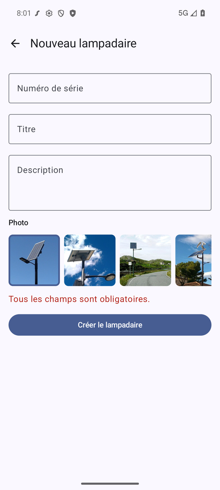

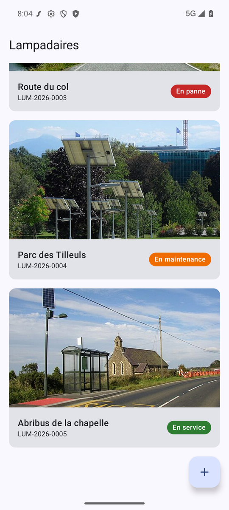
</div>
:::

Testez aussi une création avec le serveur arrêté : un message d'erreur s'affiche au-dessus du bouton, et l'écran reste ouvert.

::: details Votre application ne fonctionne pas ?
Vous pouvez repartir de l'application de référence, arrivée à ce stade : [Télécharger lampadaires-android](/demo/ktor/lampadaires-android-partie2.zip). Ouvrez le dossier dans Android Studio et vérifiez l'adresse `API_URL` dans `app/build.gradle.kts`.
:::

## Remise en contexte : les tests

Le régime change encore : à partir d'ici, vous n'avez plus que la consigne. Vous avez déjà tout vu, il s'agit de refaire le même chemin, seul, sur une nouvelle donnée.

Avant sa mise en service, puis régulièrement, chaque lampadaire passe des **tests** : allumage, autonomie de la batterie, capteur crépusculaire… Un test a un `id`, l'`id` du lampadaire testé, une `date`, un `resultat` (`OK`, `NOK`, ou `STOP` si le test a été interrompu) et un `commentaire`.

### Côté serveur

Respectez l'organisation en couches du projet :

- l'`enum` `ResultatTest` et le DTO `TestLampadaireDTO` dans `common/domain/TestLampadaireDTOs.kt` ;
- la table `tests_lampadaire` dans `database/tables/TestsLampadaire.kt`. La colonne qui fait le lien avec le lampadaire est une **clé étrangère** ;
- quelques tests de départ dans `LampadairesDatabase` (au moins deux pour la route du col, dont un `NOK`) ;
- un nouveau package `domain/test` avec son DAO, son service et sa route ;
- la route `GET /v1/lampadaires/{id}/tests`, qui renvoie la liste des tests du lampadaire.

Testez-la avec `curl` avant de passer à Android :

```text
$ curl http://localhost:8080/v1/lampadaires/3/tests
[
    {
        "id": 3,
        "lampadaireId": 3,
        "date": "2026-05-20",
        "resultat": "OK",
        "commentaire": "Mise en service conforme."
    },
    {
        "id": 4,
        "lampadaireId": 3,
        "date": "2026-10-02",
        "resultat": "NOK",
        "commentaire": "La LED ne s'allume plus à la tombée de la nuit : capteur crépusculaire à remplacer."
    }
]
```

::: details Besoin d'aide côté serveur ?
- La clé étrangère se déclare avec `reference` : `val lampadaireId = reference("lampadaire_id", Lampadaires.id)`, et le résultat avec `enumerationByName`, comme le statut.
- `SchemaUtils.create(Lampadaires, TestsLampadaire)` crée les deux tables (le lampadaire d'abord, puisque le test y fait référence).
- Le DAO n'a besoin que d'une fonction, `getByLampadaire(lampadaireId: Int)`, avec `.where { TestsLampadaire.lampadaireId eq lampadaireId }` et sans `.singleOrNull()` : nous voulons **toute** la liste (une liste vide est une réponse valide).
- La route peut recevoir le chemin complet : `testLampadaireRoutes("/lampadaires/{id}/tests", testLampadaireService)` dans le bloc `route("/v1")` de `installRouter()`, avec un simple `get(path) { … }` qui lit `call.parameters["id"]`.
- Pensez à supprimer `lampadaires.db` (serveur arrêté) pour que les données de départ soient recréées.
- Votre route `DELETE` doit maintenant supprimer les tests du lampadaire **avant** le lampadaire lui-même : la clé étrangère l'impose.
:::

### Côté Android

- Ajoutez le DTO `TestLampadaireDTO` (et son `enum`) et la fonction `tests(lampadaireId)` dans `LampadairesApi`.
- Sur l'écran détail, affichez les tests sous la description : la date, le commentaire et le résultat, en couleur (vert pour `OK`, rouge pour `NOK`, orange pour `STOP`).
- Les tests doivent être chargés en même temps que le lampadaire : l'écran ne passe à l'état `Detail` qu'une fois les deux réponses reçues.

Le résultat attendu :

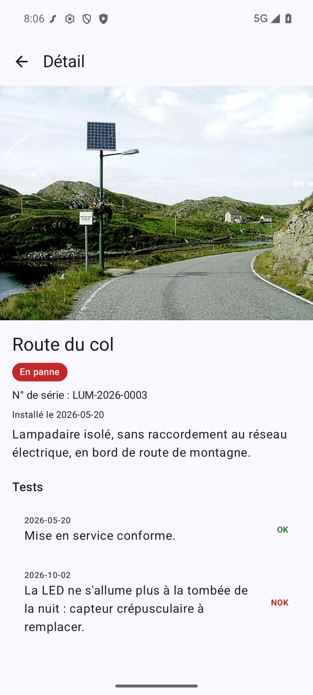

::: details Besoin d'aide côté Android ?
- L'état `EcranDetail.Detail` peut porter les deux informations : `data class Detail(val lampadaire: LampadaireDTO, val tests: List<TestLampadaireDTO>)`.
- Dans le ViewModel, les deux appels se suivent simplement dans le `try` : `EcranDetail.Detail(api.lampadaire(id), api.tests(id))`. Si l'un des deux échoue, on passe dans le `catch`.
- Pour l'affichage, un `ListItem` (Material 3) par test, avec la date en `overlineContent`, le commentaire en `headlineContent` et le résultat en `trailingContent`. Une boucle `tests.forEach { … }` suffit : la `Column` défile déjà.
:::

Vérifiez aussi un lampadaire sans test (l'avenue des Pins, par exemple) : l'écran doit l'indiquer clairement plutôt que d'afficher un titre « Tests » suivi de rien.

::: tip Vous êtes en avance ?
Ajoutez une route `POST /v1/lampadaires/{id}/tests` pour enregistrer un nouveau test, avec une **règle métier** dans le service : un test `NOK` fait passer le lampadaire `EN_PANNE`, un test `OK` le remet `EN_SERVICE`, un test `STOP` ne change rien. C'est typiquement le rôle d'un service : la route ne sait rien de cette règle, le DAO non plus. Ajoutez ensuite un petit formulaire sur l'écran détail pour saisir un test depuis le téléphone.
:::

## Un client web avec Vue.js

Notre API ne sert pas qu'à Android : n'importe quel programme capable de faire une requête HTTP peut l'utiliser. Nous allons le prouver avec une page web, écrite avec [Vue.js 3](/tp/vuejs3/tp1.md) et la fonction `fetch` de JavaScript.

### La page

Créez un dossier `front`, **en dehors** de vos deux projets, avec un fichier `index.html` :

```html
<!doctype html>
<html lang="fr">
  <head>
    <meta charset="UTF-8" />
    <meta name="viewport" content="width=device-width, initial-scale=1.0" />
    <title>Lampadaires</title>
    <script src="https://unpkg.com/vue@3.5.44/dist/vue.global.js"></script>
    <link rel="stylesheet" href="style.css" />
  </head>
  <body>
    <div id="app">
      <h1>Lampadaires</h1>

      <p v-if="erreur" class="erreur">{{ erreur }}</p>

      <!-- La liste des lampadaires -->
      <div class="grille">
        <div v-for="lampadaire in lampadaires" :key="lampadaire.id" class="carte">
          
          <h2>{{ lampadaire.titre }}</h2>
          <small>{{ lampadaire.numeroSerie }}</small>
          <span :class="['statut', lampadaire.statut]">{{ lampadaire.statut }}</span>
        </div>
      </div>
    </div>

    <script>
      const { createApp } = Vue;

      createApp({
        data() {
          return {
            API_URL: "http://localhost:8080",
            lampadaires: [],
            erreur: null,
          };
        },
        mounted() {
          this.charger();
        },
        methods: {
          // GET /v1/lampadaires
          charger() {
            fetch(`${this.API_URL}/v1/lampadaires`)
              .then((response) => response.json())
              .then((lampadaires) => {
                this.lampadaires = lampadaires;
              })
              .catch(() => {
                this.erreur = "Le serveur ne répond pas.";
              });
          },
        },
      }).mount("#app");
    </script>
  </body>
</html>
```

Vous retrouvez la même logique que dans l'application Android :

- `data()` contient l'état de la page (la liste, l'erreur éventuelle), comme le `StateFlow` du ViewModel ;
- `mounted()` lance le chargement à l'affichage de la page, comme le `LaunchedEffect` ;
- `fetch(…)` fait la requête, `response.json()` transforme la réponse en objets JavaScript, comme `.body()` avec Ktor ;
- `v-for` affiche une carte par lampadaire, comme le `items(…)` de la `LazyColumn` ;
- `API_URL + lampadaire.image` complète le chemin de la photo, comme la fonction `urlImage` côté Android.

La classe CSS du statut porte le nom de la valeur (`EN_PANNE`…) : c'est la feuille de style qui choisit la couleur. La mise en forme n'est pas le sujet du TP : créez à côté un fichier `style.css` avec le contenu ci-dessous.

::: details Le fichier style.css

```css
body {
  font-family: system-ui, sans-serif;
  max-width: 1000px;
  margin: 0 auto;
  padding: 16px;
  background: #f5f5f5;
}

.grille {
  display: grid;
  grid-template-columns: repeat(auto-fill, minmax(220px, 1fr));
  gap: 16px;
}

.carte {
  background: white;
  border-radius: 12px;
  overflow: hidden;
  cursor: pointer;
  padding-bottom: 12px;
}

.carte img {
  width: 100%;
  aspect-ratio: 16 / 9;
  object-fit: cover;
}

.carte h2,
.carte small,
.carte .statut {
  margin: 8px 12px 0;
}

.carte h2 {
  font-size: 1.1rem;
}

.carte small {
  display: block;
}

.statut {
  display: inline-block;
  padding: 2px 10px;
  border-radius: 999px;
  color: white;
  font-size: 0.8rem;
}

.EN_SERVICE {
  background: #2e7d32;
}

.EN_PANNE {
  background: #c62828;
}

.EN_MAINTENANCE {
  background: #ef6c00;
}

.detail {
  display: flex;
  gap: 16px;
  background: white;
  border-radius: 12px;
  padding: 16px;
  margin-top: 24px;
}

.detail img {
  width: 40%;
  border-radius: 8px;
  object-fit: cover;
}

form {
  display: flex;
  flex-direction: column;
  gap: 8px;
  margin-top: 24px;
  background: white;
  border-radius: 12px;
  padding: 16px;
}

input,
textarea,
select,
button {
  font: inherit;
  padding: 8px;
}

button {
  background: #00796b;
  color: white;
  border: none;
  border-radius: 8px;
  cursor: pointer;
}

.erreur {
  color: #c62828;
}
```

:::

La page doit être servie par un petit serveur web. Dans le dossier `front` :

```sh
python3 -m http.server 5500
```

(Sous Windows : `python -m http.server 5500`. Vous pouvez aussi utiliser l'extension **Live Server** de VS Code.) Ouvrez ensuite [http://localhost:5500](http://localhost:5500).

### Le piège : CORS

Surprise : la page affiche « Le serveur ne répond pas. »… alors que le serveur Ktor tourne, et que `curl` fonctionne parfaitement. Ouvrez la console du navigateur (`F12`, onglet **Console**) :

```text
Access to fetch at 'http://localhost:8080/v1/lampadaires' from origin 'http://localhost:5500'
has been blocked by CORS policy: No 'Access-Control-Allow-Origin' header is present on the requested resource.
```

Question :

- La requête est partie, le serveur a même répondu. Pourquoi le navigateur refuse-t-il de donner la réponse à la page ?

::: details Réponse
Par sécurité. Pour un navigateur, `http://localhost:5500` (la page) et `http://localhost:8080` (l'API) sont deux **origines** différentes : le port n'est pas le même. Sans autorisation, une page n'a pas le droit de lire les réponses d'un autre site.

Imaginez sinon : un site malveillant que vous visitez pourrait appeler l'API de votre banque, avec votre session, et lire vos comptes. Le navigateur bloque donc la réponse, **sauf si le serveur indique explicitement** qu'il accepte cette page, avec l'en-tête `Access-Control-Allow-Origin`. C'est le mécanisme **CORS** (*Cross-Origin Resource Sharing*, le partage de ressources entre origines).

`curl` et l'application Android ne sont pas concernés : CORS est une règle **des navigateurs**, pour protéger leurs utilisateurs.
:::

C'est donc au **serveur** d'autoriser notre page. Ktor propose pour cela le plugin CORS : une nouvelle brique, donc un nouveau fichier dans `plugins`. Arrêtez le serveur, puis ajoutez la dépendance dans `build.gradle.kts` (projet Ktor) :

```kotlin
implementation(ktorLibs.server.cors)
```

Créez `plugins/Cors.kt` :

```kotlin
package cours.brosseau.plugins

import io.ktor.http.HttpHeaders
import io.ktor.server.application.Application
import io.ktor.server.application.install
import io.ktor.server.plugins.cors.routing.CORS

fun Application.installCors() {
    install(CORS) {
        // Les pages web autorisées à appeler l'API (ici, notre page Vue.js servie sur le port 5500)
        allowHost("localhost:5500")
        allowHost("127.0.0.1:5500")
        // Le navigateur doit pouvoir envoyer du JSON (POST)
        allowHeader(HttpHeaders.ContentType)
    }
}
```

Et installez-le dans `module()`, avant les routes (import `cours.brosseau.plugins.installCors`) :

```kotlin
fun Application.module() {
    databaseConnect()
    installCors()
    installSerialization()
    installRouter()
}
```

::: tip Pourquoi deux `allowHost` ?
Pour le navigateur, `localhost` et `127.0.0.1` sont deux origines différentes, même si elles désignent la même machine. Live Server ouvre la page sur `127.0.0.1:5500`, le serveur Python sur l'adresse que vous tapez : nous autorisons les deux. Évitez en revanche `anyHost()`, qui autorise **n'importe quel** site à appeler votre API.
:::

Relancez le serveur Ktor, puis rechargez la page.

::: tip Point de contrôle
Les lampadaires s'affichent dans la page, y compris ceux ajoutés depuis l'application Android. Dans la console du navigateur, plus aucune erreur CORS.

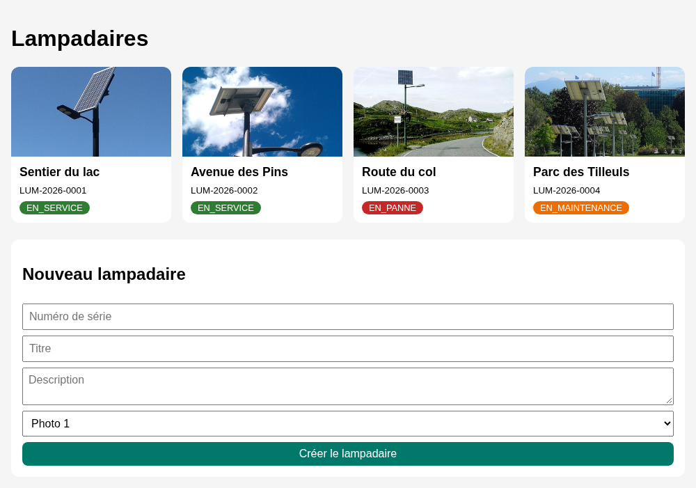
:::

### Le détail

Au clic sur une carte, nous allons afficher le détail du lampadaire sous la liste, en appelant `GET /v1/lampadaires/{id}`. Trois ajouts :

- dans `data()`, une nouvelle propriété `detail: null` ;
- sur la carte, l'événement `@click="afficherDetail(lampadaire.id)"` ;
- dans `methods`, la fonction qui fait l'appel :

```js
// GET /v1/lampadaires/{id}
afficherDetail(id) {
  fetch(`${this.API_URL}/v1/lampadaires/${id}`)
    .then((response) => response.json())
    .then((lampadaire) => {
      this.detail = lampadaire;
    });
},
```

Et dans le template, après la grille :

```html
<!-- Le détail du lampadaire sélectionné -->
<div v-if="detail" class="detail">
  
  <div>
    <h2>{{ detail.titre }}</h2>
    <span :class="['statut', detail.statut]">{{ detail.statut }}</span>
    <p>N° de série : {{ detail.numeroSerie }}<br />Installé le {{ detail.dateInstallation }}</p>
    <p>{{ detail.description }}</p>
    <button @click="detail = null">Fermer</button>
  </div>
</div>
```

`v-if="detail"` n'affiche le bloc que lorsqu'un lampadaire est sélectionné. Le bouton « Fermer » remet `detail` à `null`, et le bloc disparaît.

::: tip Point de contrôle
Un clic sur une carte affiche son détail sous la liste. Dans l'onglet **Réseau** (`F12`) du navigateur, vous voyez passer la requête `GET /v1/lampadaires/3`.


:::

### L'ajout

Pour terminer, c'est à vous : ajoutez sous la liste un formulaire (numéro de série, titre, description, et une liste déroulante pour choisir l'une des six photos) qui envoie `POST /v1/lampadaires`, puis recharge la liste.

::: details Besoin d'aide pour l'ajout ?
- Dans `data()`, un objet pour le formulaire : `nouveau: { numeroSerie: "", titre: "", description: "", image: "/images/lampadaire-1.jpg" }`, et des champs liés avec `v-model="nouveau.titre"`, etc.
- Pour la liste déroulante, un `<select v-model="nouveau.image">` et une `<option>` par photo : `v-for="n in 6"` compte de 1 à 6.
- Sur la balise `<form>`, `@submit.prevent="creer"` appelle votre méthode sans recharger la page.
- `fetch` accepte un second paramètre pour décrire la requête : `method: "POST"`, `headers: { "Content-Type": "application/json" }` et `body: JSON.stringify(this.nouveau)`. Vous reconnaissez les options de `curl` ?
- Une fois la réponse reçue, videz le formulaire et rappelez `this.charger()`.
:::

Comme pour le ViewModel de création, cherchez d'abord par vous-même.

::: details Voir l'une des solutions possibles

Le formulaire, après le bloc du détail :

```html
<!-- Le formulaire de création -->
<form @submit.prevent="creer">
  <h2>Nouveau lampadaire</h2>
  <input v-model="nouveau.numeroSerie" placeholder="Numéro de série" required />
  <input v-model="nouveau.titre" placeholder="Titre" required />
  <textarea v-model="nouveau.description" placeholder="Description" required></textarea>
  <select v-model="nouveau.image">
    <option v-for="n in 6" :key="n" :value="`/images/lampadaire-${n}.jpg`">Photo {{ n }}</option>
  </select>
  <button type="submit">Créer le lampadaire</button>
</form>
```

Dans `data()`, ajoutez `nouveau: { numeroSerie: "", titre: "", description: "", image: "/images/lampadaire-1.jpg" }`, puis la méthode :

```js
// POST /v1/lampadaires
creer() {
  fetch(`${this.API_URL}/v1/lampadaires`, {
    method: "POST",
    headers: { "Content-Type": "application/json" },
    body: JSON.stringify(this.nouveau),
  })
    .then((response) => response.json())
    .then(() => {
      this.nouveau = { numeroSerie: "", titre: "", description: "", image: "/images/lampadaire-1.jpg" };
      this.charger();
    });
},
```

:::

::: tip Point de contrôle
Ajoutez « Rond-point des Vignes » (photo 4) depuis la page : le lampadaire apparaît dans la grille, en service. Relancez l'application Android : il y est aussi. Un serveur, deux clients, les mêmes données.

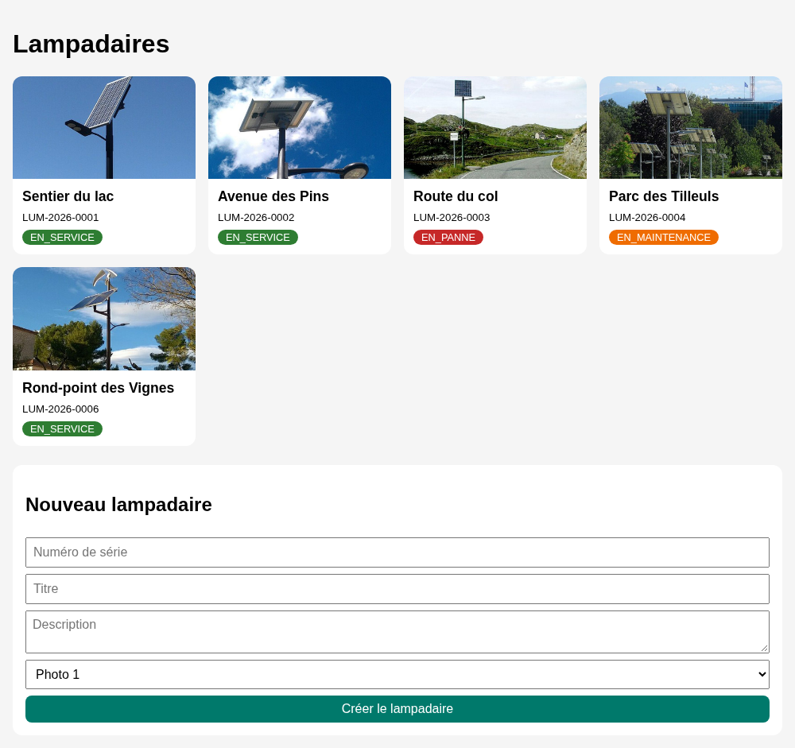
:::

Votre page affiche, détaille et ajoute des lampadaires : la boucle est bouclée.

::: tip Vous êtes en avance ?
Ajoutez un bouton « Supprimer » dans le bloc du détail, qui appelle votre route `DELETE /v1/lampadaires/{id}`. Attention : par défaut, le plugin CORS n'autorise que `GET`, `POST` et `HEAD`. Il faudra ajouter `allowMethod(HttpMethod.Delete)` dans `Cors.kt`.
:::

## Conclusion

Dans ce TP, vous avez construit une application complète, du serveur jusqu'à l'écran :

- une **API REST** avec Ktor, organisée en **couches** (route, service, DAO) et en packages (`plugins`, `database`, `common/domain`, `domain`) : des routes `GET`, `POST` (et `DELETE`) qui répondent en JSON avec les bons codes HTTP, et des photos servies par `staticResources` ;
- une base **SQLite** manipulée avec **Exposed**, sans écrire de SQL ;
- des tests avec **curl**, pour valider le serveur avant d'écrire le moindre client ;
- une **application Android** avec Ktor client : liste, détail et ajout, chaque écran étant une machine à états avec son ViewModel, et des photos chargées par **Coil** ;
- une **page web** avec `fetch` et **Vue.js 3**, qui utilise la même API, et le mécanisme **CORS** qui protège les navigateurs.

Le point le plus important : le serveur ne sait pas qui l'appelle. Android, Vue.js, curl… tous parlent le même langage (HTTP et JSON), et c'est ce qui permet d'ajouter un nouveau client sans toucher au serveur.

N'oubliez pas de **commiter vos projets** (le serveur, l'application et la page web).

Pour aller plus loin côté serveur (base PostgreSQL, migrations avec Flyway, injection de dépendances avec Koin et gestion des droits), suivez les TP [Créer des API avec Kotlin : le projet](/tp/ktor/decouverte.md) puis [CRUD et droits](/tp/ktor/crud-droits.md).

👋 Si vous avez des questions, n'hésitez pas.
