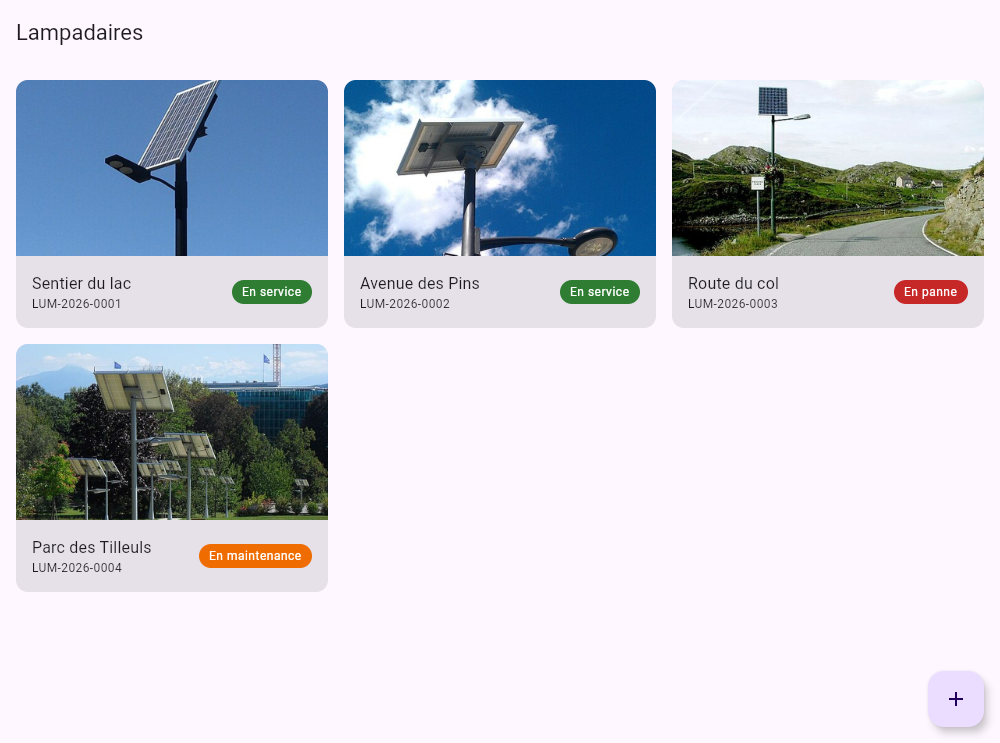
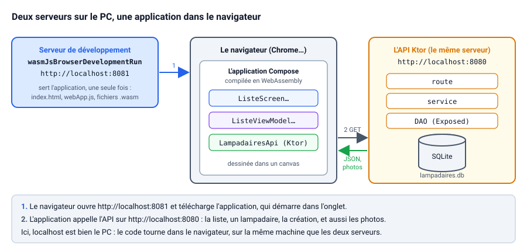
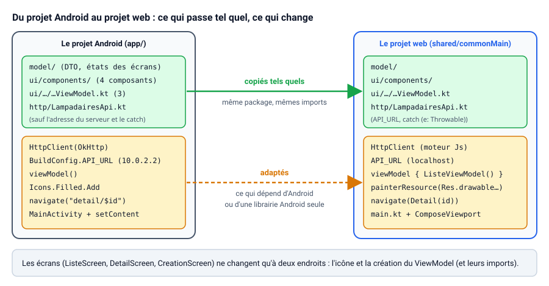
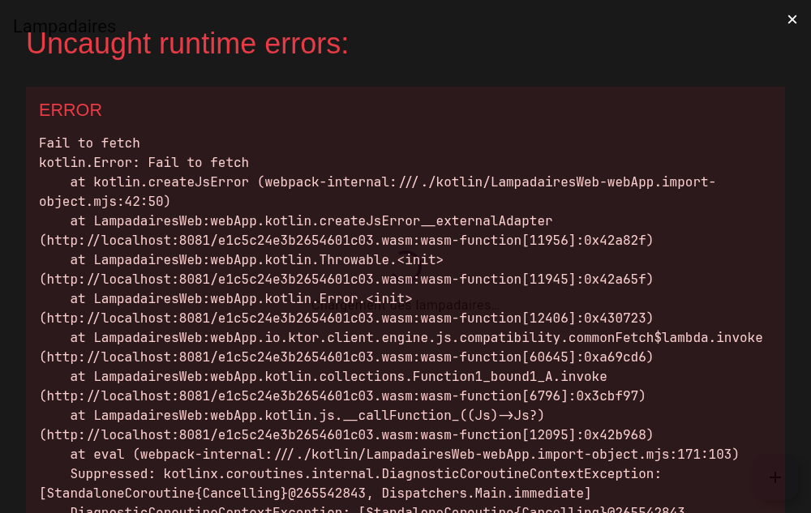
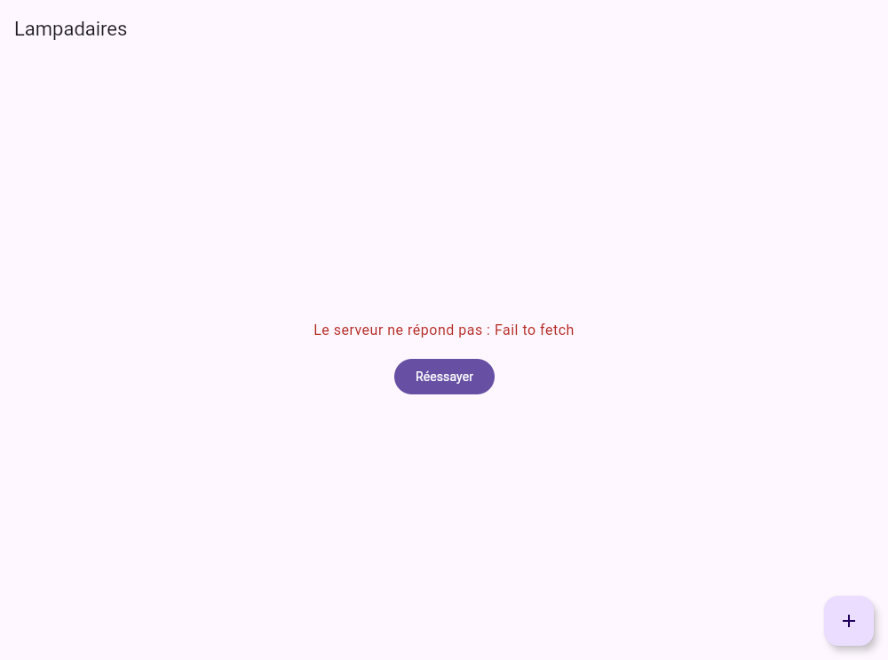
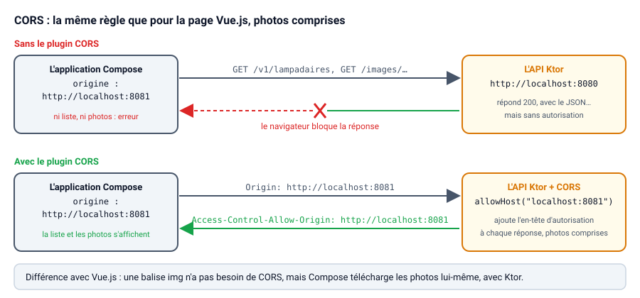
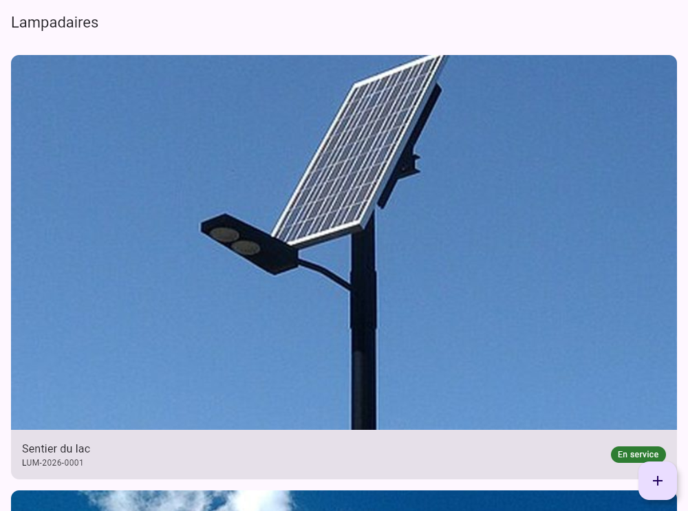
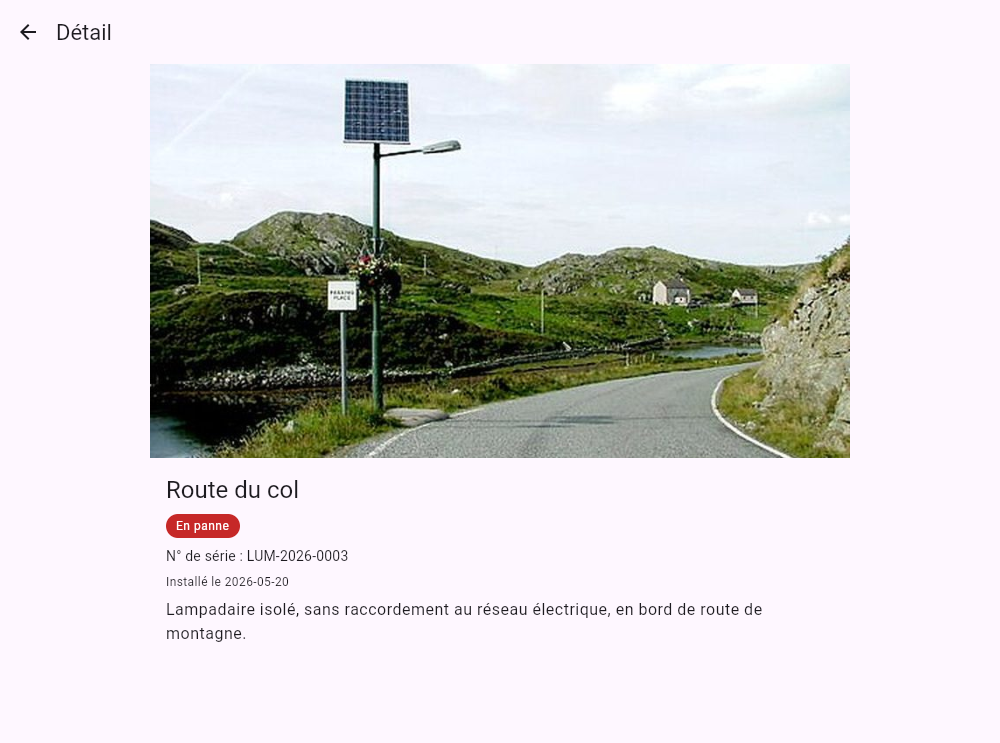
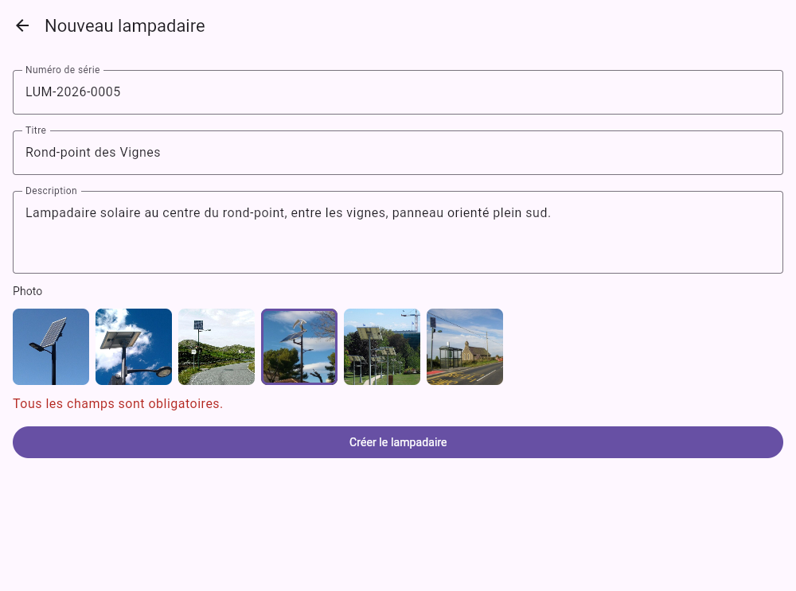
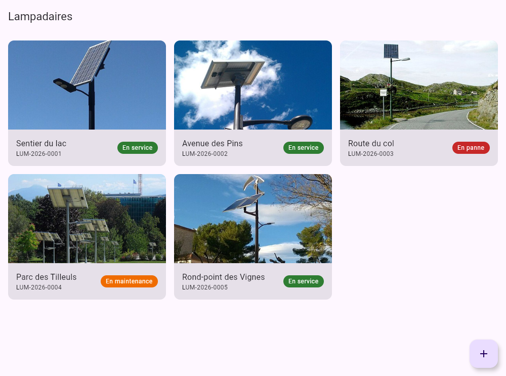

# Un client web en Kotlin avec Compose (Compose Multiplatform pour le web)

::: details Sommaire
[[toc]]
:::

Dans le TP [Une API Ktor et ses clients](./ktor-api.md), votre API des lampadaires a eu deux clients : une application **Android** écrite en Kotlin avec Compose, et une **page web** écrite en JavaScript avec Vue.js. Deux clients, donc deux langages, et tout le code de l'interface écrit deux fois : les DTO, les appels à l'API, l'affichage de la liste, du détail, le formulaire…

Et si le client web était lui aussi écrit en Kotlin, **avec les mêmes écrans Compose** que sur Android ? C'est ce que permet **Compose Multiplatform pour le web** : votre code Kotlin est compilé en **WebAssembly** (Wasm), un format que les navigateurs récents savent exécuter, et Compose dessine l'interface directement dans la page.

Aujourd'hui, pas de nouveau serveur : nous reprenons **la même API Ktor**, et nous allons faire tourner dans le navigateur les écrans de votre application Android, en changeant le moins de lignes possible. Voici ce que nous allons construire :



::: warning Une technologie encore en bêta
Au moment où ce TP est écrit, Compose Multiplatform est **stable** pour Android, iOS et l'ordinateur, mais la version **web** (basée sur Kotlin/Wasm) est encore en **bêta** ([les plateformes prises en charge](https://kotlinlang.org/docs/multiplatform/supported-platforms.html)). Elle fonctionne très bien pour notre usage, mais des noms ou des réglages peuvent encore changer d'une version à l'autre. Les versions utilisées ici : Compose Multiplatform 1.12.2 et Kotlin 2.4.21.
:::

## Prérequis

- Avoir terminé le TP [Une API Ktor et ses clients](./ktor-api.md), au moins jusqu'à l'ajout d'un lampadaire sur Android : le **serveur** (routes `GET` et `POST`) et l'**application Android** (liste, détail, création). La partie Vue.js est un plus : nous ferons souvent la comparaison.
- [IntelliJ IDEA](https://www.jetbrains.com/idea/download/) (pour le serveur et pour le client web) et un terminal.
- Un navigateur récent : Kotlin/Wasm a besoin de Chrome ou Edge 119 et plus, Firefox 120 et plus, ou Safari 18.2 et plus ([la liste officielle](https://kotlinlang.org/docs/wasm-configuration.html#browser-versions)).

::: details Votre serveur ou votre application Android ne sont pas terminés ?
Pas de panique, repartez des projets de référence du TP précédent :

- le serveur : [api-lampadaires-partie1.zip](/demo/ktor/api-lampadaires-partie1.zip) (`./gradlew run`) ;
- l'application Android : [lampadaires-android-partie2.zip](/demo/ktor/lampadaires-android-partie2.zip), dont nous allons récupérer le code.
:::

## Objectifs

À la fin de ce TP vous saurez :

- créer un projet Compose Multiplatform pour le web avec le générateur de JetBrains ;
- lancer une application Kotlin/Wasm dans le navigateur avec Gradle ;
- réutiliser des écrans, des composants et des ViewModels Compose écrits pour Android ;
- repérer ce qui dépend d'Android, et le remplacer par son équivalent multiplateforme (moteur HTTP, icônes, ViewModel, navigation) ;
- autoriser une nouvelle origine avec CORS, et comprendre pourquoi les photos sont concernées cette fois ;
- comparer trois clients d'une même API : Android, Compose pour le web et Vue.js.

## Le projet

Côté serveur, rien ne change : c'est la même API Ktor, sur le port `8080`, avec sa base SQLite. Côté client, une nouveauté : l'application est servie au navigateur par un **second serveur**, le serveur de développement de Gradle, sur le port `8081`. Une fois téléchargée, elle s'exécute dans l'onglet et appelle l'API, exactement comme la page Vue.js.



Question :

- Sur Android, l'adresse de l'API était `http://10.0.2.2:8080`. Ici, nous allons écrire `http://localhost:8080`. Pourquoi ce changement ?

::: details Réponse
`localhost` désigne toujours **la machine sur laquelle le code s'exécute**. L'application Android tournait sur l'émulateur, qui est une autre machine (d'où l'adresse spéciale `10.0.2.2`). L'application web, elle, tourne dans le navigateur de votre PC : `localhost`, c'est bien le PC, là où tourne le serveur Ktor.

C'est d'ailleurs exactement l'adresse que vous aviez utilisée dans la page Vue.js.
:::

## Créer le projet

### Le générateur

Comme pour Ktor, JetBrains propose un générateur en ligne : [kmp.jetbrains.com](https://kmp.jetbrains.com/).

1. **Project Name** : `LampadairesWeb` ;
2. **Project ID** : `cours.brosseau.lampadaires` (le même package que l'application Android : vous allez comprendre pourquoi) ;
3. décochez **Android**, **iOS**, **Desktop** et **Server** : gardez uniquement **Web**, avec l'interface partagée en Compose (**Share UI**) ;
4. cliquez sur **Download**, décompressez `LampadairesWeb.zip` **en dehors** de vos deux projets précédents, puis ouvrez le dossier dans IntelliJ IDEA.

::: details Sans navigateur : le générateur en ligne de commande
Le formulaire du générateur n'est qu'une URL : vous pouvez récupérer le même projet avec `curl`.

```sh
curl -fsSL -G -o LampadairesWeb.zip \
  --data-urlencode 'spec={"template_id":"kmt","targets":{"web":{"ui":["compose"]}}}' \
  --data-urlencode 'name=LampadairesWeb' \
  --data-urlencode 'id=cours.brosseau.lampadaires' \
  --data-urlencode 'buildSystem=gradle' \
  https://kmp.jetbrains.com/generateKmtProject
unzip LampadairesWeb.zip
```

Ce n'est pas une API documentée par JetBrains : si elle change, revenez au navigateur.
:::

### La structure du projet

```text
LampadairesWeb
├── settings.gradle.kts, build.gradle.kts, gradlew   le projet Gradle
├── gradle/libs.versions.toml                       le catalogue des versions
├── shared/                         le code partagé
│   ├── build.gradle.kts            les cibles (js, wasmJs) et les dépendances
│   └── src/
│       ├── commonMain/
│       │   ├── kotlin/…/App.kt     l'écran d'exemple, en Compose
│       │   ├── kotlin/…/Greeting.kt, GreetingUtil.kt, Platform.kt
│       │   └── composeResources/   les images, les textes…
│       └── jsMain/, wasmJsMain/    le code propre à chaque cible (Platform.….kt)
└── webApp/                         l'application web
    ├── build.gradle.kts
    └── src/webMain/
        ├── kotlin/…/main.kt        le point d'entrée : affiche App() dans la page
        └── resources/              index.html et styles.css
```

Vous retrouvez l'organisation du [TP iOS en Kotlin Multiplateforme](/tp/ios/kmp.md) : un module `shared` qui contient l'interface, et un petit module par plateforme qui l'affiche. Ici, une seule plateforme : `webApp`. Ouvrez `webApp/src/webMain/kotlin/cours/brosseau/lampadaires/main.kt` :

```kotlin
package cours.brosseau.lampadaires

import androidx.compose.ui.ExperimentalComposeUiApi
import androidx.compose.ui.window.ComposeViewport

@OptIn(ExperimentalComposeUiApi::class)
fun main() {
    ComposeViewport {
        App()
    }
}
```

Question :

- À quoi correspond cette fonction dans votre application Android ?

::: details Réponse
À `MainActivity` et son `setContent { … }`. Sur Android, `setContent` place l'interface Compose dans l'activité. Sur le web, `ComposeViewport` la place dans la page HTML. Dans les deux cas, ce qui est affiché, c'est une fonction `@Composable`.
:::

::: tip Deux cibles web : wasmJs et js
Le générateur prépare deux versions de l'application : `wasmJs` (Kotlin compilé en WebAssembly) et `js` (Kotlin compilé en JavaScript). D'après le `README.md` du projet, la version Wasm est **plus rapide** et vise les navigateurs récents, la version JS est **plus lente** mais fonctionne sur des navigateurs plus anciens. Nous utiliserons `wasmJs`, et nous garderons la cible `js` telle que le générateur l'a préparée.
:::

### Fixer le port du serveur de développement

Par défaut, le serveur de développement prend le port `8080`… celui de notre API. S'il est déjà occupé, il en choisit un autre (`8081` quand Ktor tourne déjà), et dans l'autre ordre, c'est votre serveur Ktor qui ne pourra plus démarrer. Le navigateur, lui, a besoin d'une adresse fixe : nous allons en avoir besoin pour CORS.

Remplacez le contenu de `webApp/build.gradle.kts` :

```kotlin
import org.jetbrains.kotlin.gradle.ExperimentalWasmDsl
import org.jetbrains.kotlin.gradle.targets.js.webpack.KotlinWebpackConfig

plugins {
    alias(libs.plugins.kotlinMultiplatform)
    alias(libs.plugins.composeMultiplatform)
    alias(libs.plugins.composeCompiler)
}

kotlin {
    js {
        browser {
            // Le serveur de développement toujours sur le port 8081 (le 8080 est celui de l'API Ktor)
            commonWebpackConfig {
                devServer = (devServer ?: KotlinWebpackConfig.DevServer()).copy(port = 8081)
            }
        }
        binaries.executable()
    }

    @OptIn(ExperimentalWasmDsl::class)
    wasmJs {
        browser {
            // Le serveur de développement toujours sur le port 8081 (le 8080 est celui de l'API Ktor)
            commonWebpackConfig {
                devServer = (devServer ?: KotlinWebpackConfig.DevServer()).copy(port = 8081)
            }
        }
        binaries.executable()
    }

    sourceSets {
        commonMain.dependencies {
            implementation(project(":shared"))

            implementation(libs.compose.ui)
        }
    }
}
```

Seuls les deux blocs `browser { … }` ont changé : le générateur écrivait simplement `browser()`.

### Lancer l'application d'exemple

Dans un terminal, à la racine du projet :

```sh
./gradlew :webApp:wasmJsBrowserDevelopmentRun
```

Sous Windows, dans PowerShell : `.\gradlew.bat :webApp:wasmJsBrowserDevelopmentRun`. Dans IntelliJ IDEA, la configuration de lancement **webApp [wasmJs]** fait la même chose.

La première fois, soyez patient : Gradle télécharge le compilateur, les librairies de Compose, mais aussi **Node.js** et **Yarn**, qui servent à construire et à servir la partie web. Comptez plusieurs minutes. La commande ne rend pas la main : c'est le serveur de développement qui tourne.

::: tip Point de contrôle
Les dernières lignes affichent `Loopback: http://localhost:8081/`, et le navigateur s'ouvre tout seul sur cette adresse (sinon, ouvrez-la vous-même). L'application d'exemple affiche un bouton **Click me!**, qui fait apparaître le logo de Compose Multiplatform.
:::

Arrêtez le serveur de développement (`Ctrl + C`). Dans la suite du TP, pour voir une modification de votre code, le plus simple est de l'arrêter et de relancer la commande.

## Les librairies

Ce sont les mêmes que sur Android, à une différence près : tout ce qui était lié à Android (OkHttp, la navigation d'AndroidX) est remplacé par sa version multiplateforme.

| Besoin | Android | Compose pour le web |
| --- | --- | --- |
| Client HTTP | Ktor, moteur **OkHttp** (`ktor-client-okhttp`) | Ktor, moteur du navigateur (`ktor-client-js`) |
| JSON | `ktor-client-content-negotiation`, `kotlinx-serialization-json` | les mêmes |
| Photos | Coil, téléchargées par OkHttp (`coil-network-okhttp`) | Coil, téléchargées par Ktor (`coil-network-ktor3`) |
| ViewModel, `collectAsStateWithLifecycle` | `androidx.lifecycle` | `org.jetbrains.androidx.lifecycle` (déjà ajoutées par le générateur) |
| Navigation | `androidx.navigation` | `org.jetbrains.androidx.navigation` |

Dans `gradle/libs.versions.toml`, ajoutez :

```toml
[versions]
# … les versions déjà présentes
navigation = "2.10.0"
ktor = "3.6.1"
serialization = "1.12.0"
coil = "3.6.3"

[libraries]
# … les librairies déjà présentes
navigation-compose = { module = "org.jetbrains.androidx.navigation:navigation-compose", version.ref = "navigation" }
ktor-client-core = { module = "io.ktor:ktor-client-core", version.ref = "ktor" }
ktor-client-js = { module = "io.ktor:ktor-client-js", version.ref = "ktor" }
ktor-client-content-negotiation = { module = "io.ktor:ktor-client-content-negotiation", version.ref = "ktor" }
ktor-serialization-kotlinx-json = { module = "io.ktor:ktor-serialization-kotlinx-json", version.ref = "ktor" }
kotlinx-serialization-json = { module = "org.jetbrains.kotlinx:kotlinx-serialization-json", version.ref = "serialization" }
coil-compose = { module = "io.coil-kt.coil3:coil-compose", version.ref = "coil" }
coil-network-ktor3 = { module = "io.coil-kt.coil3:coil-network-ktor3", version.ref = "coil" }

[plugins]
# … les plugins déjà présents
kotlinSerialization = { id = "org.jetbrains.kotlin.plugin.serialization", version.ref = "kotlin" }
```

Ce sont les mêmes versions de Ktor, de kotlinx.serialization et de Coil que dans l'application Android. Pas besoin de toucher à la version de Kotlin cette fois : le générateur a déjà mis une version récente.

Dans le `build.gradle.kts` à la racine, déclarez le plugin de sérialisation :

```kotlin
plugins {
    // … les plugins déjà présents
    alias(libs.plugins.kotlinSerialization) apply false
}
```

Puis dans `shared/build.gradle.kts`, appliquez-le et ajoutez les dépendances à la fin du bloc `commonMain.dependencies` :

```kotlin
plugins {
    // … les plugins déjà présents
    alias(libs.plugins.kotlinSerialization)
}

kotlin {
    // … les cibles js et wasmJs, inchangées
    sourceSets {
        commonMain.dependencies {
            // … les dépendances déjà présentes

            // La navigation entre les écrans
            implementation(libs.navigation.compose)

            // Ktor : le client HTTP (moteur du navigateur) et la conversion JSON
            implementation(libs.ktor.client.core)
            implementation(libs.ktor.client.js)
            implementation(libs.ktor.client.content.negotiation)
            implementation(libs.ktor.serialization.kotlinx.json)
            implementation(libs.kotlinx.serialization.json)

            // Coil : afficher une image à partir de son URL (téléchargée avec Ktor)
            implementation(libs.coil.compose)
            implementation(libs.coil.network.ktor3)
        }
        // … le reste, inchangé
    }
}
```

N'oubliez pas de recharger le projet Gradle (l'icône de l'éléphant).

Question :

- Nous ajoutons `ktor-client-js` dans `commonMain`, le code « commun ». Ce ne serait pas possible si le projet avait aussi une cible Android. Pourquoi ?

::: details Réponse
`commonMain` est compilé pour **toutes** les cibles du projet. Ici, il n'y en a que deux, `js` et `wasmJs`, et `ktor-client-js` existe pour les deux. Avec une cible Android, il faudrait mettre le moteur dans le code propre à chaque plateforme : `ktor-client-okhttp` dans `androidMain`, `ktor-client-js` dans le code web. C'est ce que fait un vrai projet multiplateforme.
:::

## Récupérer le code Android

### Faire un peu de ménage

Dans `shared/src/commonMain/kotlin/cours/brosseau/lampadaires`, supprimez `Greeting.kt`, `GreetingUtil.kt` et `Platform.kt`. Supprimez aussi les dossiers `shared/src/jsMain` et `shared/src/wasmJsMain` (ils ne contenaient que les deux `Platform.….kt`), et l'image d'exemple `composeResources/drawable/compose-multiplatform.xml`. Gardez `App.kt` : nous allons le remplacer.

### Ce qui passe tel quel

Ouvrez votre projet Android à côté. Ses fichiers sont dans `app/src/main/java/cours/brosseau/lampadaires`, et nous allons les ranger dans `shared/src/commonMain/kotlin/cours/brosseau/lampadaires`. C'est le même package : voilà pourquoi nous l'avons choisi dans le générateur. Copiez, **sans les modifier** :

- le dossier `model/` (les DTO et les trois machines à états) ;
- le dossier `ui/components/` (`Chargement`, `MessageErreur`, `BadgeStatut`, `LampadaireCard`) ;
- `ui/liste/ListeViewModel.kt` ;
- `http/HttpClientFactory.kt` et `http/LampadairesApi.kt` (ces deux-là vont changer un peu, juste après).

Les composants `LampadaireCard` (avec `AsyncImage` de Coil) et `BadgeStatut` n'ont pas besoin d'une seule modification. Le ViewModel non plus : `ViewModel`, `viewModelScope` et `StateFlow` existent à l'identique dans Compose Multiplatform, sous les mêmes noms de package.



Question :

- Comment se fait-il que du code écrit pour Android compile pour le navigateur, sans changer un seul `import` ?

::: details Réponse
Parce qu'il ne dépend pas d'Android ! `androidx.compose.foundation`, `androidx.compose.material3`, `androidx.lifecycle.ViewModel` : JetBrains publie ces librairies pour toutes les plateformes, avec **les mêmes noms de package** que celles de Google. Le code qui n'utilise que Compose, les coroutines, Ktor et kotlinx.serialization se recompile tel quel.

À l'inverse, tout ce qui vient vraiment d'Android (`Activity`, `BuildConfig`, `R.drawable`, OkHttp…) n'existe pas dans le navigateur : c'est ce que nous allons remplacer.
:::

### Le client HTTP

Sur Android, le client utilisait le moteur OkHttp, qui n'existe que sur Android et la JVM. Ouvrez `http/HttpClientFactory.kt` et retirez simplement le moteur :

```kotlin
package cours.brosseau.lampadaires.http

import io.ktor.client.HttpClient
import io.ktor.client.plugins.HttpTimeout
import io.ktor.client.plugins.contentnegotiation.ContentNegotiation
import io.ktor.serialization.kotlinx.json.json
import kotlinx.serialization.json.Json

/**
 * Le client HTTP de l'application. Pas de moteur précisé : Ktor prend celui du navigateur (ktor-client-js).
 */
fun createHttpClient(): HttpClient = HttpClient {
    // Une réponse 4xx ou 5xx (404, 400…) lève une exception, au lieu d'être lue comme un JSON valide
    expectSuccess = true

    // Les réponses JSON deviennent directement des objets Kotlin (et inversement)
    install(ContentNegotiation) {
        json(Json { ignoreUnknownKeys = true })
    }

    // Un serveur injoignable ne doit pas bloquer l'écran trop longtemps
    install(HttpTimeout) {
        requestTimeoutMillis = 5_000
    }
}
```

Deux lignes ont changé : l'`import` d'OkHttp a disparu, et `HttpClient(OkHttp) { … }` est devenu `HttpClient { … }`. Sans moteur précisé, Ktor utilise celui qu'il trouve dans les dépendances : ici, `ktor-client-js`, qui passe par la fonction `fetch` du navigateur. Oui, la même que dans votre page Vue.js !

### L'adresse du serveur

Le `BuildConfig` est une invention d'Android : il n'existe pas ici. Créez `http/Config.kt` :

```kotlin
package cours.brosseau.lampadaires.http

/**
 * L'adresse de l'API Ktor. L'application tourne dans le navigateur, sur le PC : localhost est bien le PC.
 */
const val API_URL = "http://localhost:8080"
```

Puis, dans `http/LampadairesApi.kt`, supprimez la ligne `import cours.brosseau.lampadaires.BuildConfig` et remplacez les deux `BuildConfig.API_URL` par `API_URL` :

```kotlin
    companion object {
        /** Une seule instance pour toute l'application, partagée par les ViewModels. */
        val instance = LampadairesApi(createHttpClient(), API_URL)
    }
}

/**
 * L'adresse complète d'une photo : le serveur renvoie un chemin (/images/lampadaire-1.jpg), il faut y ajouter son adresse.
 */
fun urlImage(chemin: String): String = API_URL + chemin
```

Le reste de la classe, les trois fonctions `suspend` qui appellent l'API, ne change pas.

## L'écran liste

### Les icônes

Sur Android, le bouton « + » utilisait `Icons.Filled.Add`, de la librairie d'icônes Material. Cette librairie n'est plus maintenue pour Compose Multiplatform : elle est bloquée à une ancienne version (1.7.3) et JetBrains conseille de passer aux icônes **Material Symbols**. Nous allons donc ajouter nos deux icônes nous-mêmes, comme des images du projet.

Dans `shared/src/commonMain/composeResources/drawable/`, créez `ic_add.xml` :

```xml
<vector xmlns:android="http://schemas.android.com/apk/res/android"
    android:width="24dp"
    android:height="24dp"
    android:viewportWidth="960"
    android:viewportHeight="960">
    <path
        android:fillColor="#FF000000"
        android:pathData="M440,520H200v-80h240v-240h80v240h240v80H520v240h-80v-240Z" />
</vector>
```

Et `ic_arrow_back.xml`, la flèche de retour dont nous aurons besoin pour le détail :

```xml
<vector xmlns:android="http://schemas.android.com/apk/res/android"
    android:width="24dp"
    android:height="24dp"
    android:viewportWidth="960"
    android:viewportHeight="960">
    <path
        android:fillColor="#FF000000"
        android:pathData="M313,520l224,224 -57,57 -320,-320 320,-320 57,57 -224,224h487v80H313Z" />
</vector>
```

Vous reconnaissez le format des *vector drawables* d'Android : Compose Multiplatform le lit sur toutes les plateformes. Les tracés viennent des icônes [Material Symbols](https://fonts.google.com/icons) `add` et `arrow_back`.

::: tip Que se passe-t-il derrière ?
Au build, Compose génère une classe `Res` à partir du dossier `composeResources`, l'équivalent multiplateforme de `R` sur Android : `Res.drawable.ic_add` désigne le fichier `ic_add.xml`. Son package vient du nom du projet et du module : `lampadairesweb.shared.generated.resources`.
:::

### L'écran

Copiez `ui/liste/ListeScreen.kt` depuis le projet Android. Deux endroits doivent changer.

**L'icône.** Retirez les deux imports `androidx.compose.material.icons.…`, ajoutez :

```kotlin
import lampadairesweb.shared.generated.resources.Res
import lampadairesweb.shared.generated.resources.ic_add
import org.jetbrains.compose.resources.painterResource
```

et remplacez l'icône du bouton :

```kotlin
Icon(painterResource(Res.drawable.ic_add), contentDescription = "Ajouter un lampadaire")
```

**Le ViewModel.** Remplacez le paramètre `viewModel: ListeViewModel = viewModel()` par :

```kotlin
viewModel: ListeViewModel = viewModel { ListeViewModel() },
```

Question :

- Sur Android, `viewModel()` suffisait pour obtenir le ViewModel. Pourquoi faut-il ici lui dire comment le créer, avec `{ ListeViewModel() }` ?

::: details Réponse
Sur Android, `viewModel()` crée le ViewModel par **réflexion** : il retrouve la classe `ListeViewModel` à partir de son type, et appelle son constructeur. Dans le navigateur (et plus généralement hors de la JVM), cette réflexion n'existe pas. La [documentation de Compose Multiplatform](https://kotlinlang.org/docs/multiplatform/compose-viewmodel.html) le dit clairement : il faut toujours fournir au moins une fonction de création, l'*initializer*.

Le principe ne change pas : le ViewModel est créé une seule fois, puis gardé tant que l'écran existe. Le `{ ListeViewModel() }` n'est appelé que la première fois.
:::

Le reste de l'écran (le `Scaffold`, le `when` sur l'état, la `LazyColumn`, le `LaunchedEffect`) est identique, au caractère près.

::: details L'écran complet, si besoin

```kotlin
package cours.brosseau.lampadaires.ui.liste

import androidx.compose.foundation.layout.Arrangement
import androidx.compose.foundation.layout.Box
import androidx.compose.foundation.layout.PaddingValues
import androidx.compose.foundation.layout.padding
import androidx.compose.foundation.lazy.LazyColumn
import androidx.compose.foundation.lazy.items
import androidx.compose.material3.ExperimentalMaterial3Api
import androidx.compose.material3.FloatingActionButton
import androidx.compose.material3.Icon
import androidx.compose.material3.Scaffold
import androidx.compose.material3.Text
import androidx.compose.material3.TopAppBar
import androidx.compose.runtime.Composable
import androidx.compose.runtime.LaunchedEffect
import androidx.compose.runtime.getValue
import androidx.compose.ui.Modifier
import androidx.compose.ui.unit.dp
import androidx.lifecycle.compose.collectAsStateWithLifecycle
import androidx.lifecycle.viewmodel.compose.viewModel
import cours.brosseau.lampadaires.model.EcranListe
import cours.brosseau.lampadaires.ui.components.Chargement
import cours.brosseau.lampadaires.ui.components.LampadaireCard
import cours.brosseau.lampadaires.ui.components.MessageErreur
import lampadairesweb.shared.generated.resources.Res
import lampadairesweb.shared.generated.resources.ic_add
import org.jetbrains.compose.resources.painterResource

/**
 * L'écran liste : une machine à états, à chaque état son composant.
 */
@OptIn(ExperimentalMaterial3Api::class)
@Composable
fun ListeScreen(
    onLampadaireClick: (Int) -> Unit,
    onAjouterClick: () -> Unit,
    viewModel: ListeViewModel = viewModel { ListeViewModel() },
) {
    val ecran by viewModel.ecran.collectAsStateWithLifecycle()

    // À chaque affichage de l'écran (y compris au retour de la création), on recharge la liste
    LaunchedEffect(Unit) {
        viewModel.charger()
    }

    Scaffold(
        topBar = { TopAppBar(title = { Text("Lampadaires") }) },
        floatingActionButton = {
            FloatingActionButton(onClick = onAjouterClick) {
                Icon(painterResource(Res.drawable.ic_add), contentDescription = "Ajouter un lampadaire")
            }
        },
    ) { padding ->
        Box(Modifier.padding(padding)) {
            when (val etat = ecran) {
                EcranListe.Chargement -> Chargement("Chargement des lampadaires…")
                is EcranListe.Erreur -> MessageErreur(etat.message, onReessayer = viewModel::charger)
                is EcranListe.Lampadaires -> LazyColumn(
                    // En bas, de la place pour que le bouton « + » ne cache pas le dernier lampadaire
                    contentPadding = PaddingValues(start = 16.dp, top = 16.dp, end = 16.dp, bottom = 88.dp),
                    verticalArrangement = Arrangement.spacedBy(16.dp),
                ) {
                    items(etat.lampadaires) { lampadaire ->
                        LampadaireCard(lampadaire, onClick = { onLampadaireClick(lampadaire.id) })
                    }
                }
            }
        }
    }
}
```

:::

### La navigation

Sur Android, les routes étaient des chaînes de caractères (`"detail/{id}"`), et l'`id` se lisait avec `entry.arguments?.getInt("id")`. Ce `getInt` vient du `Bundle` d'Android. Avec la navigation multiplateforme, nous allons utiliser la façon de faire que [la documentation](https://kotlinlang.org/docs/multiplatform/compose-navigation-routing.html) met en avant : des **routes typées**. Chaque destination est un objet Kotlin `@Serializable`, et ses paramètres sont ses propriétés.

Créez `ui/LampadairesApp.kt`, pour l'instant avec le seul écran liste :

```kotlin
package cours.brosseau.lampadaires.ui

import androidx.compose.runtime.Composable
import androidx.navigation.compose.NavHost
import androidx.navigation.compose.composable
import androidx.navigation.compose.rememberNavController
import cours.brosseau.lampadaires.ui.liste.ListeScreen
import kotlinx.serialization.Serializable

/** Les destinations de l'application : chaque écran est décrit par un objet. */
@Serializable
data object Liste

@Serializable
data class Detail(val id: Int)

@Serializable
data object Creation

/**
 * La navigation de l'application : la liste, le détail d'un lampadaire, la création.
 */
@Composable
fun LampadairesApp() {
    val navController = rememberNavController()

    NavHost(navController = navController, startDestination = Liste) {
        composable<Liste> {
            ListeScreen(
                onLampadaireClick = { id -> navController.navigate(Detail(id)) },
                onAjouterClick = { navController.navigate(Creation) },
            )
        }
    }
}
```

Comparez avec la version Android : `startDestination = "liste"` devient `startDestination = Liste`, `composable("liste")` devient `composable<Liste>`, et `navigate("detail/$id")` devient `navigate(Detail(id))`. Plus de faute de frappe possible dans une chaîne : si vous oubliez l'`id`, le code ne compile pas.

::: tip Et sur Android ?
Les routes typées existent aussi dans la navigation d'Android, avec la même syntaxe. Vous pourriez donc écrire la navigation de cette façon dans les deux projets.
:::

### Le point d'entrée

Remplacez tout le contenu de `App.kt` :

```kotlin
package cours.brosseau.lampadaires

import androidx.compose.material3.MaterialTheme
import androidx.compose.runtime.Composable
import cours.brosseau.lampadaires.ui.LampadairesApp

/**
 * Le point d'entrée commun : le thème, puis la navigation de l'application.
 */
@Composable
fun App() {
    MaterialTheme {
        LampadairesApp()
    }
}
```

C'est le contenu du `setContent { … }` de votre `MainActivity`. Le thème `LampadairesTheme`, généré par Android Studio, n'a pas été copié : nous utilisons le `MaterialTheme` par défaut. `main.kt`, lui, ne change pas : il affiche toujours `App()`.

### Premier lancement

Vérifiez que votre serveur Ktor tourne (`./gradlew run` dans son projet), puis lancez le client web :

```sh
./gradlew :webApp:wasmJsBrowserDevelopmentRun
```

Surprise : à la place de la liste, la page affiche une grande erreur rouge.



C'est le serveur de développement qui affiche par-dessus la page les erreurs que personne n'a interceptées. Fermez-la avec la croix : derrière, l'écran est resté bloqué sur « Chargement des lampadaires… ». Il y a donc **deux** problèmes : la requête a échoué (nous y viendrons), et notre `ListeViewModel` n'a pas intercepté l'erreur, alors qu'il a un `try / catch` !

Regardez la deuxième ligne du message : `kotlin.Error: Fail to fetch`.

Question :

- Dans `ListeViewModel`, le bloc est `catch (e: Exception)`. Pourquoi n'attrape-t-il pas cette erreur, alors qu'il attrapait très bien un serveur arrêté sur Android ?

::: details Réponse
En Kotlin, toutes les erreurs héritent de `Throwable`, qui a deux grandes familles : `Exception` (les problèmes que l'on prévoit d'intercepter) et `Error` (en principe, les problèmes graves). Sur Android, OkHttp signale un serveur injoignable avec une `IOException`, qui est une `Exception` : le `catch` l'attrapait.

Dans le navigateur, le moteur `ktor-client-js` signale l'échec de `fetch` avec un `kotlin.Error`, qui n'est **pas** une `Exception`. Notre `catch (e: Exception)` le laisse passer, la coroutine s'arrête, et l'écran ne quitte jamais l'état `Chargement`.
:::

Dans `ListeViewModel.kt`, élargissez le `catch` à toutes les erreurs :

```kotlin
} catch (e: Throwable) {
    EcranListe.Erreur("Le serveur ne répond pas : ${e.message}")
}
```

C'est la seule ligne qui change dans chaque ViewModel. Elle est sans risque sur Android : `Throwable` attrape aussi les `Exception`.

::: tip Throwable, vraiment ?
Attraper `Throwable` est d'habitude déconseillé : on risque d'intercepter des erreurs graves, ou l'annulation d'une coroutine (`CancellationException`). Ici, c'est sans conséquence (au pire, un écran qui n'existe plus passe à l'état `Erreur`). Dans un projet plus important, on intercepterait plutôt les erreurs réseau de façon ciblée, dans `LampadairesApi`, pour ne laisser remonter que des erreurs connues.
:::

Arrêtez le serveur de développement (`Ctrl + C`) et relancez-le. Cette fois, l'écran d'erreur s'affiche, avec son bouton « Réessayer » :



Le `ViewModel` fait maintenant son travail. Reste à comprendre pourquoi la requête échoue, alors que le serveur Ktor tourne.

## Le piège : CORS

Ouvrez la console du navigateur (`F12`, onglet **Console**) :

```text
Access to fetch at 'http://localhost:8080/v1/lampadaires' from origin 'http://localhost:8081'
has been blocked by CORS policy: No 'Access-Control-Allow-Origin' header is present on the requested resource.
```

Vous l'avez déjà vu avec la page Vue.js : c'est le mécanisme **CORS**. Pour le navigateur, `http://localhost:8081` (notre application) et `http://localhost:8080` (l'API) sont deux **origines** différentes, et il ne donne la réponse à l'application que si le serveur l'y autorise.

Question :

- L'application est écrite en Kotlin, compilée en WebAssembly. Pourquoi est-elle soumise à la même règle qu'une page JavaScript ?

::: details Réponse
Parce que CORS est une règle **du navigateur**, pas du langage. Quel que soit le langage d'origine, le code s'exécute dans l'onglet, et ses requêtes passent par le navigateur : `ktor-client-js` appelle `fetch`, exactement comme la page Vue.js. Le navigateur applique donc les mêmes règles de sécurité.

L'application Android, elle, n'est pas concernée : elle n'est pas dans un navigateur.
:::



C'est donc au **serveur** d'autoriser notre nouvelle origine. Si vous avez fait la partie Vue.js du TP précédent, votre serveur a déjà un fichier `plugins/Cors.kt` : ajoutez-y simplement le port `8081`. Sinon, ajoutez d'abord la dépendance dans le `build.gradle.kts` du projet Ktor :

```kotlin
implementation(ktorLibs.server.cors)
```

Puis créez (ou complétez) `plugins/Cors.kt` :

```kotlin
package cours.brosseau.plugins

import io.ktor.http.HttpHeaders
import io.ktor.server.application.Application
import io.ktor.server.application.install
import io.ktor.server.plugins.cors.routing.CORS

fun Application.installCors() {
    install(CORS) {
        // Les pages web autorisées à appeler l'API : la page Vue.js (port 5500)…
        allowHost("localhost:5500")
        allowHost("127.0.0.1:5500")
        // … et l'application Compose pour le web (port 8081)
        allowHost("localhost:8081")
        allowHost("127.0.0.1:8081")
        // Le navigateur doit pouvoir envoyer du JSON (POST)
        allowHeader(HttpHeaders.ContentType)
    }
}
```

Sans oublier l'appel dans `module()`, dans `Application.kt`, avant les routes (et l'`import` de `cours.brosseau.plugins.installCors`) :

```kotlin
fun Application.module() {
    databaseConnect()
    installCors()
    installSerialization()
    installRouter()
}
```

Relancez le serveur Ktor, puis rechargez la page (`F5`). Pas besoin de relancer le client web : le problème était uniquement côté serveur.

::: tip Point de contrôle
Les lampadaires s'affichent, **avec leurs photos**, et la console ne contient plus d'erreur CORS. Vérifiez aussi l'onglet **Réseau** (`F12`) : vous y voyez passer `GET /v1/lampadaires`, puis une requête par photo.


:::

::: details Ce qui reste dans la console, et que vous pouvez ignorer
Avec Chrome, au moment où ce TP est écrit, la console affiche encore quelques messages qui ne viennent pas de votre code :

- `Failed to load resource: … 404 (Not Found)` pour `favicon.ico` : le navigateur cherche l'icône de l'onglet, que le projet ne fournit pas ;
- un avertissement du serveur de développement, `Critical dependency: the request of a dependency is an expression` ;
- `Accessing memory via wasmExports is deprecated…` : un message du code généré par Kotlin, déclenché par l'une des librairies du projet, qui utilise encore une ancienne façon d'accéder à la mémoire du WebAssembly. Malgré son niveau « erreur », l'application fonctionne normalement.
:::

Question :

- Dans la page Vue.js, les photos s'affichaient avec une balise ``, et CORS ne s'en mêlait pas. Ici, d'après l'onglet **Réseau**, les photos sont elles aussi concernées. Pourquoi ?

::: details Réponse
Une balise `` est affichée par le navigateur lui-même : la page ne lit jamais le contenu de l'image, elle demande simplement au navigateur de l'afficher. CORS ne s'applique pas.

Avec Compose, il n'y a pas de balise `` : Coil **télécharge** la photo avec Ktor (donc avec `fetch`), lit ses octets, la décode, puis Compose la dessine lui-même. Lire le contenu d'une réponse venant d'une autre origine, c'est exactement ce que CORS contrôle. Heureusement, le plugin CORS de Ktor s'applique à toutes les réponses du serveur, y compris les fichiers servis par `staticResources`.
:::

::: tip Que se passe-t-il derrière ? Une page sans balises HTML
Ouvrez l'onglet **Éléments** des outils de développement (`F12`) : pas de `<h2>`, pas de ``, pas de carte. Toute l'application est dessinée dans une seule balise `<canvas>` (rangée dans un `#shadow-root`), par Skiko, la version pour le web du moteur graphique de Compose sur ordinateur. C'est ce qui donne un rendu identique sur toutes les plateformes. À côté du `<canvas>`, Compose tient seulement à jour quelques `<div>` invisibles qui reprennent les textes affichés à l'écran, notamment pour l'accessibilité.

Contrepartie : l'application est plus lourde à télécharger qu'une page Vue.js. Dans l'onglet **Réseau**, regardez la taille des deux fichiers `.wasm` : plus de 30 Mo en mode développement. La version de production, construite avec `./gradlew :webApp:wasmJsBrowserDistribution` dans `webApp/build/dist/wasmJs/productionExecutable`, descend à environ 13 Mo, dont 8 Mo pour Skiko. Compose pour le web vise donc plutôt des **applications** (un outil de supervision, un back-office…) que des sites vitrines.
:::

## Adapter la liste au grand écran

Ça fonctionne… mais sur un écran d'ordinateur, une seule colonne de photos immenses, ce n'est pas très pratique. La page Vue.js, elle, rangeait les cartes dans une grille, grâce au CSS (`grid-template-columns: repeat(auto-fill, minmax(220px, 1fr))`).

Compose a son équivalent : `LazyVerticalGrid`, la version en grille de `LazyColumn`. Dans `ListeScreen.kt`, remplacez la `LazyColumn` :

```kotlin
is EcranListe.Lampadaires -> LazyVerticalGrid(
    // Autant de colonnes que possible, chacune large d'au moins 280 dp
    columns = GridCells.Adaptive(minSize = 280.dp),
    // En bas, de la place pour que le bouton « + » ne cache pas le dernier lampadaire
    contentPadding = PaddingValues(start = 16.dp, top = 16.dp, end = 16.dp, bottom = 88.dp),
    horizontalArrangement = Arrangement.spacedBy(16.dp),
    verticalArrangement = Arrangement.spacedBy(16.dp),
) {
    items(etat.lampadaires) { lampadaire ->
        LampadaireCard(lampadaire, onClick = { onLampadaireClick(lampadaire.id) })
    }
}
```

Et remplacez les imports `androidx.compose.foundation.lazy.LazyColumn` et `androidx.compose.foundation.lazy.items` par :

```kotlin
import androidx.compose.foundation.lazy.grid.GridCells
import androidx.compose.foundation.lazy.grid.LazyVerticalGrid
import androidx.compose.foundation.lazy.grid.items
```

`GridCells.Adaptive(minSize = 280.dp)` se lit comme le `minmax(220px, 1fr)` du CSS : Compose place autant de colonnes de 280 dp minimum que la largeur le permet, puis les élargit pour remplir la ligne. Le contenu de la grille, lui, n'a pas changé : toujours un `items(…)` et une `LampadaireCard`.

::: tip Point de contrôle
Relancez le serveur de développement : les lampadaires sont rangés en trois colonnes sur un écran de 1000 pixels de large. Réduisez la largeur de la fenêtre : le nombre de colonnes diminue, jusqu'à une seule.


:::

Question :

- Vous recopiez ce nouveau `ListeScreen` dans l'application Android. Que se passe-t-il sur le téléphone ?

::: details Réponse
Rien ne casse : `LazyVerticalGrid` existe aussi sur Android. Sur un téléphone en portrait (environ 400 dp de large), il n'y a de la place que pour une colonne de 280 dp : l'écran est identique à la `LazyColumn`. Sur une tablette, ou en paysage, la grille passe toute seule à deux ou trois colonnes. Un même écran, qui s'adapte à la place disponible : c'est l'intérêt du code partagé.
:::

## Le détail d'un lampadaire

Vous connaissez maintenant la recette : à vous de récupérer le deuxième écran, avec moins d'aide.

1. Copiez `ui/detail/DetailViewModel.kt` et `ui/detail/DetailScreen.kt` depuis le projet Android.
2. Dans le ViewModel, élargissez le `catch` comme pour la liste.
3. Dans l'écran, faites les deux mêmes changements que dans `ListeScreen` : l'icône de la flèche de retour (`Res.drawable.ic_arrow_back`), et la création du ViewModel.
4. Déclarez la destination `Detail` dans le `NavHost`. Son `id` se récupère avec `entry.toRoute<Detail>().id` (`import androidx.navigation.toRoute`), et le retour se fait toujours avec `navController.navigateUp()`.

Testez : le détail s'affiche… avec une photo qui occupe tout l'écran de l'ordinateur, le texte étant relégué tout en bas. Dernière étape, donc :

5. Dans `DetailLampadaire`, centrez le contenu et limitez sa largeur à 700 dp, tout en gardant le défilement sur toute la largeur de la fenêtre. Passez aussi la photo au format 16/9, moins haut.

Deux pistes : `Modifier.widthIn(max = 700.dp)` limite la largeur d'un composant, et `horizontalAlignment = Alignment.CenterHorizontally` centre les enfants d'une `Column`.

::: details Voir l'une des solutions possibles

Dans `DetailScreen.kt`, les imports d'icônes deviennent :

```kotlin
import lampadairesweb.shared.generated.resources.Res
import lampadairesweb.shared.generated.resources.ic_arrow_back
import org.jetbrains.compose.resources.painterResource
```

La signature de l'écran et la flèche de retour :

```kotlin
fun DetailScreen(id: Int, onRetour: () -> Unit, viewModel: DetailViewModel = viewModel { DetailViewModel() }) {
```

```kotlin
IconButton(onClick = onRetour) {
    Icon(painterResource(Res.drawable.ic_arrow_back), contentDescription = "Retour")
}
```

Dans `DetailViewModel.kt` :

```kotlin
} catch (e: Throwable) {
    EcranDetail.Erreur("Impossible de charger le lampadaire $id : ${e.message}")
}
```

Et dans le `NavHost` de `LampadairesApp.kt`, après la destination `Liste` :

```kotlin
composable<Detail> { entry ->
    DetailScreen(
        id = entry.toRoute<Detail>().id,
        onRetour = { navController.navigateUp() },
    )
}
```

`entry.toRoute<Detail>()` reconstruit l'objet `Detail` à partir de la destination : son `id` est celui passé à `navigate(Detail(id))`.

Enfin, `DetailLampadaire` (avec les imports `androidx.compose.foundation.layout.widthIn` et `androidx.compose.ui.Alignment`) :

```kotlin
@Composable
private fun DetailLampadaire(lampadaire: LampadaireDTO) {
    // Toute la largeur pour défiler, mais un contenu centré de 700 dp au plus sur un grand écran
    Column(
        modifier = Modifier.fillMaxWidth().verticalScroll(rememberScrollState()),
        horizontalAlignment = Alignment.CenterHorizontally,
    ) {
        Column(Modifier.widthIn(max = 700.dp)) {
            AsyncImage(
                model = urlImage(lampadaire.image),
                contentDescription = lampadaire.titre,
                contentScale = ContentScale.Crop,
                modifier = Modifier.fillMaxWidth().aspectRatio(16f / 9f),
            )
            Column(Modifier.padding(16.dp), verticalArrangement = Arrangement.spacedBy(8.dp)) {
                Text(lampadaire.titre, style = MaterialTheme.typography.headlineSmall)
                BadgeStatut(lampadaire.statut)
                Text("N° de série : ${lampadaire.numeroSerie}", style = MaterialTheme.typography.bodyMedium)
                Text("Installé le ${lampadaire.dateInstallation}", style = MaterialTheme.typography.bodySmall)
                Text(lampadaire.description, style = MaterialTheme.typography.bodyLarge)
            }
        }
    }
}
```

La `Column` extérieure prend toute la largeur de la fenêtre et porte le défilement. La `Column` intérieure, elle, ne dépasse jamais 700 dp, et son parent la centre. Sur un téléphone, plus étroit que 700 dp, rien ne change.
:::

::: tip Point de contrôle
Un clic sur un lampadaire ouvre son détail, centré, et la flèche en haut à gauche ramène à la liste. Dans l'onglet **Réseau**, vous voyez passer `GET /v1/lampadaires/3`.


:::

Question :

- Sur l'écran détail, appuyez sur le bouton **Précédent** du navigateur. Que se passe-t-il ? Pourquoi ?

::: details Réponse
Le navigateur quitte la page (ou revient à la page précédente de l'historique), au lieu de revenir à la liste. La navigation de Compose garde sa pile d'écrans **en mémoire**, sans prévenir le navigateur : pour lui, il n'y a qu'une seule page, `http://localhost:8081/`.

Pour relier les deux, la navigation de Compose propose `navController.bindToBrowserNavigation()`, encore expérimentale : l'adresse change à chaque écran, et le bouton Précédent fonctionne. Voir [la documentation de la navigation](https://kotlinlang.org/docs/multiplatform/compose-navigation-routing.html).
:::

## L'ajout d'un lampadaire

C'est à vous de jouer ! Récupérez le formulaire de création (`ui/creation/CreationScreen.kt` et `ui/creation/CreationViewModel.kt`), adaptez-le, et ajoutez la destination `Creation` au `NavHost`. Le bouton « + » de la liste doit ouvrir le formulaire, la création doit envoyer `POST /v1/lampadaires`, puis revenir à la liste, qui affiche alors le nouveau lampadaire.

Vous savez déjà tout ce qu'il faut savoir : relisez ce que vous avez changé pour le détail.

::: details Besoin d'aide ?

- Le ViewModel : le même `catch` que pour les deux autres.
- L'écran : la flèche de retour et la création du ViewModel, comme pour le détail. Le reste (les `OutlinedTextField`, la `LazyRow` des photos avec `AsyncImage`, `rememberSaveable`) existe tel quel dans Compose Multiplatform.
- La destination : comme `Liste`, sans paramètre, avec le même `onRetour` que le détail.
:::

::: details Voir l'une des solutions possibles

Dans `CreationScreen.kt`, mêmes imports d'icône que pour le détail, puis :

```kotlin
fun CreationScreen(onRetour: () -> Unit, viewModel: CreationViewModel = viewModel { CreationViewModel() }) {
```

```kotlin
IconButton(onClick = onRetour) {
    Icon(painterResource(Res.drawable.ic_arrow_back), contentDescription = "Retour")
}
```

Dans `CreationViewModel.kt` :

```kotlin
} catch (e: Throwable) {
    EcranCreation.Erreur("La création a échoué : ${e.message}")
}
```

Dans le `NavHost`, après la destination `Detail` :

```kotlin
composable<Creation> {
    CreationScreen(onRetour = { navController.navigateUp() })
}
```

Le `NavHost` complet :

```kotlin
NavHost(navController = navController, startDestination = Liste) {
    composable<Liste> {
        ListeScreen(
            onLampadaireClick = { id -> navController.navigate(Detail(id)) },
            onAjouterClick = { navController.navigate(Creation) },
        )
    }
    composable<Detail> { entry ->
        DetailScreen(
            id = entry.toRoute<Detail>().id,
            onRetour = { navController.navigateUp() },
        )
    }
    composable<Creation> {
        CreationScreen(onRetour = { navController.navigateUp() })
    }
}
```

:::

::: tip Point de contrôle
Le bouton « + » ouvre le formulaire. Sans rien saisir, « Créer le lampadaire » affiche « Tous les champs sont obligatoires. ». Saisissez « Rond-point des Vignes », choisissez une photo, puis validez : le formulaire se ferme et le lampadaire apparaît en bas de la liste, en service. Ouvrez votre application Android (ou la page Vue.js) : il y est aussi.

<div style="display:flex;flex-wrap:wrap;gap:12px;align-items:flex-start">


</div>
:::

::: details Votre application ne fonctionne pas ?
Vous pouvez repartir du projet de référence, arrivé à ce stade, avec le serveur muni du plugin CORS : [compose-web-lampadaires.zip](/demo/kotlin/compose-web-lampadaires.zip). Le dossier `LampadairesWeb` contient le client (`./gradlew :webApp:wasmJsBrowserDevelopmentRun`), le dossier `api-lampadaires` le serveur (`./gradlew run`, à lancer en premier).
:::

## Le bilan : trois clients pour une API

Vous avez maintenant écrit trois clients pour la même API. Comparons-les :

| | Android (Compose) | Web (Compose Multiplatform) | Web (Vue.js) |
| --- | --- | --- | --- |
| Langage | Kotlin | Kotlin | JavaScript |
| Lancer | Android Studio, émulateur | `./gradlew :webApp:wasmJsBrowserDevelopmentRun` | `python3 -m http.server 5500` |
| Adresse de l'API | `10.0.2.2:8080` (`BuildConfig`) | `localhost:8080` (`Config.kt`) | `localhost:8080` (`API_URL`) |
| Le contrat (DTO) | `data class` `@Serializable` | les **mêmes** fichiers | des classes JS, sans vérification des types |
| Les appels HTTP | Ktor, moteur OkHttp | Ktor, moteur du navigateur (`fetch`) | `fetch` |
| L'état de l'écran | `StateFlow` dans un ViewModel | le **même** ViewModel | `ref(…)` dans `setup()` |
| Charger à l'affichage | `LaunchedEffect` | le **même** | `onMounted` |
| La liste | `LazyColumn` + `items` | la **même** | `v-for` |
| Les photos | Coil `AsyncImage` | Coil `AsyncImage` (téléchargées par Ktor) | balise `` |
| Les écrans | `NavHost`, routes texte | `NavHost`, routes typées | `v-if` sur le bloc détail |
| L'affichage | composants Android | dessiné dans un `<canvas>` | balises HTML |
| CORS | pas concerné | oui, JSON **et** photos | oui, JSON seulement |
| Point d'entrée | `MainActivity`, `setContent` | `main.kt`, `ComposeViewport` | `createApp(…).mount("#app")` |

Question :

- Votre équipe doit ajouter le champ `puissance` (en watts) à un lampadaire. Combien de fichiers `LampadaireDTO` faut-il modifier, avec les trois clients ? Et si les clients Android et web étaient dans le même projet multiplateforme ?

::: details Réponse
Aujourd'hui, quatre : celui du serveur, celui d'Android, celui de l'application Compose web (une copie de celui d'Android) et la classe JavaScript. Quatre copies du même contrat, et autant de risques d'en oublier une.

Dans un vrai projet Kotlin Multiplateforme, Android et le web partageraient le même module `shared` : un seul `LampadaireDTO` pour les deux applications, et même pour le serveur, si on le place dans un module commun. C'est la promesse annoncée dans le TP précédent, quand nous avons rangé les DTO dans `common/domain`.
:::

::: tip Vous êtes en avance ?

- Ajoutez un bouton « Supprimer » sur l'écran détail, qui appelle votre route `DELETE /v1/lampadaires/{id}` (une fonction de plus dans `LampadairesApi`). N'oubliez pas `allowMethod(HttpMethod.Delete)` dans `Cors.kt` : par défaut, le plugin CORS n'autorise que `GET`, `POST` et `HEAD`.
- Lancez la version JavaScript de l'application : `./gradlew :webApp:jsBrowserDevelopmentRun`. Le code est le même, seule la compilation change.
:::

## Conclusion

Dans ce TP, vous avez :

- créé un projet **Compose Multiplatform pour le web** avec le générateur de JetBrains, et lancé une application **Kotlin/Wasm** dans le navigateur ;
- récupéré **presque tel quel** le code de votre application Android : les DTO, les composants, les ViewModels et les écrans ;
- remplacé ce qui dépendait d'Android : le moteur HTTP de Ktor, le `BuildConfig`, les icônes (devenues des ressources Compose), la création des ViewModels et les routes de navigation ;
- découvert une différence de taille entre Android et le navigateur : un échec réseau y est un `kotlin.Error`, pas une `Exception` ;
- autorisé une nouvelle origine avec **CORS**, et compris pourquoi les photos sont concernées quand c'est Compose qui les dessine.

Le serveur, lui, n'a pas changé, à part une ligne de CORS : il ne sait toujours pas qui l'appelle. Android, Vue.js, Compose pour le web, `curl`… tous parlent HTTP et JSON.

N'oubliez pas de **commiter** votre projet (le `.gitignore` est fourni par le générateur).

Pour aller plus loin, [l'introduction à Kotlin Multiplateforme](/tp/android/compose-multiplateforme/introduction.md) montre comment réunir plusieurs plateformes dans un même projet, et le [TP iOS en Kotlin Multiplateforme](/tp/ios/kmp.md) fait tourner des écrans Compose sur iPhone.

👋 Si vous avez des questions, n'hésitez pas.
