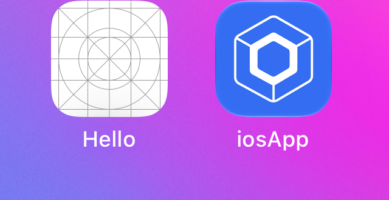
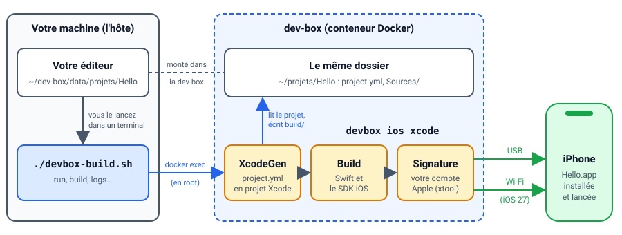

# iOS sans Mac : préparer la dev-box

::: details Sommaire
[[toc]]
:::

## Introduction

Jusqu'ici, nos applications mobiles tournaient sur Android. Pour viser aussi l'iPhone, il y a normalement un passage obligé : **un Mac avec Xcode**. Pas de Mac, pas d'application iOS… Enfin, ça, c'était avant 😄

Dans cette série de TP, nous allons créer, compiler et installer des applications iPhone **depuis Linux**, dans la [dev-box](/cheatsheets/dev-box/). Le même petit « hello world » sera écrit trois fois, avec trois technologies différentes :

1. [en Swift (SwiftUI)](./swift.md), le langage natif d'Apple ;
2. [en Flutter](./flutter.md), le framework multiplateforme de Google ;
3. [en Kotlin Multiplateforme](./kmp.md), avec Compose Multiplatform, la suite logique de ce que vous connaissez déjà sur Android.

Ce premier support prépare le terrain : une fois la dev-box prête, les trois TP vont très vite.



## Prérequis

- Une [dev-box](/cheatsheets/dev-box/) installée et à jour (version 1.61 ou plus, voir [Comment mettre à jour ?](/cheatsheets/dev-box/#comment-mettre-a-jour)), qui tourne sur un **PC x86_64** (Intel ou AMD). L'environnement iOS ne fonctionne pas sur un Raspberry Pi ni sur un Mac à puce Apple (avec un Mac, utilisez directement Xcode).
- Un **iPhone ou un iPad**, avec son câble, sous iOS 17 au minimum.
- Un **identifiant Apple** (gratuit). Nous verrons plus bas lequel utiliser.
- Environ **20 Go** de libre : Xcode à télécharger pèse plusieurs Go, et le SDK construit à partir de lui aussi.

::: tip Pas d'iPhone ?
Pas de panique : vous pouvez suivre toute la série et compiler les applications, seule l'installation sur l'appareil vous manquera. Il n'y a pas de simulateur iOS sous Linux, l'application tourne forcément sur un vrai appareil. Travaillez en binôme avec un camarade qui en a un.
:::

## Objectifs

À la fin de ce TP vous saurez :

- pourquoi développer pour iOS demande normalement un Mac, et ce qui le remplace ici ;
- installer l'environnement iOS de la dev-box ;
- construire le SDK iOS à partir de Xcode ;
- connecter la dev-box à votre compte Apple ;
- relier votre iPhone à la dev-box, avec le câble ou en Wi-Fi ;
- compiler et installer vos applications depuis votre machine, avec le script `devbox-build.sh` ;
- ce qu'est un identifiant d'application (bundle ID) et une signature.

## Pourquoi faut-il un Mac, normalement ?

Pour transformer votre code en une application qui s'installe sur un iPhone, il faut quatre choses :

| Brique | Rôle | Sur un Mac | Dans la dev-box |
|---|---|---|---|
| Le **compilateur** | Transforme votre code en programme pour le processeur de l'iPhone (ARM) | Swift, fourni avec Xcode | Swift pour Linux, Open Source |
| Le **SDK iOS** | Les bibliothèques d'Apple : SwiftUI, UIKit, l'appareil photo, etc. | Fourni avec Xcode | **Extrait du fichier de Xcode**, une seule fois |
| La **signature** | Prouve à l'iPhone que l'application vient d'un développeur connu d'Apple | Xcode | [xtool](https://github.com/xtool-org/xtool), avec votre compte Apple |
| L'**installation** | Envoie l'application sur l'appareil | Xcode | xtool et `pymobiledevice3`, par USB ou en Wi-Fi |

Le compilateur Swift est Open Source et tourne sous Linux depuis longtemps. Le vrai blocage, c'est le **SDK** : Apple ne le distribue qu'à l'intérieur de Xcode, et Xcode ne s'installe que sur macOS. La dev-box contourne le problème en ouvrant le fichier de Xcode (un `.xip`, une archive) pour en extraire le SDK.

Le reste du travail est fait par deux projets Open Source : [xtool](https://github.com/xtool-org/xtool), qui remplace Xcode en ligne de commande, et [omarchy-apple-dev](https://github.com/joshuaswarren/omarchy-apple-dev), qui l'adapte à Arch Linux (le Linux de la dev-box) et comble ce qui lui manque.

Question :

- À votre avis, pourquoi l'iPhone exige-t-il que chaque application soit **signée**, alors qu'un téléphone Android accepte un `.apk` d'où qu'il vienne (une fois l'option activée) ?

::: details Réponse
C'est un choix de sécurité d'Apple : sur iPhone, **aucun code ne s'exécute sans avoir été autorisé par Apple**. Pour une application de l'App Store, Apple l'a vérifiée. Pour une application en développement, c'est votre compte développeur qui l'a signée, et l'iPhone fait confiance à ce compte uniquement si vous l'avez accepté.

Conséquence pour nous : impossible d'installer une application sur un iPhone sans compte Apple, même gratuit.
:::

Voici le chemin que suivra votre code dans les trois TP :

```
Votre code (Swift, Dart ou Kotlin)
   │
   ▼
┌──────────────────────────────────────────────────────────────┐
│ dev-box (Linux)                                              │
│                                                              │
│   Compilateur ──► avec le SDK iOS (extrait de Xcode)         │
│        │                                                     │
│        ▼                                                     │
│   Hello.app ──► signée avec votre compte Apple (xtool)       │
└──────────────────────────────────────────────────────────────┘
   │  USB (câble) ou Wi-Fi (iOS 27)
   ▼
iPhone ou iPad
```

## Installer l'environnement iOS

Connectez-vous à votre dev-box, puis :

```bash
devbox dev-env ios
```

La commande installe Swift, Python, xtool et les outils d'omarchy-apple-dev. La compilation de xtool prend quelques minutes la première fois : c'est le moment d'aller chercher Xcode (étape suivante).

À la fin, la commande affiche les étapes qui restent à faire à la main. Pas besoin de les recopier : `devbox help ios` les réaffiche à tout moment.

::: tip Que se passe-t-il derrière ?
L'environnement est installé avec [mise](https://mise.jdx.dev/), comme tous ceux de la dev-box, et les outils d'omarchy-apple-dev sont clonés dans `~/.local/share/omarchy-apple-dev`. Tout est dans votre dossier personnel : une mise à jour de la dev-box ne supprime rien.
:::

## Le SDK iOS

### Télécharger Xcode

Regardez d'abord la version de Swift de la dev-box :

```bash
swift --version
```

```
Swift version 6.4.1 (swift-6.4.1-RELEASE)
Target: x86_64-unknown-linux-gnu
```

Chaque version de Swift va avec une version de Xcode : **Xcode 27 pour Swift 6.4**, Xcode 26 pour Swift 6.3. Téléchargez celle qui correspond sur [developer.apple.com](https://developer.apple.com/download/all/?q=Xcode), dans le navigateur de votre ordinateur (connexion avec votre identifiant Apple). Vous obtenez un fichier `Xcode_27.xip` de plusieurs Go.

Déposez ce fichier dans le dossier personnel de la dev-box, c'est-à-dire `~/dev-box/data/home` sur votre machine (voir [Où sont les fichiers ?](/cheatsheets/dev-box/#ou-sont-les-fichiers)).

::: warning Gardez le .xip
Une fois le SDK construit, le `.xip` n'est plus nécessaire et la dev-box vous proposera de le supprimer. Si vous avez la place, gardez-le quelque part sur votre machine : il resservira le jour où la dev-box passera à une nouvelle version de Swift.
:::

### Construire le SDK et se connecter à Apple

Tout se fait en une commande :

```bash
devbox ios
```

Elle enchaîne, dans l'ordre :

1. le choix du `.xip` (si vous en avez plusieurs) ;
2. la construction du SDK à partir de Xcode (quelques minutes) ;
3. la vérification du SDK ;
4. la suppression du `.xip`, si vous le souhaitez ;
5. la connexion à votre compte Apple (`xtool auth`).

## Votre compte Apple

À l'étape `xtool auth`, deux modes vous sont proposés. Voici ce que chacun permet :

| | Identifiant Apple gratuit (mode `1`, mot de passe) | Programme développeur payant (mode `0`, clé d'API) |
|---|---|---|
| Compiler les applications des trois TP | ✅ | ✅ |
| Installer une application Flutter | ✅ | ✅ |
| Installer avec `devbox ios xcode` (TP Swift et Kotlin Multiplateforme) | ❌ (compilation seulement) | ✅ |
| Durée de la signature | **7 jours** | 1 an |
| Publier sur l'App Store / TestFlight | ❌ | ✅ |

Avec un identifiant Apple gratuit, vous pouvez suivre les trois TP et tout compiler, mais seule l'application Flutter s'installera sur l'iPhone. Votre enseignant vous dira si une clé d'API de la classe est disponible.

::: danger Un identifiant Apple dédié
Avec le mode mot de passe, xtool se connecte à Apple par des interfaces privées (celles qu'utilise Xcode). Ça fonctionne, mais Apple ne le garantit pas. xtool conseille donc d'utiliser **un identifiant Apple créé pour l'occasion**, plutôt que celui de votre téléphone personnel (avec vos photos, vos achats, etc.).
:::

### Le bundle ID

Toute application iOS a un identifiant unique, le **bundle ID**, écrit comme un nom de domaine à l'envers : `fr.jean.dupont.hello`. C'est l'équivalent de l'`applicationId` d'Android.

Question :

- Pourquoi ce format « à l'envers » ? Et que se passe-t-il si toute la classe garde `com.example.Hello` ?

::: details Réponse
Le domaine à l'envers garantit l'unicité : si vous possédez `dupont.fr`, personne d'autre ne devrait utiliser `fr.dupont.*`. Et il range les identifiants par organisation (`fr.dupont.hello`, `fr.dupont.meteo`, etc.).

Apple refuse deux fois le même bundle ID, **tous comptes confondus** : le premier qui enregistre `com.example.Hello` le garde, les autres auront une erreur à la signature. Dans les TP, utilisez toujours `fr.<prenom>.<nom>.<application>`.
:::

## Relier l'iPhone à la dev-box

Par défaut, un conteneur Docker ne voit pas les appareils USB de votre machine. La marche à suivre dépend de l'endroit où tourne votre dev-box : elle est détaillée dans l'aide-mémoire, partie [Brancher l'iPhone ou l'iPad](/cheatsheets/dev-box/#_3-brancher-l-iphone-ou-l-ipad-une-seule-fois). En résumé :

- **la dev-box tourne sous Linux, sur la machine où l'iPhone est branché** : un bloc à ajouter dans `compose.override.yaml`, puis `devbox pkg add usbmuxd` et `sudo usbmuxd` dans la dev-box ;
- **la dev-box tourne sous Windows, sous macOS ou sur une autre machine** : votre ordinateur gère l'USB, et la dev-box lui parle à travers votre connexion SSH (`ssh -R 27015:...`).

Branchez l'appareil, déverrouillez-le, puis dans la dev-box :

```bash
xtool devices
```

L'iPhone vous demande si vous faites confiance à cet ordinateur : répondez **Se fier**, puis relancez `xtool devices`. Votre appareil apparaît dans la liste.

::: tip Le mode développeur
Au premier envoi d'une application, l'iPhone peut vous demander d'activer le **mode développeur** : Réglages, Confidentialité et sécurité, Mode développeur. L'appareil redémarre, c'est normal.
:::

### Et sans le câble ?

À partir d'**iOS 27**, la dev-box peut aussi installer vos applications en Wi-Fi. Il faut associer l'appareil une fois avec le câble (`devbox ios pair`), puis lui donner une adresse que la dev-box peut joindre : le plus simple est d'installer l'application [Tailscale](/cheatsheets/dev-box/#votre-dev-box-partout-avec-tailscale) sur l'iPhone. Toutes les étapes sont dans `devbox help ios-wifi`.

C'est d'ailleurs comme ça que les captures de ces TP ont été faites : la dev-box sur un PC, l'iPhone posé sur le bureau, sans câble.

## Le script devbox-build.sh

Dans les TP, vous écrirez votre code **sur votre machine**, dans VSCode, et c'est la dev-box qui le compilera. Plutôt que de jongler entre deux terminaux, un petit script fait le lien : `devbox-build.sh`. Vous le posez dans le dossier de votre projet, et vous le lancez **depuis un terminal de votre machine** :

```bash
./devbox-build.sh            # compile, signe, installe et lance l'application
./devbox-build.sh build      # compile seulement
./devbox-build.sh logs       # les logs de l'application (Ctrl-C pour arrêter)
```

Le script est maintenu dans le dépôt de la dev-box : [`scripts/devbox-build.sh`](https://github.com/c4software/dev-box/blob/main/scripts/devbox-build.sh) ([le télécharger](https://raw.githubusercontent.com/c4software/dev-box/main/scripts/devbox-build.sh)). Il est écrit en anglais, comme tout ce dépôt : ses commentaires et ses messages aussi. Chaque TP vous dit où le placer, et `devbox help ios`, dans la dev-box, le rappelle.



Le script ne compile rien lui-même. Voici ce qu'il fait, dans l'ordre :

1. il refuse de se lancer **dans** la dev-box : sa place est sur votre machine ;
2. il vérifie que votre dev-box tourne (le conteneur `dev-box`), et que l'environnement iOS est prêt : SDK, connexion à Apple. Sinon, il vous dit quoi faire (`docker compose up -d`, `devbox dev-env ios`, etc.) ;
3. il traduit le chemin du projet : `~/dev-box/data/projets/Hello` sur votre machine, c'est `/home/dev/projets/Hello` dans la dev-box ;
4. il demande à la dev-box, avec `docker exec`, de lancer la commande `devbox ios xcode` dans ce dossier, avec les réglages de votre application (écrits en tête du script). C'est elle qui fait tout le travail : le projet Xcode généré par XcodeGen, la compilation, la signature, l'installation sur l'iPhone.

Question :

- Pourquoi ne pas tout simplement taper `devbox ios xcode` dans un terminal de la dev-box ?

::: details Réponse
Vous pouvez ! Le script n'est qu'un raccourci, mais il a trois avantages :

- vous restez dans votre éditeur et son terminal, sur votre machine : pas besoin de vous connecter à la dev-box à chaque modification ;
- les réglages propres à l'application (le module Kotlin, la configuration, etc.) sont écrits **une fois** dans le script, versionné avec le projet. Toute l'équipe lance la même commande, sans rien retenir ;
- la même commande sert aux trois TP : seules quelques lignes en tête du fichier changent.
:::

::: tip Que se passe-t-il derrière ?
`docker exec` lance une commande dans un conteneur qui tourne déjà, comme si vous l'aviez tapée dedans. Le script la lance en `root` dans la dev-box (avec vos outils, votre SDK et votre connexion Apple) : avec Docker « rootless », `root` dans le conteneur correspond à votre utilisateur sur la machine, et les fichiers créés dans le projet vous appartiennent. Avec Docker classique, le script rend à la fin les fichiers créés (le dossier `build/`, etc.) au propriétaire du projet.
:::

Ses étapes et ses réglages :

| Étape | Rôle |
|---|---|
| `run` (par défaut) | Compile, signe, installe sur l'iPhone et lance l'application |
| `build` | Compile seulement, sans signer |
| `project`, `install`, `launch` | Une seule étape : le projet, l'installation, le lancement |
| `logs` | Les logs de l'application sur l'iPhone |
| `status` | L'état de la dev-box (SDK, compte Apple, appareils) |
| `pair` | Associe l'iPhone pour le Wi-Fi (iOS 27), une seule fois |
| `shell` | Un terminal dans la dev-box, dans le dossier du projet |
| `key <AuthKey_XXXX.p8>` | Copie votre clé d'API App Store Connect dans la dev-box |

- `--wifi 100.x.y.z` (ou la variable `IOS_WIFI`) installe en Wi-Fi plutôt que par le câble ;
- `DEVBOX_CONTAINER` change le nom du conteneur, `DEVBOX_PROJECTS` le dossier des projets sur votre machine (par défaut, celui que Docker indique pour la dev-box) ;
- `./devbox-build.sh --help` affiche toute l'aide, celle du script puis celle de `devbox ios xcode`.

::: warning Sous Windows
Le script est écrit en bash : lancez-le depuis le terminal Ubuntu (WSL), dans `~/dev-box/data/projets`, comme vos autres commandes Docker.
:::

## Point de contrôle

```bash
devbox ios status
```

```
  swift        6.4 (Xcode 27)
  SDK          registered (darwin)
  SDK cache    /home/dev/.cache/xtool/darwin-iPhoneOS27.1.xtoolsdk
  Apple        signed in (/home/dev/.config/xtool/data)
```

::: tip Point de contrôle
Vous devez voir :

- `SDK registered`, le SDK iOS est prêt ;
- `Apple signed in`, la dev-box est connectée à votre compte ;
- votre appareil dans `xtool devices`.

Le même état s'affiche depuis votre machine, avec `./devbox-build.sh status`. Il vous manque quelque chose ? `devbox help ios` reprend chaque étape, avec les erreurs courantes.
:::

## Conclusion

Votre dev-box est maintenant une machine de développement iOS :

- le compilateur Swift tourne sous Linux ;
- le SDK iOS a été extrait de Xcode, une fois pour toutes ;
- xtool signe vos applications avec votre compte Apple ;
- l'iPhone est relié à la dev-box, par câble ou en Wi-Fi ;
- `devbox-build.sh` compile et installe vos applications depuis votre machine.

Place au code ! Je vous conseille de commencer par [le hello world en Swift](./swift.md) : c'est le plus rapide à compiler, et il vous permettra de vérifier que toute la chaîne fonctionne avant de passer à [Flutter](./flutter.md) et à [Kotlin Multiplateforme](./kmp.md).

👋 Si vous avez des questions, n'hésitez pas.
