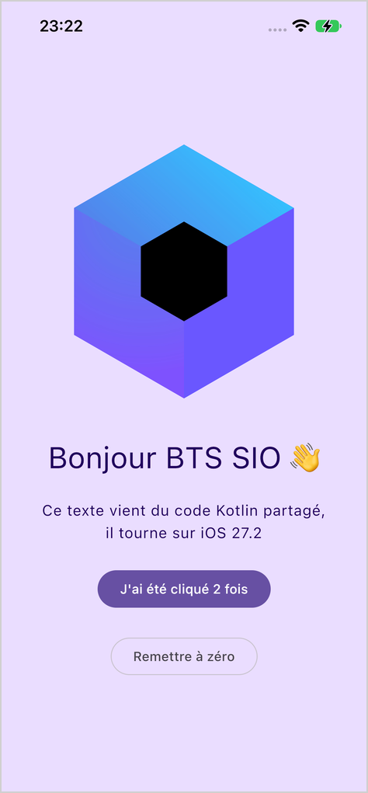

# iOS sans Mac : hello world en Kotlin Multiplateforme

::: details Sommaire
[[toc]]
:::

## Introduction

Dernier épisode de la série : après [Swift](./swift.md) et [Flutter](./flutter.md), nous revenons en terrain connu avec **Kotlin**. Grâce à **Kotlin Multiplateforme** et **Compose Multiplatform**, le code Kotlin et les écrans Compose que vous écrivez pour Android peuvent aussi tourner sur iPhone.

Vous avez sans doute déjà croisé ces outils dans [l'introduction à Kotlin Multiplateforme](/tp/android/compose-multiplateforme/introduction.md). Il y avait alors une limite de taille : **la partie iOS ne se compilait que sur un Mac**. Gradle (et plus précisément Kotlin/Native) refuse de construire pour iOS sous Linux. La dev-box lève cette limite avec deux commandes : `devbox ios kmp` et `devbox ios xcode`.

Voici ce que nous allons construire :


## Prérequis

- La dev-box prête pour iOS : le [support de préparation](./introduction.md) doit être terminé (`devbox ios status` affiche `SDK registered` et `Apple signed in`).
- Les bases de Compose : `@Composable`, `Column`, `Button`, `remember { mutableStateOf() }` (voir [Découverte des bases d'Android](/tp/android/compose/android-base.md)).
- Pour **installer** l'application sur l'iPhone, une connexion à Apple avec une **clé d'API** (programme développeur payant, voir [votre compte Apple](./introduction.md#votre-compte-apple)). Avec un identifiant Apple gratuit, vous pourrez suivre tout le TP et compiler l'application, mais pas l'installer.

## Objectifs

À la fin de ce TP vous saurez :

- générer un projet Compose Multiplatform pour iOS ;
- lire l'organisation d'un projet multiplateforme (`shared`, `iosApp`) ;
- partager du code et des écrans Compose avec iOS ;
- utiliser `expect` / `actual` pour appeler l'API de l'iPhone depuis Kotlin ;
- construire le framework iOS et l'application sous Linux, puis l'installer sur l'iPhone.

## Java

Gradle a besoin d'un JDK. Dans la dev-box :

```bash
devbox dev-env java
```

## Créer le projet

### Le générateur de JetBrains

Comme pour Ktor, JetBrains fournit un générateur en ligne : [kmp.jetbrains.com](https://kmp.jetbrains.com/). Dans le navigateur de votre ordinateur :

1. **Project Name** : `HelloKmp` ;
2. **Project ID** : `fr.prenom.nom` (avec vos vrais prénom et nom, c'est le début du bundle ID) ;
3. décochez **Android**, **Desktop**, **Web** et **Server** : gardez uniquement **iOS** ;
4. pour iOS, choisissez **Share UI** (l'interface est écrite en Compose, et partagée) ;
5. cliquez sur **Download**.

Déposez le `.zip` dans `~/dev-box/data/projets` sur votre machine, puis dans la dev-box :

```bash
cd ~/projets
unzip HelloKmp.zip
cd HelloKmp
```

::: details Sans navigateur : le générateur en ligne de commande
Le formulaire du générateur n'est qu'une URL : vous pouvez récupérer le même projet directement depuis la dev-box.

```bash
cd ~/projets
curl -fsSL -G -o HelloKmp.zip \
  --data-urlencode 'spec={"template_id":"kmt","targets":{"ios":{"ui":["compose"]}}}' \
  --data-urlencode 'name=HelloKmp' \
  --data-urlencode 'id=fr.prenom.nom' \
  --data-urlencode 'buildSystem=gradle' \
  https://kmp.jetbrains.com/generateKmtProject
unzip HelloKmp.zip
```

Ce n'est pas une API documentée par JetBrains : si elle change, revenez au navigateur.
:::

::: tip Et Android ?
Nous ne gardons qu'iOS pour aller à l'essentiel. Avec la cible Android, Gradle a besoin du SDK Android même pour construire la partie iOS : `devbox dev-env android-sdk` l'installe dans la dev-box. Le code partagé, lui, ne change pas.
:::

### La structure du projet

```
HelloKmp/
├── settings.gradle.kts, build.gradle.kts, gradlew   Le projet Gradle
├── gradle.properties                                Les réglages de Gradle
├── shared/                       Le code Kotlin partagé
│   ├── build.gradle.kts          Les cibles (iosArm64, etc.) et le framework iOS
│   └── src/
│       ├── commonMain/           Le code commun à toutes les plateformes
│       │   ├── kotlin/…/App.kt   L'écran, en Compose
│       │   └── composeResources/ Les images, textes, etc.
│       └── iosMain/              Le code spécifique à iOS
└── iosApp/                       L'application iOS (projet Xcode)
    ├── iosApp.xcodeproj
    └── iosApp/
        ├── iOSApp.swift          Le point d'entrée, en Swift
        └── ContentView.swift     Affiche l'écran Compose
```

Le principe : le module `shared` est compilé en un **framework** iOS (une bibliothèque, nommée `Shared`), et la petite application Swift de `iosApp` l'affiche. Ouvrez `iosApp/iosApp/ContentView.swift` :

```swift
import UIKit
import SwiftUI
import Shared

struct ComposeView: UIViewControllerRepresentable {
    func makeUIViewController(context: Self.Context) -> UIViewController {
        MainViewControllerKt.MainViewController()
    }

    func updateUIViewController(_ uiViewController: UIViewController, context: Self.Context) {}
}

struct ContentView: View {
    var body: some View {
        ComposeView()
            .ignoresSafeArea()
    }
}
```

Question :

- Vous reconnaissez `struct ContentView: View` du [TP Swift](./swift.md). D'où vient `MainViewControllerKt.MainViewController()` ?

::: details Réponse
Du code Kotlin ! `import Shared` importe le framework construit à partir du module `shared`, et `MainViewController()` est la fonction Kotlin écrite dans `shared/src/iosMain/kotlin/…/MainViewController.kt` :

```kotlin
fun MainViewController() = ComposeUIViewController { App() }
```

Elle emballe notre écran Compose `App()` dans un `UIViewController`, l'élément d'interface de base d'iOS. Kotlin/Native range les fonctions d'un fichier `MainViewController.kt` dans une classe `MainViewControllerKt`, d'où le nom côté Swift.
:::

### Un réglage de Gradle

Ouvrez `gradle.properties`, et passez le cache de configuration à `false` :

```properties
org.gradle.configuration-cache=false
```

::: warning Pourquoi ?
Le cache de configuration permet à Gradle de démarrer plus vite en réutilisant la configuration du build précédent. Mais pour construire le framework iOS sous Linux, la dev-box ajoute une tâche à Gradle (par un script d'initialisation d'omarchy-apple-dev), et cette tâche n'est pas compatible avec ce cache. Sans ce réglage, le build s'arrête avec `Configuration cache state could not be cached`.
:::

## Le code partagé

### Le texte

Ouvrez `shared/src/commonMain/kotlin/…/GreetingUtil.kt` et remplacez la fonction :

```kotlin
fun sayHello(to: String): String =
    "Ce texte vient du code Kotlin partagé, il tourne sur $to"
```

Gardez bien la première ligne, `package fr.prenom.nom`, avec votre propre package.

### L'écran

Ouvrez `shared/src/commonMain/kotlin/…/App.kt`, et remplacez tout, **sauf la ligne `package`**, par :

```kotlin
import androidx.compose.foundation.Image
import androidx.compose.foundation.layout.Arrangement
import androidx.compose.foundation.layout.Column
import androidx.compose.foundation.layout.fillMaxSize
import androidx.compose.foundation.layout.padding
import androidx.compose.foundation.layout.safeContentPadding
import androidx.compose.material3.Button
import androidx.compose.material3.MaterialTheme
import androidx.compose.material3.Surface
import androidx.compose.material3.Text
import androidx.compose.runtime.*
import androidx.compose.ui.Alignment
import androidx.compose.ui.Modifier
import androidx.compose.ui.text.style.TextAlign
import androidx.compose.ui.tooling.preview.Preview
import androidx.compose.ui.unit.dp
import org.jetbrains.compose.resources.painterResource

import hellokmp.shared.generated.resources.Res
import hellokmp.shared.generated.resources.compose_multiplatform

@Composable
@Preview
fun App() {
    MaterialTheme {
        var compteur by remember { mutableStateOf(0) }
        val greeting = remember { Greeting().greet() }

        Surface(color = MaterialTheme.colorScheme.primaryContainer) {
            Column(
                modifier = Modifier
                    .safeContentPadding()
                    .fillMaxSize()
                    .padding(24.dp),
                horizontalAlignment = Alignment.CenterHorizontally,
                verticalArrangement = Arrangement.spacedBy(24.dp, Alignment.CenterVertically),
            ) {
                Image(painterResource(Res.drawable.compose_multiplatform), null)

                Text("Bonjour BTS SIO 👋", style = MaterialTheme.typography.headlineLarge)

                Text(greeting, textAlign = TextAlign.Center)

                Button(onClick = { compteur++ }) {
                    Text("J'ai été cliqué $compteur fois")
                }
            }
        }
    }
}
```

C'est du Compose tout à fait classique, celui que vous écrivez sur Android. La seule nouveauté : `painterResource(Res.drawable.compose_multiplatform)`, qui charge l'image de `composeResources/drawable/` (l'équivalent multiplateforme de `R.drawable`).

### expect et actual

D'où vient le texte `greeting` ? Suivons le fil :

```kotlin
// commonMain/…/Greeting.kt
class Greeting {
    private val platform = getPlatform()

    fun greet(): String {
        return sayHello(platform.name)
    }
}
```

```kotlin
// commonMain/…/Platform.kt
interface Platform {
    val name: String
}

expect fun getPlatform(): Platform
```

```kotlin
// iosMain/…/Platform.ios.kt
import platform.UIKit.UIDevice

class IOSPlatform: Platform {
    override val name: String = UIDevice.currentDevice.systemName() + " " + UIDevice.currentDevice.systemVersion
}

actual fun getPlatform(): Platform = IOSPlatform()
```

Questions :

- Que signifient `expect` et `actual` ?
- `UIDevice` n'est pas une classe Kotlin : d'où vient-elle ?

::: details Réponse
`expect` déclare, dans le code commun, une fonction **promise** sans l'écrire : « chaque plateforme me fournira un `getPlatform()` ». Chaque plateforme écrit ensuite sa version, marquée `actual`. Si vous ajoutez la cible Android, Gradle refusera de compiler tant que vous n'aurez pas écrit l'`actual` Android (un `Platform.android.kt`).

`UIDevice` est une classe **d'iOS** (le framework UIKit d'Apple), que Kotlin/Native rend utilisable directement depuis Kotlin avec `import platform.UIKit.UIDevice`. C'est ainsi que le texte affiche la vraie version de l'iPhone (« iOS 27.2 » sur la capture). Et c'est pour ça que la dev-box a besoin du SDK iOS : sans lui, Kotlin ne connaît pas UIKit.
:::

## Construire et installer

### Ce que fait la dev-box

Sur un Mac, Xcode construit l'application, et une étape de son build lance Gradle pour produire le framework `Shared`. Sous Linux, la dev-box enchaîne les étapes elle-même :

```
shared/ (Kotlin)
   │  Gradle compile le code Kotlin (klibs)
   ▼
devbox ios kmp ──► Shared.framework (lié pour iOS, sous Linux)
   │
   ▼
iosApp/ (Swift) + Shared.framework
   │  devbox ios xcode : build, signature
   ▼
iosApp.app ──► installée et lancée sur l'iPhone
```

### C'est parti

Branchez l'iPhone, déverrouillez-le, puis depuis le dossier `iosApp` :

```bash
cd ~/projets/HelloKmp/iosApp
devbox ios xcode --kmp :shared
```

- `devbox ios xcode` construit l'application du projet Xcode qu'il trouve dans le dossier, la signe, l'installe et la lance ;
- `--kmp :shared` lui demande de construire d'abord le framework du module Gradle `:shared`, et de l'intégrer à l'application.

La première fois, soyez patient : la dev-box télécharge le nécessaire pour Kotlin/Native (environ 300 Mo) et toutes les dépendances Gradle. Comptez **5 à 10 minutes**, puis environ 3 minutes pour les suivantes. Voici les étapes principales qui s'affichent :

```
[dev-box-ios] xtool package from iosApp.xcodeproj (Debug)
[kmp] Gradle: the klibs of the iOS framework and what it exports (iosArm64)
[kmp] :shared: Shared.framework for ios_arm64 (Kotlin/Native 2.4.21, iPhoneOS27.1.sdk, several minutes)
[kmp] framework: /home/dev/projets/HelloKmp/iosApp/build/devbox-ios/kmp/Shared.framework
[dev-box-ios] Shared.framework: a binary target of the package
[dev-box-ios] iosApp (debug, ship.sh --device; the first build fetches and builds every package, minutes)
Build complete! (5.09 secs)
[dev-box-ios] app: /home/dev/projets/HelloKmp/iosApp/build/devbox-ios/xtool/xtool/iosApp.app (unsigned)
[dev-box-ios] signed (rcodesign)
[dev-box-ios] installed on 00008110-… 
[dev-box-ios] launching XTL-….fr.prenom.nom.HelloKmp
```

L'application s'appelle « iosApp » sur l'écran d'accueil (c'est le nom de la cible du projet Xcode), et elle s'ouvre toute seule :


::: tip Point de contrôle
L'application s'ouvre sur l'iPhone, affiche la version d'iOS de votre appareil, et le compteur augmente à chaque clic.
:::

::: details Identifiant Apple gratuit : compiler sans installer
Sans clé d'API, `devbox ios xcode` ne peut pas signer l'application. Vous pouvez tout de même vérifier que tout compile, framework compris :

```bash
devbox ios xcode build --kmp :shared
```

L'application (non signée) est alors dans `build/devbox-ios/xtool/xtool/iosApp.app`.
:::

::: details Sans câble, en Wi-Fi
Avec un iPhone sous iOS 27 associé à la dev-box (`devbox help ios-wifi`), ajoutez simplement son adresse :

```bash
devbox ios xcode --kmp :shared --wifi 100.x.y.z
```

C'est ainsi qu'ont été faites les captures de ce TP.
:::

::: tip Que veut dire XTL-… devant le bundle ID ?
`devbox ios xcode` signe l'application sous un identifiant préfixé, `XTL-<équipe>.fr.prenom.nom.HelloKmp`, comme le fait xtool. Ainsi, votre version de développement ne remplace jamais la vraie application si elle est un jour publiée sur l'App Store sous `fr.prenom.nom.HelloKmp`.
:::

## À vous de jouer

C'est à vous de jouer ! Ajoutez, sous le bouton du compteur, un bouton « Remettre à zéro » qui remet le compteur à `0`, et qui est grisé quand le compteur vaut déjà `0`.

Une piste : en Compose, `OutlinedButton` est un bouton plus discret, et tous les boutons acceptent un paramètre `enabled`.

Relancez ensuite `devbox ios xcode --kmp :shared`.



::: details Voir l'une des solutions possibles

Ajoutez l'import :

```kotlin
import androidx.compose.material3.OutlinedButton
```

Puis, juste après le `Button` du compteur :

```kotlin
OutlinedButton(onClick = { compteur = 0 }, enabled = compteur > 0) {
    Text("Remettre à zéro")
}
```

:::

Question bonus :

- Et si vous vouliez afficher le **modèle** de l'appareil (« iPhone ») plutôt que la version d'iOS, quel fichier modifieriez-vous ? Et faudrait-il toucher à `App.kt` ?

::: details Réponse
Uniquement `Platform.ios.kt`, le code spécifique à iOS : `UIDevice.currentDevice.model` donne le modèle. `App.kt` ne change pas, il ne connaît que l'interface `Platform`. C'est tout l'intérêt de `expect` / `actual` : le code commun ignore les détails de chaque plateforme.
:::

## Conclusion

Dans ce TP, vous avez :

- généré un projet Compose Multiplatform avec le générateur de JetBrains ;
- compris le lien entre le module `shared` (Kotlin) et l'application `iosApp` (Swift) ;
- partagé un écran Compose avec iOS, et appelé une API d'iOS avec `expect` / `actual` ;
- construit le framework et l'application iOS **sous Linux**, puis installé l'application sur l'iPhone avec `devbox ios xcode --kmp`.

Faisons le bilan des trois TP :

| | Swift (SwiftUI) | Flutter | Kotlin Multiplateforme |
|---|---|---|---|
| Langage | Swift | Dart | Kotlin |
| Plateformes | iOS (et les autres systèmes d'Apple) | Android, iOS, Web, ordinateur | Android, iOS, Web, ordinateur |
| Interface | SwiftUI, native | Widgets Flutter, dessinés par Flutter | Compose, dessiné par Compose (ou native, si on ne partage que la logique) |
| Ce qui est partagé | Rien, c'est du natif | Tout | Au choix : la logique seule, ou aussi les écrans |
| Préparation dans la dev-box | Aucune | Compilateur Dart pour iOS (15 min, 7 Go) | Java, et 300 Mo au premier build |
| Signature pour installer | Identifiant Apple gratuit | Identifiant Apple gratuit | Clé d'API (compte payant) |

Il n'y a pas de « meilleur » choix : tout dépend du projet et de l'équipe. Une équipe qui fait déjà de l'Android en Kotlin ira naturellement vers Kotlin Multiplateforme ; une application uniquement pour iPhone, qui doit s'intégrer parfaitement au système, sera souvent écrite en Swift.

Pensez à versionner votre projet (`git init`, le `.gitignore` est fourni par le générateur).

👋 Si vous avez des questions, n'hésitez pas.
