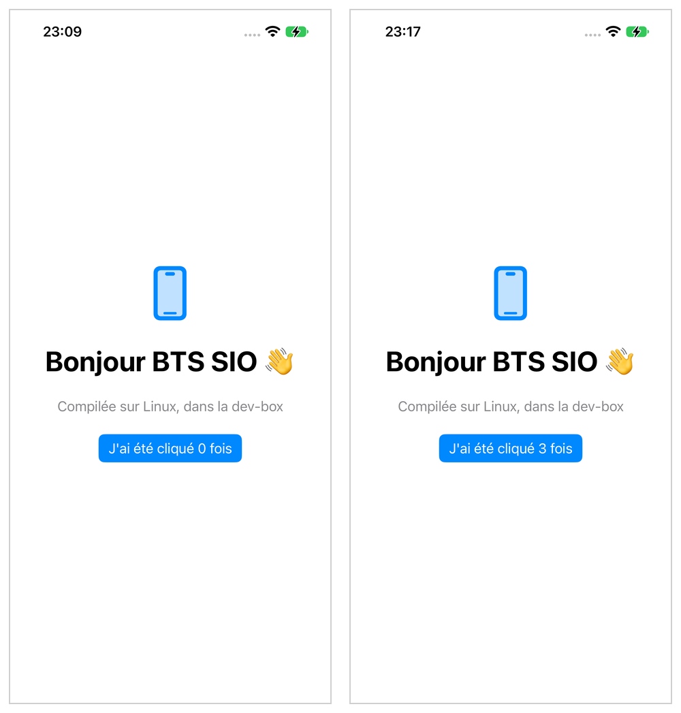
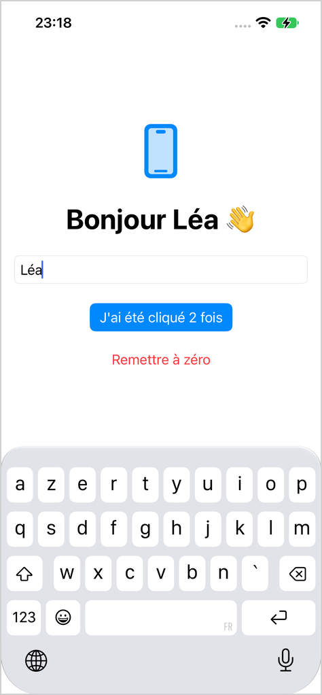

# iOS sans Mac : hello world en Swift

::: details Sommaire
[[toc]]
:::

## Introduction

Dans [le support précédent](./introduction.md), nous avons préparé la dev-box : SDK iOS, compte Apple, iPhone relié. Place à la première application !

Nous commençons par **Swift**, le langage d'Apple, avec **SwiftUI**, sa façon moderne de construire des interfaces. Vous connaissez Jetpack Compose ? Bonne nouvelle : SwiftUI repose exactement sur les mêmes idées. Vous allez retrouver vos marques très vite.

Voici ce que nous allons construire :



## Prérequis

- La dev-box prête pour iOS (version 1.61 ou plus) : le [support précédent](./introduction.md) doit être terminé, `devbox ios status` doit afficher `SDK registered` et `Apple signed in`.
- Pour **installer** l'application sur l'iPhone, une connexion à Apple avec une **clé d'API** (programme développeur payant, voir [votre compte Apple](./introduction.md#votre-compte-apple)). Avec un identifiant Apple gratuit, vous pourrez suivre tout le TP et compiler l'application, mais pas l'installer.
- Avoir déjà écrit une interface avec Compose (par exemple dans [Découverte des bases d'Android](/tp/android/compose/android-base.md)) : ce n'est pas obligatoire, mais les comparaisons vous parleront davantage.

## Objectifs

À la fin de ce TP vous saurez :

- décrire un projet iOS dans un simple fichier texte, `project.yml` (XcodeGen) ;
- lire la structure d'un projet SwiftUI ;
- écrire une vue avec un état (`@State`) ;
- compiler, signer et installer l'application sur votre iPhone depuis Linux, avec `devbox-build.sh`.

## Créer le projet

Sur un Mac, Xcode crée un dossier `Hello.xcodeproj` rempli de fichiers illisibles, qu'on ne modifie qu'à travers Xcode. Nous allons faire autrement : décrire le projet dans un **fichier texte**, `project.yml`, que l'outil Open Source [XcodeGen](https://github.com/yonaskolb/XcodeGen) transforme en projet Xcode au moment de compiler. La dev-box s'en charge, vous n'avez rien à installer.

### Le dossier du projet

Tout se passe **sur votre machine**, dans le dossier des projets de la dev-box (voir [Où sont les fichiers ?](/cheatsheets/dev-box/#ou-sont-les-fichiers)). Dans un terminal de votre machine :

```bash
cd ~/dev-box/data/projets
mkdir -p Hello/Sources
cd Hello
curl -fsSLO https://raw.githubusercontent.com/c4software/dev-box/main/scripts/devbox-build.sh
chmod +x devbox-build.sh
```

Vous venez de récupérer le script `devbox-build.sh` présenté dans [le support de préparation](./introduction.md#le-script-devbox-build-sh). Ouvrez maintenant le dossier `Hello` dans VSCode : vous allez y créer trois fichiers.

### La structure du projet

```
Hello/
├── project.yml            La description du projet (XcodeGen)
├── devbox-build.sh        Le script qui compile et installe l'application
└── Sources/
    ├── HelloApp.swift     Le point d'entrée de l'application
    └── ContentView.swift  Le premier (et seul) écran
```

Tout est en texte simple : un avantage énorme pour Git, et le même `project.yml` fonctionne sur un Mac (`xcodegen generate`, puis le projet s'ouvre dans Xcode).

### Le fichier project.yml

Créez `project.yml` à la racine du dossier `Hello` :

```yaml
name: Hello
options:
  bundleIdPrefix: fr.prenom.nom
  deploymentTarget:
    iOS: "17.0"
targets:
  Hello:
    type: application
    platform: iOS
    sources:
      - Sources
    info:
      path: Sources/Info.plist
      properties:
        CFBundleDisplayName: Hello
        UILaunchScreen: {}
    settings:
      base:
        PRODUCT_BUNDLE_IDENTIFIER: fr.prenom.nom.hello
        MARKETING_VERSION: "1.0"
        CURRENT_PROJECT_VERSION: "1"
```

Comme expliqué dans [le support précédent](./introduction.md#le-bundle-id), le bundle ID doit être unique chez Apple : remplacez `fr.prenom.nom` par vos vrais prénom et nom, aux deux endroits.

Prenez le temps de lire ce fichier :

| Clé | Rôle | Sur Android |
|---|---|---|
| `name` | Le nom du projet | `rootProject.name` |
| `deploymentTarget` | La version minimale d'iOS | `minSdk` |
| `targets` | Les « cibles » à construire, ici une seule application, `Hello` | Le module `app` |
| `sources` | Le dossier du code | `src/main/java` |
| `info` | Le fichier `Info.plist` (nom affiché, écran de lancement, etc.), généré par XcodeGen | `AndroidManifest.xml` |
| `PRODUCT_BUNDLE_IDENTIFIER` | Le bundle ID | `applicationId` |
| `MARKETING_VERSION`, `CURRENT_PROJECT_VERSION` | La version affichée et le numéro de build | `versionName`, `versionCode` |

::: tip Que se passe-t-il derrière ?
À chaque compilation, la dev-box lance XcodeGen, qui écrit le projet Xcode dans `build/devbox-ios/xcodegen` (jamais à côté de votre code). Puis `devbox ios xcode` le transforme en paquet Swift (`build/devbox-ios/xtool`), que xtool sait compiler sous Linux. Vous ne modifiez que `project.yml` et `Sources/` ; tout ce qui est dans `build/` est régénéré, ne le versionnez pas.
:::

## Le code

### Le point d'entrée

Créez `Sources/HelloApp.swift` :

```swift
import SwiftUI

@main
struct HelloApp: App {
    var body: some Scene {
        WindowGroup {
            ContentView()
        }
    }
}
```

- `@main` indique **où démarre l'application**, comme le `MainActivity` déclaré dans le `AndroidManifest.xml`.
- `WindowGroup` est la fenêtre de l'application ; elle affiche `ContentView`, notre écran.

### L'écran

Créez `Sources/ContentView.swift` :

```swift
import SwiftUI

struct ContentView: View {
    @State private var compteur = 0

    var body: some View {
        VStack(spacing: 24) {
            Image(systemName: "iphone")
                .font(.system(size: 64))
                .foregroundStyle(.tint)

            Text("Bonjour BTS SIO 👋")
                .font(.largeTitle)
                .bold()

            Text("Compilée sur Linux, dans la dev-box")
                .foregroundStyle(.secondary)

            Button("J'ai été cliqué \(compteur) fois") {
                compteur += 1
            }
            .buttonStyle(.borderedProminent)
        }
        .padding()
    }
}

#Preview {
    ContentView()
}
```

Prenez quelques minutes pour lire ce code. Si vous avez fait du Compose, la ressemblance est frappante :

| SwiftUI | Jetpack Compose | Rôle |
|---|---|---|
| `struct ContentView: View` | `@Composable fun ContentView()` | Un composant d'interface |
| `VStack { }` | `Column { }` | Empile les éléments verticalement |
| `HStack { }` | `Row { }` | Les aligne horizontalement |
| `Text("…")` | `Text("…")` | Affiche un texte |
| `Button("…") { action }` | `Button(onClick = { action }) { Text("…") }` | Un bouton |
| `@State private var compteur = 0` | `var compteur by remember { mutableStateOf(0) }` | Un état : quand il change, l'écran se redessine |
| `.padding()`, `.font(…)` | `Modifier.padding()`, `style = …` | La mise en forme |
| `"\(compteur)"` | `"$compteur"` | Insérer une variable dans un texte |

Questions :

- Que se passe-t-il, concrètement, quand vous cliquez sur le bouton ?
- Et si vous retiriez `@State` devant `compteur` ?

::: details Réponse
Au clic, `compteur += 1` modifie l'état. SwiftUI détecte le changement et **recalcule `body`** : le texte du bouton est redessiné avec la nouvelle valeur. C'est exactement la recomposition de Compose.

Sans `@State`, le code ne compile même pas : une `struct` SwiftUI ne peut pas modifier ses propres propriétés. `@State` demande à SwiftUI de stocker la valeur **en dehors** de la vue, et de redessiner l'écran à chaque modification.
:::

::: tip Les images « systemName »
`Image(systemName: "iphone")` utilise les **SF Symbols**, plus de 6 000 icônes fournies par iOS : rien à télécharger. La liste complète est dans l'application [SF Symbols](https://developer.apple.com/sf-symbols/) d'Apple (sur Mac).
:::

## Compiler

Avant d'envoyer l'application sur l'iPhone, vérifions qu'elle compile. Dans le terminal **de votre machine**, dans le dossier `Hello` :

```bash
./devbox-build.sh build
```

```
[dev-box-ios] project.yml: Xcode project generated (XcodeGen)
[dev-box-ios] xtool package from Hello.xcodeproj (Debug)
…
[dev-box-ios] Hello (debug, ship.sh --device; the first build fetches and builds every package, minutes)
Building for debugging...
[3 / 3] Hello-App-product
Build complete! (0.71 secs)
…
[dev-box-ios] app: /home/dev/projets/Hello/build/devbox-ios/xtool/xtool/Hello.app (unsigned)
```

La première compilation prend quelques minutes (Swift compile tout ce dont l'application a besoin), les suivantes quelques secondes. Les lignes `warning:` qui peuvent s'afficher au passage ne sont pas des erreurs.

::: tip Point de contrôle
Vous devez obtenir `Build complete!` et un dossier `build/devbox-ios/xtool/xtool/Hello.app`.

Une erreur ? Lisez-la attentivement : le compilateur Swift indique le fichier, la ligne, et souvent la correction à apporter. Et si le script vous dit que la dev-box n'est pas prête, il vous dit aussi quoi faire.
:::

Question :

- `Hello.app` est un **dossier**, pas un fichier. À votre avis, que contient-il ?

::: details Réponse
Une application iOS est un « bundle » : un dossier qui contient le programme compilé (pour le processeur ARM de l'iPhone), le fichier `Info.plist` (le bundle ID, la version, le nom affiché, etc.) et les ressources (images, traductions). Allez voir avec `ls build/devbox-ios/xtool/xtool/Hello.app`.

Pour l'installer, ce dossier est signé puis compressé dans un fichier `.ipa`, l'équivalent du `.apk` d'Android.
:::

## Installer sur l'iPhone

Branchez votre iPhone, déverrouillez-le, puis :

```bash
./devbox-build.sh
```

Sans étape, le script fait tout (`run`) : il compile, **signe** l'application avec votre compte Apple, l'installe sur l'appareil, puis la lance. L'icône « Hello » apparaît sur l'écran d'accueil :

```
[dev-box-ios] app: /home/dev/projets/Hello/build/devbox-ios/xtool/xtool/Hello.app (unsigned)
[dev-box-ios] development profile for XTL-….fr.prenom.nom.hello on 00008110-…
[dev-box-ios] signed (rcodesign)
[dev-box-ios] installed on 00008110-…
[dev-box-ios] launching XTL-….fr.prenom.nom.hello
Process launched with pid 2992
```

Si l'iPhone refuse d'ouvrir l'application (« Développeur non approuvé »), c'est qu'il ne connaît pas encore votre compte : allez dans **Réglages, Général, VPN et gestion de l'appareil**, choisissez votre compte, puis **Faire confiance**. Votre hello world s'affiche 🎉


::: tip Point de contrôle
L'application s'ouvre sur l'iPhone, et le compteur augmente à chaque clic.
:::

::: tip Que veut dire XTL-… devant le bundle ID ?
L'application est signée sous un identifiant préfixé, `XTL-<équipe>.fr.prenom.nom.hello`, comme le fait xtool. Ainsi, votre version de développement ne remplace jamais la vraie application si elle est un jour publiée sur l'App Store sous `fr.prenom.nom.hello`.
:::

::: details Sans câble, en Wi-Fi
Avec un iPhone sous iOS 27 associé à la dev-box (une fois, câble branché : `./devbox-build.sh pair`, voir `devbox help ios-wifi`), ajoutez simplement son adresse :

```bash
./devbox-build.sh run --wifi 100.x.y.z
```

C'est ainsi qu'ont été faites les captures de ce TP.
:::

::: details Identifiant Apple gratuit : compiler sans installer
Sans clé d'API, la dev-box ne peut pas signer l'application pour `devbox ios xcode`. Vous pouvez tout de même vérifier que tout compile avec `./devbox-build.sh build`, et travailler en binôme avec un camarade qui a accès à une clé pour l'installation.
:::

::: details Voir les logs de l'application
Le script affiche aussi les logs de l'application, comme le Logcat d'Android Studio (`Ctrl + C` pour arrêter) :

```bash
./devbox-build.sh logs
```

Un `print("Clic !")` dans l'action du bouton s'affichera ici à chaque clic.
:::

## À vous de jouer

C'est à vous de jouer ! Modifiez l'application pour que :

1. un champ de texte demande le prénom de l'utilisateur ;
2. le titre affiche « Bonjour Léa 👋 » quand le prénom est saisi, « Bonjour BTS SIO 👋 » sinon ;
3. un bouton « Remettre à zéro » remette le compteur à `0`, et soit grisé quand le compteur vaut déjà `0`.

Quelques pistes :

- un champ de texte s'écrit `TextField("Votre prénom", text: $prenom)`. Le `$` donne au champ un **lien** vers l'état `prenom`, pour qu'il puisse le modifier (c'est le `value` / `onValueChange` de Compose, en une seule fois) ;
- un bouton se grise avec `.disabled(condition)` ;
- `Button("…", role: .destructive) { }` affiche un bouton en rouge, pour une action « dangereuse ».

Relancez ensuite `./devbox-build.sh`.



::: details Voir l'une des solutions possibles

```swift
import SwiftUI

struct ContentView: View {
    @State private var compteur = 0
    @State private var prenom = ""

    var body: some View {
        VStack(spacing: 24) {
            Image(systemName: "iphone")
                .font(.system(size: 64))
                .foregroundStyle(.tint)

            Text(prenom.isEmpty ? "Bonjour BTS SIO 👋" : "Bonjour \(prenom) 👋")
                .font(.largeTitle)
                .bold()

            TextField("Votre prénom", text: $prenom)
                .textFieldStyle(.roundedBorder)

            Button("J'ai été cliqué \(compteur) fois") {
                compteur += 1
            }
            .buttonStyle(.borderedProminent)

            Button("Remettre à zéro", role: .destructive) {
                compteur = 0
            }
            .disabled(compteur == 0)
        }
        .padding()
    }
}

#Preview {
    ContentView()
}
```

:::

## Le projet complet

[Le projet complet de ce TP est téléchargeable ici](/demo/ios/swift-hello.zip), avec la solution de l'exercice et son `devbox-build.sh`. Pensez à remplacer `fr.prenom.nom` dans `project.yml` avant de le lancer.

## Conclusion

Dans ce TP, vous avez :

- décrit un projet iOS dans un fichier texte, `project.yml`, sans Xcode ;
- découvert SwiftUI, et ses nombreux points communs avec Compose (`VStack`, `@State`, etc.) ;
- compilé l'application sous Linux avec `./devbox-build.sh build` ;
- signé, installé et lancé l'application sur votre iPhone avec `./devbox-build.sh`, depuis votre machine.

Pensez à versionner votre projet : un fichier `.gitignore` qui contient `build/`, puis `git init` et un premier commit.

La suite : le même hello world, cette fois avec [Flutter](./flutter.md), puis avec [Kotlin Multiplateforme](./kmp.md).

👋 Si vous avez des questions, n'hésitez pas.
