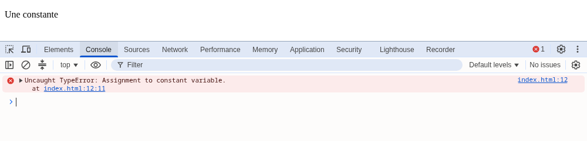
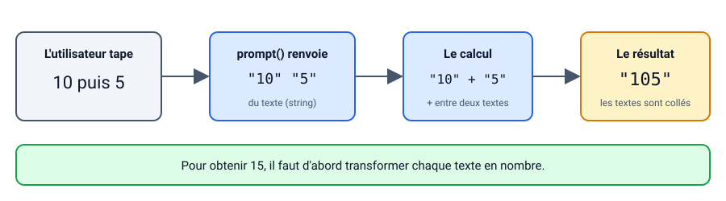

# Des variables en veux-tu en voilà !

::: details Sommaire
[[toc]]
:::

Nous avons vu comment déclarer une balise `script`. Un code sans variable c'est un peu comme une pizza sans olives…

## Introduction

Nous avons vu dans le cours que les variables pouvaient être de deux types, `variable` et `constante`, dans ce TP nous allons les utiliser.

Nous repartons de la page du [TP précédent](./tp1.md) : nous allons y ranger le message de l'alerte dans une variable, voir ce qui se passe quand on essaie de modifier une constante, puis poser des questions à l'utilisateur pour construire une petite machine à additionner.

## Prérequis

- Avoir terminé [le TP 1](./tp1.md) : une page HTML qui charge un script externe, et la console du navigateur que vous savez ouvrir.
- [Le complément de cours JavaScript, partie variables](./support.md#les-variables) à portée de main.

::: details Rattrapage : vous n'avez plus la page du TP 1 ?
Pas de panique. Créez une page `index.html` contenant une balise `<script src="./public/js/script.js"></script>`, et le fichier `public/js/script.js` à côté. C'est dans ce fichier que vous écrirez le code de ce TP.
:::

## Objectifs

À la fin de ce TP vous saurez :

- Déclarer une variable avec `let` et une constante avec `const`.
- Lire une erreur dans la console et comprendre ce qu'elle vous dit.
- Poser une question à l'utilisateur avec `prompt` et récupérer sa réponse.
- Comprendre pourquoi `"10" + "5"` ne donne pas `15`.

## Une variable

Modifier le code du [TP précédent](./tp1.md) afin de déclarer une variable :

```javascript
let message = "Bonjour à tous";
```

Utiliser cette variable dans votre alerte.

::: tip Point de contrôle
L'alerte affiche toujours « Bonjour à tous », mais le texte ne se trouve plus dans l'appel à `alert` : il vient de la variable `message`. Changez la valeur de la variable, rechargez la page : l'alerte suit.
:::

## Une constante

Une variable, c'est une boîte avec une étiquette dont on peut changer le contenu. Une constante, c'est la même boîte… mais fermée une fois remplie :


En utilisant le code suivant :

```javascript
const nom = "Brosseau";

nom = "valentin";
```

Vérifier que la constante n'est pas écrasée pendant le fonctionnement de votre programme. Que voyez-vous dans la console de votre navigateur ?

::: details La réponse
Votre navigateur produit une erreur : `Uncaught TypeError: Assignment to constant variable.`. Une constante ne peut pas être réécrite, c'est tout l'intérêt.



Remarquez le lien à droite de l'erreur (le fichier et le numéro de ligne) : un clic dessus vous emmène directement à la ligne fautive.
:::

Et si vous écrivez deux fois `let message = …;` dans le même script, que se passe-t-il ?

::: details Réponse
Une autre erreur : `Uncaught SyntaxError: Identifier 'message' has already been declared`. Contrairement au PHP, une variable ne se déclare qu'une seule fois ; ensuite on lui affecte une nouvelle valeur sans le `let` (`message = "Bonsoir";`). Attention, c'est une erreur de syntaxe : **aucune** ligne du script n'est exécutée, même celles placées avant.
:::

## Poser une question ?

Nous avons vu qu'il était possible de déclarer une variable, mais il est également possible de poser des questions à votre utilisateur. Pour ça nous avons la fonction `prompt`, cette fonction s'utilise comme ça :

```javascript
prompt("Votre âge ?");
```

Cette fonction retourne la valeur saisie par l'utilisateur, vous pouvez donc écrire :

```javascript
let age = prompt("Votre âge ?");
```

::: tip Que se passe-t-il derrière ?
Comme `alert`, `prompt` met la page en pause : la ligne suivante de votre script ne s'exécute qu'une fois que l'utilisateur a validé. Si l'utilisateur clique sur « Annuler », `prompt` retourne `null` (et non un texte vide).
:::

### À faire

Écrire le code permettant :

- De demander l'âge à votre utilisateur.
- Afficher la valeur avec une alerte.

::: tip Point de contrôle
À l'ouverture de la page, une fenêtre vous demande votre âge. Une fois validée, une alerte affiche exactement ce que vous avez saisi.
:::

## Et si nous allions plus loin ?

Maintenant que vous savez poser des questions et afficher des valeurs. Je vous propose de créer une machine à additionner. Pour ça votre programme doit :

- Demander la première valeur à additionner à l'utilisateur
- Demander la seconde valeur à l'utilisateur
- Réaliser l'opération `variable1 + variable2` et afficher le résultat à l'utilisateur (dans la console ou dans une alerte).

C'est à vous de jouer !

::: tip Astuce
Surpris par le résultat ? `10 + 5` qui donne `105` ? La fonction `prompt` retourne toujours du **texte**, l'opérateur `+` fait donc une concaténation. Il est possible en JavaScript de « changer le type d'une variable » avec [parseInt](https://developer.mozilla.org/fr/docs/Web/JavaScript/Reference/Global_Objects/parseInt). Je vous laisse tester.


:::

::: tip Point de contrôle
Avec `10` puis `5`, votre machine affiche `15`.
:::

## Conclusion

Récapitulons ce que vous savez faire maintenant :

- Déclarer une variable avec `let` (une seule fois), puis changer sa valeur.
- Déclarer une constante avec `const`, et reconnaître l'erreur quand on essaie de la modifier.
- Lire une erreur dans la console : son type, son message, et la ligne en cause.
- Demander une valeur à l'utilisateur avec `prompt`, en gardant en tête qu'elle arrive toujours sous forme de texte.

La suite ? [Le TP 1.2 pour découvrir les sélecteurs](./tp1.2.md).

👋 Si vous avez des questions, n'hésitez pas.
