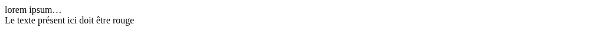

# Une petite mise en bouche

::: details Sommaire
[[toc]]
:::

Nous allons créer une page fictive afin de tester un peu le fonctionnement des sélecteurs.

Dans les TP précédents, votre JavaScript parlait à l'utilisateur avec des fenêtres (`alert`, `prompt`) ou à vous dans la console. Ici, il va enfin **modifier la page elle-même** : ajouter un titre, cacher un bloc, changer une couleur, ajouter un paragraphe. C'est ce que nous ferons ensuite dans tous les TP, en commençant par [le retour de Bart](./tp2.md).

Pour réaliser ce TP nous utiliserons [les ressources disponibles ici](/tp/javascript/support.md#manipuler-le-html-et-la-css)

## Prérequis

- Avoir terminé [le TP 1](./tp1.md) et [le TP 1.1](./tp1.1.md) : écrire un script, déclarer une variable, lire la console.
- Vos sélecteurs CSS (`#id`, `.classe`, `div`) : ce sont exactement les mêmes en JavaScript.
- [Le complément de cours, partie manipuler le HTML et la CSS](./support.md#manipuler-le-html-et-la-css) ouvert à côté.

## Objectifs

À la fin de ce TP vous saurez :

- Trouver un élément de la page avec `document.querySelector`.
- Créer un élément en JavaScript et l'ajouter dans la page.
- Masquer un élément et modifier son style.
- Vérifier dans l'inspecteur ce que votre JavaScript a réellement changé.

## Le fichier HTML

Créez une page avec le contenu suivant :

```html
<!DOCTYPE html>
<html lang="fr">
  <head>
    <meta charset="UTF-8" />
    <title>Document</title>
  </head>
  <body>
    <div id="monId">
      <!-- Ajouter un titre ici en JavaScript -->
    </div>

    <!-- Cacher la div suivante via le JS -->
    <div id="cacheMoi">lorem ipsum…</div>

    <!-- Je souhaite que le texte soit rouge -->
    <div id="redText">Le texte présent ici doit être rouge</div>

    <!-- Ajouter ici un paragraphe (p) en JavaScript-->

    <script>
      // Vous devez écrire votre code JavaScript ici.
    </script>
  </body>
</html>
```

Ouverte telle quelle, sans JavaScript, la page ressemble à ça :



La page contient pourtant trois `div`. Où est passée la première ?

::: details Réponse
Elle est bien là, mais elle est vide : la `div` `#monId` ne contient qu'un commentaire HTML, qui ne s'affiche jamais. C'est justement là que votre JavaScript devra ajouter un titre.
:::

## Trouver un élément avec un sélecteur

Pour modifier un élément, il faut d'abord le **trouver** dans la page. Le navigateur a transformé votre HTML en un arbre (le DOM), et `document.querySelector` vous permet d'aller chercher un élément de cet arbre avec un sélecteur CSS. Vous obtenez alors l'élément lui-même : ce que vous changez dessus se voit tout de suite dans la page.


Quelle est la différence entre `document.querySelector("div")` et `document.querySelectorAll("div")` sur cette page ?

::: details Réponse
`querySelector` retourne le **premier** élément trouvé (ici la `div` `#monId`), `querySelectorAll` retourne **la liste** de tous les éléments trouvés (ici les trois `div`). Pour viser un élément précis, l'`id` reste le plus sûr : `document.querySelector("#cacheMoi")`.
:::

## À vous de jouer

::: tip Hou hou
Les consignes sont présentes dans les commentaires du code fourni. Je vous laisse regarder, et tenter de faire les actions demandées.
:::

C'est à vous de jouer !

::: tip Point de contrôle
Avant de passer à la suite, vous devez savoir :

- Ajouter un élément dans la page en JavaScript.
- Masquer un élément (`style.display` ou une classe CSS).
- Modifier le style d'un élément.

Côté page, vous devez voir un titre en haut, plus de « lorem ipsum… », le texte en rouge, et un nouveau paragraphe en dessous. Ouvrez ensuite l'inspecteur (`F12`, onglet « Elements ») : il montre la page **telle que votre JavaScript l'a modifiée**. Par exemple, avec un titre et un paragraphe de votre choix :


:::

Faites maintenant un clic droit sur la page, puis « Afficher le code source de la page » (`Ctrl + U`). Votre titre et votre paragraphe y apparaissent-ils ?

::: details Réponse
Non. Le code source, c'est le fichier HTML **tel que le navigateur l'a reçu**, avant l'exécution de votre script. L'inspecteur, lui, montre le DOM **actuel**, après les modifications de votre JavaScript. Quand vous cherchez si votre code a bien fonctionné, c'est donc l'inspecteur qu'il faut regarder.
:::

## Conclusion

Récapitulons ce que vous savez faire maintenant :

- Trouver un élément de la page avec `document.querySelector` et un sélecteur CSS.
- Créer un élément, le remplir, puis l'ajouter dans la page.
- Cacher un élément et changer son style depuis le JavaScript.
- Faire la différence entre le code source (le fichier reçu) et l'inspecteur (la page telle qu'elle est maintenant).

La suite ? [Le TP 2 pour manipuler le DOM dans un vrai mini projet](./tp2.md).

👋 Si vous avez des questions, n'hésitez pas.
