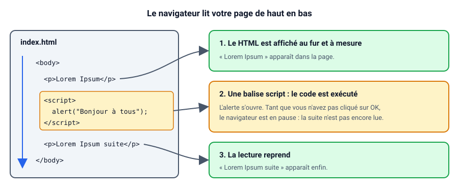
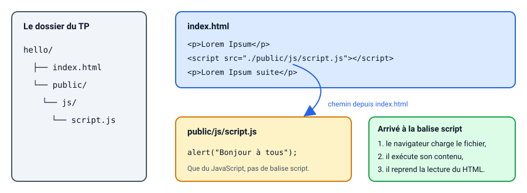
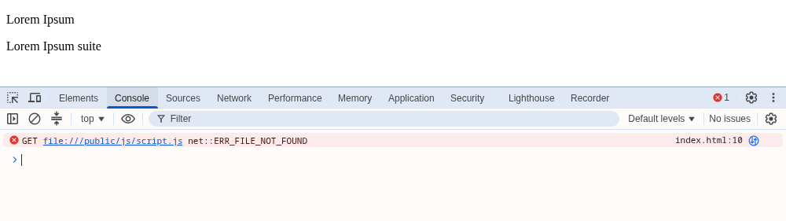
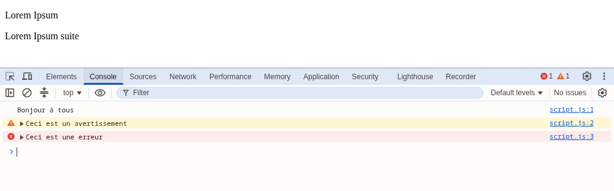

# Hello World

::: details Sommaire
[[toc]]
:::

C'est un grand classique, nous allons faire notre premier Hello World.

Jusqu'ici, tout votre code s'exécutait **sur le serveur** : le PHP fabrique une page HTML, puis l'envoie au navigateur. Le JavaScript, lui, s'exécute **dans le navigateur**, une fois la page reçue. Dans ce premier TP nous allons simplement faire parler le navigateur : une alerte, puis un message dans la console.

## Introduction

Nous avons vu dans [le cours](./support.md) qu'il était possible de mettre des balises script n'importe où dans le code HTML. Je vais vous laisser tester cette fonctionnalité avec trois cas d'usage.

## Prérequis

Pour ce TP, il vous faut :

- Un éditeur de code (VSCode par exemple) et un navigateur récent (Chrome, Firefox, Edge…).
- Savoir écrire une page HTML simple (voir [les fondamentaux du web](/pages/categories/les-fondamentaux-du-web.md)).
- [Le complément de cours JavaScript](./support.md#votre-premier-hello-world) ouvert à côté.

## Objectifs

À la fin de ce TP vous saurez :

- Écrire du JavaScript directement dans une page HTML avec la balise `script`.
- Ranger ce code dans un fichier `.js` externe, et le charger depuis la page.
- Ouvrir la console de votre navigateur et y lire vos messages (et vos erreurs).
- Afficher un message avec `alert` et avec `console.log`.

## Une alerte dans le code HTML

En utilisant le support de cours, mettre en place une alerte qui dit « Bonjour à tous » dans une page HTML créée pour l'occasion.

::: tip Point de contrôle
Quand vous ouvrez votre page, une fenêtre « Bonjour à tous » s'affiche. Une fois que vous avez cliqué sur « OK », la fenêtre se ferme et vous retrouvez votre page.
:::

::: tip Que se passe-t-il derrière ?
Le navigateur lit votre page de haut en bas. Quand il rencontre une balise `script`, il s'arrête, exécute le code qu'elle contient, puis reprend la lecture du HTML là où il en était. L'`alert` a une particularité : elle met **tout** en pause tant que vous n'avez pas cliqué sur « OK ».


:::

Une petite question pour vérifier que vous avez compris : si vous placez votre balise `script` **avant** le premier paragraphe de la page, que voyez-vous derrière l'alerte ?

::: details Réponse
Rien, la page est encore vide. Le navigateur n'a pas encore lu les paragraphes qui suivent la balise `script` : il ne peut donc pas les afficher. Ils apparaissent seulement après le clic sur « OK ».
:::

## Une alerte dans un script externe

Mettre le code dans la page directement n'est pas super. Je vous propose de sortir le code afin de le mettre dans un autre fichier. En utilisant les bonnes pratiques d'organisation que nous avons vues précédemment, je vous laisse mettre votre `alert` dans un fichier « externe ».

Pour vous aider à vous représenter les choses, voici une organisation possible :



Une fois mise en place, vérifier que votre code fonctionne tout le temps.

::: tip Point de contrôle
Le comportement est **exactement** le même qu'avant : l'alerte « Bonjour à tous » s'affiche à chaque ouverture (et à chaque rechargement) de la page. La différence est invisible pour l'utilisateur, elle est dans l'organisation de votre code.
:::

::: warning Attention au chemin
Le chemin écrit dans `src` est calculé **depuis votre page HTML**. Si le navigateur ne trouve pas le fichier, il ne vous affiche rien de spécial : la page s'affiche normalement… mais sans alerte. Le seul endroit où le problème est visible, c'est la console (nous allons l'ouvrir juste après).

Par exemple, un `src="/public/js/script.js"` (avec un `/` au début) sur une page ouverte par un double clic depuis vos fichiers va chercher le script à la racine de votre disque :



Avec un chemin relatif (`./public/js/script.js`), le fichier est cherché à côté de votre page, ce qui fonctionne dans tous les cas.
:::

## Remplacer l'alerte par un console.log

Je vous propose maintenant de tester la console de votre navigateur. La console va nous permettre de débugger un programme. Elle va nous permettre également d'afficher du texte (de debug). En utilisant la ligne de code suivante :

```js
console.log("Bonjour à tous");
```

Tester que celle-ci s'affiche bien dans la console de votre navigateur.

::: tip Ouvrir la console
`F12` (ou clic droit puis « Inspecter »), puis l'onglet « Console ». Raccourci direct : `Ctrl + Maj + J` sous Windows et Linux, `Cmd + Option + J` sur Mac (Chrome et Edge), `Ctrl + Maj + K` dans Firefox. Pensez à **recharger la page** une fois la console ouverte.
:::

::: tip Astuce de pro
Vous avez d'autres possibilités :

- `console.log`
- `console.error`
- `console.warn`
- …

Je vous laisse les tester.

:::

::: tip Point de contrôle
Plus aucune fenêtre ne s'ouvre : la page s'affiche directement, et votre message n'apparaît que dans la console. Voici ce que vous devez obtenir si vous avez aussi testé `console.warn` et `console.error` (chaque message est suivi du fichier et du numéro de ligne qui l'a produit) :


:::

Pourquoi préférer `console.log` à `alert` pour débugger, à votre avis ?

::: details Réponse
L'`alert` bloque la page et doit être fermée à chaque fois : avec plusieurs messages, ça devient vite pénible. `console.log` ne dérange pas l'utilisateur, garde l'historique de tous les messages, et indique le fichier et la ligne qui l'a affiché.
:::

:hand: Oui c'était simple… Mais l'idée est de prendre en main le langage. :hand:

## Conclusion

Récapitulons ce que vous savez faire maintenant :

- Exécuter du JavaScript dans une page avec la balise `script`, directement dans le HTML.
- Ranger ce code dans un fichier `.js` externe, chargé avec `<script src="…">` (et vérifier son chemin).
- Comprendre que le navigateur lit la page de haut en bas, et exécute le script au moment où il le rencontre.
- Ouvrir la console, y afficher des messages (`console.log`, `console.warn`, `console.error`) et y repérer les erreurs.

Gardez la console ouverte pendant **tous** vos développements JavaScript, à partir de maintenant c'est votre meilleure amie.

La suite ? [Le TP 1.1 pour manipuler des variables](./tp1.1.md).

👋 Si vous avez des questions, n'hésitez pas.
