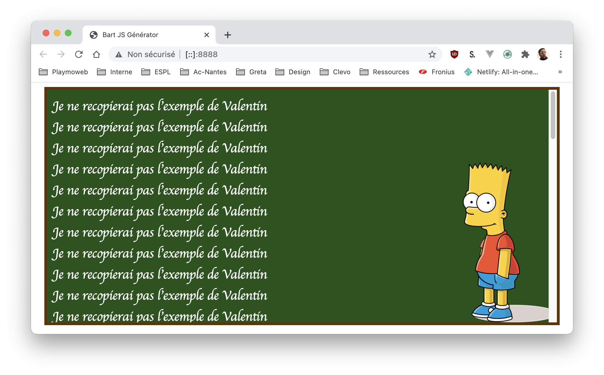
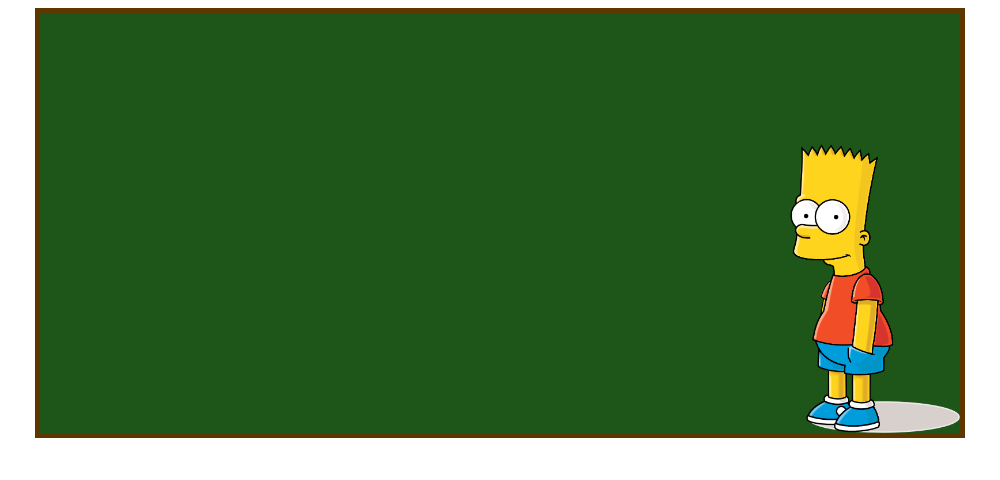
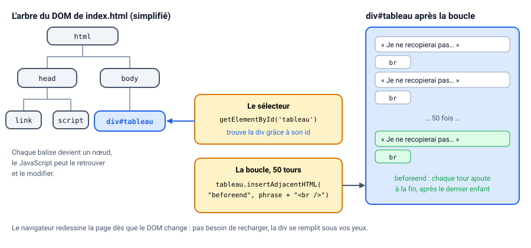
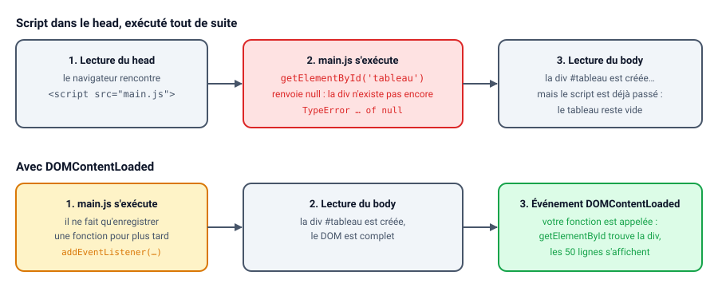

# Le retour de Bart

::: details Sommaire
[[toc]]
:::

[Vous vous souvenez du générateur de Bart écrit en PHP ?](/tp/php/tp1.1.md) Eh bien cette fois-ci nous allons coder la version JavaScript du générateur de phrase.

Dans le [TP précédent](./tp1.2.md) vous avez testé les sélecteurs sur une page fictive : ajouter un élément, en masquer un autre, changer un style. Nous passons maintenant à un vrai mini projet.

Dans ce TP nous allons pratiquer la manipulation du DOM en JavaScript. Bien que je trouve que ça ne soit pas forcément la meilleure façon de faire (je préfère de loin l'approche VueJS), il est complètement possible de créer, afficher, conditionner l'affichage d'éléments 100% avec du JavaScript. Dans ce TP vous allez écrire le code JavaScript afin de réaliser :



La grande différence avec la version PHP : ici, **aucun serveur ne fabrique la page**. Le navigateur reçoit un HTML presque vide, et c'est votre JavaScript qui le remplit, directement chez l'utilisateur.

## Prérequis

Pour ce TP, il vous faut :

- Les bases du JavaScript vues en semaine 1 : les variables, les boucles et les sélecteurs ([TP 1](./tp1.md), [TP 1.1](./tp1.1.md) et [TP 1.2](./tp1.2.md)).
- [Le support de cours](/tp/javascript/support.md#manipuler-le-html-et-la-css), partie « Manipuler le HTML et la CSS », à portée de main.
- La CSS et l'image du [Bart en version PHP](/tp/php/tp1.1.md).

::: details Rattrapage : vous n'avez plus la CSS ni l'image de Bart ?
Pas de panique. L'image est [disponible ici](/demo/js/bart/public/img/bart.png) (clic droit, « Enregistrer l'image sous… » dans `public/img/`), et voici la feuille de style utilisée pour les captures de ce TP, à placer dans `public/style/main.css` :

```css
#tableau {
  background-color: #1e5518;
  color: white;
  border: 5px solid #5e3600;
  padding: 10px;
  max-width: 900px;
  margin: auto;
  height: 400px;
  overflow: auto;
  background-image: url(../img/bart.png);
  background-size: 170px;
  background-repeat: no-repeat;
  background-position: bottom right;
  font-family: cursive;
  font-size: x-large;
}
```

:::

## Objectifs

À la fin de ce TP vous saurez :

- Organiser un petit projet front (HTML, CSS et JavaScript dans des fichiers séparés).
- Retrouver un élément de la page avec un sélecteur (`getElementById`).
- Ajouter du contenu dans la page depuis une boucle JavaScript.
- Expliquer pourquoi un script placé dans le `head` ne trouve pas les éléments de la page, et attendre l'événement `DOMContentLoaded`.
- Lire une erreur dans la console du navigateur.

## Création de la structure

Nous l'avons fait de multiples fois, je vous laisse mettre en place la structure de votre projet. Je souhaite cependant que celle-ci respecte quelques règles :

- Votre fichier HTML doit s'appeler `index.html`.
- L'ensemble de vos ressources `public` doivent être dans un dossier `public`.
- La CSS doit être externalisée dans un dossier nommé `style`.
- Le JavaScript doit être dans un fichier `main.js` dans un dossier nommé `js`.

Ce qui donne :

```text
bart-js/
├── index.html
└── public/
    ├── img/
    │   └── bart.png
    ├── js/
    │   └── main.js
    └── style/
        └── main.css
```

::: tip La fainéantise ! La clé du succès 🔑
Nous en avons déjà parlé, un développeur doit être efficace (et fainéant)… Ne vous amusez donc pas à recoder l'ensemble. Reprenez le code que vous avez réalisé lors de la création du [Bart en version PHP](/tp/php/tp1.1.md)
:::

::: danger Halt !

Quelques petits rappels…

```HTML
<!-- Inclure une CSS -->
<link rel="stylesheet" href="public/style/main.css" />

<!-- Inclure un fichier JS -->
<script src="public/js/main.js"></script>
```

:::

## Le HTML

Voilà la structure de **mon HTML** :

```html
<!DOCTYPE html>
<html lang="fr">
  <head>
    <meta charset="UTF-8" />
    <meta name="viewport" content="width=device-width, initial-scale=1.0" />
    <title>Bart JS Générator</title>
    <link rel="stylesheet" href="public/style/main.css" />
    <script src="public/js/main.js"></script>
  </head>
  <body>
    <div id="tableau"></div>
  </body>
</html>
```

Oui, c'est tout. La `div` est vide : c'est le JavaScript qui va la remplir.

::: tip Point de contrôle
Créez un fichier `main.js` vide pour l'instant, puis ouvrez `index.html` dans votre navigateur. Vous devez obtenir le tableau, vide, avec Bart dans le coin :



Pas de tableau ? Ouvrez les outils de développement (F12), onglet « Console » ou « Réseau » : un fichier en erreur 404 signifie que le chemin de votre CSS (ou de l'image dans la CSS) ne correspond pas à votre structure.
:::

## Le JS

Votre fichier JavaScript va contenir la logique de notre application. Pour rappel, celle-ci est très simple, elle ne « fait que » afficher des phrases dans la `div` avec comme identifiant `#tableau`.

Votre travail va donc se résumer à :

- Créer les variables (phrase et nombre de lignes).
- Une boucle (type `for`, voir vos notes ou le cours).
- Un sélecteur pour obtenir le tableau (`let tableau = document.getElementById('tableau');`)
- L'ajout d'élément « dans la div tableau ». ([voir le support](/tp/javascript/support.md#creer-des-elements-dans-la-page))

Pour résumer ce que va faire votre code :



::: tip réfléchir avant d'agir
Écrire le code immédiatement est tentant ? Mais arrêtons-nous un instant pour réfléchir à notre code. Tenter d'écrire votre code en français (ou via un diagramme)
:::

Question : que contient la variable `tableau` si aucun élément de la page n'a l'identifiant `tableau` ?

::: details Réponse
`null`, c'est-à-dire « rien ». `getElementById` ne plante pas quand il ne trouve rien, il renvoie `null`. C'est la ligne **suivante**, celle qui essaie d'utiliser `tableau`, qui provoque une erreur. Gardez cette réponse en tête, elle va servir tout de suite.
:::

### Où placer le JS ?

Maintenant que vous avez votre code JavaScript, vous avez deux solutions :

- La première est de mettre votre JS à la fin de votre HTML. L'objectif : faire en sorte que celui-ci soit exécuté quand votre page est chargée. (À votre avis, est-ce une bonne idée ?)
- La seconde est de mettre votre JS dans le `head` de votre site. Celui-ci sera donc chargé au plus tôt par contre le code sera lancé immédiatement… Alors, comment faire ?

::: details Réponse : le JS à la fin du HTML, une bonne idée ?
Ça fonctionne : quand le navigateur arrive au `script`, il a déjà lu le `body`, la `div` existe. Mais votre code dépend alors de **l'endroit** où est placée la balise : le jour où quelqu'un la déplace dans le `head`, la page casse sans prévenir. On préfère un code qui fonctionne où qu'il soit placé.
:::

Essayez donc votre code tel quel, avec le `script` dans le `head` comme dans mon HTML. Le tableau reste vide, et la console (F12, onglet « Console ») affiche une erreur de ce genre :

```text
Uncaught TypeError: Cannot read properties of null (reading 'insertAdjacentHTML')
    at main.js:7:13
```

::: tip Que se passe-t-il derrière ?
Le navigateur lit votre HTML **de haut en bas**, et exécute chaque `script` au moment où il le rencontre. Dans le `head`, la `div` du `body` n'a pas encore été lue : `getElementById` renvoie `null`, et la ligne suivante plante.


:::

::: tip La solution ?
Attendre que votre page « soit entièrement chargée » afin de déclencher votre JavaScript ! Cet évènement est appelé `Dom Ready` (il est très important), dès que cet évènement est « levé » vous pouvez exécuter votre JS.
:::

Concrètement il faut écrire :

_En pur JS :_

```js
document.addEventListener("DOMContentLoaded", function () {
  // Votre code ici
  console.log("Je m'affiche quand la page est chargée entièrement.");
});
```

::: tip Une petite remarque
Vous croiserez peut-être dans du code existant l'écriture jQuery équivalente : `$(function () { … });`. C'est plus concis, mais ça nécessite une librairie externe. On verra qu'avec VueJS ça sera encore plus simple, sans réinventer la roue.
:::

::: tip Point de contrôle
Avec ce code dans votre `main.js`, rechargez la page et regardez la console : le message `Je m'affiche quand la page est chargée entièrement.` apparaît, sans aucune erreur en rouge.
:::

Je vous laisse écrire le code nécessaire au bon fonctionnement de votre site.

::: details Bloqué ?
Besoin d'aide ? [Voici ma version](/demo/js/bart/index.html)
:::

::: tip Point de contrôle
Votre page affiche la phrase autant de fois que demandé, comme sur la capture en haut de ce TP. Changez la valeur de vos variables (phrase, nombre de lignes) et rechargez : le tableau suit.
:::

## Allons plus loin

::: tip Vous êtes en avance ?
Cette partie est un bonus pour les étudiants qui ont terminé. [jQuery](https://jquery.com/) n'est plus un choix automatique aujourd'hui, mais vous le croiserez très certainement dans des projets existants en entreprise. Autant savoir le reconnaitre et le manipuler.
:::

Vous avez codé votre application en pur JS. Je vous laisse migrer votre code pour utiliser :

- Les sélecteurs [jQuery](https://jquery.com/).
- La création et la manipulation du DOM grâce à jQuery.

::: tip Petit rappel

Inclure jQuery dans votre projet est aussi simple que d'ajouter dans votre `head`, **avant** votre `main.js` (sinon `$` n'existe pas encore quand votre code s'exécute) :

```html
<script src="https://ajax.googleapis.com/ajax/libs/jquery/3.7.1/jquery.min.js"></script>
```

:::

C'est à vous, je vous laisse travailler.

[Le projet complet de ce TP est téléchargeable ici](/demo/javascript/bart-js.zip) (la version en pur JavaScript, sans le bonus jQuery).

## Conclusion

Récapitulons ce que vous savez faire maintenant :

- Organiser un projet front : `index.html`, la CSS dans `public/style/`, le JavaScript dans `public/js/`.
- Retrouver un élément de la page avec `getElementById` (et savoir qu'il renvoie `null` quand il ne trouve rien).
- Remplir la page depuis une boucle avec `insertAdjacentHTML`.
- Attendre `DOMContentLoaded` avant de toucher au DOM, quel que soit l'endroit où est placé le script.
- Lire une erreur dans la console : c'est le premier réflexe quand « il ne se passe rien ».

Pour l'instant, c'est encore **vous** qui choisissez la phrase, dans le code. La suite ? [Le TP 3 pour demander la phrase à l'utilisateur avec un formulaire](./tp3.md).

👋 Si vous avez des questions, n'hésitez pas.
