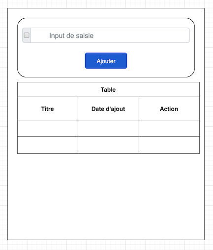
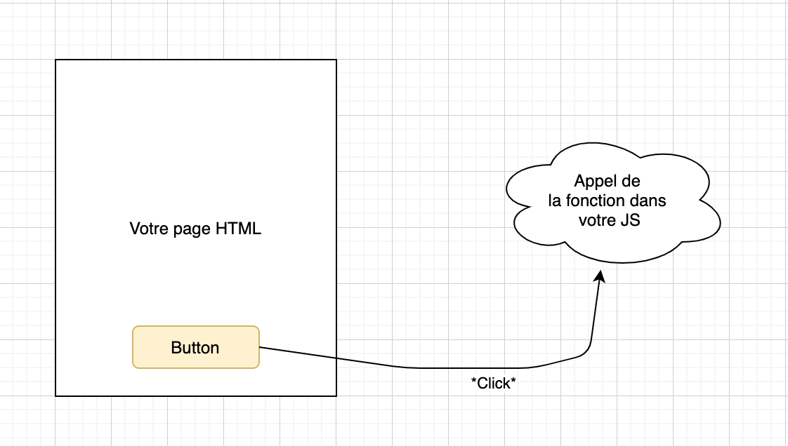
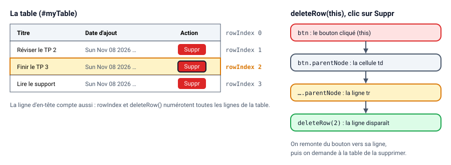
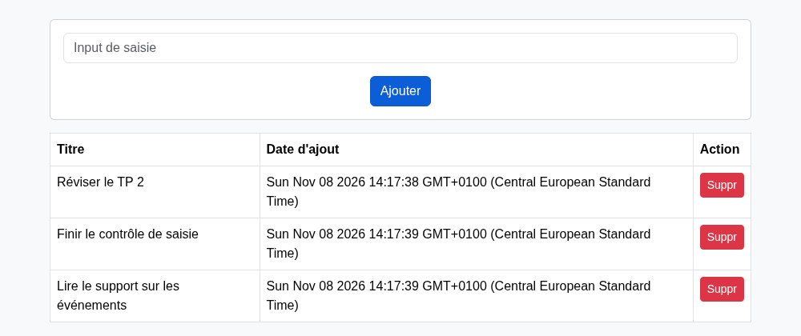
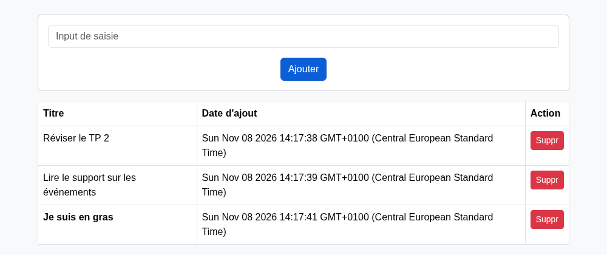

# Interactivité

::: details Sommaire
[[toc]]
:::

::: tip Pour les étudiants en avance
Ce TP est un bonus : faites-le si vous avez terminé le [TP 3](./tp3.md) et qu'il vous reste du temps. Il n'est pas nécessaire pour la suite du parcours.
:::

Nous avons créé dans l'exemple précédent une page avec un formulaire. Je vous propose un autre exemple très simple, nous allons créer une page interactive avec seulement du JavaScript.

Au [TP 3](./tp3.md), le JavaScript **remplaçait** le contenu du tableau à chaque validation. Ici, chaque clic va **ajouter** une ligne à une table, et chaque ligne aura son propre bouton pour se supprimer : la page grandit et rétrécit au gré des actions de l'utilisateur.

Cette fois-ci je vous laisse travailler avec comme seule information « mon cahier des charges » / « le visuel que je souhaite ».



## Prérequis

Pour ce TP, il vous faut :

- Avoir terminé le [TP 3](./tp3.md) : lire une saisie, attacher un événement, modifier la page.
- [L'aide-mémoire](/cheatsheets/javascript/) et [le support de cours](/tp/javascript/support.md), en particulier [« Les évènements »](/tp/javascript/support.md#les-evenements) et [« Allons un peu plus loin »](/tp/javascript/support.md#allons-un-peu-plus-loin) (se « balader » dans le DOM).

## Objectifs

À la fin de ce TP vous saurez :

- Construire une page à partir d'un cahier des charges et d'une maquette, sans pas-à-pas.
- Ajouter des lignes dans une table HTML depuis le JavaScript.
- Retrouver, depuis le bouton cliqué, la ligne à laquelle il appartient, et la supprimer.
- Repérer le risque d'insérer une saisie utilisateur sous forme de HTML.

## Cahier des charges

- La page doit être en HTML.
- Le champ de saisie permet de saisir du texte libre.
- Le bouton ajouté doit :
  - Ajouter une ligne dans la table présente en dessous.
  - La colonne titre est remplie avec la valeur saisie.
  - La colonne date contient la date au moment de l'ajout. `Date()`.
  - L'action est un bouton permettant de supprimer la ligne en question.
- Votre JavaScript doit être externalisé (fichier .js)

## Technologies souhaitées

Pour réaliser cette page, je vous propose d'utiliser :

- Bootstrap (ou Tailwind).
- Du VanillaJS (ou jQuery si vous voulez pratiquer la syntaxe vue en bonus).
- Datatable pour avoir une table interactive. (en option, plus complexe)

Je vous laisse plancher sur le sujet. N'oubliez pas :

- [L'aide-mémoire](/cheatsheets/javascript/)
- [Le support de cours](/tp/javascript/support.md)

::: danger STOP

⚠️ Un appel important ⚠️

En JavaScript votre code est appelé au moment de l'interaction, **il doit donc toujours être dans une fonction** :



:::

::: details Quelques éléments en vrac pour aider

### Obtenir la valeur d'un input

```js
// En jQuery
$("#idDeLinput").val();

// En VanillaJS
document.getElementById("idDeLinput").value;
```

### Ajouter des éléments dans un tableau

```js
$("#myTable").append(
  "<tr><td>" + phrase + "</td><td>" + Date() + "</td><td>L'input…</td></tr>"
);
```

### Obtenir la date actuelle

```js
Date();
```

`Date()` renvoie la date en anglais (`Sun Nov 08 2026 14:17:38 GMT+0100…`). Pour un affichage à la française : `new Date().toLocaleString("fr-FR")`.

### Supprimer la ligne d'un tableau

```html
<tr>
  <td><button onclick="deleteRow(this)">Suppr</button></td>
</tr>
```

```js
// Avec jQuery
function deleteRow(elem) {
  $(elem).closest("tr").remove();
}

// Avec du JS
function deleteRow(btn) {
  const d = btn.parentNode.parentNode.rowIndex;
  document.getElementById("myTable").deleteRow(d);
}
```

Ce que fait la version en JavaScript :



::: warning Une fonction appelée depuis le HTML
Avec `onclick="deleteRow(this)"`, c'est le HTML qui appelle la fonction : elle doit donc être déclarée **directement** dans votre fichier `.js`, pas à l'intérieur de votre `DOMContentLoaded`. Sinon, la console vous répondra `deleteRow is not defined`.
:::

### Rafraichir la table

C'est du test, nous sommes en mode sauvage.

```js
$("#myTable").DataTable().destroy();

$("#myTable").DataTable();
```

:::

::: tip Point de contrôle
Saisissez un titre et cliquez sur « Ajouter » plusieurs fois : une ligne apparait à chaque clic, avec la date de l'ajout et son bouton de suppression. Par exemple :



Un clic sur le « Suppr » d'une ligne retire **cette** ligne, et seulement elle.
:::

Question : que se passe-t-il si vous saisissez `<b>Je suis en gras</b>` dans le champ, puis cliquez sur « Ajouter » ?

::: details Réponse
Si vous construisez la ligne en concaténant la saisie dans du HTML (comme dans l'exemple `append` ci-dessus, ou avec `insertAdjacentHTML`), le navigateur **interprète** la saisie : le titre s'affiche en gras.



Ici c'est amusant, mais remplacez `<b>` par une balise `` piégée ou un `<script>`, et c'est une faille XSS : le code saisi s'exécute dans la page. C'est le danger signalé dans [le support](/tp/javascript/support.md#exemple-de-creation-d-elements-version-alternative). Pour du texte venu de l'utilisateur, préférez `textContent` (ou `.text()` en jQuery), qui affiche la saisie telle quelle.
:::

## Conclusion

Récapitulons ce que vous avez pratiqué dans ce TP :

- Partir d'une maquette et d'un cahier des charges pour construire une page complète.
- Ajouter des lignes dans une table à chaque action de l'utilisateur.
- Remonter du bouton cliqué jusqu'à sa ligne (`parentNode`, ou `closest` en jQuery) pour la supprimer.
- Vous méfier d'une saisie utilisateur insérée comme du HTML.

La suite ? La semaine prochaine, place à l'Ajax avec [le TP 4](./tp4.md).

👋 Si vous avez des questions, n'hésitez pas.
