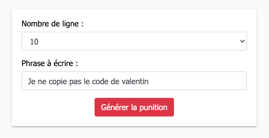
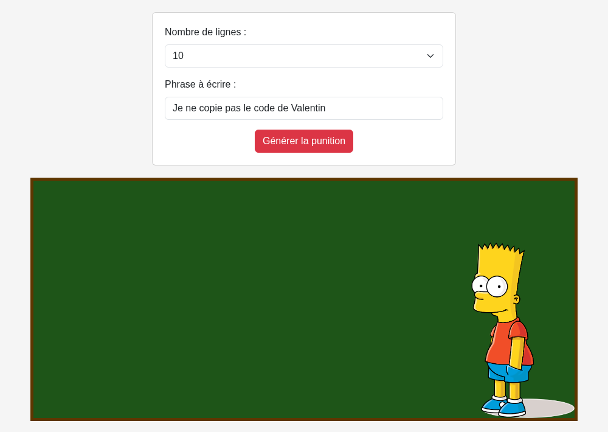
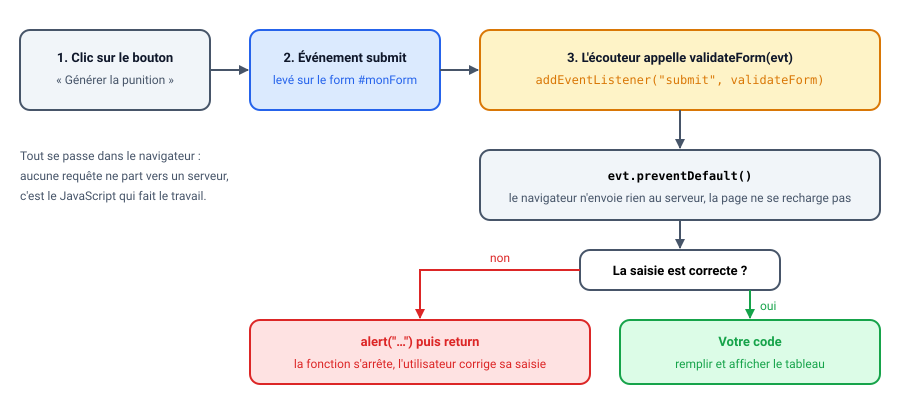
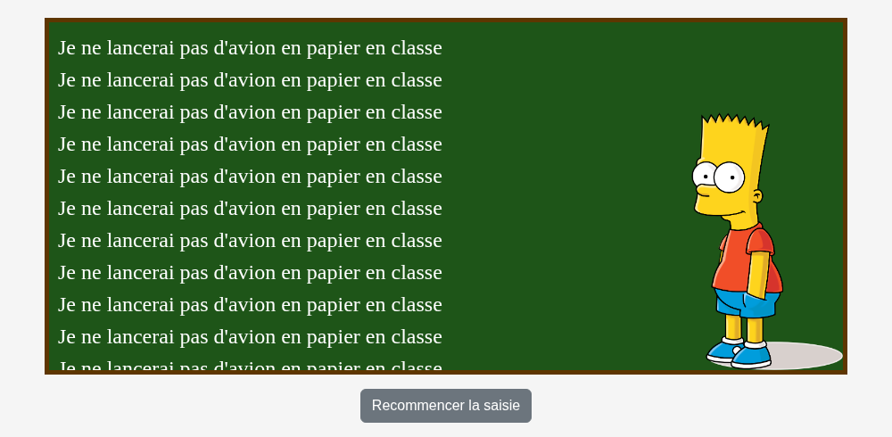
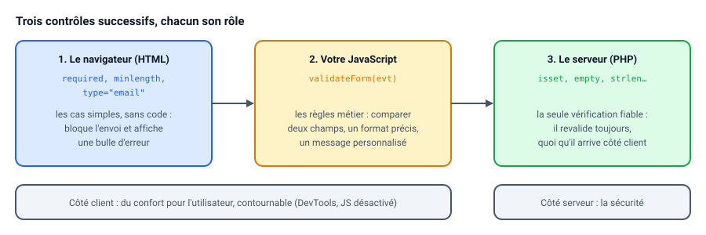

# Contrôle de saisie & interactivité

::: details Sommaire
[[toc]]
:::

Le JavaScript, comme je l'indiquais en introduction, est partout. Pour l'instant, nous allons le limiter principalement aux interactions utilisateurs (contrôle de saisie, validation de formulaire, interactivité).

Dans le [TP précédent](./tp2.md), votre JavaScript remplissait le tableau de Bart dès le chargement de la page, avec une phrase écrite en dur dans le code. Nous allons maintenant pratiquer les événements JavaScript en ajoutant à notre TP Bart ([Version JavaScript](/tp/javascript/tp2.md)) un simple formulaire puis des contrôles de saisie : c'est l'utilisateur qui choisira la phrase, et le code ne réagira qu'**au moment où** il valide.

L'objectif étant donc d'ajouter des contrôles de saisie sur votre page formulaire.

Deux solutions sont possibles : coder les contrôles nous-mêmes en JavaScript, ou s'appuyer sur la validation native du navigateur. Nous allons voir les deux.

## Prérequis

Pour ce TP, il vous faut :

- Le projet Bart en JavaScript du [TP 2](./tp2.md), fonctionnel.
- [Le support de cours](/tp/javascript/support.md), parties [« Obtenir les valeurs d'un input »](/tp/javascript/support.md#obtenir-les-valeurs-d-un-input) et [« Les événements »](/tp/javascript/support.md#les-evenements).
- [L'aide-mémoire](/cheatsheets/javascript/) à portée de main.

::: details Rattrapage : votre TP 2 ne fonctionne pas ?
Pas de panique. [Le projet complet du TP 2 est téléchargeable ici](/demo/javascript/bart-js.zip), partez de cette version.
:::

## Objectifs

À la fin de ce TP vous saurez :

- Attacher une fonction à l'événement `submit` d'un formulaire avec `addEventListener`.
- Empêcher l'envoi du formulaire avec `evt.preventDefault()` pour que le JavaScript fasse le travail.
- Lire les valeurs saisies par l'utilisateur et les contrôler.
- Afficher et masquer des éléments de la page en réponse à une action.
- Utiliser la validation native du navigateur (`required`, `minlength`, `type="email"`) en complément de la vôtre, et savoir pourquoi le serveur doit toujours revalider.

## Ajouter le formulaire sur votre page

La première étape va être d'ajouter dans la page un formulaire HTML qui doit ressembler à :



Je vous laisse écrire le code _et le style_ du formulaire en question. Quelques règles :

- Vous pouvez ajouter Bootstrap si vous le souhaitez.
- Vous devez utiliser un « form »
- Vous devez externaliser la CSS.
- Votre formulaire doit être avant le tableau.

::: tip Point de contrôle
Pour l'instant, rien n'est branché : la page affiche le formulaire, puis le tableau (vide ou rempli par votre code du TP 2, selon ce que vous avez gardé). Par exemple, avec Bootstrap :



Cliquez sur le bouton : la page se recharge et rien d'autre ne se passe. C'est normal, c'est ce que nous allons changer.
:::

## La validation sans Librairie

Ajouter des contrôles, finalement c'est simple. Il « faut juste » :

- Ajouter un événement « onSubmit ».
- Vérifier que les champs `input` ne sont pas vides (ou du moins, possèdent les valeurs attendues).

En pratique ça va donner :

```javascript
function validateForm(evt) {
  // Empêche l'envoi du formulaire au serveur (nous n'en avons pas ici),
  // c'est notre JavaScript qui va faire le travail.
  evt.preventDefault();

  const name = document.getElementById("name").value;
  const password = document.getElementById("password").value;

  if (name == null || name == "") {
    alert("Name can't be blank");
    return;
  }

  if (password.length < 6) {
    alert("Password must be at least 6 characters long.");
    return;
  }

  // Cas de réussite : la saisie est valide, votre code ici.
}

// Attacher l'événement en JS, une fois la page chargée (comme au TP 2,
// sinon le formulaire n'existe pas encore quand ce code s'exécute).
document.addEventListener("DOMContentLoaded", function () {
  document
    .getElementById("monForm")
    .addEventListener("submit", validateForm, true);
});

// Vous pouvez également attacher l'événement directement dans le HTML avec
// <form onsubmit="validateForm(event)">
// …
```

::: warning Un exemple à adapter
Cet exemple vient d'un formulaire de connexion (un nom et un mot de passe). Votre formulaire Bart n'a pas ces champs : à vous d'adapter les identifiants et les règles à **vos** champs (la phrase, le nombre de lignes). Et pensez à donner l'identifiant `monForm` à votre `form`.
:::

::: tip Un Instant !
`evt.preventDefault()` ? Eh oui, c'est aussi simple que ça ! En JS si vous souhaitez stopper la soumission d'un formulaire il suffit d'appeler `evt.preventDefault()` dans votre fonction de validation. Votre navigateur saura automatiquement qu'il doit arrêter immédiatement la soumission du formulaire. Votre _serveur ne recevra donc **pas**_ les données.
:::

Pour résumer, voici ce qui se passe quand l'utilisateur clique sur le bouton :



::: tip Que se passe-t-il derrière ?
`addEventListener("submit", validateForm)` n'appelle **pas** la fonction : il la confie au navigateur, qui l'appellera lui-même à chaque soumission, en lui passant un objet `evt` qui décrit l'événement. C'est pour cela que l'on écrit `validateForm` sans parenthèses.

Dans la version HTML, c'est le mot `event` qui désigne cet objet : `onsubmit="validateForm(event)"`. Attention à ne pas écrire `validateForm(this)` : `this` serait le formulaire, pas l'événement, et `evt.preventDefault()` provoquerait l'erreur `evt.preventDefault is not a function`… puis le formulaire partirait quand même.
:::

Question : que se passe-t-il si vous oubliez la ligne `evt.preventDefault()` ?

::: details Réponse
Le navigateur fait son travail normal : il **envoie** le formulaire. Comme notre `form` n'a pas d'`action`, il l'envoie à la page elle-même, qui se recharge. Votre JavaScript a peut-être eu le temps de remplir le tableau, mais tout disparaît au rechargement : on a l'impression que « rien ne marche ».
:::

### À faire

- Je vous laisse le mettre en place dans votre code.
- Rendre la page interactive avec les données saisies (via un `onsubmit` en HTML ou, `submit` via les events)

::: tip Point de contrôle
Videz le champ de la phrase et validez : une fenêtre d'alerte s'ouvre avec **votre** message, et la page ne se recharge pas. Avec une saisie correcte, plus d'alerte, et toujours pas de rechargement : la suite se passe dans votre code.
:::

## Faire l'action souhaitée

Maintenant que nos informations sont validées, il faut les utiliser dans la page. En reprenant [le code du TP précédent](./tp2.md), je vous laisse intégrer la logique suivante :

- Le tableau ne doit pas être visible au chargement de la page.
- Une fois la validation du formulaire effective (saisie correcte), le tableau doit s'afficher avec dedans la phrase choisie par l'utilisateur (ainsi que le nombre).
- Le formulaire ne doit plus être visible (ainsi que la `card` dans laquelle celui-ci est).
- « Une action » recommencer la saisie doit permettre de :
  - Masquer le tableau
  - Afficher le formulaire à nouveau

::: tip Rappels

Je vous rappelle que vous avez [l'aide-mémoire](/cheatsheets/javascript/) ainsi que le [support du cours](/tp/javascript/support.md) pour vous aider. Mais l'ensemble va reposer sur :

- Des sélecteurs, exemple `document.getElementById('tableau')`.
- L'obtention de valeur, exemple `document.getElementById('monInputText').value`.
- Masquer / afficher des éléments, exemple `document.getElementById('monInputText').className='hidden'`. La classe `hidden` doit exister dans **votre** CSS (`.hidden { display: none; }`), le navigateur ne la connait pas tout seul. Pour ajouter ou retirer une seule classe sans écraser les autres, voyez aussi `classList.add` et `classList.remove` dans [le support](/tp/javascript/support.md#jouer-sur-la-visibilite).

:::

::: tip Point de contrôle
Au chargement, seul le formulaire est visible. Après une saisie correcte, le formulaire disparait et le tableau affiche **votre** phrase, autant de fois que demandé :



Un clic sur votre action « recommencer » masque le tableau et réaffiche le formulaire.
:::

## Avec la validation native du navigateur

Nous avons vu la façon manuelle de valider les formulaires. Je pense que sans vous faire un dessin… vous vous rendez compte que si nous avons 200 champs, ça va être plus compliqué ! D'autant plus que plus notre formulaire sera complexe, plus celui-ci aura des règles complexes.

Heureusement, votre navigateur sait déjà faire une grande partie du travail, directement en HTML :

```html
<input type="text" id="name" required minlength="2" />
<input type="password" id="password" required minlength="6" />
<input type="email" id="email" required />
```

Avec les attributs `required`, `minlength`, `type="email"`, etc. le navigateur bloque la soumission et affiche un message d'erreur, sans une seule ligne de JavaScript.

::: tip Alors pourquoi avoir codé la validation ?
Bonne question ! La validation native couvre les cas simples. Le JavaScript reste nécessaire pour les règles métier (comparer deux champs, vérifier un format spécifique, afficher une erreur personnalisée…). En pratique, on combine les deux. Et rappelez-vous : la validation côté client est du **confort utilisateur**, le serveur doit **toujours** revalider les données (vous l'avez vu en PHP).


:::

Question : avec `required minlength="5"` sur le champ de la phrase, une phrase composée de six espaces est-elle acceptée par le navigateur ?

::: details Réponse
Oui. Pour le navigateur, six espaces font bien six caractères : le champ n'est pas vide et dépasse la longueur minimale. C'est typiquement le genre de règle que la validation native ne couvre pas, et que votre JavaScript doit garder.
:::

### À faire

Réécrire votre formulaire pour utiliser la validation native du navigateur en complément de votre validation JavaScript.

::: tip Point de contrôle
Videz le champ de la phrase et validez : cette fois, c'est le **navigateur** qui affiche une bulle d'erreur sous le champ (« Veuillez renseigner ce champ »), et votre fonction `validateForm` n'est même pas appelée. Vos contrôles JavaScript continuent de jouer pour ce que le HTML ne sait pas vérifier.
:::

## Conclusion

Récapitulons ce que vous savez faire maintenant :

- Réagir à une action de l'utilisateur : `addEventListener("submit", maFonction)` (ou `onsubmit="maFonction(event)"` dans le HTML).
- Empêcher l'envoi du formulaire avec `evt.preventDefault()`, pour que le JavaScript prenne la main.
- Lire une saisie avec `.value` et la contrôler avant de l'utiliser.
- Afficher et masquer des parties de la page avec une classe CSS.
- Combiner la validation native du navigateur et la vôtre, en sachant que seul le serveur offre une vraie garantie.

Vous êtes en avance ? [Le TP 3.1 pour une page 100% interactive](./tp3.1.md). Sinon, la semaine prochaine, place à l'Ajax avec [le TP 4](./tp4.md).

👋 Si vous avez des questions, n'hésitez pas.
