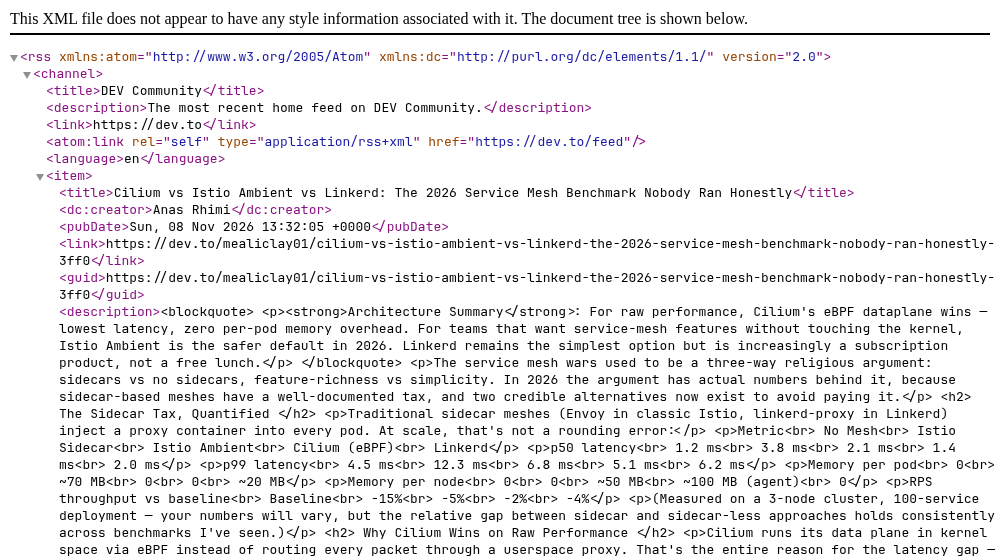
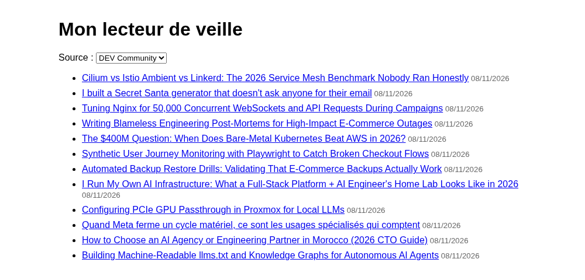
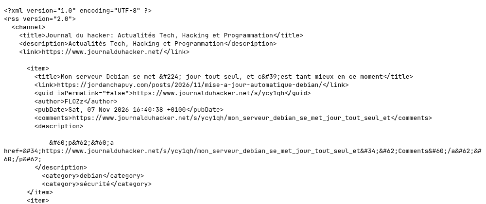

# Mon lecteur de veille (Ajax, RSS et CORS)

::: details Sommaire
[[toc]]
:::

::: tip Pour les étudiants en avance
Ce TP est un bonus : il prolonge le [TP 4](./tp4.md) avec un nouveau format (le XML des flux RSS) et le problème que l'on y avait juste effleuré, le **CORS**. Si vous n'avez pas terminé le TP 4, terminez-le d'abord.
:::

Dans le [TP 4](./tp4.md), vous avez appelé avec `fetch` votre propre API, puis une API publique (`dummyjson.com`) qui avait choisi d'accepter les appels de n'importe quel site. Ici, nous allons construire un petit outil que vous pourrez vraiment utiliser : un **lecteur de veille**, une page qui affiche les derniers articles de plusieurs sites d'actualité technique.

Ces sites publient leurs articles dans un **flux RSS**, un fichier XML. Le premier flux va se lire sans difficulté… et le deuxième va refuser. Nous verrons pourquoi, puis comment s'en sortir proprement avec quelques lignes de PHP.

## Prérequis

- Le [TP 4](./tp4.md) : `fetch`, les `.then()` et `response.text()`.
- Créer un élément avec `document.createElement` et le remplir avec `textContent`, comme dans [le support](./support.md#exemple-de-creation-d-elements-version-alternative) et le [TP 3.1](./tp3.1.md).
- Les bases du PHP : `$_GET`, un tableau, `header` (vu dans le [TP 4](./tp4.md) et dans [la BTS TV 2.0](./tp4.1.md)).
- XAMPP / WAMP démarré, ou le serveur intégré à PHP (`php -S localhost:9000` dans le dossier du projet, comme dans le [TP 4](./tp4.md#prerequis)).

::: warning Pas de double-clic sur index.html
Comme dans le TP 4, ouvrez toujours votre page via un serveur (`http://localhost/...` ou `http://localhost:9000/index.html`), jamais en double-cliquant dessus. Dans la dernière partie, c'est un fichier PHP qui fera le travail : sans serveur, il ne serait jamais exécuté.
:::

## Objectifs

À la fin de ce TP vous saurez :

- Expliquer ce qu'est un flux RSS et à quoi il sert pour votre veille.
- Lire une réponse XML avec `fetch`, `response.text()` et `DOMParser`, puis la parcourir avec `querySelectorAll`.
- Construire l'affichage avec `createElement` et `textContent`, sans risque de XSS.
- Reconnaître une erreur CORS dans la console et expliquer la politique de même origine.
- Écrire un relais PHP qui ne récupère que des sources autorisées (liste blanche), et expliquer pourquoi un relais ouvert est dangereux.

## Un flux RSS ?

Vous allez devoir faire de la veille technologique pendant tout votre BTS : suivre l'actualité de votre domaine, régulièrement. Aller voir dix sites chaque matin, c'est long. La plupart des sites d'actualité proposent donc un **flux RSS** : un fichier XML, toujours à la même adresse, qui contient la liste de leurs derniers articles (titre, lien, date…). Un « lecteur de flux » va chercher ces fichiers et vous présente tout au même endroit.

C'est ce lecteur que nous allons écrire. Voici les sources que nous allons utiliser :

| Source | Adresse du flux |
| --- | --- |
| DEV Community | `https://dev.to/feed` |
| TLDR Tech | `https://tldr.tech/api/rss/tech` |
| Journal du hacker | `https://www.journalduhacker.net/rss` |

## La page de départ

Créez un dossier `lecteur-veille` avec un fichier `index.html` :

```html
<!DOCTYPE html>
<html lang="fr">
  <head>
    <meta charset="UTF-8" />
    <meta name="viewport" content="width=device-width, initial-scale=1.0" />
    <title>Mon lecteur de veille</title>
    <style>
      body {
        font-family: sans-serif;
        max-width: 800px;
        margin: 2rem auto;
        padding: 0 1rem;
      }
      li {
        margin-bottom: 0.5rem;
      }
      small {
        color: #666;
      }
    </style>
  </head>
  <body>
    <h1>Mon lecteur de veille</h1>

    <label for="source">Source :</label>
    <select id="source">
      <option value="devto">DEV Community</option>
    </select>

    <ul id="articles">
      <!-- Rempli par veille.js -->
    </ul>

    <script src="veille.js"></script>
  </body>
</html>
```

Rien de nouveau : une liste déroulante pour choisir la source, une liste vide que votre JavaScript remplira, et un script externe `veille.js` (que nous allons écrire juste après).

Notez la `value` de l'option : `devto`. C'est un **identifiant** de source, pas une adresse. Gardez ce détail en tête, il aura toute son importance à la fin du TP.

## Lire un premier flux

### Regarder la donnée d'abord

Le réflexe du TP 4 : avant d'écrire le code, on regarde ce que l'on va recevoir. Ouvrez `https://dev.to/feed` dans un nouvel onglet :



- Quelle balise contient chaque article ?
- Dans cette balise, où trouvez-vous le titre, le lien et la date ?

::: details Réponse
Chaque article est une balise `<item>`, placée dans `<channel>`, lui-même dans `<rss>`. Dans chaque `<item>` : le titre dans `<title>`, l'adresse de l'article dans `<link>` et la date de publication dans `<pubDate>`. C'est le format RSS 2.0, le même pour tous les sites qui l'utilisent : un code qui sait lire un flux sait donc les lire tous.
:::

### Le code

Créez `veille.js`, à côté de `index.html` :

```js
// Les flux que l'on sait lire : un identifiant, une adresse
const sources = {
  devto: "https://dev.to/feed",
};

function afficherArticles(texte) {
  // On transforme le texte reçu en document XML que l'on peut parcourir
  const xml = new DOMParser().parseFromString(texte, "text/xml");
  const liste = document.getElementById("articles");
  liste.innerHTML = "";

  xml.querySelectorAll("item").forEach((item) => {
    const titre = item.querySelector("title").textContent;
    const lien = item.querySelector("link").textContent;
    const date = new Date(item.querySelector("pubDate").textContent);

    const a = document.createElement("a");
    a.href = lien;
    a.target = "_blank";
    a.textContent = titre;

    const quand = document.createElement("small");
    quand.textContent = " " + date.toLocaleDateString("fr-FR");

    const li = document.createElement("li");
    li.append(a, quand);
    liste.append(li);
  });
}

function chargerSource() {
  const id = document.getElementById("source").value;
  document.getElementById("articles").innerHTML = "<li>Chargement…</li>";

  fetch(sources[id])
    .then((response) => response.text())
    .then((texte) => afficherArticles(texte));
}

document.getElementById("source").addEventListener("change", chargerSource);
chargerSource();
```

Je vous laisse mettre ce code en place, puis ouvrir votre page via votre serveur.

::: tip Point de contrôle
La page affiche la liste des derniers articles de DEV Community (une douzaine au moment où j'écris ces lignes), chacun avec sa date. Un clic sur un titre ouvre l'article dans un nouvel onglet. La console ne montre aucune erreur rouge.


:::

- Pourquoi `response.text()` et pas `response.json()` comme dans le TP 4 ?
- À quoi sert `DOMParser` ?
- Pourquoi construire chaque ligne avec `createElement` et `textContent` plutôt qu'avec `insertAdjacentHTML` comme dans le TP 4 ?

::: details Réponse

- **`response.text()`** : la réponse n'est pas du JSON mais du XML. `response.json()` échouerait. On récupère donc le texte brut, et on le transforme nous-mêmes.
- **`DOMParser`** : il transforme ce texte en **document**, exactement comme le navigateur le fait avec votre page HTML. Le type `"text/xml"` lui dit de le lire comme du XML (et non comme du HTML). Sur ce document, vous retrouvez des outils que vous connaissez déjà : `querySelectorAll("item")` pour obtenir tous les articles, `querySelector("title")` pour descendre dans l'un d'eux, `textContent` pour lire le texte d'une balise.
- **`createElement` et `textContent`** : les titres viennent d'un autre site, vous ne les maîtrisez pas. Un titre qui contiendrait du HTML (une balise `` piégée, par exemple) serait interprété avec `innerHTML` ou `insertAdjacentHTML` : c'est une XSS. Avec `textContent`, le titre est toujours affiché comme du texte, quoi qu'il contienne. Le seul `innerHTML` restant (« Chargement… ») est écrit par vous.

:::

Pour résumer le trajet de la donnée :

![Trois étapes : 1. le texte reçu, du XML avec rss, channel puis des item contenant title, link et pubDate ; new DOMParser().parseFromString(texte, "text/xml") le transforme en 2. un document XML, un arbre rss, channel, item, title, link, pubDate ; querySelectorAll("item") puis querySelector("title").textContent permettent de fabriquer 3. la page, une ul#articles avec un li par item contenant un a (titre et lien) et un small (date). Le document XML n'est jamais affiché, on le parcourt avec les mêmes querySelector que la page](./res/tp4.2_rss_dom.svg)

::: tip Que se passe-t-il derrière ?
`chargerSource()` est appelée deux fois : une fois tout en bas du fichier, pour remplir la page dès son chargement, puis à chaque changement de la liste déroulante grâce à `addEventListener("change", …)`. Dans les deux cas, elle lit l'identifiant choisi, cherche l'adresse correspondante dans l'objet `sources` (`sources["devto"]`), et lance le `fetch`.
:::

### Une deuxième source

C'est à vous de jouer ! Ajoutez TLDR Tech (`https://tldr.tech/api/rss/tech`) à votre lecteur. Deux endroits à modifier, et aucune ligne de `afficherArticles` à toucher.

::: tip Point de contrôle
La liste déroulante propose « DEV Community » et « TLDR Tech ». En choisissant TLDR Tech, la liste est remplacée par les derniers numéros de la lettre d'information TLDR (une vingtaine), sans rechargement de la page et toujours sans erreur dans la console.
:::

## Le Journal du hacker ne répond pas

Ajoutons une source en français : le Journal du hacker, `https://www.journalduhacker.net/rss`. Même chose que pour TLDR : une `<option value="journalduhacker">` dans la page et une ligne dans l'objet `sources`.

Choisissez-le dans la liste… et rien ne se passe :


Pas de panique, c'est le comportement attendu. Ouvrez la console (F12). Vous y trouvez (avec votre adresse à la place de `http://localhost:9000`) :

```
Access to fetch at 'https://www.journalduhacker.net/rss' from origin 'http://localhost:9000'
has been blocked by CORS policy: No 'Access-Control-Allow-Origin' header is present on the
requested resource.
```

suivi d'une ligne `net::ERR_FAILED` pour la requête, puis de l'erreur levée par `fetch` : `Uncaught (in promise) TypeError: Failed to fetch`.

Maintenant, ouvrez `https://www.journalduhacker.net/rss` directement dans un nouvel onglet :



Le flux existe, il répond, votre navigateur l'affiche sans broncher.

- Pourquoi le navigateur accepte-t-il d'afficher ce flux dans un onglet, mais refuse-t-il de le donner à votre JavaScript ?
- Que contient la réponse de dev.to que celle du Journal du hacker ne contient pas ? (relisez le message d'erreur)

Réfléchissez-y avant de lire la suite.

### La politique de même origine

Votre navigateur applique une règle de sécurité appelée la **politique de même origine** (*Same Origin Policy*). L'**origine** d'une page, c'est le trio protocole + domaine + port. Votre page a pour origine `http://localhost:9000`. Le flux est sur `https://www.journalduhacker.net` : ce n'est pas la même origine.

La règle : un JavaScript peut **envoyer** une requête vers une autre origine, mais il ne peut **lire la réponse** que si le serveur distant l'y autorise explicitement. Cette autorisation, c'est l'en-tête `Access-Control-Allow-Origin` : c'est le mécanisme **CORS** (*Cross Origin Resource Sharing*), déjà croisé à la fin du [TP 4](./tp4.md#integrer-une-api-publique).

- `dev.to` répond avec `Access-Control-Allow-Origin: *` (« n'importe quelle page peut me lire »), TLDR aussi.
- Le Journal du hacker répond bien, avec le flux complet… mais sans cet en-tête. Le navigateur reçoit la réponse et refuse de la donner à votre JavaScript : `fetch` échoue avec `TypeError: Failed to fetch`.

![En haut, le navigateur (origine http://localhost:9000) : votre JavaScript fait fetch, et un contrôle CORS vérifie si la réponse autorise l'origine de la page. dev.to répond avec l'en-tête Access-Control-Allow-Origin: *, le JavaScript lit le flux. journalduhacker.net répond 200 OK avec le flux mais sans cet en-tête : la réponse est bloquée, TypeError: Failed to fetch. En bas, curl ou PHP avec file_get_contents demandent le même flux à journalduhacker.net : pas de navigateur, donc pas de contrôle CORS, le flux est lu sans aucune vérification. La requête part et le serveur répond : c'est le navigateur qui refuse de donner la réponse à votre JavaScript](./res/tp4.2_cors.svg)

Pourquoi cette règle ? Imaginez une page piégée, ouverte pendant que vous êtes connecté à votre webmail ou à l'intranet de votre entreprise. Sans la politique de même origine, son JavaScript pourrait appeler ces sites **avec vos cookies** et lire vos messages. Le navigateur protège l'utilisateur : c'est au site appelé de dire qui a le droit de lire ses réponses.

::: details Réponse aux deux questions

- **L'onglet contre `fetch`** : quand vous ouvrez le flux dans un onglet, c'est **vous** qui le lisez, ce n'est pas le JavaScript d'une autre page. Il n'y a rien à protéger, la politique de même origine ne s'applique pas. Elle ne concerne que le code qui tourne dans une page et qui veut lire la réponse d'une autre origine.
- **La différence** : l'en-tête `Access-Control-Allow-Origin`. Vous pouvez le constater dans l'onglet Réseau (Network) des outils de développement : cliquez sur la requête vers `dev.to/feed`, puis regardez ses en-têtes de réponse (Response Headers).

:::

::: tip Et avec curl, ou en PHP ?
Faites le test dans un terminal :

```sh
curl https://www.journalduhacker.net/rss
```

Le flux s'affiche. `curl`, PHP, Python… ne sont pas des navigateurs : ils n'ont pas de cookies de l'utilisateur à protéger, et n'appliquent pas la politique de même origine. Le CORS n'est **pas** une protection du serveur, c'est une protection que le navigateur offre à son utilisateur.
:::

::: details Question : peut-on corriger ça dans notre JavaScript ?
Non. C'est le serveur du Journal du hacker qui décide d'envoyer, ou non, `Access-Control-Allow-Origin`. Vous ne pouvez pas ajouter cet en-tête à sa place : vous ne maîtrisez pas son serveur. Dans la BTS TV 2.0, c'était **votre** API, et vous pouviez ajouter `header('Access-Control-Allow-Origin: *');`. Ici, il faut trouver une autre solution.
:::

## Un relais PHP

L'idée découle de ce que nous venons de voir : PHP n'est pas concerné par le CORS. Nous allons donc écrire un petit **relais** sur **notre** serveur :

- notre JavaScript appelle notre relais, sur la même origine que la page : pas de CORS ;
- le relais va chercher le flux côté serveur, puis le renvoie tel quel.

### Pas n'importe quel relais

Avant d'écrire la moindre ligne, une question. La façon la plus « simple » d'écrire ce relais serait de lui passer l'adresse du flux : `relais.php?url=https://www.journalduhacker.net/rss`, avec dedans `echo file_get_contents($_GET['url']);`.

- Que pourrait faire une personne malveillante avec un tel relais, en ligne sur votre serveur ?

::: details Réponse
Un relais qui accepte n'importe quelle adresse, c'est un **relais ouvert** : il récupère tout ce qu'on lui demande, avec les droits de **votre** serveur.

- `file_get_contents` ne lit pas que des URL, il lit aussi des fichiers : `relais.php?url=/etc/passwd`, ou `relais.php?url=config.php` qui renverrait votre code PHP, avec le mot de passe de la base de données dedans.
- Votre serveur peut joindre des machines que l'attaquant ne voit pas depuis Internet : `relais.php?url=http://192.168.1.10/admin`, une imprimante, une interface d'administration du réseau interne… C'est une attaque connue, la **SSRF** (*Server Side Request Forgery*).
- N'importe qui peut s'en servir pour attaquer ou aspirer d'autres sites en se cachant derrière l'adresse de votre serveur, ou pour afficher du contenu piégé sous votre nom de domaine.

La règle est la même que pour la `$whitelist` des TP PHP : on n'accepte jamais une donnée libre de l'utilisateur pour décider quoi inclure ou quoi télécharger. Notre relais ne recevra qu'un **identifiant** (`journalduhacker`), et c'est lui qui connaît la liste des adresses autorisées.
:::

### Le code du relais

Créez `relais.php` à côté de `index.html` :

```php
<?php
// Les seules sources que le relais accepte d'aller chercher (liste blanche)
$sources = [
    'devto' => 'https://dev.to/feed',
    'tldr' => 'https://tldr.tech/api/rss/tech',
    'journalduhacker' => 'https://www.journalduhacker.net/rss',
];

$source = $_GET['source'] ?? '';

// Un identifiant absent de la liste : on refuse, sans rien télécharger
if (!array_key_exists($source, $sources)) {
    http_response_code(400);
    header('Content-Type: text/plain; charset=utf-8');
    echo 'Source inconnue';
    exit;
}

// Certains sites refusent les requêtes qui ne disent pas qui elles sont
$contexte = stream_context_create([
    'http' => [
        'timeout' => 10,
        'user_agent' => 'LecteurVeille/1.0 (TP BTS SIO)',
    ],
]);

// Le @ masque le Warning de PHP : l'échec est traité juste en dessous
$flux = @file_get_contents($sources[$source], false, $contexte);

if ($flux === false) {
    http_response_code(502);
    header('Content-Type: text/plain; charset=utf-8');
    echo 'La source ne répond pas';
    exit;
}

header('Content-Type: application/xml');
echo $flux;
```

Quelques explications :

- `$sources` est un tableau **associatif** : chaque identifiant est une clé, l'adresse est la valeur. `array_key_exists` vérifie que l'identifiant reçu est bien une de ces clés. L'adresse téléchargée vient toujours de ce tableau, jamais de l'utilisateur.
- `$_GET['source'] ?? ''` : si le paramètre est absent, on prend une chaîne vide (qui n'est pas dans la liste) au lieu d'avoir un Warning.
- `file_get_contents` sait télécharger une URL. Le contexte (`stream_context_create`) lui donne un délai maximum (10 secondes) et un `User-Agent`, le nom sous lequel notre relais se présente. Sans lui, `dev.to` répond `403 Forbidden` : il refuse les requêtes anonymes.
- `header('Content-Type: application/xml')` annonce au navigateur ce qu'on lui renvoie, comme `application/json` dans le TP 4.
- Les codes `400` (la demande est invalide) et `502` (le site distant n'a pas répondu) permettent au client de savoir ce qui s'est passé.

Avant de toucher au JavaScript, testez le relais seul, directement dans votre navigateur.

::: tip Point de contrôle

- `http://localhost:9000/relais.php?source=journalduhacker` affiche le flux du Journal du hacker, comme quand vous l'avez ouvert directement.
- `http://localhost:9000/relais.php?source=nimportequoi` affiche seulement « Source inconnue » (et l'onglet Réseau indique un code `400`).
- Aucun message `Warning`, `Notice` ou `Deprecated` dans l'une ou l'autre réponse.

:::

::: warning « La source ne répond pas » pour toutes les sources ?
Retirez temporairement le `@` devant `file_get_contents` pour voir l'erreur de PHP. Si elle contient `Unable to find the wrapper "https"`, c'est que l'extension `openssl` de votre PHP n'est pas activée : dans le `php.ini` de XAMPP / WAMP, la ligne `extension=openssl` ne doit pas commencer par un `;`. Redémarrez Apache ensuite. Pensez à remettre le `@` une fois le problème réglé.
:::

### Le JavaScript passe par le relais

Le relais connaît maintenant toutes les adresses. Côté JavaScript, l'objet `sources` ne sert plus à rien : supprimez-le, et modifiez l'appel de `chargerSource` :

```js
function chargerSource() {
  const id = document.getElementById("source").value;
  document.getElementById("articles").innerHTML = "<li>Chargement…</li>";

  // On ne demande plus le flux au site distant, mais à notre relais
  fetch("relais.php?source=" + id)
    .then((response) => response.text())
    .then((texte) => afficherArticles(texte));
}
```

`afficherArticles` ne change pas : elle reçoit exactement le même XML qu'avant, il passe juste par un autre chemin.

![Le navigateur (page servie par localhost:9000, veille.js) appelle relais.php avec ?source=journalduhacker, sur la même origine. relais.php, sur votre serveur, vérifie avec array_key_exists($source, $sources) que l'identifiant est dans la liste blanche ; si oui, il fait file_get_contents($sources[$source]) vers journalduhacker.net qui renvoie le flux RSS, puis header('Content-Type: application/xml') et echo $flux renvoient le XML au navigateur, sans CORS ; sinon il répond 400 « Source inconnue » et rien n'est téléchargé. En dessous, en rouge : jamais de relais.php?url=…, un relais ouvert lit tout ce qu'on lui donne, ?url=/etc/passwd, ?url=config.php et son mot de passe, une machine du réseau interne, le site de quelqu'un d'autre](./res/tp4.2_relais.svg)

::: tip Point de contrôle
Les trois sources s'affichent, y compris le Journal du hacker (25 articles au moment où j'écris ces lignes), et la console ne contient plus aucune erreur. Dans l'onglet Réseau, vous ne voyez plus aucun appel vers `dev.to`, `tldr.tech` ou `journalduhacker.net` : uniquement des appels à `relais.php?source=…`.


:::

::: details Question : dev.to et TLDR autorisaient le CORS, pourquoi les faire passer aussi par le relais ?
Ce n'est pas obligatoire, et c'est un choix. En passant tout par le relais : la liste des sources n'existe qu'à un seul endroit (le PHP), le JavaScript ne connaît plus aucune adresse externe, et le jour où dev.to retire son en-tête `Access-Control-Allow-Origin`, votre lecteur continue de fonctionner. En contrepartie, chaque lecture coûte une requête à votre serveur, ce que la consigne sur le cache, juste en dessous, va limiter.
:::

[Le projet complet de ce TP est téléchargeable ici](/demo/javascript/lecteur-veille.zip) (la page, `veille.js` et le relais `relais.php` ; les évolutions ci-dessous restent à votre charge).

## À vous de jouer

Votre lecteur fonctionne. Voici de quoi l'améliorer : c'est à vous de jouer, sans solution cette fois.

### Les flux Atom

Tous les sites n'utilisent pas le RSS. Certains publient un flux **Atom**, l'autre grand format, par exemple `https://www.reddit.com/r/webdev/.rss` (malgré son nom) ou les versions d'un projet sur GitHub, comme `https://github.com/php/php-src/releases.atom`. Ajoutez-en un à votre relais et à votre liste, puis observez le flux avant de coder :

- les articles sont dans des `<entry>`, pas des `<item>` ;
- la date est dans `<updated>` (ou `<published>`) ;
- le lien n'est pas le texte de `<link>`, mais son attribut `href`.

Adaptez `afficherArticles` pour qu'elle sache lire les deux formats.

::: warning Reddit est capricieux
Reddit limite fortement les requêtes qui ne viennent pas d'un navigateur : lors de mes essais, il a répondu `403` à une requête sans `User-Agent`, et `429 Too Many Requests` à celle de notre relais. Si votre relais renvoie « La source ne répond pas » pour Reddit, ce n'est pas votre code : utilisez plutôt le flux Atom de GitHub.
:::

::: tip Point de contrôle
Votre nouvelle source s'affiche avec ses titres, ses dates, et des liens qui mènent bien aux articles. Les sources RSS fonctionnent toujours.
:::

### Toutes les sources, triées par date

Ajoutez une option « Toutes les sources » à la liste déroulante : elle affiche les articles de **toutes** les sources dans une seule liste, du plus récent au plus ancien. Indiquez aussi, sur chaque ligne, de quelle source vient l'article.

Quelques pistes : il faut attendre plusieurs `fetch` avant d'afficher (regardez `Promise.all`), et un tableau JavaScript se trie avec `sort`.

::: tip Point de contrôle
Avec « Toutes les sources », les articles des différents sites sont mélangés, et les dates affichées décroissent du haut vers le bas de la liste.
:::

### Un cache côté relais

Pour l'instant, chaque changement de source déclenche un téléchargement depuis le site distant. Si toute la classe utilise votre lecteur, c'est beaucoup de requêtes pour un flux qui change quelques fois par jour (et c'est comme ça qu'on se fait bloquer, comme avec Reddit).

Modifiez `relais.php` pour qu'il enregistre chaque flux téléchargé dans un fichier, et qu'il renvoie ce fichier sans rien télécharger tant qu'il a moins de 10 minutes. Les fonctions `file_put_contents`, `file_exists`, `filemtime` et `time` vous seront utiles.

::: tip Point de contrôle
Deux affichages de la même source à quelques secondes d'intervalle : le second est quasi immédiat, et un fichier de cache existe sur votre serveur. Au bout de 10 minutes, le flux est de nouveau téléchargé.
:::

### Un message propre quand une source ne répond pas

Aujourd'hui, si une source est en panne, la liste se vide et rien n'explique pourquoi : le relais renvoie « La source ne répond pas », `DOMParser` n'y trouve aucun `<item>`, et il ne reste qu'une ligne rouge `502` dans la console (testez en mettant temporairement une adresse inexistante dans la liste du relais). Si c'est votre serveur qui ne répond plus, c'est pire : la page reste bloquée sur « Chargement… ». Faites en sorte que la page affiche dans les deux cas un message clair, du type « Impossible de charger cette source, réessayez plus tard ».

Pistes : `response.ok` indique si le code HTTP est un succès (votre relais renvoie `400` ou `502` en cas de problème), et une promesse se termine par un `.catch()` quand quelque chose a échoué.

::: tip Point de contrôle
Une source en panne affiche votre message au lieu d'une liste vide, et votre serveur arrêté aussi (au lieu de « Chargement… »). Les autres sources fonctionnent toujours.
:::

## Conclusion

Dans ce TP, vous avez :

- Lu un flux RSS avec `fetch` et `response.text()`, puis l'avez transformé en document avec `DOMParser` pour le parcourir avec `querySelectorAll` et `textContent`.
- Construit l'affichage avec `createElement` et `textContent`, parce que le contenu vient d'un autre site.
- Rencontré une vraie erreur CORS, et compris la politique de même origine : le navigateur ne donne une réponse d'une autre origine à votre JavaScript que si elle contient `Access-Control-Allow-Origin`.
- Vu que curl et PHP ne sont pas concernés, et utilisé ça pour écrire un relais PHP.
- Protégé ce relais avec une liste blanche d'identifiants : jamais de relais ouvert qui accepte une adresse libre.

Gardez ce lecteur : avec quelques sources bien choisies, c'est un vrai outil pour votre veille technologique. La suite ? [Le point étape : mon catalogue de films](./eval1.md), qui vous demandera du DOM, des événements et de l'Ajax avec `fetch`.

👋 Si vous avez des questions, n'hésitez pas.
