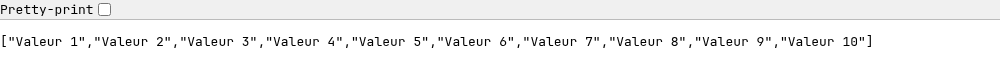
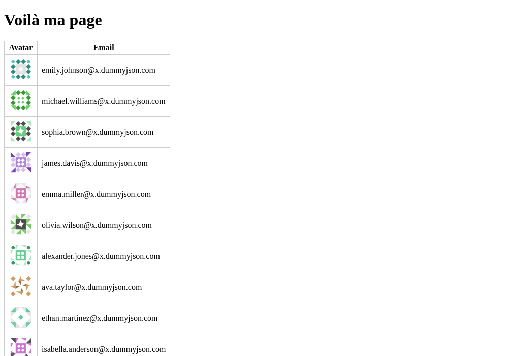
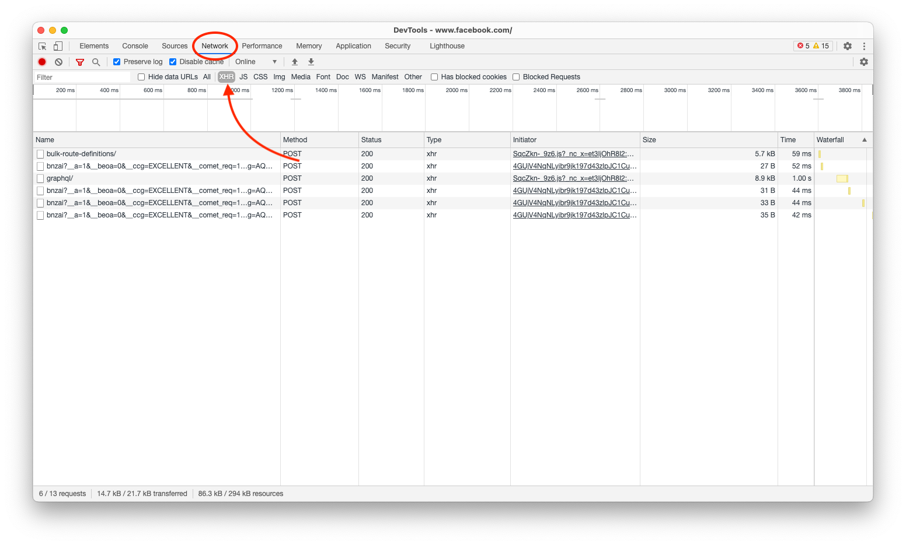

# Pratiquer l'Ajax

::: details Sommaire
[[toc]]
:::

Jusqu'ici, votre JavaScript travaillait avec ce que la page contenait déjà : dans le [TP 3](./tp3.md), il réagissait aux actions de l'utilisateur et contrôlait un formulaire, sans jamais discuter avec le serveur. Dans ce TP nous allons mettre en pratique l'Ajax au travers de deux exemples : la page va aller chercher du contenu sur le serveur **après** son chargement, et ça sans être rechargée.

Nous commencerons par un serveur qui renvoie un morceau de HTML, puis par un serveur qui ne renvoie que la donnée (au format JSON) que votre JavaScript mettra en forme. Pour finir, vous utiliserez une API publique fournie par un autre développeur.

Dans ce TP, je vous invite à avoir en parallèle :

- [Le complément de cours JavaScript](./support.md)
- [L'aide mémoire Ajax / JavaScript](/cheatsheets/javascript/)

## Prérequis

- Savoir manipuler la page en JavaScript (`getElementById`, `innerHTML`) et réagir à un événement, comme dans le [TP 2](./tp2.md) et le [TP 3](./tp3.md).
- Les bases du PHP (une boucle `for`, `echo`, un tableau) vues dans [les TP PHP de base](/pages/categories/les-tp-php-de-base.md).
- XAMPP / WAMP démarré, ou le serveur intégré à PHP (voir juste en dessous).

::: warning Pas de double-clic sur index.html
Ce TP a besoin d'un **serveur** : c'est lui qui exécute le PHP. Si vous ouvrez `index.html` en double-cliquant dessus (l'adresse commence alors par `file://`), le navigateur refuse l'appel `fetch` et votre fichier PHP n'est jamais exécuté.

Placez vos fichiers dans un dossier servi par XAMPP / WAMP (par exemple `htdocs/ajax/`), puis ouvrez `http://localhost/ajax/index.html`.
:::

::: tip Vous souhaitez utiliser le serveur intégré à PHP ?

C'est plutôt simple, dans un terminal (par exemple celui intégré à VSCode), placez-vous dans le dossier de votre projet puis :

```sh
# Windows (avec XAMPP)
C:/xampp/php/php -S localhost:9000

# Windows (avec WAMP)
C:/wamp64/bin/php/php8.4.27/php -S localhost:9000

# Linux / OSX
php -S localhost:9000
```

Votre page est alors disponible à l'adresse `http://localhost:9000/index.html`.

:::

## Objectifs

À la fin de ce TP vous saurez :

- Expliquer ce qu'est l'Ajax : charger du contenu après le chargement de la page, sans la recharger.
- Faire un appel réseau avec `fetch` et enchaîner les `.then()` pour exploiter la réponse.
- Faire la différence entre un serveur qui renvoie du HTML et un serveur qui ne renvoie que la donnée (JSON).
- Écrire une petite API en PHP avec `header` et `json_encode`.
- Consommer une API publique et construire un tableau HTML à partir de sa réponse.
- Faire le même appel avec jQuery (`$.get` et `$.post`).

## Introduction

L'Ajax est vraiment le cœur de nos sites Internet modernes. On le retrouve dans de simples chats comme dans des applications « complexes ». Avec l'avènement des PWA, nous utilisons maintenant l'Ajax comme nous pouvons utiliser une API dans une application classique.

## Le serveur génère toujours la page (mais pas entière)

Dans cette première version, nous allons « juste » découper la logique de génération de notre page. Celle-ci va être construite en deux temps, lors du chargement nous allons avoir la structure principale de notre page. Puis dans un second temps notre page va télécharger le contenu manquant via un appel réseau.

Le contenu en question sera généré comme « avant » via du PHP (ou autre langage serveur), mais il se limitera à la partie donnée. Avant d'attaquer, utilisons un exemple simple qui permettra d'illustrer la logique de construction asynchrone.

_Page index.html_ :

```html
<!DOCTYPE html>
<html lang="en">
  <head>
    <meta charset="UTF-8" />
    <meta name="viewport" content="width=device-width, initial-scale=1.0" />
    <title>Ceci est une page dynamique</title>
  </head>
  <body>
    <h1>Voilà ma page</h1>

    <div id="contenuAsynchrone">
      <!-- Vide au chargement -->
      …Chargement en cours…
    </div>

    <script>
      setTimeout(() => {
        fetch("./monContenuAsynchrone.php")
          .then((response) => response.text())
          .then(
            (content) =>
              (document.getElementById("contenuAsynchrone").innerHTML = content)
          );
      }, 5000);
    </script>
  </body>
</html>
```

_Contenu dynamique_ `monContenuAsynchrone.php` (dans le même dossier que `index.html`) :

```php
<ul>
<?php
    for ($i = 1; $i <= 10; $i++) {
        echo "<li>Valeur $i</li>";
    }
?>
</ul>
```

Je vous laisse mettre en place le code suivant sur votre machine.

- Que va-t-il se passer ?
- À quoi sert la fonction `setTimeout`, pourquoi est-ce inutile ? Mais dans notre cas utile ?
- À quoi correspond le `then` ?
- Seriez-vous capable de le faire seul ?

::: tip Point de contrôle
En ouvrant `index.html` (via votre serveur), la page affiche d'abord son titre et le texte « …Chargement en cours… ». Environ 5 secondes plus tard, ce texte est remplacé par une liste de 10 valeurs, **sans que la page se recharge**.


:::

::: details Réponse

- **Que va-t-il se passer ?** La page s'affiche immédiatement avec « …Chargement en cours… ». 5 secondes plus tard, le navigateur appelle `monContenuAsynchrone.php`, reçoit la liste fabriquée par le PHP et la place dans la `div`. Le reste de la page ne bouge pas.
- **`setTimeout` ?** Il exécute une fonction après un délai (ici 5000 millisecondes). Dans un vrai site c'est inutile, on ne va pas faire attendre l'utilisateur pour rien. Ici c'est utile : en local la réponse arrive en quelques millisecondes, et sans ce délai vous ne verriez jamais la page « avant » l'arrivée du contenu.
- **Le `then` ?** `fetch` ne renvoie pas directement la réponse : la requête prend du temps, il renvoie une **promesse** (« je vous donnerai la réponse quand elle sera là »). Le premier `then` est exécuté quand la réponse arrive, `response.text()` lit son contenu (c'est encore une promesse) ; le second `then` reçoit enfin le texte et le place dans la page.

:::

::: tip Que se passe-t-il derrière ?
Le navigateur fait **deux** requêtes au serveur : une pour la page, puis une pour le contenu. La seconde est faite par votre JavaScript, et seule la `div` est mise à jour :


Vous pouvez le constater dans l'onglet **Réseau** (Network) des outils de développement (F12) : rechargez la page et regardez la ligne `monContenuAsynchrone.php` apparaître au bout de 5 secondes.
:::

::: tip setTimeout ?

Le `setTimeout` n'est pas obligatoire. Il permet juste de créer un faux délai afin de visualiser le côté asynchrone du chargement de la page. La partie de l'Ajax se résume donc à :

```js
fetch("./monContenuAsynchrone.php")
  .then((response) => response.text())
  .then(
    (content) =>
      (document.getElementById("contenuAsynchrone").innerHTML = content)
  );
```

:::

::: warning ATTENTION
Vous vous souvenez des XSS ? Faites très attention avec cette façon de faire… Car nous avons ici un XSS puissance 10000. Vous insérez dans votre page du code provenant d'Internet. Et ça sans aucune validation.

C'est TRÈS TRÈS TRÈS RISQUÉ. Très clairement, le risque est très important. Je vous conseille vivement de choisir une solution « sans HTML », comme nous allons le faire juste après avec le JSON.
:::

### Charger le contenu au clic sur un bouton

En utilisant les compétences vues précédemment, je vous laisse mettre en place :

- Un bouton dans votre page.
- Le bouton doit déclencher sur l'action `onclick` l'obtention des données (vous allez devoir créer une fonction avec dedans l'appel fetch).

::: tip Point de contrôle
Au chargement, la page n'affiche que son titre et votre bouton : aucune liste. Un clic sur le bouton fait apparaître les 10 valeurs, toujours sans rechargement de la page.
:::

### Et avec jQuery ?

Nous avons vu la version VanillaJS, voilà la version jQuery :

```js
setTimeout(() => {
  $.get("./monContenuAsynchrone.php", (data) => {
    $("#contenuAsynchrone").html(data);
  });
}, 5000);
```

C'est à vous, je vous laisse :

- Mettre jQuery.
- Ajouter le code au bon endroit.

::: tip Point de contrôle
Le résultat à l'écran est exactement le même qu'avec `fetch` : « …Chargement en cours… », puis la liste des 10 valeurs. Si rien ne se passe, ouvrez la console : une erreur `$ is not defined` veut dire que jQuery n'est pas (ou pas encore) chargé.
:::

#### Envoyer un paramètre en POST

Je vous laisse maintenant utiliser la fonction `$.post` en utilisant la documentation de jQuery, je vous laisse écrire l'appel en POST vers votre serveur.

Le but : envoyer un nombre dynamique de résultats en retour de l'API. Vous allez donc devoir :

- Ajouter un paramètre de type POST dans votre script PHP (et l'utiliser dans la boucle).
- L'envoyer dans le POST de votre appel Ajax.

::: tip Point de contrôle
En changeant la valeur envoyée dans votre appel (3, 25…), la liste affichée contient exactement ce nombre de lignes, sans toucher au fichier PHP.
:::

## Le serveur génère juste la donnée (au format JSON)

Nous allons ici faire travailler à la fois votre navigateur et le serveur. Le serveur va nous produire de la donnée « au format brut », c'est-à-dire un format compréhensible par un ordinateur. Votre JavaScript construira le code HTML par rapport à cette donnée.

C'est la façon que moi je préfère, on verra plus tard avec VueJS que cette solution nous permettra de réaliser rapidement, et sans écrire énormément de code, des interfaces web réactives.

Avant d'aller plus loin, voyons un exemple simple ensemble :

```html
<!DOCTYPE html>
<html lang="en">
  <head>
    <meta charset="UTF-8" />
    <meta name="viewport" content="width=device-width, initial-scale=1.0" />
    <title>Ceci est une page dynamique</title>
  </head>
  <body>
    <h1>Voilà ma page</h1>

    <div id="contenuAsynchrone">
      <!-- Vide au chargement -->
      …Chargement en cours…
    </div>

    <script>
      setTimeout(() => {
        fetch("./monContenuAsynchrone.php")
          .then((response) => response.json())
          .then((datas) => {
            document.getElementById("contenuAsynchrone").innerHTML = "";

            datas.forEach((el) => {
              document
                .getElementById("contenuAsynchrone")
                .insertAdjacentHTML("beforeend", "<li>" + el + "</li>");
            });
          });
      }, 5000);
    </script>
  </body>
</html>
```

_Contenu dynamique_ `monContenuAsynchrone.php` :

```php
<?php
    header('Content-Type: application/json');

    $data = [];
    for ($i = 1; $i <= 10; $i++) {
        $data[] = "Valeur $i";
    }

    echo json_encode($data);
?>
```

Je vous laisse mettre en place le code sur votre ordinateur.

Avant même de regarder votre page, ouvrez directement `monContenuAsynchrone.php` dans votre navigateur. Plus de HTML : le serveur ne renvoie que la donnée.



- Quelles différences notez-vous par rapport au précédent exemple ?
- À quoi correspond le `header` ?
- `json_encode` ? À quoi sert cette fonction ?

::: tip Point de contrôle
Votre page `index.html` affiche, comme tout à l'heure, « …Chargement en cours… » puis les 10 valeurs. Le résultat à l'écran est le même, mais cette fois c'est **votre JavaScript** qui a fabriqué chaque ligne.
:::

::: details Réponse

- **Les différences** : le PHP ne contient plus aucune balise, il fabrique un tableau. Côté JavaScript, on lit la réponse avec `response.json()` (et non plus `response.text()`), on obtient un vrai tableau JavaScript que l'on parcourt avec `forEach` pour construire chaque `<li>`.
- **Le `header`** : il indique au navigateur le type de contenu renvoyé (`application/json`) au lieu du `text/html` envoyé par défaut par PHP. Le client sait ainsi qu'il reçoit de la donnée, pas une page.
- **`json_encode`** : il transforme une variable PHP (ici un tableau) en texte au format JSON, que n'importe quel langage sait relire. Côté JavaScript, `response.json()` fait l'opération inverse.

:::

Pour résumer, voici ce qui change entre les deux façons de faire :


::: tip API ?
Ce que vous venez de créer est une API. Une API est le cœur de beaucoup de systèmes modernes. Il est important de comprendre ce concept dès à présent. Pourquoi faire une API ?

Une API va nous permettre de séparer la logique entre client et serveur afin de réaliser si vous le souhaitez différents clients pour la même donnée (exemple Twitter avec des clients multiplateformes).

Pourquoi préférer une API « JSON / XML » à un retour HTML basique ? Tout simplement, car l'API va être universelle ; nous pourrons donc l'utiliser dans un site Internet, mais également dans une application ou n'importe quel client applicatif.
:::

### Intégrer une API publique

Nous avons utilisé pour l'instant une API que vous avez créée. Nous allons tenter l'utilisation d'une API (json) fournie par un autre développeur. En utilisant l'API suivante :

```
https://dummyjson.com/users
```

Modifier la page pour :

- Afficher un tableau.
- Qui contiendra autant de lignes que d'utilisateurs présents dans la partie `users` de la réponse.
- Chaque ligne du tableau devra afficher l'email & l'avatar (la propriété `image`, dans une balise ``).

::: tip Avant de coder
Ouvrez l'URL directement dans votre navigateur pour observer la structure du JSON retourné. C'est un réflexe à prendre : on regarde toujours la donnée avant d'écrire le code qui la consomme.

Cochez la case « Pretty-print » (ou « Impression élégante ») pour la rendre lisible : un objet, avec dedans un tableau `users`, et pour chaque utilisateur un `email` et une `image`.


:::

::: tip Point de contrôle
Votre tableau contient **30 lignes**, chacune avec un avatar et une adresse email. Pourquoi 30 ? Regardez la fin de la réponse : l'API indique `"total": 208` mais ne renvoie que les 30 premiers (`"limit": 30`), elle découpe ses résultats en pages.

Voici par exemple ce que vous pouvez obtenir (la mise en forme est libre) :


:::

::: details Question : votre page et dummyjson.com ne sont pas sur le même site, pourquoi le navigateur accepte-t-il l'appel ?
Par défaut, le navigateur bloque la lecture d'une réponse qui vient d'un autre domaine que celui de la page : c'est la protection **CORS** (Cross Origin Resource Sharing). Ici, l'API a choisi de s'ouvrir à tout le monde : sa réponse contient l'en-tête `Access-Control-Allow-Origin`, qui autorise votre page à la lire. Vous le verrez dans l'onglet Réseau, et nous y reviendrons quand ce sera **votre** API qui sera appelée depuis un autre site.
:::

## Regardons d'autres sites

Nous avons vu qu'il était possible assez simplement de charger du contenu de manière asynchrone. Ce chargement asynchrone est la base du web que vous pratiquez tous les jours (sans vous en rendre compte). Maintenant que vous savez ça, je vous propose une petite expérimentation :

- Rendez-vous sur GMAIL, constatez que le chargement est fait « de manière asynchrone », et que seul l'intérieur change.
- Idem sur Facebook (ou Instagram Web)
- Idem sur X (Twitter)

Nous allons maintenant regarder ce qu'il se passe « à l'intérieur » (dans le code), grâce à `l'inspecteur d'éléments` vous allez pouvoir entrevoir ce qu'il se passe. Rendez-vous sur par exemple `Facebook`, puis ouvrez l'inspecteur :



## Concrètement dans un site existant

Nous avons fait deux pages de tests, je vous propose de faire la même chose, mais dans un code plus complet, plusieurs possibilités s'offrent à vous :

- [→ Ajouter de l'Ajax dans la BTS TV / Site PHP ←](./tp4.1.md)
- [→ Ajouter de l'Ajax dans Larablog / Site Laravel ←](./tp6.md)
- [→ Découverte de HTMX ←](./htmx.md)
- [→ Ajouter un chat dans Laravel ←](../laravel/authentification.md#ajouter-un-système-de-chat)

## Conclusion

Dans ce TP, vous avez :

- Chargé du contenu **après** le chargement de la page, sans la recharger : c'est l'Ajax.
- Utilisé `fetch` et ses `.then()` successifs : la réponse arrive plus tard, sous la forme d'une promesse.
- Vu deux façons de faire : le serveur renvoie un morceau de HTML (`response.text()` + `innerHTML`, attention aux XSS), ou il ne renvoie que la donnée en JSON (`header`, `json_encode`, puis `response.json()` et votre JavaScript qui construit l'affichage).
- Écrit votre première API en PHP, puis consommé une API publique (`dummyjson.com`) en commençant par observer sa réponse.
- Fait les mêmes appels avec jQuery (`$.get`, `$.post`).

La suite ? Si vous êtes en avance, [la BTS TV 2.0](./tp4.1.md) applique tout ça à un vrai projet PHP. Sinon, préparez-vous pour [le point étape : mon catalogue de films](./eval1.md), qui vous demandera justement du DOM, des événements et de l'Ajax avec `fetch`.

👋 Si vous avez des questions, n'hésitez pas.
