# L'authentification avec Breeze

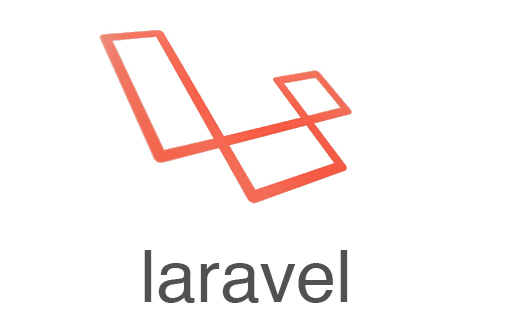

::: details Sommaire
[[toc]]
:::

Dans les TP précédents, vous avez codé **à la main** toute la mécanique d'authentification : [mots de passe hashés, session et middleware](./authentification_manuelle.md), puis [le reset de mot de passe](./reset_mot_de_passe.md) (token, expiration, email). Et vous avez vu que la gestion des utilisateurs est un élément complexe d'une application :

- L'authentification.
- Limiter l'accès à certaines ressources.
- La sécurité des mots de passe.
- La gestion du mot de passe oublié.
- …

Vous l'avez compris, la liste est longue… La force de Laravel, c'est justement de vous fournir l'ensemble de ces briques, dans les standards du marché, **sans tout recoder**. Dans ce TP, nous allons générer une authentification complète avec **Laravel Breeze**, puis la modifier pour l'adapter à nos besoins : un profil enrichi, des rôles, et pour finir un petit chat en Ajax.

Dans ce TP, je vous invite à avoir en parallèle :

- [L'aide-mémoire Laravel](/cheatsheets/laravel/)
- [La synthèse des commandes](/cheatsheets/laravel/quick.md)

## Les slides

Avant de commencer, voici une présentation rapide de la partie théorie de notre TP du jour : le scaffolding, ce que Breeze génère, et les nouveaux outils qui arrivent avec (Tailwind, Vite, composants).

<ClientOnly>
<SlidesDeck src="laravel_breeze" />
</ClientOnly>

## Prérequis

Ce TP repart d'un **nouveau projet** Laravel, mais il s'appuie sur ce que vous avez construit dans la chaîne des TP Laravel :

- Créer un projet, des routes, des contrôleurs et des vues ([TP introduction](./introduction.md)).
- Les migrations, les modèles et les relations ([TP base de données](./base_de_donnees.md)).
- Le fonctionnement d'une authentification : hash, session, middleware ([TP Comprendre l'authentification](./authentification_manuelle.md)).

Il vous faut également **Node.js** (et donc `npm`) sur votre poste : Breeze en a besoin pour compiler l'interface. Si vous ne l'avez pas, vous pouvez le télécharger [ici](https://nodejs.org/).

::: details Vous n'avez pas fait le TP Comprendre l'authentification ?

Vous pouvez suivre ce TP sans lui, Breeze fait tout le travail. Mais vous perdrez le plus intéressant : comprendre ce que Breeze a généré. Je vous conseille de le faire avant, ou au moins de le lire en parallèle.

:::

## Objectifs

À la fin de ce TP vous saurez :

- Installer **Breeze** et retrouver dans le code généré les briques codées à la main dans les TP précédents.
- Utiliser les outils du front qui arrivent avec (**Tailwind**, **Vite**, `npm`).
- Utiliser et créer des **composants Blade** (`<x-app-layout>`, `<x-card>`), et en récupérer sur **HyperUI**.
- Protéger une page avec le middleware `auth`.
- Modifier le code généré : champs supplémentaires, table liée, rôles (relation **many-to-many**).
- Rafraîchir une page en Ajax avec `fetch` ou **HTMX**.

## Créer votre projet

Pour cette étape, je vous laisse suivre le début du [TP introduction](./introduction.md#creer-le-premier-projet). Votre projet doit être en **Laravel 13** (la commande `php artisan --version` vous l'indique).

::: tip Point de contrôle

`php artisan serve` affiche la page d'accueil par défaut de Laravel sur `http://127.0.0.1:8000`.

:::

## Installer la Laravel Debugbar

Vous avez remarqué que les pages d'erreurs de Laravel sont toujours pleines de bonnes informations. Avec Laravel nous pouvons avoir « encore mieux » : une extension qui ajoute une barre en bas de votre site (uniquement le temps du développement) et qui vous permet de voir :

- Les requêtes SQL réalisées par l'ORM.
- Les vues affichées.
- Le contenu de la session.
- …

Pour l'installer, dans le dossier de votre projet :

```sh
composer require fruitcake/laravel-debugbar --dev
```

::: tip Un nouveau nom

Vous croiserez sur Internet le nom `barryvdh/laravel-debugbar` : c'est le même paquet, il a simplement changé d'organisation. Les deux noms fonctionnent, préférez le nouveau.

:::

La Debugbar est automatiquement active quand `APP_DEBUG` vaut `true` dans votre fichier `.env`. Elle apparaît **en bas de chaque page**, cliquez sur un onglet pour le déplier. Voici par exemple l'onglet « Queries » sur une page que nous allons construire plus loin :

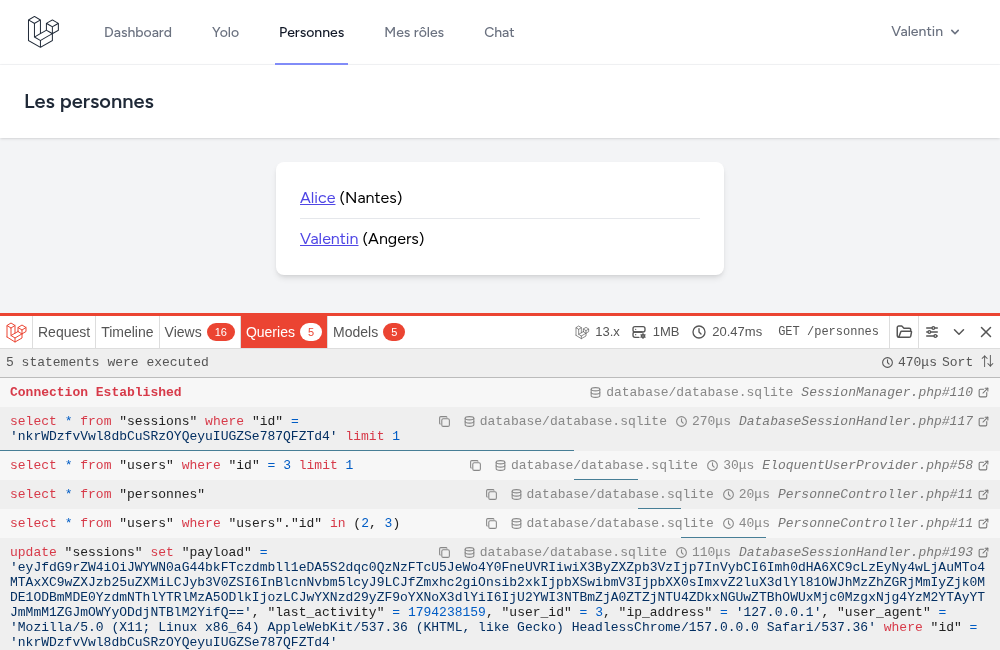

Elle vous sera très utile pour comprendre ce que fait Eloquent derrière vos `->get()` et vos relations. Gardez-la sous le coude !

[En savoir plus](https://github.com/fruitcake/laravel-debugbar)

## Ajout de l'authentification

Nous allons intégrer l'authentification en utilisant [Laravel Breeze](https://github.com/laravel/breeze). Ce paquet `Composer` va ajouter dans votre projet l'ensemble des :

- Routes
- Contrôleurs
- Vues (templates Blade)

Permettant de gérer simplement l'ensemble des problématiques : inscription, connexion, déconnexion, mot de passe oublié, vérification de l'email et page de profil.

::: warning Nous avons plusieurs choix

Breeze n'est pas la seule option. Depuis Laravel 12, Laravel met en avant de [nouveaux « starter kits »](https://laravel.com/docs/13.x/starter-kits) (React, Vue ou Livewire), proposés directement par la commande `laravel new`. Ils sont plus complets, mais reposent sur des technologies front que nous n'avons pas encore vues.

Breeze, lui, ne reçoit plus de nouvelles fonctionnalités, mais il reste maintenu, compatible Laravel 13, et surtout il génère du **Blade simple et lisible**. Pour comprendre ce qui est généré, c'est le meilleur point de départ.

Ces starter kits reposent sur **Fortify**, le moteur d'authentification de Laravel. Vous les découvrirez dans le TP [L'authentification avec un starter kit](./starter_kit.md), avec en prime une double authentification par application.

:::

### Ajout de la dépendance

Dans le dossier de votre projet, ajoutez Breeze :

```sh
composer require laravel/breeze --dev
```

Une fois ajouté, nous allons lancer son installation pour qu'il génère l'ensemble des fichiers :

```sh
php artisan breeze:install
```

La commande va vous poser quelques questions, voici les réponses à donner :

- **Stack** : `Blade with Alpine` (le choix par défaut, validez avec Entrée).
- **Dark mode** : `No`.
- **Testing framework** : `PHPUnit` (flèche du bas, puis Entrée). C'est celui que nous utiliserons dans le [TP sur les tests](./tests.md).

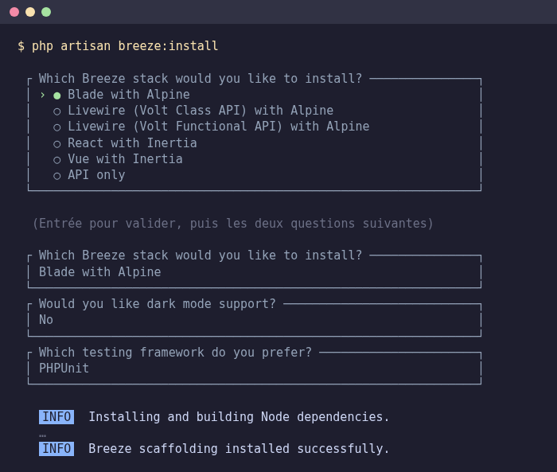

L'installation se termine par l'installation des dépendances JavaScript (`npm install`) et une première compilation de l'interface (`npm run build`) : Breeze le fait pour vous, rien à faire de plus pour l'instant.

::: tip Et la base de données ?

Breeze utilise la table `users` créée par Laravel lors de la création du projet (les migrations ont déjà été lancées, sur SQLite par défaut). Si vous avez configuré une autre base, n'oubliez pas un `php artisan migrate`.

:::

### Ce que Breeze a généré

Prenez quelques minutes pour regarder ce qui vient d'arriver dans votre projet :

- `routes/auth.php` : toutes les routes de l'authentification (inscription, connexion, mot de passe oublié…), incluses à la fin de `routes/web.php`.
- `app/Http/Controllers/Auth/` : un contrôleur par fonctionnalité (`RegisteredUserController`, `AuthenticatedSessionController`, `PasswordResetLinkController`…).
- `resources/views/auth/` : les vues des formulaires.
- `resources/views/layouts/` et `resources/views/components/` : les layouts et les composants de l'interface (nous y revenons plus loin).

Pour le reste, c'est dans les dossiers que vous connaissez déjà.

Questions :

- Ouvrez `app/Http/Controllers/Auth/RegisteredUserController.php`. Où est hashé le mot de passe ? Retrouvez-vous ce que vous aviez écrit à la main ?
- Ouvrez `app/Http/Controllers/Auth/AuthenticatedSessionController.php`. Quelle méthode de la façade `Auth` connecte l'utilisateur ? Et que fait `$request->session()->regenerate()` ?

::: details Voir les réponses

- Dans la méthode `store` : `Hash::make($request->password)`, exactement comme dans votre TP. Notez que le modèle `User` déclare aussi `'password' => 'hashed'` dans ses `casts()` : une sécurité supplémentaire si un mot de passe arrive en clair.
- La connexion passe par `Auth::attempt()` (dans `app/Http/Requests/Auth/LoginRequest.php`), qui vérifie le hash comme votre `Hash::check()`. `regenerate()` change l'identifiant de session après la connexion : c'est la protection contre la fixation de session.

:::

### L'UI : Tailwind et Vite

Les fichiers ajoutés par Breeze reposent sur un « framework UI » autre que Bootstrap : [Tailwind](https://tailwindcss.com/). Tailwind poursuit le même objectif que Bootstrap, mais avec une approche différente : des petites classes CSS que l'on va appeler « utilitaires » (`text-center`, `font-bold`, `p-6`…), que vous composez directement dans votre HTML.

C'est pour ça que nous avons besoin de `node` et surtout de `npm` : Vite va lire vos templates, ne garder que les classes Tailwind réellement utilisées, puis « compiler » / « packager » l'ensemble dans un fichier CSS et un fichier JS optimisés pour vos clients. Rien d'étonnant à croiser ces outils du monde JavaScript dans un projet PHP : c'est partout aujourd'hui.

Les commandes à connaître, dans le dossier de votre projet :

```sh
# Installer les dépendances (déjà fait par Breeze, à refaire après un git clone)
npm install

# Compiler une fois les ressources (pour la mise en production)
npm run build

# Ou recompiler automatiquement à chaque modification (pendant le développement)
npm run dev
```

Voici le résultat attendu d'un `npm run build` :

```
vite v8.3.7 building client environment for production...
✓ 4 modules transformed.
public/build/manifest.json             0.33 kB │ gzip:  0.16 kB
public/build/assets/app-DciKFhTV.css  35.47 kB │ gzip:  6.97 kB
public/build/assets/app-Dr67-uCa.js   54.32 kB │ gzip: 19.13 kB
✓ built in 289ms
```

::: danger npm run build ?

La commande `npm run build` fige vos ressources à un instant donné. Si vous ajoutez une classe Tailwind dans un template après le build, **elle n'aura aucun effet** tant que vous ne relancez pas la compilation.

Pendant le développement, lancez plutôt `npm run dev` dans un second terminal, à côté de `php artisan serve`. Encore plus simple : la commande `composer run dev` lance le serveur PHP **et** Vite en même temps.

:::

Et Bootstrap ? Notre projet ne contient que Tailwind après installation. Si vous souhaitez également Bootstrap, le plus simple est de l'ajouter via un CDN dans les layouts. Mélanger les deux frameworks est cependant rarement une bonne idée : je vous conseille de jouer le jeu de Tailwind dans ce TP.

### Tester le code

Votre site est fonctionnel ! Avant d'aller plus loin, je vous laisse tester l'ensemble :

- La page d'accueil, qui affiche maintenant deux liens **Log in** et **Register** en haut à droite.
- La création d'un compte.
- La déconnexion, puis la connexion.
- La page **Profile** (menu en haut à droite une fois connecté).

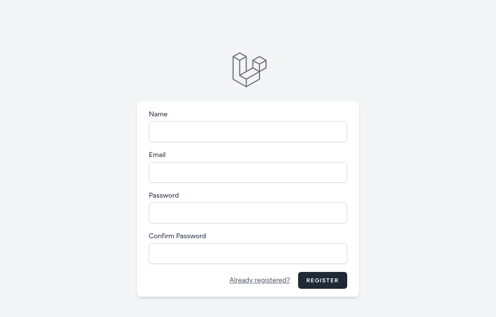

::: tip Point de contrôle

Après l'inscription, vous arrivez sur la page `/dashboard` avec le message « You're logged in! ». Dans la Debugbar, l'onglet « Session » contient votre identifiant de connexion.

:::

Laravel Breeze est intéressant, car il ne cache pas le code : **l'ensemble des éléments sont dans votre projet**, vous pouvez modifier le code fourni sans aucun problème ! C'est d'ailleurs ce que nous allons faire. Regardez aussi les templates et les règles de validation présentes dans les contrôleurs : bref, tout ce que vous avez pu installer de manière automatique.

<div style="width:100%;height:0;padding-bottom:56%;position:relative;"><iframe src="https://giphy.com/embed/YWy93Zf9eW8RMlK0gK" width="100%" height="100%" style="position:absolute" frameBorder="0" class="giphy-embed" allowFullScreen></iframe></div>

## Les composants et les templates Blade

Si vous avez regardé le code des vues, vous avez remarqué une syntaxe un peu particulière : des balises qui commencent par `x-` (`<x-app-layout>`, `<x-text-input>`, `<x-primary-button>`…). Ce sont des **composants** Blade. Ils permettent de créer des morceaux de vue réutilisables, mais également des layouts de base.

Tout est déjà configuré : vous pouvez utiliser les composants fournis, mais également en créer de nouveaux en ajoutant des fichiers `.blade.php` dans `resources/views/components/`.

[Pour plus d'informations, rendez-vous ici](https://laravel.com/docs/13.x/blade#components)

::: tip Nous avons déjà vu l'héritage

Dans le [TP introduction](./introduction.md), nous avions vu [l'héritage de template](https://laravel.com/docs/13.x/blade#layouts-using-template-inheritance) (`@extends`, `@section`, `@yield`). Ici c'est la même idée, mais via un système de « composants », très à la mode en ce moment. Les deux fonctionnent, personnellement je trouve l'approche composant plus moderne et plus lisible.

:::

Avec Breeze, nous avons à notre disposition **deux layouts** :

- `layouts/app.blade.php` pour les clients **connectés**, utilisable dans votre template via `<x-app-layout>`.
- `layouts/guest.blade.php` pour les clients **non connectés**, utilisable via `<x-guest-layout>`.

Le layout `app` est découpé en plusieurs parties : le menu (inclus depuis `layouts/navigation.blade.php`), un titre de page optionnel, et le contenu de votre page.

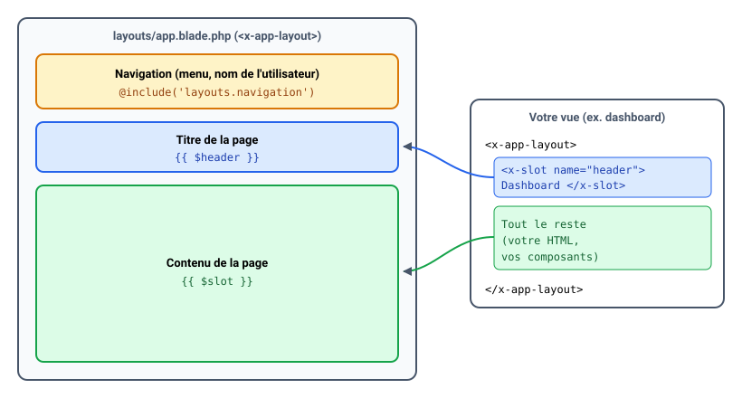

::: tip Hey toi lecteur ! Stop !

L'organisation est tout aussi importante que le code. Vous pouvez copier-coller du code entre tous les templates, oui… Mais ce n'est pas efficace, et si on vous demande une modification **vous perdrez du temps** !

Prendre du temps pour utiliser le système de layout proposé par Laravel est un vrai gain de temps. Le vous du futur vous remercie d'avance.

:::

### Migrer la page « / » vers le nouveau système

Retournez sur la page d'accueil de votre site. Surprise : elle semble « cassée ».

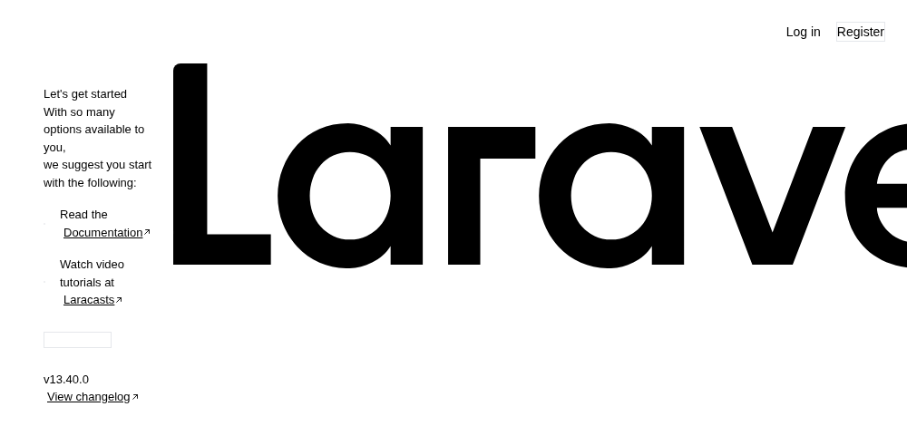

Pas de panique : la page d'accueil par défaut de Laravel était prévue pour sa propre feuille de style. Depuis l'installation de Breeze, c'est la feuille de style de Breeze (compilée par Vite) qui est chargée, et elle ne contient pas les classes utilisées par cette page. C'est l'occasion idéale de la migrer vers notre layout `<x-guest-layout>`.

Remplacez **tout** le contenu de `resources/views/welcome.blade.php` par :

```html
<x-guest-layout>
    @if (Route::has('login'))
        <div class="fixed top-0 right-0 px-6 py-4">
            @auth
                <a href="{{ url('/dashboard') }}" class="text-sm text-gray-700 underline">Dashboard</a>
            @else
                <a href="{{ route('login') }}" class="text-sm text-gray-700 underline">Log in</a>

                @if (Route::has('register'))
                    <a href="{{ route('register') }}" class="ml-4 text-sm text-gray-700 underline">Register</a>
                @endif
            @endauth
        </div>
    @endif

    Bienvenue sur mon site !
</x-guest-layout>
```

Plus de `<html>`, de `<head>` ni de `<body>` : tout cela est dans le layout. Votre page ne contient que **ce qui lui est propre**.

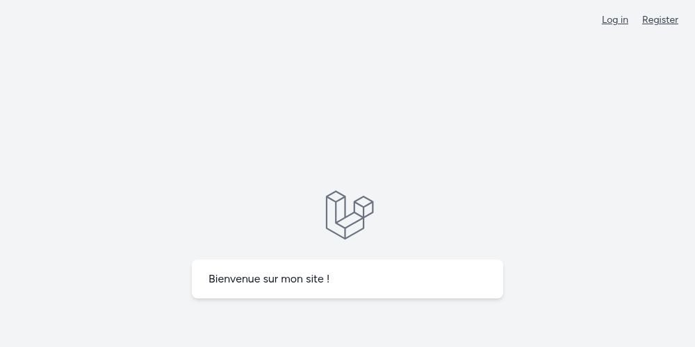

::: danger À partir de maintenant

J'espère qu'à partir de maintenant, vous allez utiliser le système de layout ! Je vous encourage vivement à le faire.

:::

### Fonctionnement des composants

Vous avez utilisé les composants, mais avez-vous compris le fonctionnement ? Un composant, c'est quelque chose de très simple : un morceau de vue réutilisable (un bouton, une card, etc.), donc du « code HTML ». Si vous voulez une comparaison, c'est une sorte de fonction. Prenons un exemple.

Nous souhaitons faire une `Card`. Créez le fichier `resources/views/components/card.blade.php` :

```html
<div class="flex flex-col sm:justify-center items-center pt-6 sm:pt-0">
    <div class="w-full sm:max-w-md mt-6 px-6 py-4 bg-white shadow-md overflow-hidden sm:rounded-lg">
        {{ $slot }}
    </div>
</div>
```

L'important ici est <code v-pre>{{ $slot }}</code>. `$slot` est une variable qui va contenir les éléments placés à l'intérieur de votre Card lors de son utilisation :

```html
<x-card>
  Ceci est une démo
</x-card>
```

Dans ce cas, la variable `$slot` contiendra… `Ceci est une démo`. Vous venez en quelque sorte de créer votre propre élément HTML réutilisable, comme une `div`, un `span` ou un `li`. Mais cet élément est plus complet : il peut contenir du style, un comportement, des données par défaut.

Question :

- Le nom du fichier est `card.blade.php` et la balise est `<x-card>`. Comment s'appellerait la balise d'un composant `resources/views/components/forms/bouton-rouge.blade.php` ?

::: details Voir la réponse

`<x-forms.bouton-rouge>` : le préfixe `x-`, puis le chemin depuis `components/`, les sous-dossiers étant séparés par un point.

:::

Je vous laisse parcourir les composants déjà disponibles dans le dossier `components` (regardez par exemple `primary-button.blade.php`, et la façon dont il accepte des attributs supplémentaires avec `$attributes`).

::: details Pour résumer

Le système de composants va vous permettre :

- De rendre générique un morceau de code que vous utilisez plusieurs fois dans votre projet.
- De penser composant plutôt que HTML copié depuis Internet.
- De rendre « génériques » les layouts pour les partager entre les pages.

:::

### Des composants tout prêts : HyperUI

Écrire ses composants, c'est bien. Mais pour une jolie carte, un tableau ou une alerte, inutile de partir d'une page blanche : des sites proposent des composants Tailwind **prêts à copier**. Parmi eux, [HyperUI](https://hyperui.dev/) : une collection gratuite et open source (licence MIT) de composants Tailwind, rangés en trois familles :

- **Application** : pour les interfaces d'application (statistiques, tableaux, formulaires, menus…).
- **Marketing** : pour les sites vitrines (bannières, cartes, témoignages…).
- **Neobrutalism** : un style graphique plus marqué.

Chaque composant est livré en HTML, avec un bouton pour copier le code. Pas de paquet à installer : comme votre projet utilise déjà Tailwind, il suffit de coller le HTML.

Nous allons ajouter des **statistiques** sur le dashboard. Rendez-vous dans [Application > Stats](https://hyperui.dev/components/application/stats), choisissez un modèle (pour ma part, le troisième, avec un titre, une valeur et un badge d'évolution) et copiez le code d'**une seule** carte, c'est-à-dire le premier bloc `<article>…</article>`.

Créez le fichier `resources/views/components/stat.blade.php` et collez-y le code copié sur HyperUI. C'est tout : le fichier contient uniquement le HTML du composant, sans `<html>` ni `<body>`.

Puis utilisez-le dans `resources/views/dashboard.blade.php`, par exemple juste au-dessus du bloc blanc « You're logged in! » :

```html
<x-stat />
```

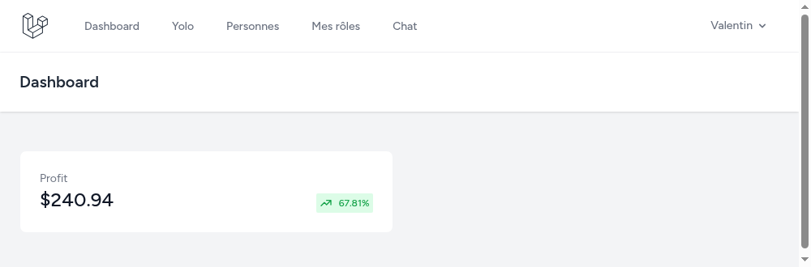

Ça fonctionne… mais votre composant affiche toujours « Profit » et « $240.94 ». Pour le rendre **réutilisable**, transformons ces textes en paramètres. Dans `stat.blade.php` :

- Ajoutez tout en haut du fichier la ligne `@props(['titre', 'valeur'])`.
- Remplacez le texte « Profit » par <code v-pre>{{ $titre }}</code>.
- Remplacez le montant « $240.94 » par <code v-pre>{{ $valeur }}</code>.
- Supprimez le badge d'évolution (le `<div>` qui contient le pourcentage), dont nous n'avons pas l'usage.

`@props(['titre', 'valeur'])` déclare les **attributs** acceptés par le composant : ils deviennent les variables `$titre` et `$valeur`. Vous pouvez maintenant l'utiliser autant de fois que nécessaire :

```html
<div class="grid gap-4 md:grid-cols-2">
    <x-stat titre="Personnes inscrites" valeur="12" />
    <x-stat titre="Messages dans le chat" valeur="42" />
</div>
```

Pour l'instant les valeurs sont écrites en dur. Quand le dashboard aura son contrôleur (un peu plus loin dans ce TP), vous pourrez lui passer de vraies valeurs : un attribut précédé de `:` reçoit une **expression PHP** au lieu d'un texte, par exemple `:valeur="$nbPersonnes"`.

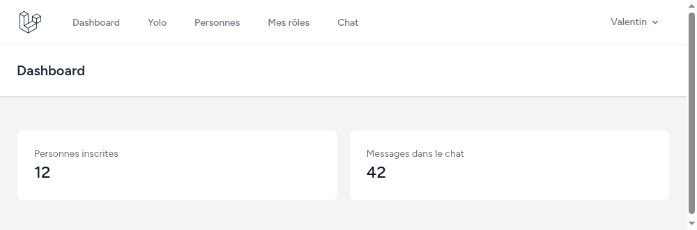

::: tip Point de contrôle

Le dashboard affiche vos deux cartes de statistiques côte à côte. Si une carte apparaît sans style, c'est que Vite n'a pas vu vos nouvelles classes : lancez `npm run dev` (ou relancez `npm run build`).

:::

## Protéger une page

Le but de l'authentification est de limiter l'accès à certaines pages, vous l'avez bien compris… Voyons comment le faire sur nos propres pages. Nous allons créer un contrôleur de test :

```sh
php artisan make:controller YoloController
```

Vous venez de créer un contrôleur vide. En reprenant si nécessaire les exemples du [TP introduction](./introduction.md), je vous laisse y créer :

| Route             | Méthode         | Accès                       |
| :---------------- | :-------------- | :-------------------------- |
| `/yolo`           | `publicView()`  | Tout le monde               |
| `/yolo-connected` | `privateView()` | Utilisateurs connectés      |

### La partie publique

Pour la partie publique (non connecté), rien de nouveau par rapport aux TP précédents :

- Une méthode `publicView`, qui retourne une vue `yolo.publicView` affichant pour l'instant `Bonjour non connecté`. Attention ! Cette vue doit utiliser le layout `<x-guest-layout>`.
- La route correspondante dans le fichier `routes/web.php`.

::: details Besoin d'aide ?

Avez-vous bien cherché ?

Pour la route :

```php
use App\Http\Controllers\YoloController;

Route::get('/yolo', [YoloController::class, 'publicView']);
```

Pour la méthode :

```php
public function publicView()
{
    return view('yolo.publicView');
}
```

:::

Nous avons le temps, n'hésitez pas à utiliser les classes de Tailwind (vous avez même de la complétion dans PhpStorm). Pour ma part, voilà mon rendu :

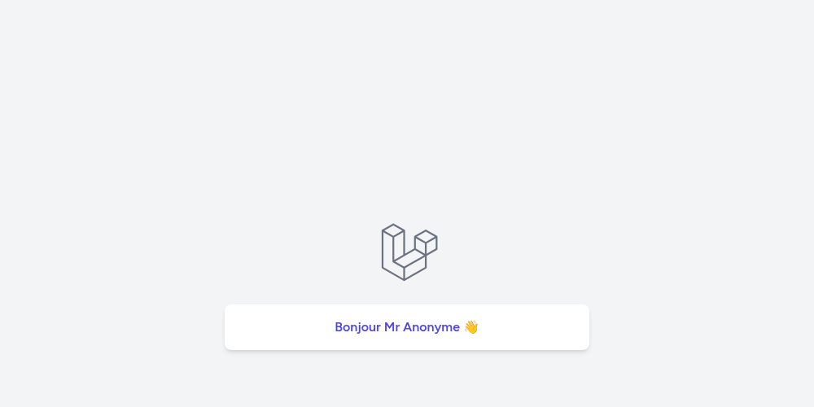

::: details Vous voulez voir mon template ?

Est-ce vraiment une bonne idée ? Je vous encourage vraiment à faire le vôtre. Mais voilà mon code :

_resources/views/yolo/publicView.blade.php :_

```html
<x-guest-layout>
    <div class="text-center font-bold text-indigo-600">Bonjour Mr Anonyme 👋</div>
</x-guest-layout>
```

:::

### La partie privée

Pour la partie privée, je vous laisse gérer l'ensemble de la base :

- La création de la méthode `privateView` dans le contrôleur.
- La création du template. Attention, cette fois-ci nous allons utiliser le composant `<x-app-layout>`, qui contient toute la logique de la partie « information de connexion » (menu, nom de l'utilisateur, déconnexion…).

#### La vue

Pour la vue, j'ai décidé de la nommer `privateView.blade.php` et de la mettre ici : `resources/views/yolo/privateView.blade.php`. J'en profite pour utiliser notre composant `<x-card>` :

```html
<x-app-layout>
    <x-slot name="header">
        <h2 class="font-semibold text-xl text-gray-800 leading-tight">Hello</h2>
    </x-slot>

    <x-card>
        <div class="text-center font-bold text-indigo-600">
            Bonjour {{ Auth::user()->name }} 👋
        </div>
    </x-card>
</x-app-layout>
```

Remarquez le `<x-slot name="header">` : c'est un **slot nommé**. Son contenu remplit la zone de titre du layout (la variable `$header`), le reste remplit `$slot`.

<code v-pre>{{ Auth::user()->name }}</code> vous donne accès à l'utilisateur connecté, dans une vue comme dans un contrôleur. Vous l'aviez déjà utilisé dans le [TP Comprendre l'authentification](./authentification_manuelle.md).

#### Le contrôleur

Pour le contrôleur, je vous laisse ajouter la méthode `privateView` comme demandé dans le tableau plus haut.

::: details Voir l'une des solutions possibles

```php
public function privateView()
{
    return view('yolo.privateView');
}
```

:::

#### La route

C'est la partie qui nous intéresse… Vous avez remarqué que dans les lignes précédentes, nous n'avons jamais parlé d'authentification. Comment alors la page peut-elle n'être accessible qu'aux gens connectés ?

C'est simple : avec un **middleware**, comme celui que vous aviez écrit vous-même (`CheckAuth`). Laravel en fournit un tout prêt, nommé `auth`. Il intercepte la requête avant le contrôleur et vérifie que l'utilisateur est connecté :

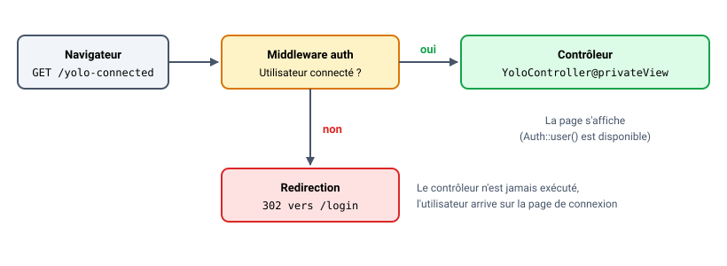

Ajoutez dans le fichier `routes/web.php` :

```php
Route::get('/yolo-connected', [YoloController::class, 'privateView'])->middleware(['auth'])->name('yoloPrivate');
```

Ici la protection est ajoutée grâce à `->middleware(['auth'])`. Le `->name('yoloPrivate')` donne un nom à la route, pour pouvoir la retrouver avec `route('yoloPrivate')`.

::: tip Que se passe-t-il derrière ?

Le middleware `auth` fait exactement ce que faisait votre `CheckAuth` : un `Auth::check()`, et une redirection vers la page de connexion si ce n'est pas le cas. Petit bonus : après la connexion, Laravel vous renvoie automatiquement sur la page que vous vouliez voir au départ.

Regardez aussi la route `/dashboard` générée par Breeze : elle utilise `['auth', 'verified']`. Le second middleware vérifie que l'email a été confirmé, il ne bloque rien tant que le modèle `User` n'implémente pas `MustVerifyEmail`.

:::

Testez en navigation privée : `/yolo-connected` vous renvoie sur `/login`. Une fois connecté, voilà le résultat pour moi :

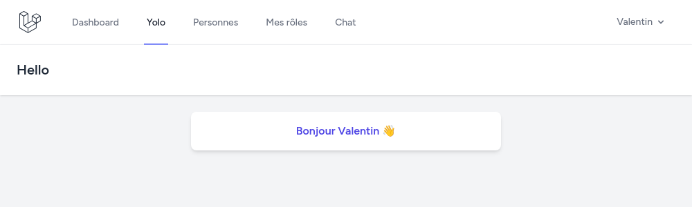

#### Le lien dans le menu

Vous noterez que dans ma version, j'ai un lien « Yolo » dans le menu… Pas de magie ! Il suffit d'ajouter un composant `<x-nav-link>` dans le fichier `resources/views/layouts/navigation.blade.php`, dans la partie « Navigation Links », juste après le lien du Dashboard :

```html
<!-- Navigation Links -->
<div class="hidden space-x-8 sm:-my-px sm:ms-10 sm:flex">
    <x-nav-link :href="route('dashboard')" :active="request()->routeIs('dashboard')">
        {{ __('Dashboard') }}
    </x-nav-link>
    <x-nav-link :href="route('yoloPrivate')" :active="request()->routeIs('yoloPrivate')">
        Yolo
    </x-nav-link>
</div>
```

L'attribut `:active` souligne le lien quand on est sur la page correspondante. Le même fichier contient un second menu pour les petits écrans (`<x-responsive-nav-link>`), je vous laisse y ajouter le lien également.

::: tip Point de contrôle

- `/yolo` s'affiche avec ou sans connexion.
- `/yolo-connected` redirige vers `/login` si vous n'êtes pas connecté, et affiche votre nom sinon.
- Le lien « Yolo » apparaît dans le menu une fois connecté.

:::

👋 Si vous avez des questions, n'hésitez pas. Vous avez maintenant la base de ce qu'il faut savoir. La suite du TP consiste à **modifier le code généré** par Breeze : c'est là que vous allez vraiment en comprendre le fonctionnement.

## Modifier les informations demandées

En reprenant ce que vous avez vu dans le [TP base de données](./base_de_donnees.md), je vous laisse ajouter dans la table `users` un nouveau champ nommé `pseudo`, demandé à l'inscription :

- Ajouter la colonne en base, avec une migration.
- Modifier le formulaire de création de compte `resources/views/auth/register.blade.php` pour ajouter le champ.
- Modifier le modèle `app/Models/User.php` pour autoriser le remplissage du nouveau champ.
- Modifier le contrôleur pour valider et sauvegarder la nouvelle valeur (méthode `store` dans `app/Http/Controllers/Auth/RegisteredUserController.php`).

Pour la migration :

```sh
php artisan make:migration add_pseudo_to_users_table --table=users
```

Puis dans votre migration :

```php
public function up(): void
{
    Schema::table('users', function (Blueprint $table) {
        $table->string('pseudo')->nullable();
    });
}

public function down(): void
{
    Schema::table('users', function (Blueprint $table) {
        $table->dropColumn('pseudo');
    });
}
```

::: warning Pourquoi nullable() ?

Votre table `users` contient déjà des comptes (ceux créés pour tester). Que mettre dans la colonne `pseudo` de ces comptes ? Sans valeur par défaut, la base refuse d'ajouter une colonne obligatoire : SQLite répond `Cannot add a NOT NULL column with default value NULL`. Le `nullable()` règle le problème, et c'est la **validation du formulaire** qui rendra le pseudo obligatoire pour les nouveaux comptes.

:::

Côté modèle, attention à une nouveauté de Laravel 13 : le modèle `User` n'a plus de tableau `$fillable`, mais un **attribut PHP** placé juste au-dessus de la classe.

::: details Besoin d'aide pour le modèle ?

C'est la même chose qu'un `$fillable`, écrite différemment :

```php
#[Fillable(['name', 'email', 'password', 'pseudo'])]
#[Hidden(['password', 'remember_token'])]
class User extends Authenticatable
```

:::

Pour le formulaire, réutilisez les composants fournis par Breeze plutôt que du HTML brut : vos champs auront le même style que les autres.

::: details Besoin d'aide pour le formulaire ?

Inspirez-vous du bloc du champ `name`, en réutilisant les composants de Breeze :

```html
<!-- Pseudo -->
<div class="mt-4">
    <x-input-label for="pseudo" value="Pseudo" />
    <x-text-input id="pseudo" class="block mt-1 w-full" type="text" name="pseudo" :value="old('pseudo')" required />
    <x-input-error :messages="$errors->get('pseudo')" class="mt-2" />
</div>
```

Et dans le contrôleur, une règle de validation de plus (`'pseudo' => ['required', 'string', 'max:50']`) et une ligne de plus dans le `User::create()`.

:::

Pour afficher le pseudo de l'utilisateur connecté, c'est comme pour le nom : <code v-pre>{{ Auth::user()->pseudo }}</code>.

## Créer plusieurs enregistrements en base de données

Le but de Breeze est de vous permettre de modifier le code « préfourni », c'est ce que l'on appelle du **scaffolding**. Nous allons en profiter pour modifier son comportement afin de créer, lors de l'inscription, une autre entrée en base de données : une `personne`, qui contient des informations complémentaires sur l'utilisateur.

- Créez la migration ainsi que le modèle : `php artisan make:model Personne --migration`.
- Renseignez les champs dans votre migration **mais également** dans le `$fillable` du modèle. Exemple de migration :

```php
Schema::create('personnes', function (Blueprint $table) {
    $table->id();
    $table->string('ville');
    $table->date('date_naissance');
    $table->string('genre');
    $table->foreignId('user_id')->constrained();
    $table->timestamps();
});
```

- Lancez la migration : `php artisan migrate`.
- Ajoutez les champs `ville`, `date_naissance` (un `type="date"`) et `genre` dans le formulaire d'inscription.
- Modifiez la méthode `store` du contrôleur `RegisteredUserController` pour créer la personne, **après** la création de l'utilisateur (il nous faut son `id`) :

```php
Personne::create([
    'ville' => $request->ville,
    'date_naissance' => $request->date_naissance,
    'genre' => $request->genre,
    'user_id' => $user->id,
]);
```

N'oubliez pas le `use App\Models\Personne;` en haut du contrôleur. Et voilà : l'inscription crée maintenant un utilisateur **et** une personne.

::: tip Pourquoi user_id ?

`foreignId('user_id')->constrained()` crée la colonne **et** la clé étrangère vers la table `users`. Laravel devine la table grâce au nom de la colonne : `user_id` → table `users`. En respectant cette convention, vous n'aurez rien à préciser dans vos relations.

:::

Il reste un point essentiel avant de tester.

::: danger N'oubliez pas la validation

Les données que vous récupérez dans le formulaire doivent être validées. Laravel propose un système de validation très complet, je vous laisse regarder [la liste des règles disponibles](https://laravel.com/docs/13.x/validation#available-validation-rules) pour compléter le `$request->validate([...])` de la méthode `store`. Par exemple, pour la date : `'date_naissance' => ['required', 'date', 'before:today']`.

:::

Je vous laisse implémenter la modification dans votre code. Pour ma part, voici le formulaire obtenu :

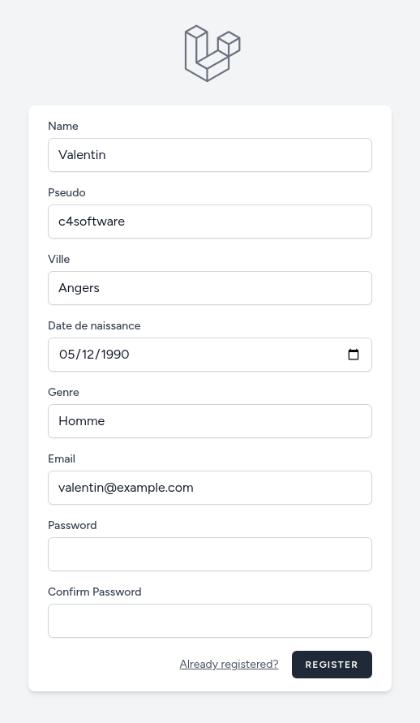

::: tip Point de contrôle

Créez un nouveau compte : la table `personnes` contient une ligne dont le `user_id` correspond au nouvel utilisateur. Et si vous oubliez un champ, le message d'erreur s'affiche sous le champ concerné.

:::

Avant de passer à la suite, lancez `php artisan test`.

::: warning Breeze a aussi généré des tests

Le test `test_new_users_can_register` échoue maintenant. Normal, il envoie un formulaire d'inscription sans vos nouveaux champs obligatoires ! Je vous laisse le corriger dans `tests/Feature/Auth/RegistrationTest.php`, en ajoutant les champs manquants dans le `$this->post('/register', [...])`. Nous reviendrons sur les tests dans le [TP dédié](./tests.md).

:::

## Afficher les informations de l'utilisateur

Maintenant que nous créons une personne lors de l'inscription, nous allons afficher ses informations sur le dashboard après la connexion.

Pour l'instant, la route `/dashboard` générée par Breeze affiche directement la vue, sans contrôleur. Nous allons donc :

- Créer un contrôleur `DashboardController` (`php artisan make:controller DashboardController`) avec une méthode `index`.
- Modifier la route `/dashboard` pour qu'elle utilise ce contrôleur (en gardant son middleware et son nom).
- Modifier la vue `resources/views/dashboard.blade.php` pour afficher les informations de la personne connectée.

Le plus propre est de déclarer la relation dans le modèle `User`. Une personne par utilisateur, c'est une relation **un à un** (`hasOne`) :

```php
public function personne()
{
    return $this->hasOne(Personne::class);
}
```

Vous pourrez alors récupérer la personne de l'utilisateur connecté avec `Auth::user()->personne`.

::: details Besoin d'aide pour le contrôleur et la route ?

```php
use Illuminate\Support\Facades\Auth;

class DashboardController extends Controller
{
    public function index()
    {
        $personne = Auth::user()->personne;

        return view('dashboard', ['personne' => $personne]);
    }
}
```

```php
Route::get('/dashboard', [DashboardController::class, 'index'])->middleware(['auth', 'verified'])->name('dashboard');
```

:::

C'est à vous de jouer pour la vue ! Attention : les comptes créés **avant** cette étape n'ont pas de personne, `$personne` vaudra alors `null`. Pensez à un `@if`.

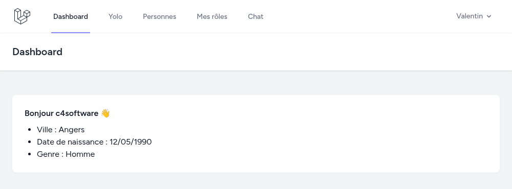

## Utiliser le système de mapping des paramètres de route

En cours, nous avons vu qu'il était possible de passer des paramètres dans des routes. Pour l'instant, vous vous êtes contentés de récupérer des paramètres simples (`id`, `slug`, etc.). Mais il est possible de faire plus pratique.

- Créer une nouvelle route `/personne/{personne}` qui va afficher les informations d'une personne.
- Créer une méthode `show` dans un contrôleur `PersonneController` qui va récupérer les informations de la personne.
- Créer une vue `resources/views/personne.blade.php` qui va afficher les informations de la personne.

Je vous laisse créer la structure de cette demande, en protégeant la route avec le middleware `auth`.

### Vous avez la base

Comment gagner du temps ? En laissant Laravel récupérer l'objet en base pour vous ! Il suffit de typer le paramètre de la méthode avec le modèle `Personne` :

```php
public function show(Personne $personne)
{
    return view('personne', ['personne' => $personne]);
}
```

Et voilà : Laravel récupère automatiquement la `Personne` correspondant à l'`id` passé dans l'URL (`/personne/1`). Si elle n'existe pas, il répond directement par une erreur **404**. Pas de `find()`, pas de `if`, c'est ce que l'on appelle le [Route Model Binding](https://laravel.com/docs/13.x/routing#route-model-binding).

Question :

- Pour que cela fonctionne, deux noms doivent être identiques. Lesquels ?

::: details Voir la réponse

Le nom du paramètre dans la route (`{personne}`) et le nom de la variable dans la méthode (`$personne`). Si vous écrivez `{id}` dans la route, Laravel ne fera pas le lien.

:::

Dans la vue, vous pouvez afficher le nom de l'utilisateur lié en ajoutant la relation inverse dans le modèle `Personne` :

```php
public function user()
{
    return $this->belongsTo(User::class);
}
```

## Liste des personnes

Maintenant que nous avons la possibilité de voir une personne, nous allons créer une page qui affiche la liste de toutes les personnes enregistrées dans la base de données.

Je vous laisse créer une nouvelle route `/personnes` (méthode `index` du `PersonneController`) qui affiche la liste des personnes, avec pour chacune un lien vers sa page `/personne/{id}`. Ajoutez-la au menu.

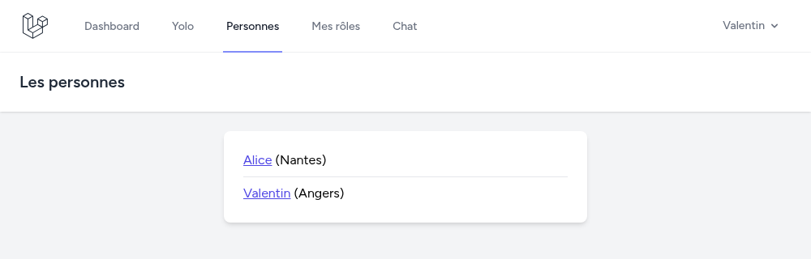

::: tip Ouvrez la Debugbar

Affichez votre liste avec `Personne::all()`, puis regardez l'onglet « Queries » : une requête pour les personnes, puis **une requête par personne** pour récupérer son utilisateur. Avec 100 personnes, 101 requêtes ! C'est le problème dit « N+1 ».

Remplacez par `Personne::with('user')->get()` et regardez à nouveau : deux requêtes seulement, quel que soit le nombre de personnes (c'est la capture de la Debugbar en début de TP).

:::

## Création d'une table pivot pour les rôles

Dans cette partie, nous allons créer une table pivot pour gérer les rôles des utilisateurs. Pour cela, nous allons créer une table `roles` qui contient les différents rôles disponibles, et une table `role_user` qui fait le lien entre les utilisateurs et les rôles.

La relation entre les utilisateurs et les rôles est une relation **many-to-many** (plusieurs à plusieurs) : un utilisateur peut avoir plusieurs rôles, et un rôle peut être attribué à plusieurs utilisateurs. Elle se représente de la façon suivante :

```plaintext
+-----------+     +-----------+     +-----------+
| users     |     | role_user |     | roles     |
+-----------+     +-----------+     +-----------+
| id        |     | user_id   |     | id        |
| name      |     | role_id   |     | name      |
| …         |     |           |     |           |
+-----------+     +-----------+     +-----------+

users.id <----> role_user.user_id
roles.id <----> role_user.role_id
```

Vous aviez déjà construit une relation de ce type dans le [TP base de données](./base_de_donnees.md) : c'est le même principe.

### Créer la table roles

Pour commencer, créons la table `roles` avec sa migration :

```sh
php artisan make:migration create_roles_table
```

Dans la migration, nous ajoutons un champ `name` :

```php
Schema::create('roles', function (Blueprint $table) {
    $table->id();
    $table->string('name');
    $table->timestamps();
});
```

### Créer la table role_user

Ensuite, la table pivot `role_user` qui fait le lien entre les utilisateurs et les rôles :

```sh
php artisan make:migration create_role_user_table
```

```php
Schema::create('role_user', function (Blueprint $table) {
    $table->id();
    $table->foreignId('user_id')->constrained();
    $table->foreignId('role_id')->constrained();
    $table->timestamps();
});
```

::: tip Le nom role_user n'est pas choisi au hasard

Par convention, Laravel nomme la table pivot avec les deux noms de modèles **au singulier**, dans l'**ordre alphabétique**, séparés par un `_` : `role` + `user` → `role_user`. En respectant cette convention, Laravel trouve la table tout seul.

:::

Lancez les migrations : `php artisan migrate`.

### Créer le modèle et les relations

Créons le modèle `Role` :

```sh
php artisan make:model Role
```

Dans le modèle `Role`, ajoutez le `$fillable` et la relation `belongsToMany` avec le modèle `User` :

```php
class Role extends Model
{
    protected $fillable = ['name'];

    public function users()
    {
        return $this->belongsToMany(User::class);
    }
}
```

Et dans le modèle `User`, la relation `belongsToMany` avec le modèle `Role` :

```php
public function roles()
{
    return $this->belongsToMany(Role::class);
}
```

Question :

- Nous n'avons pas créé de modèle `RoleUser` pour la table pivot. Pourquoi n'en a-t-on pas besoin ?

::: details Voir la réponse

`belongsToMany` gère la table pivot pour nous : il sait la lire (pour retrouver les rôles d'un utilisateur) et y écrire (avec `attach`, `detach` et `sync`, que nous allons utiliser). Un modèle pour la table pivot n'est utile que si elle porte des données supplémentaires que l'on veut manipuler.

:::

### Créer les rôles en base de données

Pour créer les rôles en base de données, nous allons les ajouter **au début** de la méthode `run` du seeder `database/seeders/DatabaseSeeder.php` :

```php
public function run(): void
{
    // Les rôles de l'application (firstOrCreate : pas de doublon si on relance le seeder)
    Role::firstOrCreate(['name' => 'admin']);
    Role::firstOrCreate(['name' => 'user']);

    // … le reste du seeder
}
```

N'oubliez pas le `use App\Models\Role;` en haut du fichier. Exécutez ensuite le seeder :

```sh
php artisan db:seed
```

::: warning Seulement la première fois !

Le seeder par défaut crée aussi un utilisateur `test@example.com`. Si vous relancez `db:seed`, cette création échoue (l'email existe déjà). Pour repartir d'une base propre : `php artisan migrate:fresh --seed` (attention, cette commande **vide toute la base**).

:::

### Affecter un rôle à un utilisateur lors de la création

Dans la méthode `store` du contrôleur `RegisteredUserController`, ajoutez après la création de l'utilisateur :

```php
// Rôle « user » par défaut
$user->roles()->attach(Role::where('name', 'user')->first());
```

La méthode `attach` ajoute un rôle à un utilisateur : elle insère une ligne dans la table `role_user` pour faire le lien. Nous recherchons le rôle par son nom plutôt que d'écrire son `id` en dur : rien ne garantit que le rôle `user` porte l'`id` 2 dans toutes les bases.

::: tip Code magique ?

Une ligne, et Laravel s'occupe de la table pivot. C'est ça la puissance de l'ORM Eloquent !

:::

### Afficher les rôles de l'utilisateur

Pour tester, ajoutez une page `/roles` qui affiche les rôles de l'utilisateur connecté. Vous pouvez ajouter une méthode `roles` dans le contrôleur `DashboardController` :

```php
public function roles()
{
    $roles = Auth::user()->roles;

    return view('roles', ['roles' => $roles]);
}
```

Je vous laisse écrire la vue `roles.blade.php`. Cette page doit être disponible uniquement pour les utilisateurs connectés et visible dans le menu.


### Super bouton

Pour tester notre système de rôles, nous allons ajouter un « super bouton » qui permet à l'utilisateur de devenir administrateur. Ajoutez une méthode `glowUpAsAdmin` dans le contrôleur `DashboardController`, elle remplace le rôle de l'utilisateur par le rôle d'administrateur :

```php
public function glowUpAsAdmin()
{
    $admin = Role::where('name', 'admin')->first();
    Auth::user()->roles()->sync([$admin->id]);

    return redirect()->route('roles');
}
```

::: tip Pourquoi sync ?

`sync` synchronise les rôles de l'utilisateur avec la liste passée en paramètre : les rôles absents de la liste sont retirés, les nouveaux sont ajoutés. Après l'appel, l'utilisateur n'a **que** le rôle `admin`.

:::

Cette action **modifie** des données : la route doit donc être en `POST` (protégée par le middleware `auth`), et le bouton doit être dans un formulaire avec `@csrf` :

```php
Route::post('/glow-up', [DashboardController::class, 'glowUpAsAdmin'])->middleware(['auth'])->name('glowUp');
```

```html
<form method="POST" action="{{ route('glowUp') }}">
    @csrf
    <x-primary-button>Devenir administrateur 🚀</x-primary-button>
</form>
```

Question :

- Pourquoi ne pas avoir fait un simple lien `<a href="/glow-up">` avec une route en `GET` ?

::: details Voir la réponse

Une route `GET` ne doit jamais modifier de données. Un simple lien peut être déclenché sans le vouloir (une image `` sur un autre site, un navigateur qui précharge les liens…). En `POST`, Laravel exige le jeton CSRF : la requête ne peut venir que de **votre** formulaire.

:::

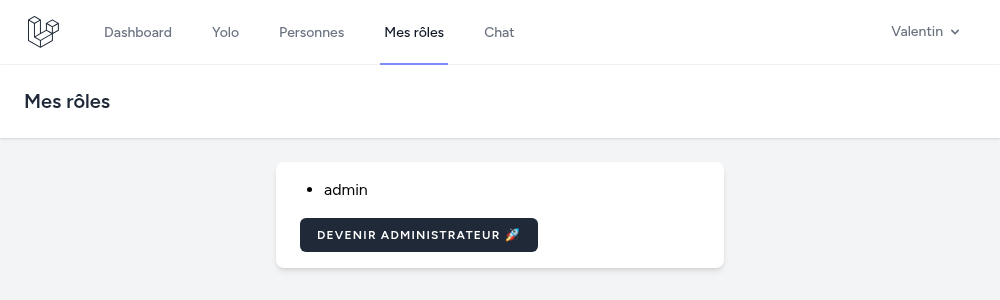

Évidemment, ce bouton n'a rien à faire dans une vraie application. Il nous servira à tester la partie suivante 😉.

## Ajouter un système de chat

Pour conclure ce TP, je vais vous demander d'ajouter un système de chat à votre application. Ce chat doit être accessible uniquement aux utilisateurs connectés.

Voici les fonctionnalités que vous devez implémenter :

- Un utilisateur connecté peut envoyer un message visible par tous les autres utilisateurs.
- Les messages sont disponibles dans une page `/chat`, accessible depuis le menu. Elle doit s'intégrer visuellement à votre application (`<x-app-layout>`).
- Les messages sont stockés en base de données (une table `messages`, liée à `users`).
- Les messages sont affichés dans l'ordre chronologique.
- Chaque message affiche le nom de l'utilisateur qui l'a envoyé, la date et l'heure d'envoi, et le contenu du message.
- Les utilisateurs avec le rôle d'administrateur peuvent supprimer les messages.

::: tip Rôle d'administrateur ?

Pour vérifier si un utilisateur a le rôle d'administrateur, vous pouvez utiliser la relation `roles` du modèle `User` :

```php
if (Auth::user()->roles->contains('name', 'admin')) {
    // L'utilisateur a le rôle d'administrateur
}
```

Vous allez en avoir besoin à deux endroits (la vue pour afficher le bouton, le contrôleur pour **refuser** la suppression avec un `abort(403)`) : pourquoi ne pas en faire une méthode `isAdmin()` dans le modèle `User` ?

:::

Je vous laisse construire votre chat. Si vous ne savez pas par quel bout le prendre, voici une proposition d'ordre.

::: details Coup de pouce : par où commencer ?

1. Le modèle et la migration : `php artisan make:model Message --migration`, avec un `user_id` (comme pour `Personne`) et un champ `contenu`.
2. Un `ChatController` avec trois méthodes : `index` (afficher la page), `store` (enregistrer un message) et `destroy` (supprimer un message).
3. Les routes : un `GET /chat`, un `POST /sendMessage` et un `DELETE /message/{message}` (le Route Model Binding vous donne directement le message à supprimer).
4. La vue, avec un formulaire et la liste. Pour la suppression, un formulaire avec `@csrf` et `@method('DELETE')`.

Pour afficher l'heure, `$message->created_at->format('d/m/Y H:i')`. L'heure est décalée ? Laravel travaille en UTC par défaut : passez la clé `timezone` de `config/app.php` à `'Europe/Paris'`.

:::

Une fois le chat en place, testez-le à plusieurs.

::: tip Point de contrôle

Connectez-vous avec deux comptes dans deux navigateurs (ou une fenêtre de navigation privée). Les messages de l'un apparaissent chez l'autre… après avoir rechargé la page. Le compte administrateur voit les liens « Supprimer », l'autre non.

:::

### Faire évoluer le code pour utiliser de l'Ajax

::: danger Un instant !

Avant d'attaquer cette partie, nous allons réaliser ce mini TP [ici](../javascript/tp4.md) pour comprendre comment fonctionne l'Ajax.

:::

Votre chat fonctionne, mais il ne se met pas à jour automatiquement. Pour cela, vous allez utiliser de l'Ajax pour récupérer régulièrement les messages. Nous allons découper notre code en plusieurs parties :

- Une page `/getMessages` qui retourne **uniquement** la liste des messages, en HTML (sans layout).
- La page `/chat` qui affiche cette liste et la rafraîchit régulièrement grâce à un peu de JavaScript.

#### Une vue partielle

En général, pour récupérer des données en Ajax, on utilise une API Rest qui retourne du JSON. Ici, nous allons faire autrement : nous allons retourner du **HTML** directement. C'est une approche très « Web centric » qui simplifie énormément le code JavaScript.

Pour ne pas écrire deux fois le HTML d'un message, sortez la boucle d'affichage des messages dans une vue à part, par exemple `resources/views/chat/messages.blade.php` (sans `<x-app-layout>`, juste la liste). Vous l'utiliserez à deux endroits :

- Dans la page `/chat`, avec `@include('chat.messages')`.
- Dans la méthode `getMessages` du contrôleur, qui retourne `view('chat.messages', [...])`.

Exemple de HTML retourné par `/getMessages` :

```html
<!-- Message 1 -->
<div class="message">
    <div class="user">Valentin</div>
    <div class="content">Bonjour tout le monde !</div>
</div>

<!-- Message 2 -->
<div class="message">
    <div class="user">Valentin</div>
    <div class="content">Ceci est un test</div>
</div>

<!-- etc. -->
```

#### Pour le JavaScript

Grâce à l'Ajax, nous allons récupérer ce code HTML et le placer dans notre page `/chat`, par exemple toutes les 15 secondes. Voici un exemple de code JavaScript :

```javascript
function getMessages() {
    fetch('/getMessages')
        .then(response => response.text())
        .then(html => {
            document.getElementById('messages').innerHTML = html;
        });
}

setInterval(() => {
    getMessages();
}, 15000);

document.addEventListener('DOMContentLoaded', function () {
    getMessages();
});
```

Quelques explications :

- `setInterval` exécute une fonction toutes les 15 secondes.
- `fetch` fait une requête HTTP pour récupérer les messages.
- `response.text()` récupère le contenu de la réponse en tant que texte.
- `document.getElementById('messages').innerHTML = html;` remplace le contenu de la balise d'identifiant `messages` par le HTML reçu.
- `DOMContentLoaded` permet de récupérer les messages une première fois lorsque la page est chargée.

Extrait du template `chat/index.blade.php` :

```html
<div id="messages">
  Chargement des messages...
  <!-- Les messages vont remplacer ce texte automatiquement -->
</div>
```

#### L'approche HTMX

HTMX est une librairie JavaScript qui permet de faire des requêtes HTTP pour récupérer du HTML et l'ajouter à la page, **sans écrire de JavaScript**. C'est une approche très simple et très efficace pour faire des applications Web modernes.

Pour les curieux, je vous invite à consulter le site officiel de [HTMX](https://htmx.org/), ou mon TP sur le sujet [ici](../javascript/htmx.md).

Pour utiliser HTMX dans votre projet, ajoutez la librairie via un CDN, par exemple à la fin de votre vue `chat/index.blade.php` (à l'intérieur de `<x-app-layout>`) :

```html
<script src="https://unpkg.com/htmx.org@2.0.11"></script>
```

Puis, utilisez HTMX pour charger les messages :

```html
<div id="messages" hx-get="/getMessages" hx-trigger="load">
  Chargement des messages...
  <!-- Les messages vont remplacer ce texte automatiquement -->
</div>
```

- `hx-get="/getMessages"` fait une requête HTTP GET pour récupérer les messages.
- `hx-trigger="load"` déclenche cette requête lorsque la page est chargée.
- Par défaut, HTMX remplace le contenu de la balise par la réponse.

#### Rafraîchir les messages en (presque) temps réel

Pour rafraîchir les messages à intervalles réguliers, il suffit de changer la valeur de `hx-trigger`. Voici un exemple qui rafraîchit les messages toutes les 2 secondes :

```html
<div id="messages" hx-get="/getMessages" hx-trigger="every 2s">
    @include('chat.messages')
</div>
```

Ici, les messages sont affichés dès le chargement grâce au `@include`, puis HTMX prend le relais toutes les 2 secondes.

::: tip C'est magique !

HTMX utilise une approche différente de VueJS ou React, mais elle est très intéressante : le serveur reste maître du HTML. Je vous encourage à l'essayer pour voir si elle correspond à vos besoins.

:::

#### Bonus : et si vous faisiez l'ajout en Ajax ?

Pour aller plus loin, vous pouvez également envoyer le formulaire de nouveau message en Ajax avec HTMX :

```html
<form method="POST" action="/sendMessage"
      hx-post="/sendMessage" hx-target="#messages" hx-swap="innerHTML"
      hx-on::after-request="this.reset()">
    @csrf
    <input type="text" name="message" placeholder="Votre message">
    <button type="submit">Envoyer</button>
</form>
```

Ce formulaire envoie le message en Ajax à la route `/sendMessage`, puis remplace le contenu de la balise `#messages` par la réponse. La réponse doit donc être… la liste des messages en HTML (votre vue partielle) ! Et `hx-on::after-request` vide le champ après l'envoi.

Dans la méthode `store`, HTMX ajoute l'en-tête `HX-Request` à ses requêtes : vous pouvez ainsi retourner la vue partielle pour HTMX, et une redirection classique sinon (le formulaire fonctionne alors aussi sans JavaScript).

```php
if ($request->header('HX-Request')) {
    return view('chat.messages', [/* ... */]);
}

return redirect()->route('chat');
```

::: warning Et l'erreur 419 ?

Le `@csrf` dans le formulaire suffit : HTMX envoie tous les champs du formulaire, jeton compris. Si un jour vous faites un `hx-post` **hors formulaire** (sur un bouton seul), Laravel répondra `419` faute de jeton. Il faudra alors l'ajouter en en-tête, par exemple avec <code v-pre>hx-headers='{"X-CSRF-TOKEN": "{{ csrf_token() }}"}'</code> sur la balise.

:::

Pour ma part, voici le résultat avec un compte administrateur :

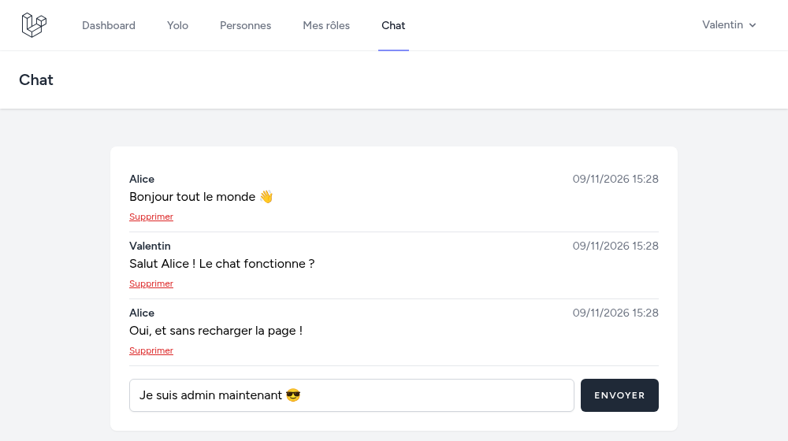

::: tip C'est à vous de jouer !

Ici, l'idée c'est de vous laisser faire. Vous avez toutes les informations nécessaires pour ajouter un chat à votre application.

:::

## Conclusion

Dans ce TP, vous avez :

- Généré une authentification complète avec **Breeze**, et retrouvé dans le code généré les briques codées à la main (hash, session, middleware).
- Découvert **Tailwind** et **Vite** (`npm run dev` pendant le développement, `npm run build` pour figer).
- Utilisé et créé des **composants Blade** (`<x-app-layout>`, `<x-guest-layout>`, `<x-card>`, slots nommés), et transformé un composant **HyperUI** en `<x-stat>` réutilisable.
- Protégé des pages avec le middleware **`auth`**.
- Modifié le code généré : nouveaux champs, table liée (`hasOne` / `belongsTo`), **Route Model Binding**.
- Mis en place des **rôles** avec une table pivot (`belongsToMany`, `attach`, `sync`).
- Rafraîchi une page en **Ajax**, avec `fetch` ou avec **HTMX**.

N'oubliez pas de **commiter votre projet** !

Breeze vous a également généré un système de « mot de passe oublié » complet. Et vous savez **exactement** ce qu'il fait : c'est le mécanisme que vous avez codé à la main dans le TP [Le reset de mot de passe](./reset_mot_de_passe.md) (token, expiration, envoi d'email). Je vous invite d'ailleurs à comparer : explorez `PasswordResetLinkController` et `NewPasswordController`, et retrouvez-y les briques que vous connaissez.

Oui, nous avions tout codé à la main, mais Breeze le fait automatiquement : la force d'un framework, c'est de ne pas tout recoder. Vous l'utiliserez désormais **en sachant ce qu'il fait**.

::: details Le code entier, mais uniquement après avoir essayé

Vous souhaitez comparer avec mon code ? [Téléchargez le projet de référence](/demo/laravel/laravel-breeze.zip) et décompressez-le **à côté** de votre projet (pas dedans !). Il contient l'ensemble du TP, chat compris. Comme pour tout projet Laravel récupéré, il faut l'installer avant de le lancer :

```sh
cd laravel-breeze
composer install
cp .env.example .env
php artisan key:generate
php artisan migrate --seed
npm install
npm run build
php artisan serve
```

Si `migrate` vous demande de créer le fichier `database.sqlite`, répondez `yes`. Le `--seed` crée les rôles `admin` et `user` : créez ensuite votre compte sur `/register`.

:::

Pour la suite :

- [Tester son application avec PHPUnit](./tests.md) : Breeze vous a fourni une vingtaine de tests, vous allez apprendre à les lire et à écrire les vôtres.
- [Eloquent les modèles simplement](./generation_model.md) : aller plus loin avec les modèles.
