# L'authentification avec un starter kit

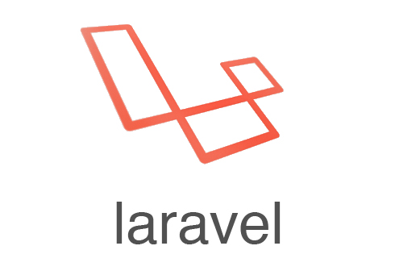

::: details Sommaire
[[toc]]
:::

Dans les TP précédents, vous avez codé **à la main** toute la mécanique d'authentification : [mots de passe hashés, session et middleware](./authentification_manuelle.md), puis [le reset de mot de passe](./reset_mot_de_passe.md) (token, expiration, email). Et vous avez vu que la gestion des utilisateurs est un élément complexe d'une application :

- L'authentification.
- Limiter l'accès à certaines ressources.
- La sécurité des mots de passe.
- La gestion du mot de passe oublié.
- La double authentification.
- …

Vous l'avez compris, la liste est longue… La force de Laravel, c'est justement de vous fournir l'ensemble de ces briques, dans les standards du marché, **sans tout recoder**. Dans ce TP, nous allons générer une application complète avec un **starter kit** de Laravel, comprendre ce qui tourne derrière (**Fortify**), puis la modifier pour l'adapter à nos besoins : un profil enrichi, des rôles, des composants récupérés sur HyperUI, et pour finir un petit chat en Ajax.

Dans ce TP, je vous invite à avoir en parallèle :

- [L'aide-mémoire Laravel](/cheatsheets/laravel/)
- [La synthèse des commandes](/cheatsheets/laravel/quick.md)

## Les slides

Avant de commencer, voici une présentation rapide de la partie théorie de notre TP du jour : le scaffolding, les starter kits, Fortify, et les outils qui arrivent avec (Tailwind, Vite, composants).

<ClientOnly>
<SlidesDeck src="laravel_starter_kit" />
</ClientOnly>

## Prérequis

Ce TP repart d'un **nouveau projet** Laravel, mais il s'appuie sur ce que vous avez construit dans la chaîne des TP Laravel :

- Créer un projet, des routes, des contrôleurs et des vues ([TP introduction](./introduction.md)).
- Les migrations, les modèles et les relations ([TP base de données](./base_de_donnees.md)).
- Le fonctionnement d'une authentification : hash, session, middleware ([TP Comprendre l'authentification](./authentification_manuelle.md)).

Il vous faut également **Node.js** (et donc `npm`) sur votre poste : le starter kit en a besoin pour compiler l'interface. Si vous ne l'avez pas, vous pouvez le télécharger [ici](https://nodejs.org/).

::: details Vous n'avez pas fait le TP Comprendre l'authentification ?

Vous pouvez suivre ce TP sans lui, le starter kit fait tout le travail. Mais vous perdrez le plus intéressant : comprendre ce qui a été généré. Je vous conseille de le faire avant, ou au moins de le lire en parallèle. Même chose pour le TP bonus [La double authentification (2FA)](./2fa.md), que nous comparerons à la 2FA du kit en fin de TP.

:::

## Objectifs

À la fin de ce TP vous saurez :

- Créer un projet avec un **starter kit** (`laravel new`) et expliquer le rôle de **Fortify**.
- Retrouver dans le code généré les briques codées à la main dans les TP précédents.
- Utiliser les outils du front qui arrivent avec (**Tailwind**, **Vite**, `npm`).
- Utiliser et créer des **composants Blade** (`<x-layouts::app>`, `<x-card>`), et en récupérer sur **HyperUI**.
- Protéger une page avec le middleware `auth`.
- Modifier le code généré : champs supplémentaires, table liée, rôles (relation **many-to-many**).
- Expliquer le fonctionnement d'une double authentification **TOTP** (QR code, codes de récupération).
- Rafraîchir une page en Ajax avec `fetch` ou **HTMX**.

## Breeze, starter kits et Fortify

Si vous avez suivi des tutoriels Laravel, vous avez sûrement croisé **Breeze** : c'était, jusqu'à Laravel 11, le kit officiel pour générer une authentification. Depuis Laravel 12, il a été remplacé par les [starter kits](https://laravel.com/docs/13.x/starter-kits), proposés directement par l'installeur `laravel new`. Il en existe quatre :

| Kit          | Les vues                                         |
| :----------- | :----------------------------------------------- |
| React        | React + TypeScript (via Inertia)                 |
| Vue          | Vue + TypeScript (via Inertia)                   |
| Svelte       | Svelte + TypeScript (via Inertia)                |
| **Livewire** | **Blade**, avec les composants **Flux**          |

Nous allons utiliser le kit **Livewire** : ses vues sont en Blade, ce que vous connaissez déjà.

Et la partie serveur ? Tous les kits s'appuient sur le même moteur : **Laravel Fortify**. Fortify fournit les routes, les contrôleurs et toute la sécurité (limitation des tentatives, reset du mot de passe, double authentification…), mais **aucune vue** : on parle de paquet « headless » (sans tête : sans interface). Le kit, lui, fournit les vues et les branche sur Fortify.

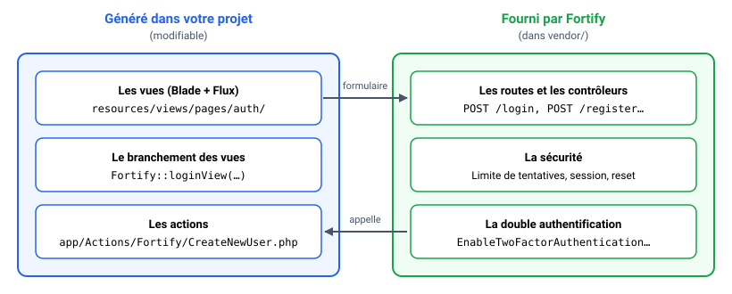

## Créer votre projet

### L'installeur Laravel

Jusqu'ici, vous avez créé vos projets avec `composer create-project`. Pour profiter des starter kits, il nous faut l'**installeur Laravel**, une petite commande `laravel` à installer une seule fois sur votre poste :

```sh
composer global require laravel/installer
```

Vérifiez ensuite qu'elle fonctionne :

```sh
laravel --version
```

::: details laravel : commande introuvable ?

Composer installe les commandes globales dans un dossier qui doit être dans votre `PATH` :

- Sous Windows : `%USERPROFILE%\AppData\Roaming\Composer\vendor\bin`.
- Sous Linux : `~/.config/composer/vendor/bin` (ou `~/.composer/vendor/bin`).
- Sous macOS : `~/.composer/vendor/bin`.

La commande `composer global config bin-dir --absolute` vous donne le chemin exact sur votre poste. Ajoutez-le à votre `PATH`, puis **rouvrez votre terminal**.

:::

### Le projet

Lancez maintenant la création du projet :

```sh
laravel new mon-projet --phpunit
```

L'option `--phpunit` choisit **PHPUnit** comme outil de tests, celui que nous utiliserons dans le [TP sur les tests](./tests.md) (sans elle, l'installeur choisit Pest). La commande va vous poser quelques questions, voici les réponses à donner :

- **Do you want to use a starter kit?** : `Yes` (flèche de gauche, puis Entrée).
- **Which frontend stack?** : `Livewire` (flèche du bas, puis Entrée).
- **Which authentication provider?** : `Laravel's built-in authentication` (le choix par défaut).
- **Single-file Livewire components?** : `Yes` (le choix par défaut).
- **Teams support?** : `No` (le choix par défaut).
- **Which authentication features?** : décochez `Email verification` et `Passkeys` avec la touche **Espace**, gardez le reste, puis Entrée.

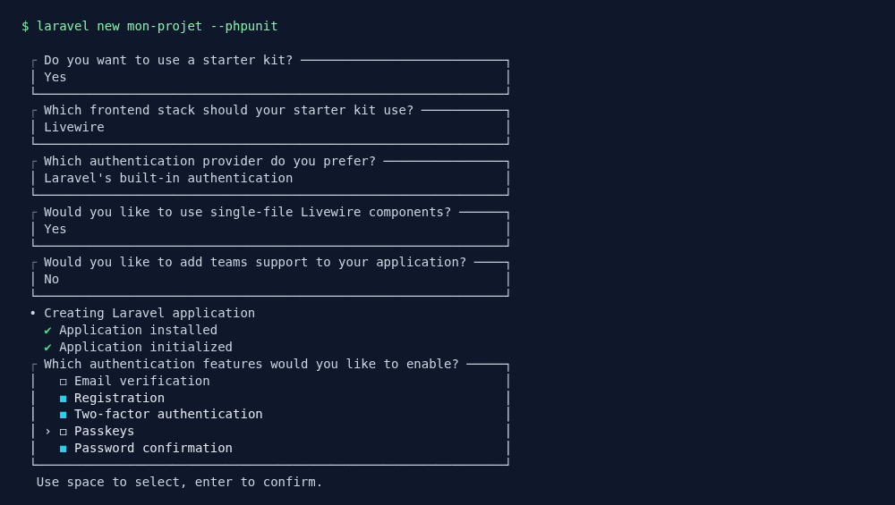

La vérification de l'email et les passkeys (connexion sans mot de passe, avec l'empreinte du téléphone) sont deux fonctionnalités intéressantes, mais elles ajouteraient des étapes à chaque inscription : nous nous en passons pour ce TP.

L'installation se termine toute seule : création de la base SQLite, migrations, installation des dépendances JavaScript (`npm install`) et première compilation de l'interface (`npm run build`). Elle installe aussi **Laravel Boost**, un outil qui aide les assistants IA (Copilot, Claude…) à comprendre votre projet : vous pouvez l'ignorer.

Pour lancer votre application :

```sh
cd mon-projet
composer run dev
```

`composer run dev` lance en une seule commande le serveur PHP (`php artisan serve`), Vite (`npm run dev`, nous y revenons), et l'affichage des logs. Votre site est disponible sur `http://127.0.0.1:8000`. Pour tout arrêter : `Ctrl+C`.

::: tip Point de contrôle

`http://127.0.0.1:8000` affiche la page d'accueil du kit, avec deux liens **Log in** et **Register** en haut à droite. `php artisan --version` indique **Laravel 13**.

:::

## Installer la Laravel Debugbar

Vous avez remarqué que les pages d'erreurs de Laravel sont toujours pleines de bonnes informations. Avec Laravel nous pouvons avoir « encore mieux » : une extension qui ajoute une barre en bas de votre site (uniquement le temps du développement) et qui vous permet de voir :

- Les requêtes SQL réalisées par l'ORM.
- Les vues affichées.
- Le contenu de la session.
- …

Pour l'installer, dans le dossier de votre projet :

```sh
composer require fruitcake/laravel-debugbar --dev
```

La Debugbar est automatiquement active quand `APP_DEBUG` vaut `true` dans votre fichier `.env`. Elle apparaît **en bas de chaque page**, cliquez sur un onglet pour le déplier. Elle vous sera très utile pour comprendre ce que fait Eloquent derrière vos `->get()` et vos relations. Gardez-la sous le coude !

[En savoir plus](https://github.com/fruitcake/laravel-debugbar)

## Ce que le kit a généré

### Tester le code

Votre site est fonctionnel ! Avant d'aller plus loin, je vous laisse tester l'ensemble :

- La création d'un compte (**Register**).
- La déconnexion (menu en bas à gauche, **Log out**), puis la connexion.
- Les réglages (**Settings**, dans le même menu) : profil, mot de passe, apparence (essayez le mode sombre).

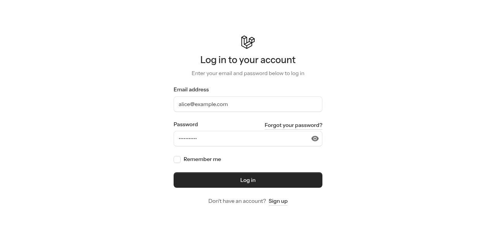

::: tip Point de contrôle

Après l'inscription, vous arrivez sur la page `/dashboard`, avec un menu latéral à gauche. Dans la Debugbar, l'onglet « Session » contient votre identifiant de connexion.

:::

### Le tour des fichiers

Prenez quelques minutes pour regarder ce que contient votre projet. Voici les dossiers et fichiers importants, classés par rôle :

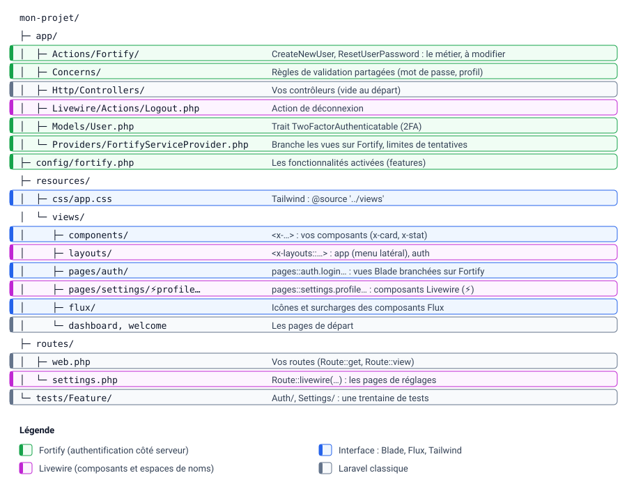

Côté **Fortify** :

- `config/fortify.php` : la configuration, et en bas du fichier la liste des **fonctionnalités** activées (`features`). Vous y retrouvez vos choix de l'installation.
- `app/Providers/FortifyServiceProvider.php` : c'est ici que les vues du kit sont branchées sur Fortify (méthode `configureViews`), et que sont réglées les limitations de tentatives (`configureRateLimiting`).
- `app/Actions/Fortify/` : les **actions**, le code métier exécuté par Fortify : `CreateNewUser` (inscription) et `ResetUserPassword`.
- `app/Concerns/` : les règles de validation partagées (mot de passe, profil).

Côté **interface** :

- `routes/web.php` et `routes/settings.php` : vos routes (accueil, dashboard, réglages).
- `resources/views/pages/auth/` : les vues de connexion, d'inscription, de mot de passe oublié…
- `resources/views/pages/settings/` : les pages de réglages, sous forme de composants Livewire (les fichiers `⚡`).
- `resources/views/layouts/` et `resources/views/components/` : les layouts et les composants de l'interface (nous y revenons plus loin).

### Ce qu'apporte Livewire

Si vous avez déjà vu un projet Breeze, trois éléments vont vous surprendre. Tous viennent de **Livewire**, la bibliothèque qui permet d'écrire des pages dynamiques en PHP et en Blade, sans écrire de JavaScript.

**Les espaces de noms `pages::` et `layouts::`.** Dans le provider de Fortify, vous lisez `view('pages::auth.login')`, et dans les vues `<x-layouts::app>`. Ce sont des raccourcis vers des dossiers, déclarés par Livewire :

| Vous écrivez                | Le fichier utilisé                                  |
| :-------------------------- | :-------------------------------------------------- |
| `view('pages::auth.login')` | `resources/views/pages/auth/login.blade.php`        |
| `<x-layouts::app>`          | `resources/views/layouts/app.blade.php`             |
| `<x-layouts::auth>`         | `resources/views/layouts/auth.blade.php`            |

Le `::` sépare l'espace de noms du chemin, et le `.` sépare les sous-dossiers, comme pour vos composants `<x-…>`.

**Les fichiers `⚡`.** Ce sont des **composants Livewire** « mono-fichier » : en haut, une classe PHP (`new class extends Component { … }`) avec ses propriétés et ses méthodes ; en bas, le HTML en Blade. Les attributs `wire:` relient les deux : `wire:model="name"` lie un champ à la propriété `$name`, `wire:submit="updateProfileInformation"` appelle la méthode PHP du même nom à l'envoi du formulaire. Livewire fait l'aller-retour avec le serveur en Ajax et met la page à jour, sans la recharger. Le `⚡` ne fait pas partie du nom : il sert uniquement à repérer les composants d'un coup d'œil (`⚡profile.blade.php` s'appelle `pages::settings.profile`).

**`Route::livewire()`.** Dans `routes/settings.php`, `Route::livewire('settings/profile', 'pages::settings.profile')` affiche un composant Livewire comme une page entière, placée automatiquement dans le layout `layouts::app`.

Nous ne modifierons pas les composants Livewire dans ce TP : nos pages resteront des contrôleurs et des vues Blade classiques, que vous savez déjà écrire. Mais vous savez maintenant les lire.

Question :

- Ouvrez `resources/views/pages/settings/⚡profile.blade.php`. Que se passe-t-il quand on clique sur **Save** ? Retrouvez la méthode appelée et ce qu'elle fait.

::: details Voir la réponse

Le formulaire porte `wire:submit="updateProfileInformation"` : Livewire appelle la méthode `updateProfileInformation()` de la classe PHP, en haut du fichier. Elle valide les propriétés `$name` et `$email` (remplies par les `wire:model`), met à jour l'utilisateur (`$user->fill(...)` puis `$user->save()`), et affiche une notification avec `Flux::toast(...)`. Pas de route, pas de contrôleur, pas de redirection : tout passe par Livewire.

:::

### Les routes de Fortify

Et les routes de connexion ? Elles ne sont pas dans `routes/web.php` : elles sont déclarées par Fortify, dans le paquet. Pour toutes les voir :

```sh
php artisan route:list
```

Vous y retrouvez `login`, `logout`, `register`, `forgot-password`, `reset-password`, `two-factor-challenge`…

::: tip Que se passe-t-il derrière ?

Le `POST /login` de votre formulaire arrive dans un contrôleur de Fortify, qui fait exactement ce que vous aviez codé à la main dans le [TP Comprendre l'authentification](./authentification_manuelle.md) : il valide les champs, vérifie le hash avec `Auth::attempt()`, régénère la session (`$request->session()->regenerate()`, contre la fixation de session), puis vous redirige vers le dashboard. Avec, en prime, la limitation des tentatives.

:::

Questions :

- Ouvrez `app/Providers/FortifyServiceProvider.php`. Quelle vue est affichée quand on demande la page `/login` ?
- Ouvrez `app/Actions/Fortify/CreateNewUser.php`. Le mot de passe est passé tel quel au `User::create()`, sans `Hash::make()`. Est-il pour autant stocké en clair ? (Indice : regardez la méthode `casts()` du modèle `User`.)
- Toujours dans le provider, que fait le `RateLimiter::for('login', …)` ?

::: details Voir les réponses

- `Fortify::loginView(fn () => view('pages::auth.login'))` : la vue `resources/views/pages/auth/login.blade.php`. Fortify ne sait pas afficher de formulaire, il appelle cette fonction pour obtenir la vue. Le `POST /login` est ensuite traité par Fortify.
- Non : le modèle `User` déclare `'password' => 'hashed'` dans ses `casts()`. Laravel hashe automatiquement le mot de passe au moment de l'enregistrement. Vérifiez dans votre base : la colonne `password` commence par `$2y$`, c'est bien un hash bcrypt, comme dans votre TP.
- Il limite la connexion à **5 tentatives par minute** pour un même couple email + adresse IP : c'est la protection contre la **force brute**, que vous avez vue dans le [TP sécurité sur l'authentification](../securite/tp4_authentification.md).

:::

### L'UI : Tailwind et Vite

Les vues du kit reposent sur un « framework UI » autre que Bootstrap : [Tailwind](https://tailwindcss.com/). Tailwind poursuit le même objectif que Bootstrap, mais avec une approche différente : des petites classes CSS que l'on va appeler « utilitaires » (`text-center`, `font-bold`, `p-6`…), que vous composez directement dans votre HTML.

C'est pour ça que nous avons besoin de `node` et surtout de `npm` : Vite va lire vos templates, ne garder que les classes Tailwind réellement utilisées, puis « compiler » / « packager » l'ensemble dans un fichier CSS et un fichier JS optimisés pour vos clients. Rien d'étonnant à croiser ces outils du monde JavaScript dans un projet PHP : c'est partout aujourd'hui.

Les commandes à connaître, dans le dossier de votre projet :

```sh
# Installer les dépendances (déjà fait par l'installeur, à refaire après un git clone)
npm install

# Compiler une fois les ressources (pour la mise en production)
npm run build

# Ou recompiler automatiquement à chaque modification (pendant le développement)
npm run dev
```

::: danger npm run build ?

La commande `npm run build` fige vos ressources à un instant donné. Si vous ajoutez une classe Tailwind dans un template après le build, **elle n'aura aucun effet** tant que vous ne relancez pas la compilation.

Pendant le développement, utilisez `composer run dev` : il lance Vite en mode `dev` à côté du serveur PHP, et vos classes sont prises en compte à chaque enregistrement.

:::

Où se configure Tailwind ? Dans `resources/css/app.css`. La ligne `@source '../views';` indique à Tailwind d'aller chercher les classes utilisées dans **tous** vos templates : vos futures vues et vos futurs composants sont donc pris en compte automatiquement.

## Les composants et les templates Blade

Si vous avez regardé le code des vues, vous avez remarqué une syntaxe un peu particulière : des balises qui commencent par `x-` (`<x-layouts::app>`, `<x-auth-header>`…) et d'autres par `flux:` (`<flux:input>`, `<flux:button>`…). Ce sont des **composants** Blade. Ils permettent de créer des morceaux de vue réutilisables, mais également des layouts de base.

- Les balises `x-…` sont des composants **de votre projet** : des fichiers dans `resources/views/components/` (ou dans `resources/views/layouts/` pour la syntaxe `x-layouts::…`).
- Les balises `flux:…` sont les composants de [Flux](https://fluxui.dev/), la bibliothèque d'interface utilisée par le kit : champs, boutons, menus, modales… La version gratuite suffit largement pour ce TP.

[Pour plus d'informations sur les composants, rendez-vous ici](https://laravel.com/docs/13.x/blade#components)

::: tip Nous avons déjà vu l'héritage

Dans le [TP introduction](./introduction.md), nous avions vu [l'héritage de template](https://laravel.com/docs/13.x/blade#layouts-using-template-inheritance) (`@extends`, `@section`, `@yield`). Ici c'est la même idée, mais via un système de « composants », très à la mode en ce moment. Les deux fonctionnent, personnellement je trouve l'approche composant plus moderne et plus lisible.

:::

Avec le kit, nous avons à notre disposition **deux layouts** :

- `layouts/app.blade.php` pour les clients **connectés**, utilisable dans votre template via `<x-layouts::app>`. Il contient le menu latéral (dans `layouts/app/sidebar.blade.php`).
- `layouts/auth.blade.php` pour les pages de connexion et d'inscription, utilisable via `<x-layouts::auth>`.

Les deux acceptent un attribut `title`, qui devient le titre de l'onglet : `<x-layouts::app title="Mon titre">`.

::: tip Hey toi lecteur ! Stop !

L'organisation est tout aussi importante que le code. Vous pouvez copier-coller du code entre tous les templates, oui… Mais ce n'est pas efficace, et si on vous demande une modification **vous perdrez du temps** !

Prendre du temps pour utiliser le système de layout proposé par Laravel est un vrai gain de temps. Le vous du futur vous remercie d'avance.

:::

### Fonctionnement des composants

Vous avez utilisé les composants, mais avez-vous compris le fonctionnement ? Un composant, c'est quelque chose de très simple : un morceau de vue réutilisable (un bouton, une card, etc.), donc du « code HTML ». Si vous voulez une comparaison, c'est une sorte de fonction. Prenons un exemple.

Nous souhaitons faire une `Card`. Créez le fichier `resources/views/components/card.blade.php` :

```html
<div class="rounded-xl border border-neutral-200 bg-white p-6 shadow-sm dark:border-neutral-700 dark:bg-neutral-900">
    {{ $slot }}
</div>
```

L'important ici est <code v-pre>{{ $slot }}</code>. `$slot` est une variable qui va contenir les éléments placés à l'intérieur de votre Card lors de son utilisation :

```html
<x-card>
  Ceci est une démo
</x-card>
```

Dans ce cas, la variable `$slot` contiendra… `Ceci est une démo`. Vous venez en quelque sorte de créer votre propre élément HTML réutilisable, comme une `div`, un `span` ou un `li`. Remarquez aussi les classes `dark:…` : elles ne s'appliquent qu'en mode sombre, votre card suit donc le réglage d'apparence du kit.

Question :

- Le nom du fichier est `card.blade.php` et la balise est `<x-card>`. Comment s'appellerait la balise d'un composant `resources/views/components/forms/bouton-rouge.blade.php` ?

::: details Voir la réponse

`<x-forms.bouton-rouge>` : le préfixe `x-`, puis le chemin depuis `components/`, les sous-dossiers étant séparés par un point.

:::

Je vous laisse parcourir les composants déjà disponibles dans le dossier `components` (regardez par exemple `auth-header.blade.php`, et la façon dont il reçoit son titre et sa description avec `@props`).

::: details Pour résumer

Le système de composants va vous permettre :

- De rendre générique un morceau de code que vous utilisez plusieurs fois dans votre projet.
- De penser composant plutôt que HTML copié depuis Internet.
- De rendre « génériques » les layouts pour les partager entre les pages.

:::

### Des composants tout prêts : HyperUI

Écrire ses composants, c'est bien. Mais pour une jolie carte, un tableau ou une alerte, inutile de partir d'une page blanche : des sites proposent des composants Tailwind **prêts à copier**. Parmi eux, [HyperUI](https://hyperui.dev/) : une collection gratuite et open source (licence MIT) de composants Tailwind, rangés en trois familles :

- **Application** : pour les interfaces d'application (statistiques, tableaux, formulaires, menus…).
- **Marketing** : pour les sites vitrines (bannières, cartes, témoignages…).
- **Neobrutalism** : un style graphique plus marqué.

Chaque composant est livré en HTML, avec un bouton pour copier le code. Pas de paquet à installer : comme votre projet utilise déjà Tailwind, il suffit de coller le HTML.

Nous allons ajouter des **statistiques** sur le dashboard. Rendez-vous dans [Application > Stats](https://hyperui.dev/components/application/stats), choisissez un modèle (pour ma part, le troisième, avec un titre, une valeur et un badge d'évolution) et copiez le code d'**une seule** carte, c'est-à-dire le premier bloc `<article>…</article>`.

Créez le fichier `resources/views/components/stat.blade.php` et collez-y le code copié sur HyperUI. C'est tout : le fichier contient uniquement le HTML du composant, sans `<html>` ni `<body>`.

Puis utilisez-le dans `resources/views/dashboard.blade.php`, par exemple tout en haut de la page, à l'intérieur de `<x-layouts::app>` :

```html
<x-stat />
```

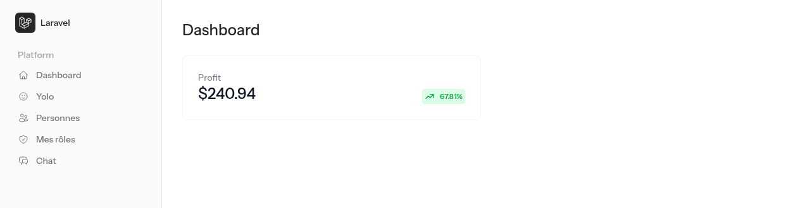

Ça fonctionne… mais votre composant affiche toujours « Profit » et « $240.94 ». Pour le rendre **réutilisable**, transformons ces textes en paramètres. Dans `stat.blade.php` :

- Ajoutez tout en haut du fichier la ligne `@props(['titre', 'valeur'])`.
- Remplacez le texte « Profit » par <code v-pre>{{ $titre }}</code>.
- Remplacez le montant « $240.94 » par <code v-pre>{{ $valeur }}</code>.
- Supprimez le badge d'évolution (le `<div>` qui contient le pourcentage), dont nous n'avons pas l'usage.

`@props(['titre', 'valeur'])` déclare les **attributs** acceptés par le composant : ils deviennent les variables `$titre` et `$valeur`. Vous pouvez maintenant l'utiliser autant de fois que nécessaire :

```html
<div class="mb-6 grid gap-4 md:grid-cols-2">
    <x-stat titre="Personnes inscrites" valeur="12" />
    <x-stat titre="Messages dans le chat" valeur="42" />
</div>
```

Pour l'instant les valeurs sont écrites en dur. Nous leur passerons de vraies valeurs quand le dashboard aura son contrôleur.

::: tip Point de contrôle

Le dashboard affiche vos deux cartes de statistiques côte à côte. Si une carte apparaît sans style, vérifiez que `composer run dev` tourne (ou relancez `npm run build`).

:::

Et le mode sombre ? Les composants HyperUI sont prévus pour un fond clair (`bg-white`, `text-gray-900`). Si vous passez le kit en mode sombre, vos cartes resteront blanches. HyperUI propose une version sombre de la plupart de ses composants : vous pouvez fusionner les deux en ajoutant les classes sombres préfixées par `dark:`, comme dans notre `<x-card>`.

## Protéger une page

Le but de l'authentification est de limiter l'accès à certaines pages, vous l'avez bien compris… Voyons comment le faire sur nos propres pages. Nous allons créer un contrôleur de test :

```sh
php artisan make:controller YoloController
```

Vous venez de créer un contrôleur vide. En reprenant si nécessaire les exemples du [TP introduction](./introduction.md), je vous laisse y créer :

| Route             | Méthode         | Accès                       |
| :---------------- | :-------------- | :-------------------------- |
| `/yolo`           | `publicView()`  | Tout le monde               |
| `/yolo-connected` | `privateView()` | Utilisateurs connectés      |

### La partie publique

Pour la partie publique (non connecté), rien de nouveau par rapport aux TP précédents :

- Une méthode `publicView`, qui retourne une vue `yolo.publicView` affichant pour l'instant `Bonjour non connecté`. Attention ! Cette vue doit utiliser le layout `<x-layouts::auth>`.
- La route correspondante dans le fichier `routes/web.php`.

::: details Besoin d'aide ?

Avez-vous bien cherché ?

Pour la route :

```php
use App\Http\Controllers\YoloController;

Route::get('/yolo', [YoloController::class, 'publicView']);
```

Pour la méthode :

```php
public function publicView()
{
    return view('yolo.publicView');
}
```

Et pour la vue `resources/views/yolo/publicView.blade.php` :

```html
<x-layouts::auth title="Yolo">
    <div class="text-center font-bold text-indigo-600">Bonjour Mr Anonyme 👋</div>
</x-layouts::auth>
```

:::


### La partie privée

Pour la partie privée, je vous laisse gérer l'ensemble de la base :

- La création de la méthode `privateView` dans le contrôleur.
- La création du template `resources/views/yolo/privateView.blade.php`. Attention, cette fois-ci nous allons utiliser le layout `<x-layouts::app>`, qui contient toute la logique de la partie « information de connexion » (menu, nom de l'utilisateur, déconnexion…).

Pour la vue, j'en profite pour utiliser notre composant `<x-card>` et un titre Flux :

```html
<x-layouts::app title="Yolo">
    <flux:heading size="xl" class="mb-6">Hello</flux:heading>

    <x-card>
        <div class="text-center font-bold text-indigo-600">
            Bonjour {{ Auth::user()->name }} 👋
        </div>
    </x-card>
</x-layouts::app>
```

<code v-pre>{{ Auth::user()->name }}</code> vous donne accès à l'utilisateur connecté, dans une vue comme dans un contrôleur. Vous l'aviez déjà utilisé dans le [TP Comprendre l'authentification](./authentification_manuelle.md).

#### La route

C'est la partie qui nous intéresse… Vous avez remarqué que dans les lignes précédentes, nous n'avons jamais parlé d'authentification. Comment alors la page peut-elle n'être accessible qu'aux gens connectés ?

C'est simple : avec un **middleware**, comme celui que vous aviez écrit vous-même (`CheckAuth`). Laravel en fournit un tout prêt, nommé `auth`. Il intercepte la requête avant le contrôleur et vérifie que l'utilisateur est connecté :

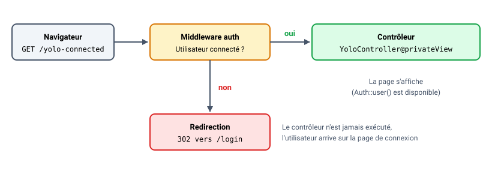

Ajoutez dans le fichier `routes/web.php` :

```php
Route::get('/yolo-connected', [YoloController::class, 'privateView'])->middleware(['auth'])->name('yoloPrivate');
```

Ici la protection est ajoutée grâce à `->middleware(['auth'])`. Le `->name('yoloPrivate')` donne un nom à la route, pour pouvoir la retrouver avec `route('yoloPrivate')`.

::: tip Que se passe-t-il derrière ?

Le middleware `auth` fait exactement ce que faisait votre `CheckAuth` : un `Auth::check()`, et une redirection vers la page de connexion si ce n'est pas le cas. Petit bonus : après la connexion, Laravel vous renvoie automatiquement sur la page que vous vouliez voir au départ.

Regardez aussi la route `dashboard` du kit : elle est dans un groupe `Route::middleware(['auth', 'verified'])`. Le second middleware vérifie que l'email a été confirmé : comme nous avons désactivé la vérification d'email à l'installation, il ne bloque rien.

:::

#### Le lien dans le menu

Il reste à ajouter un lien « Yolo » dans le menu latéral. Ouvrez `resources/views/layouts/app/sidebar.blade.php` et ajoutez un `<flux:sidebar.item>` juste après celui du Dashboard :

```html
<flux:sidebar.item icon="home" :href="route('dashboard')" :current="request()->routeIs('dashboard')" wire:navigate>
    {{ __('Dashboard') }}
</flux:sidebar.item>
<flux:sidebar.item icon="face-smile" :href="route('yoloPrivate')" :current="request()->routeIs('yoloPrivate')" wire:navigate>
    Yolo
</flux:sidebar.item>
```

Quelques explications :

- `icon="face-smile"` : le nom d'une icône [Heroicons](https://heroicons.com/), la bibliothèque d'icônes utilisée par Flux.
- `:current` met le lien en valeur quand on est sur la page correspondante.
- `wire:navigate` : Livewire charge la page suivante en arrière-plan et ne remplace que son contenu, sans recharger tout le site. La navigation est plus fluide.

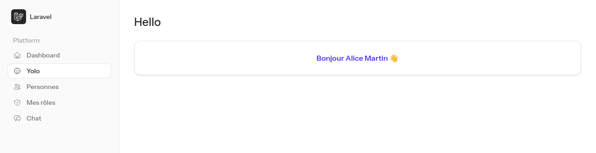

::: tip Point de contrôle

- `/yolo` s'affiche avec ou sans connexion.
- `/yolo-connected` redirige vers `/login` si vous n'êtes pas connecté, et affiche votre nom sinon.
- Le lien « Yolo » apparaît dans le menu latéral une fois connecté.

:::

👋 Si vous avez des questions, n'hésitez pas. Vous avez maintenant la base de ce qu'il faut savoir. La suite du TP consiste à **modifier le code généré** : c'est là que vous allez vraiment en comprendre le fonctionnement.

## Modifier les informations demandées

En reprenant ce que vous avez vu dans le [TP base de données](./base_de_donnees.md), je vous laisse ajouter dans la table `users` un nouveau champ nommé `pseudo`, demandé à l'inscription :

- Ajouter la colonne en base, avec une migration.
- Modifier le formulaire de création de compte `resources/views/pages/auth/register.blade.php` pour ajouter le champ.
- Modifier le modèle `app/Models/User.php` pour autoriser le remplissage du nouveau champ.
- Modifier **l'action** `app/Actions/Fortify/CreateNewUser.php` pour valider et sauvegarder la nouvelle valeur.

Pour la migration :

```sh
php artisan make:migration add_pseudo_to_users_table --table=users
```

Puis dans votre migration :

```php
public function up(): void
{
    Schema::table('users', function (Blueprint $table) {
        $table->string('pseudo')->nullable();
    });
}

public function down(): void
{
    Schema::table('users', function (Blueprint $table) {
        $table->dropColumn('pseudo');
    });
}
```

::: warning Pourquoi nullable() ?

Votre table `users` contient déjà des comptes (ceux créés pour tester). Que mettre dans la colonne `pseudo` de ces comptes ? Sans valeur par défaut, la base refuse d'ajouter une colonne obligatoire : SQLite répond `Cannot add a NOT NULL column with default value NULL`. Le `nullable()` règle le problème, et c'est la **validation du formulaire** qui rendra le pseudo obligatoire pour les nouveaux comptes.

:::

Côté modèle, attention à une nouveauté de Laravel 13 : le modèle `User` n'a plus de tableau `$fillable`, mais un **attribut PHP** placé juste au-dessus de la classe : `#[Fillable(['name', 'email', 'password', 'pseudo'])]`.

Pour le formulaire, réutilisez le composant `<flux:input>`, comme les autres champs. Bonne surprise : il affiche **tout seul** le message d'erreur de validation de son champ, pas besoin de `@error`.

::: details Besoin d'aide pour le formulaire ?

```html
<!-- Pseudo -->
<flux:input
    name="pseudo"
    label="Pseudo"
    :value="old('pseudo')"
    type="text"
    required
/>
```

:::

Et dans l'action, c'est là que la logique de Fortify devient intéressante. Le contrôleur de l'inscription reste dans le paquet : vous ne le modifiez jamais. Fortify lui demande simplement d'appeler **votre** action `CreateNewUser`, qui valide et crée l'utilisateur. C'est donc elle qu'il faut compléter : une règle de validation de plus dans le `Validator::make()` (`'pseudo' => ['required', 'string', 'max:50']`), et une ligne de plus dans le `User::create()`.

Question :

- Pourquoi Fortify vous fait-il modifier une **action** plutôt qu'un contrôleur ?

::: details Voir la réponse

Le contrôleur s'occupe du HTTP (lire la requête, rediriger, répondre en HTML ou en JSON), l'action s'occupe du **métier** (valider et créer l'utilisateur). En séparant les deux, Fortify peut mettre à jour ses contrôleurs (corrections de sécurité, nouvelles fonctionnalités) avec un simple `composer update`, sans jamais écraser **votre** code, qui reste dans `app/Actions`.

:::

Pour afficher le pseudo de l'utilisateur connecté, c'est comme pour le nom : <code v-pre>{{ Auth::user()->pseudo }}</code>.

## Créer plusieurs enregistrements en base de données

Le but du kit est de vous permettre de modifier le code « préfourni », c'est ce que l'on appelle du **scaffolding**. Nous allons en profiter pour modifier son comportement afin de créer, lors de l'inscription, une autre entrée en base de données : une `personne`, qui contient des informations complémentaires sur l'utilisateur.

- Créez la migration ainsi que le modèle : `php artisan make:model Personne --migration`.
- Renseignez les champs dans votre migration **mais également** dans le `$fillable` du modèle. Exemple de migration :

```php
Schema::create('personnes', function (Blueprint $table) {
    $table->id();
    $table->string('ville');
    $table->date('date_naissance');
    $table->string('genre');
    $table->foreignId('user_id')->constrained();
    $table->timestamps();
});
```

- Lancez la migration : `php artisan migrate`.
- Ajoutez les champs `ville`, `date_naissance` (un `type="date"`) et `genre` dans le formulaire d'inscription. Pour le genre, Flux propose une liste déroulante :

```html
<flux:select name="genre" label="Genre" required>
    <flux:select.option value="">Choisir…</flux:select.option>
    <flux:select.option value="femme" :selected="old('genre') === 'femme'">Femme</flux:select.option>
    <flux:select.option value="homme" :selected="old('genre') === 'homme'">Homme</flux:select.option>
    <flux:select.option value="autre" :selected="old('genre') === 'autre'">Autre</flux:select.option>
</flux:select>
```

- Modifiez l'action `CreateNewUser` pour créer la personne, **après** la création de l'utilisateur (il nous faut son `id`). Il faut donc garder l'utilisateur dans une variable au lieu de le retourner directement :

```php
$user = User::create([
    'name' => $input['name'],
    'pseudo' => $input['pseudo'],
    'email' => $input['email'],
    'password' => $input['password'],
]);

Personne::create([
    'ville' => $input['ville'],
    'date_naissance' => $input['date_naissance'],
    'genre' => $input['genre'],
    'user_id' => $user->id,
]);

return $user;
```

N'oubliez pas le `use App\Models\Personne;` en haut du fichier. Et voilà : l'inscription crée maintenant un utilisateur **et** une personne.

::: tip Pourquoi user_id ?

`foreignId('user_id')->constrained()` crée la colonne **et** la clé étrangère vers la table `users`. Laravel devine la table grâce au nom de la colonne : `user_id` → table `users`. En respectant cette convention, vous n'aurez rien à préciser dans vos relations.

:::

Il reste un point essentiel avant de tester.

::: danger N'oubliez pas la validation

Les données que vous récupérez dans le formulaire doivent être validées. Laravel propose un système de validation très complet, je vous laisse regarder [la liste des règles disponibles](https://laravel.com/docs/13.x/validation#available-validation-rules) pour compléter le `Validator::make()` de l'action. Par exemple, pour la date : `'date_naissance' => ['required', 'date', 'before:today']`.

:::

Je vous laisse implémenter la modification dans votre code. Pour ma part, voici le formulaire obtenu :

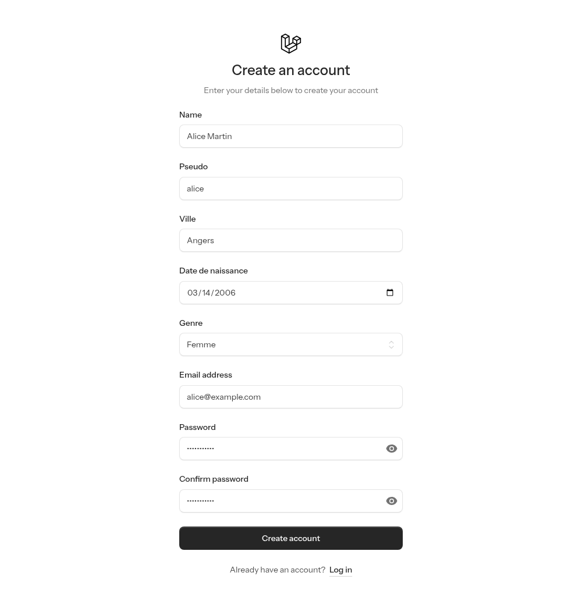

::: tip Point de contrôle

Créez un nouveau compte : la table `personnes` contient une ligne dont le `user_id` correspond au nouvel utilisateur. Et si vous oubliez un champ, le message d'erreur s'affiche sous le champ concerné.

:::

Avant de passer à la suite, lancez `php artisan test`.

::: warning Le kit a aussi généré des tests

Le test `test_new_users_can_register` échoue maintenant. Normal, il envoie un formulaire d'inscription sans vos nouveaux champs obligatoires ! Je vous laisse le corriger dans `tests/Feature/Auth/RegistrationTest.php`, en ajoutant les champs manquants dans le `$this->post(route('register.store'), [...])`. Nous reviendrons sur les tests dans le [TP dédié](./tests.md).

:::

## Afficher les informations de l'utilisateur

Maintenant que nous créons une personne lors de l'inscription, nous allons afficher ses informations sur le dashboard après la connexion.

Pour l'instant, la route `dashboard` du kit affiche directement la vue (`Route::view`), sans contrôleur. Nous allons donc :

- Créer un contrôleur `DashboardController` (`php artisan make:controller DashboardController`) avec une méthode `index`.
- Modifier la route `dashboard` pour qu'elle utilise ce contrôleur (en la laissant dans son groupe de middlewares, avec son nom).
- Modifier la vue `resources/views/dashboard.blade.php` pour afficher les informations de la personne connectée, et donner enfin de **vraies valeurs** à nos composants `<x-stat>`.

Le plus propre est de déclarer la relation dans le modèle `User`. Une personne par utilisateur, c'est une relation **un à un** (`hasOne`) :

```php
public function personne()
{
    return $this->hasOne(Personne::class);
}
```

Vous pourrez alors récupérer la personne de l'utilisateur connecté avec `Auth::user()->personne`.

::: details Besoin d'aide pour le contrôleur et la route ?

```php
use App\Models\Personne;
use Illuminate\Support\Facades\Auth;

class DashboardController extends Controller
{
    public function index()
    {
        $personne = Auth::user()->personne;

        return view('dashboard', [
            'personne' => $personne,
            'nbPersonnes' => Personne::count(),
        ]);
    }
}
```

```php
Route::middleware(['auth', 'verified'])->group(function () {
    Route::get('dashboard', [DashboardController::class, 'index'])->name('dashboard');
});
```

Et dans la vue, l'attribut précédé de `:` reçoit une **expression PHP** au lieu d'un texte : `<x-stat titre="Personnes inscrites" :valeur="$nbPersonnes" />`.

:::

C'est à vous de jouer pour la vue ! Attention : les comptes créés **avant** cette étape n'ont pas de personne, `$personne` vaudra alors `null`. Pensez à un `@if`.

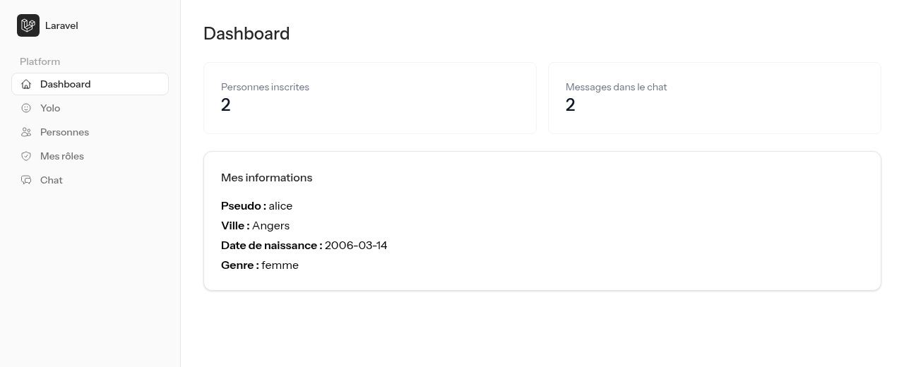

## Utiliser le système de mapping des paramètres de route

En cours, nous avons vu qu'il était possible de passer des paramètres dans des routes. Pour l'instant, vous vous êtes contentés de récupérer des paramètres simples (`id`, `slug`, etc.). Mais il est possible de faire plus pratique.

- Créer une nouvelle route `/personne/{personne}` qui va afficher les informations d'une personne.
- Créer une méthode `show` dans un contrôleur `PersonneController` qui va récupérer les informations de la personne.
- Créer une vue `resources/views/personne.blade.php` qui va afficher les informations de la personne.

Je vous laisse créer la structure de cette demande, en protégeant la route avec le middleware `auth`.

### Vous avez la base

Comment gagner du temps ? En laissant Laravel récupérer l'objet en base pour vous ! Il suffit de typer le paramètre de la méthode avec le modèle `Personne` :

```php
public function show(Personne $personne)
{
    return view('personne', ['personne' => $personne]);
}
```

Et voilà : Laravel récupère automatiquement la `Personne` correspondant à l'`id` passé dans l'URL (`/personne/1`). Si elle n'existe pas, il répond directement par une erreur **404**. Pas de `find()`, pas de `if`, c'est ce que l'on appelle le [Route Model Binding](https://laravel.com/docs/13.x/routing#route-model-binding).

Question :

- Pour que cela fonctionne, deux noms doivent être identiques. Lesquels ?

::: details Voir la réponse

Le nom du paramètre dans la route (`{personne}`) et le nom de la variable dans la méthode (`$personne`). Si vous écrivez `{id}` dans la route, Laravel ne fera pas le lien.

:::

Dans la vue, vous pouvez afficher le nom de l'utilisateur lié en ajoutant la relation inverse dans le modèle `Personne` :

```php
public function user()
{
    return $this->belongsTo(User::class);
}
```

## Liste des personnes

Maintenant que nous avons la possibilité de voir une personne, nous allons créer une page qui affiche la liste de toutes les personnes enregistrées dans la base de données.

Je vous laisse créer une nouvelle route `/personnes` (méthode `index` du `PersonneController`) qui affiche la liste des personnes, avec pour chacune un lien vers sa page `/personne/{id}`. Ajoutez-la au menu latéral (l'icône `users` fera l'affaire).

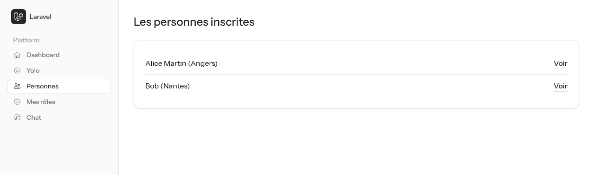

::: tip Ouvrez la Debugbar

Affichez votre liste avec `Personne::all()`, puis regardez l'onglet « Queries » : une requête pour les personnes, puis **une requête par personne** pour récupérer son utilisateur. Avec 100 personnes, 101 requêtes ! C'est le problème dit « N+1 ».

Remplacez par `Personne::with('user')->get()` et regardez à nouveau : deux requêtes seulement, quel que soit le nombre de personnes.

:::

## Création d'une table pivot pour les rôles

Dans cette partie, nous allons créer une table pivot pour gérer les rôles des utilisateurs. Pour cela, nous allons créer une table `roles` qui contient les différents rôles disponibles, et une table `role_user` qui fait le lien entre les utilisateurs et les rôles.

La relation entre les utilisateurs et les rôles est une relation **many-to-many** (plusieurs à plusieurs) : un utilisateur peut avoir plusieurs rôles, et un rôle peut être attribué à plusieurs utilisateurs. Elle se représente de la façon suivante :

```plaintext
+-----------+     +-----------+     +-----------+
| users     |     | role_user |     | roles     |
+-----------+     +-----------+     +-----------+
| id        |     | user_id   |     | id        |
| name      |     | role_id   |     | name      |
| …         |     |           |     |           |
+-----------+     +-----------+     +-----------+

users.id <----> role_user.user_id
roles.id <----> role_user.role_id
```

Vous aviez déjà construit une relation de ce type dans le [TP base de données](./base_de_donnees.md) : c'est le même principe.

### Créer les tables

Pour commencer, créons la table `roles` avec sa migration (`php artisan make:migration create_roles_table`), avec un champ `name` :

```php
Schema::create('roles', function (Blueprint $table) {
    $table->id();
    $table->string('name');
    $table->timestamps();
});
```

Ensuite, la table pivot `role_user` (`php artisan make:migration create_role_user_table`) qui fait le lien entre les utilisateurs et les rôles :

```php
Schema::create('role_user', function (Blueprint $table) {
    $table->id();
    $table->foreignId('user_id')->constrained();
    $table->foreignId('role_id')->constrained();
    $table->timestamps();
});
```

::: tip Le nom role_user n'est pas choisi au hasard

Par convention, Laravel nomme la table pivot avec les deux noms de modèles **au singulier**, dans l'**ordre alphabétique**, séparés par un `_` : `role` + `user` → `role_user`. En respectant cette convention, Laravel trouve la table tout seul.

:::

Lancez les migrations : `php artisan migrate`.

### Créer le modèle et les relations

Créons le modèle `Role` (`php artisan make:model Role`), avec le `$fillable` et la relation `belongsToMany` avec le modèle `User` :

```php
class Role extends Model
{
    protected $fillable = ['name'];

    public function users()
    {
        return $this->belongsToMany(User::class);
    }
}
```

Et dans le modèle `User`, la relation `belongsToMany` avec le modèle `Role` :

```php
public function roles()
{
    return $this->belongsToMany(Role::class);
}
```

Question :

- Nous n'avons pas créé de modèle `RoleUser` pour la table pivot. Pourquoi n'en a-t-on pas besoin ?

::: details Voir la réponse

`belongsToMany` gère la table pivot pour nous : il sait la lire (pour retrouver les rôles d'un utilisateur) et y écrire (avec `attach`, `detach` et `sync`, que nous allons utiliser). Un modèle pour la table pivot n'est utile que si elle porte des données supplémentaires que l'on veut manipuler.

:::

### Créer les rôles en base de données

Pour créer les rôles en base de données, nous allons les ajouter **au début** de la méthode `run` du seeder `database/seeders/DatabaseSeeder.php` :

```php
public function run(): void
{
    // Les rôles de l'application (firstOrCreate : pas de doublon si on relance le seeder)
    Role::firstOrCreate(['name' => 'admin']);
    Role::firstOrCreate(['name' => 'user']);

    // … le reste du seeder
}
```

N'oubliez pas le `use App\Models\Role;` en haut du fichier. Exécutez ensuite le seeder : `php artisan db:seed`.

::: warning Seulement la première fois !

Le seeder par défaut crée aussi un utilisateur `test@example.com`. Si vous relancez `db:seed`, cette création échoue (l'email existe déjà). Pour repartir d'une base propre : `php artisan migrate:fresh --seed` (attention, cette commande **vide toute la base**).

:::

### Affecter un rôle à un utilisateur lors de la création

Dans l'action `CreateNewUser`, ajoutez après la création de l'utilisateur (avant le `return $user;`) :

```php
// Rôle « user » par défaut
$user->roles()->attach(Role::where('name', 'user')->first());
```

La méthode `attach` ajoute un rôle à un utilisateur : elle insère une ligne dans la table `role_user` pour faire le lien. Nous recherchons le rôle par son nom plutôt que d'écrire son `id` en dur : rien ne garantit que le rôle `user` porte l'`id` 2 dans toutes les bases.

### Afficher les rôles de l'utilisateur

Pour tester, ajoutez une page `/roles` (nommée `roles`) qui affiche les rôles de l'utilisateur connecté. Vous pouvez ajouter une méthode `roles` dans le contrôleur `DashboardController` :

```php
public function roles()
{
    $roles = Auth::user()->roles;

    return view('roles', ['roles' => $roles]);
}
```

Je vous laisse écrire la vue `roles.blade.php`. Cette page doit être disponible uniquement pour les utilisateurs connectés et visible dans le menu.

### Super bouton

Pour tester notre système de rôles, nous allons ajouter un « super bouton » qui permet à l'utilisateur de devenir administrateur. Ajoutez une méthode `glowUpAsAdmin` dans le contrôleur `DashboardController`, elle remplace le rôle de l'utilisateur par le rôle d'administrateur :

```php
public function glowUpAsAdmin()
{
    $admin = Role::where('name', 'admin')->first();
    Auth::user()->roles()->sync([$admin->id]);

    return redirect()->route('roles');
}
```

::: tip Pourquoi sync ?

`sync` synchronise les rôles de l'utilisateur avec la liste passée en paramètre : les rôles absents de la liste sont retirés, les nouveaux sont ajoutés. Après l'appel, l'utilisateur n'a **que** le rôle `admin`.

:::

Cette action **modifie** des données : la route doit donc être en `POST` (protégée par le middleware `auth`), et le bouton doit être dans un formulaire avec `@csrf` :

```php
Route::post('/glow-up', [DashboardController::class, 'glowUpAsAdmin'])->middleware(['auth'])->name('glowUp');
```

```html
<form method="POST" action="{{ route('glowUp') }}">
    @csrf
    <flux:button type="submit" variant="primary">Devenir administrateur 🚀</flux:button>
</form>
```

Question :

- Pourquoi ne pas avoir fait un simple lien `<a href="/glow-up">` avec une route en `GET` ?

::: details Voir la réponse

Une route `GET` ne doit jamais modifier de données. Un simple lien peut être déclenché sans le vouloir (une image `` sur un autre site, un navigateur qui précharge les liens…). En `POST`, Laravel exige le jeton CSRF : la requête ne peut venir que de **votre** formulaire.

:::

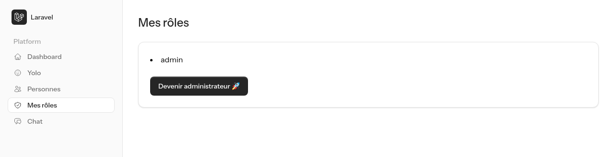

Évidemment, ce bouton n'a rien à faire dans une vraie application. Il nous servira à tester la partie suivante 😉.

## Ajouter un système de chat

Pour la suite de ce TP, je vais vous demander d'ajouter un système de chat à votre application. Ce chat doit être accessible uniquement aux utilisateurs connectés.

Voici les fonctionnalités que vous devez implémenter :

- Un utilisateur connecté peut envoyer un message visible par tous les autres utilisateurs.
- Les messages sont disponibles dans une page `/chat`, accessible depuis le menu. Elle doit s'intégrer visuellement à votre application (`<x-layouts::app>`).
- Les messages sont stockés en base de données (une table `messages`, liée à `users`).
- Les messages sont affichés dans l'ordre chronologique.
- Chaque message affiche le nom de l'utilisateur qui l'a envoyé, la date et l'heure d'envoi, et le contenu du message.
- Les utilisateurs avec le rôle d'administrateur peuvent supprimer les messages.
- Le nombre de messages s'affiche dans la seconde carte `<x-stat>` du dashboard.

::: tip Rôle d'administrateur ?

Pour vérifier si un utilisateur a le rôle d'administrateur, vous pouvez utiliser la relation `roles` du modèle `User` :

```php
if (Auth::user()->roles->contains('name', 'admin')) {
    // L'utilisateur a le rôle d'administrateur
}
```

Vous allez en avoir besoin à deux endroits (la vue pour afficher le bouton, le contrôleur pour **refuser** la suppression avec un `abort(403)`) : pourquoi ne pas en faire une méthode `isAdmin()` dans le modèle `User` ?

:::

Je vous laisse construire votre chat. Si vous ne savez pas par quel bout le prendre, voici une proposition d'ordre.

::: details Coup de pouce : par où commencer ?

1. Le modèle et la migration : `php artisan make:model Message --migration`, avec un `user_id` (comme pour `Personne`) et un champ `contenu`.
2. Un `ChatController` avec trois méthodes : `index` (afficher la page), `store` (enregistrer un message) et `destroy` (supprimer un message).
3. Les routes : un `GET /chat`, un `POST /sendMessage` et un `DELETE /message/{message}` (le Route Model Binding vous donne directement le message à supprimer).
4. La vue, avec un formulaire (`<flux:input>` et `<flux:button>`) et la liste. Pour la suppression, un formulaire avec `@csrf` et `@method('DELETE')`.

Pour afficher l'heure, `$message->created_at->format('d/m/Y H:i')`. L'heure est décalée ? Laravel travaille en UTC par défaut : passez la clé `timezone` de `config/app.php` à `'Europe/Paris'`.

:::

Une fois le chat en place, testez-le à plusieurs.

::: tip Point de contrôle

Connectez-vous avec deux comptes dans deux navigateurs (ou une fenêtre de navigation privée). Les messages de l'un apparaissent chez l'autre… après avoir rechargé la page. Le compte administrateur voit les liens « Supprimer », l'autre non.

:::

### Faire évoluer le code pour utiliser de l'Ajax

::: danger Un instant !

Avant d'attaquer cette partie, nous allons réaliser ce mini TP [ici](../javascript/tp4.md) pour comprendre comment fonctionne l'Ajax.

:::

Votre chat fonctionne, mais il ne se met pas à jour automatiquement. Pour cela, vous allez utiliser de l'Ajax pour récupérer régulièrement les messages. Nous allons découper notre code en plusieurs parties :

- Une page `/getMessages` qui retourne **uniquement** la liste des messages, en HTML (sans layout).
- La page `/chat` qui affiche cette liste et la rafraîchit régulièrement grâce à un peu de JavaScript.

#### Une vue partielle

En général, pour récupérer des données en Ajax, on utilise une API Rest qui retourne du JSON. Ici, nous allons faire autrement : nous allons retourner du **HTML** directement. C'est une approche très « Web centric » qui simplifie énormément le code JavaScript.

Pour ne pas écrire deux fois le HTML d'un message, sortez la boucle d'affichage des messages dans une vue à part, par exemple `resources/views/chat/messages.blade.php` (sans `<x-layouts::app>`, juste la liste). Vous l'utiliserez à deux endroits :

- Dans la page `/chat`, avec `@include('chat.messages')`.
- Dans la méthode `getMessages` du contrôleur, qui retourne `view('chat.messages', [...])`.

#### Pour le JavaScript

Grâce à l'Ajax, nous allons récupérer ce code HTML et le placer dans notre page `/chat`, par exemple toutes les 15 secondes. Voici un exemple de code JavaScript :

```javascript
function getMessages() {
    fetch('/getMessages')
        .then(response => response.text())
        .then(html => {
            document.getElementById('messages').innerHTML = html;
        });
}

setInterval(() => {
    getMessages();
}, 15000);

document.addEventListener('DOMContentLoaded', function () {
    getMessages();
});
```

Quelques explications :

- `setInterval` exécute une fonction toutes les 15 secondes.
- `fetch` fait une requête HTTP pour récupérer les messages.
- `response.text()` récupère le contenu de la réponse en tant que texte.
- `document.getElementById('messages').innerHTML = html;` remplace le contenu de la balise d'identifiant `messages` par le HTML reçu.
- `DOMContentLoaded` permet de récupérer les messages une première fois lorsque la page est chargée.

Extrait du template `chat/index.blade.php` :

```html
<div id="messages">
  Chargement des messages...
  <!-- Les messages vont remplacer ce texte automatiquement -->
</div>
```

#### L'approche HTMX

HTMX est une librairie JavaScript qui permet de faire des requêtes HTTP pour récupérer du HTML et l'ajouter à la page, **sans écrire de JavaScript**. C'est une approche très simple et très efficace pour faire des applications Web modernes.

Pour les curieux, je vous invite à consulter le site officiel de [HTMX](https://htmx.org/), ou mon TP sur le sujet [ici](../javascript/htmx.md).

Pour utiliser HTMX dans votre projet, ajoutez la librairie via un CDN, par exemple à la fin de votre vue `chat/index.blade.php` (à l'intérieur de `<x-layouts::app>`) :

```html
<script src="https://unpkg.com/htmx.org@2.0.11"></script>
```

Puis, utilisez HTMX pour charger et rafraîchir les messages, ici toutes les 2 secondes :

```html
<div id="messages" hx-get="/getMessages" hx-trigger="every 2s">
    @include('chat.messages')
</div>
```

- `hx-get="/getMessages"` fait une requête HTTP GET pour récupérer les messages.
- `hx-trigger="every 2s"` déclenche cette requête toutes les 2 secondes.
- Par défaut, HTMX remplace le contenu de la balise par la réponse.

Ici, les messages sont affichés dès le chargement grâce au `@include`, puis HTMX prend le relais toutes les 2 secondes. Et comme le script est dans votre vue, il est bien chargé même quand vous arrivez sur le chat par un lien `wire:navigate` du menu.

::: tip Et avec Livewire ?

Le kit est construit avec Livewire, qui sait faire exactement la même chose avec l'attribut `wire:poll.2s` sur un composant. HTMX a l'avantage de fonctionner dans n'importe quel projet, même sans Livewire. Les deux approches partagent la même idée : le serveur reste maître du HTML.

:::

#### Bonus : et si vous faisiez l'ajout en Ajax ?

Pour aller plus loin, vous pouvez également envoyer le formulaire de nouveau message en Ajax avec HTMX :

```html
<form method="POST" action="/sendMessage" class="mt-6 flex gap-2"
      hx-post="/sendMessage" hx-target="#messages" hx-swap="innerHTML"
      hx-on::after-request="this.reset()">
    @csrf
    <flux:input name="message" placeholder="Votre message" required class="flex-1" />
    <flux:button type="submit" variant="primary">Envoyer</flux:button>
</form>
```

Ce formulaire envoie le message en Ajax à la route `/sendMessage`, puis remplace le contenu de la balise `#messages` par la réponse. La réponse doit donc être… la liste des messages en HTML (votre vue partielle) ! Et `hx-on::after-request` vide le champ après l'envoi.

Dans la méthode `store`, HTMX ajoute l'en-tête `HX-Request` à ses requêtes : vous pouvez ainsi retourner la vue partielle pour HTMX, et une redirection classique sinon (le formulaire fonctionne alors aussi sans JavaScript).

```php
if ($request->header('HX-Request')) {
    return view('chat.messages', [/* ... */]);
}

return redirect()->route('chat');
```

Pour ma part, voici le résultat avec un compte administrateur :

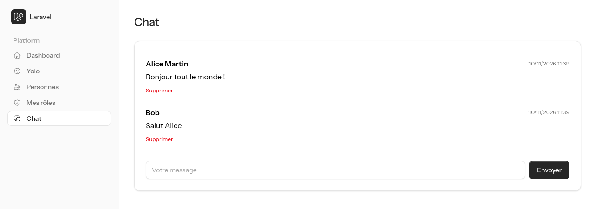

::: tip C'est à vous de jouer !

Ici, l'idée c'est de vous laisser faire. Vous avez toutes les informations nécessaires pour ajouter un chat à votre application.

:::

## La double authentification

Pour terminer, un cadeau du kit : la **double authentification** (2FA) est déjà en place. Vous l'avez peut-être codée à la main dans le TP bonus [La double authentification (2FA)](./2fa.md), avec un code envoyé par email. Le kit utilise une autre méthode, celle que vous avez sûrement déjà croisée sur GitHub, Google ou votre banque : une **application d'authentification** sur votre téléphone.

### Le principe : TOTP

TOTP signifie Time-based One-Time Password (mot de passe à usage unique basé sur l'heure).

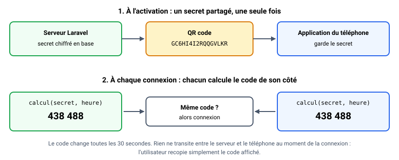

1. À l'activation, le serveur génère un **secret** et vous le transmet **une seule fois**, sous forme de QR code.
2. L'application du téléphone enregistre ce secret.
3. À chaque connexion, le téléphone **et** le serveur calculent un code à partir du secret et de l'heure actuelle. Même secret, même heure : même code.

Le code change toutes les 30 secondes, et rien ne transite entre le serveur et le téléphone au moment de la connexion : pas d'email, pas de SMS, ça fonctionne même en mode avion.

Il vous faut une application d'authentification sur votre téléphone. N'importe laquelle compatible TOTP fait l'affaire : Google Authenticator, Microsoft Authenticator, ou des applications libres comme [Aegis](https://getaegis.app/) (Android) ou [2FAS](https://2fas.com/) (Android et iOS).

::: details Pas de téléphone sous la main ?

Pas de panique. Vous pouvez saisir la clé à la main dans une application de bureau (par exemple KeePassXC, qui sait générer des codes TOTP), ou, **pour vos tests uniquement**, demander le code courant à Laravel avec Tinker :

```sh
php artisan tinker --execute='echo app(\PragmaRX\Google2FA\Google2FA::class)->getCurrentOtp(decrypt(\App\Models\User::where("email", "votre@email.fr")->first()->two_factor_secret));'
```

C'est exactement le calcul que fait le téléphone. Évidemment, cette commande n'a de sens que sur votre poste de développement.

:::

### Activer la 2FA

Ouvrez **Settings**, puis l'onglet **Security**. Première surprise : le kit vous redemande votre mot de passe.

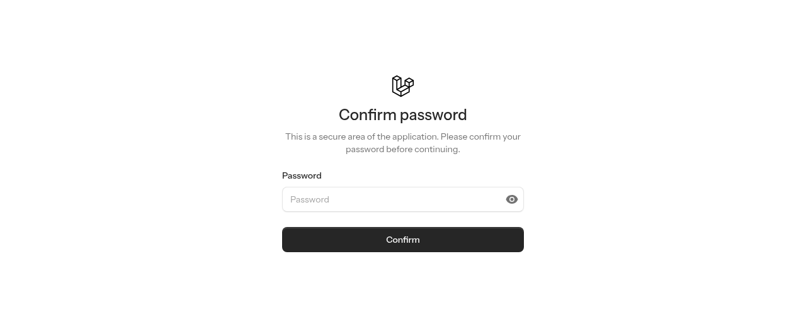

C'est voulu : activer ou désactiver la 2FA est une action **sensible**. Imaginez que vous laissiez votre session ouverte sur un poste du CDI : quelqu'un pourrait désactiver votre 2FA. La route `settings/security` (dans `routes/settings.php`) est donc protégée par le middleware `password.confirm`, qui exige un mot de passe **retapé récemment** (dans les 3 dernières heures).

Cliquez ensuite sur **Enable 2FA** : un QR code s'affiche.

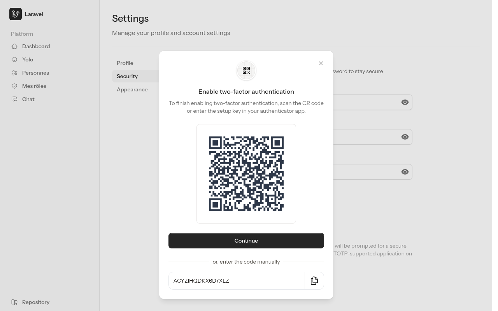

Scannez-le avec votre application, cliquez sur **Continue** et saisissez le code à 6 chiffres affiché par votre téléphone. La 2FA est active ! Cliquez sur **View recovery codes** :

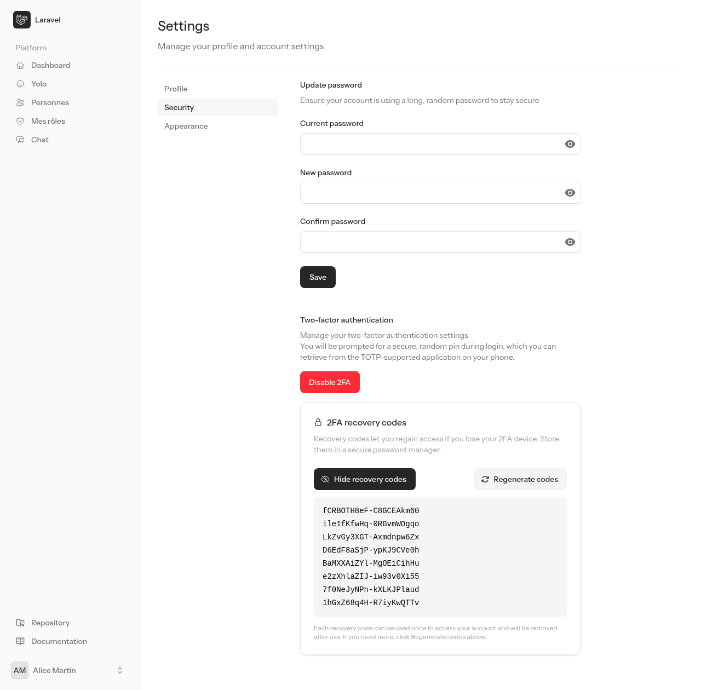

Que se passe-t-il si vous perdez votre téléphone ? Sans précaution, vous êtes enfermé dehors. C'est le rôle des **codes de récupération** : 8 codes, chacun utilisable **une seule fois** à la place du code TOTP. On les range en lieu sûr (sur papier, dans un gestionnaire de mots de passe), mais **pas** sur le téléphone.

Déconnectez-vous, puis reconnectez-vous : après le mot de passe, un nouvel écran vous demande le code.

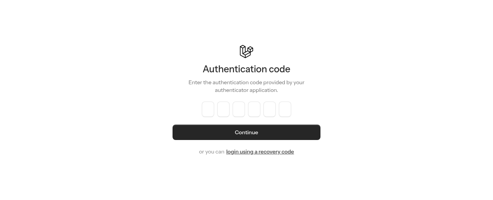

::: tip Point de contrôle

- Un code valide vous amène sur le dashboard, un mauvais code affiche une erreur.
- Le lien « login using a recovery code » permet d'utiliser un code de récupération. Il ne fonctionne **qu'une fois** : réessayez-le à la connexion suivante, il est refusé.
- Le même code TOTP ne peut pas servir deux fois non plus : attendez le suivant (30 secondes) pour vous reconnecter.

:::

### Que se passe-t-il derrière ?

Vous n'avez écrit aucune ligne, mais vous savez maintenant où chercher. Je vous laisse retrouver chacune de ces briques dans votre projet :

- `config/fortify.php` : la fonctionnalité `Features::twoFactorAuthentication()`, avec ses deux options. `confirm` oblige à saisir un premier code avant que la 2FA ne soit active (un QR code mal scanné ne vous enferme donc pas dehors), `confirmPassword` exige la confirmation du mot de passe.
- `database/migrations/…_add_two_factor_columns_to_users_table.php` : trois colonnes dans `users` : `two_factor_secret`, `two_factor_recovery_codes` et `two_factor_confirmed_at`.
- `app/Models/User.php` : le **trait** `TwoFactorAuthenticatable`. Un trait, c'est un morceau de classe « copié » dans la vôtre : votre `User` gagne d'un coup les méthodes `hasEnabledTwoFactorAuthentication()`, `twoFactorQrCodeSvg()`, `recoveryCodes()`…
- `resources/views/pages/settings/⚡two-factor-setup-modal.blade.php` : le composant Livewire de la fenêtre d'activation. Regardez les `use` en haut du fichier : il appelle directement les **actions de Fortify** `EnableTwoFactorAuthentication` et `ConfirmTwoFactorAuthentication`. Le kit ne fait que l'interface, Fortify fait le travail.
- `app/Providers/FortifyServiceProvider.php` : la vue de l'écran de vérification (`Fortify::twoFactorChallengeView`) et sa limite de tentatives (`RateLimiter::for('two-factor', …)` : 5 essais par minute).

Questions :

- Entre le mot de passe et le code, l'utilisateur est-il connecté ? Essayez d'ouvrir `/dashboard` à ce moment-là.
- Ouvrez votre base de données et regardez la colonne `two_factor_secret` de votre utilisateur. Elle commence par `eyJpdiI6…` : le secret est **chiffré**. Mais le mot de passe, lui, est **hashé**. Pourquoi ne pas avoir hashé le secret aussi ?

::: details Voir les réponses

- Non : `/dashboard` vous renvoie sur `/login`. Fortify a vérifié le mot de passe, mais il a seulement mémorisé **en session** l'identifiant de l'utilisateur à vérifier. La connexion (`Auth::login()`) n'a lieu qu'après un code valide : tant que le second facteur n'est pas validé, la session n'est pas ouverte.
- Un hash est à **sens unique** : on ne peut jamais retrouver la valeur d'origine, on peut seulement comparer. C'est parfait pour un mot de passe. Le secret TOTP, lui, doit être **réutilisé** : le serveur en a besoin à chaque connexion pour calculer le code attendu. Il est donc **chiffré** (réversible) avec la clé `APP_KEY` de votre `.env`. Une copie de la base volée seule ne suffit pas à retrouver les secrets… à condition que la `APP_KEY` ne fuite pas avec !

:::

Si vous avez fait le TP bonus sur la 2FA, une dernière question pour comparer les deux approches.

Question :

- Quels sont les avantages du TOTP par rapport au code envoyé par email ? Et ses inconvénients ?

::: details Voir la réponse

Avantages du TOTP :

- Pas d'envoi : pas de serveur mail à configurer, pas d'email qui arrive en retard ou dans les spams, fonctionne sans réseau.
- Le facteur « ce que je possède » est vraiment le **téléphone** : avec le code par email, quelqu'un qui a volé le mot de passe de la boîte mail (souvent le même !) a les deux facteurs.
- Rien à stocker à chaque connexion : pas de code temporaire en base, pas d'expiration à gérer.

Inconvénients :

- Il faut installer une application, et l'activation demande une étape de plus (QR code, confirmation).
- La perte du téléphone impose de prévoir les codes de récupération.

Dans les deux cas, les règles de sécurité sont les mêmes : expiration courte, usage unique, limitation des tentatives, session ouverte seulement après validation.

:::

## Conclusion

Dans ce TP, vous avez :

- Créé un projet avec un **starter kit** (`laravel new`), et compris le rôle de **Fortify**, le moteur qui tourne derrière.
- Retrouvé dans le code généré les briques codées à la main (hash, session, middleware, limitation des tentatives).
- Découvert **Tailwind** et **Vite** (`composer run dev` pendant le développement, `npm run build` pour figer).
- Utilisé et créé des **composants Blade** (`<x-layouts::app>`, `<x-card>`, les composants Flux), et transformé un composant **HyperUI** en `<x-stat>` réutilisable.
- Protégé des pages avec le middleware **`auth`**.
- Modifié le code généré : nouveaux champs dans l'action `CreateNewUser`, table liée (`hasOne` / `belongsTo`), **Route Model Binding**.
- Mis en place des **rôles** avec une table pivot (`belongsToMany`, `attach`, `sync`).
- Rafraîchi une page en **Ajax**, avec `fetch` ou avec **HTMX**.
- Utilisé et compris une double authentification **TOTP** (QR code, codes de récupération, `password.confirm`).

N'oubliez pas de **commiter votre projet** !

Le kit vous a également généré un système de « mot de passe oublié » complet. Et vous savez **exactement** ce qu'il fait : c'est le mécanisme que vous avez codé à la main dans le TP [Le reset de mot de passe](./reset_mot_de_passe.md) (token, expiration, envoi d'email). Testez-le : avec `MAIL_MAILER=log` dans votre `.env`, l'email n'est pas envoyé mais écrit dans `storage/logs/laravel.log`, lien de reset compris.

Oui, nous avions tout codé à la main, mais le kit et Fortify le font automatiquement : la force d'un framework, c'est de ne pas tout recoder. Vous l'utiliserez désormais **en sachant ce qu'il fait**.

::: details Le code entier, mais uniquement après avoir essayé

Vous souhaitez comparer avec mon code ? [Téléchargez le projet de référence](/demo/laravel/laravel-starter-kit.zip) et décompressez-le **à côté** de votre projet (pas dedans !). Il contient l'ensemble du TP, chat compris. Comme pour tout projet Laravel récupéré, il faut l'installer avant de le lancer :

```sh
cd laravel-starter-kit
composer install
cp .env.example .env
php artisan key:generate
php artisan migrate --seed
npm install
npm run build
composer run dev
```

Si `migrate` vous demande de créer le fichier `database.sqlite`, répondez `yes`. Le `--seed` crée les rôles `admin` et `user` : créez ensuite votre compte sur `/register`.

:::

Pour la suite :

- [Tester son application avec PHPUnit](./tests.md) : le kit vous a fourni une trentaine de tests, vous allez apprendre à les lire et à écrire les vôtres.
- [Eloquent les modèles simplement](./generation_model.md) : aller plus loin avec les modèles.
