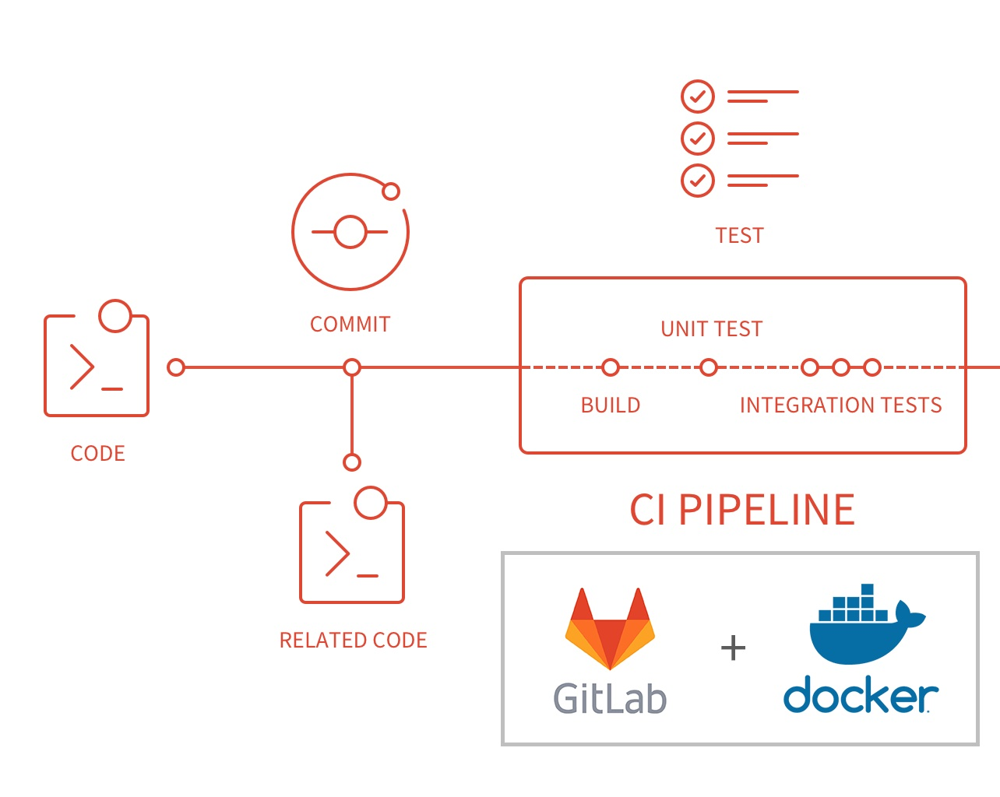
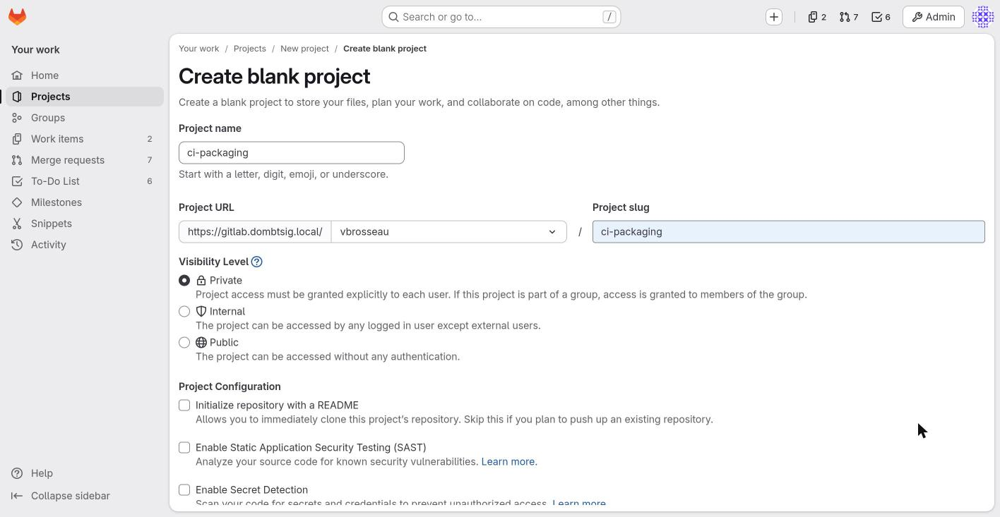
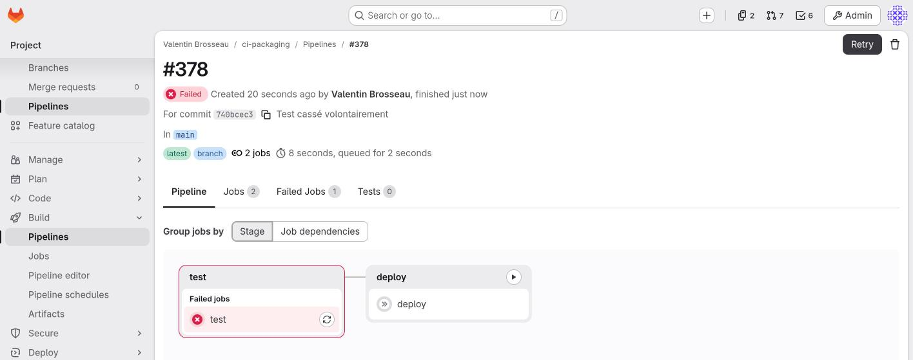
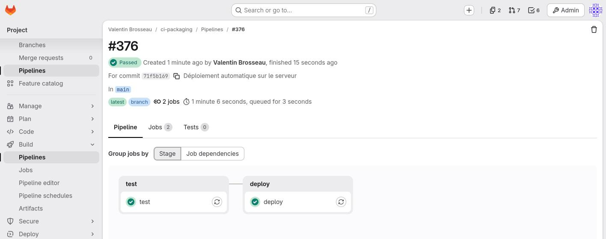
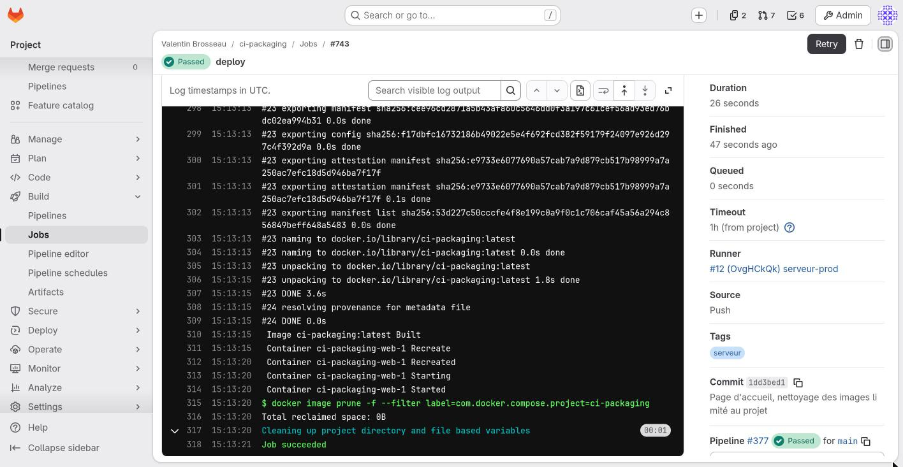

# Intégration continue avec Laravel

Dans ce TP nous allons voir comment mettre en place de l'intégration continue avec Laravel. Dans le [précédent TP](./deployer-laravel-docker.md) nous avons vu en détail comment « lancer / héberger » votre site avec Docker + Compose, en envoyant le code à la main sur le serveur. Nous allons ici automatiser tout ça : un simple `git push` suffira pour tester, construire et mettre en ligne votre site.

::: details Sommaire

[[toc]]

:::

## Avant-propos

Nous allons dans ce TP mettre en place les briques réutilisables qui vous permettront de tester et déployer vos applications avec Docker et Gitlab-CI. La procédure est relativement guidée, vous devez donc vous poser les bonnes questions pour contrôler si vous êtes capables de le refaire dans votre propre projet.



Notre objectif ici est donc :

- Paramétrer une CI (Gitlab-CI) qui lance les tests à chaque push.
- Installer un Runner sur votre serveur.
- Construire l'image et mettre le site à jour sur ce même serveur, sans rien taper.

## Les objectifs d'une CI

L'objectif de faire construire et déployer l'image Docker par la CI est d'automatiser à 100% le processus de livraison de votre application. Plus d'humain == plus de risque.

::: tip Plus de risque ?

Façon de parler évidemment… En sécurité l'humain est source de vulnérabilité « volontaire » et « involontaire ». En automatisant au maximum les opérations de packaging, nous pourrons par la même réduire les risques :

- D'erreurs.
- De corruption du livrable.
- De perte de temps.

:::

La finalité est donc de créer le livrable directement depuis la CI, **ici l'image Docker de notre application**, et de le mettre en service. Nous utiliserons Gitlab-CI, la même opération est possible avec les [GitHub Actions](https://docs.github.com/en/actions).

Voici le principe que nous allons suivre :

1. Vous poussez votre code sur Gitlab.
2. Gitlab lance les tests sur un runner partagé.
3. Si les tests passent, le Runner installé sur votre serveur construit l'image Docker sur place et redémarre le site avec la nouvelle version.

L'image n'existe que sur le serveur qui l'utilise : pas de « hub » à gérer, pas de mot de passe supplémentaire à donner au serveur.

::: tip Et le Registry ?

Gitlab propose aussi un [Container Registry](https://docs.gitlab.com/user/packages/container_registry/) : la CI y publie l'image, et chaque serveur vient la télécharger. C'est la solution quand plusieurs serveurs utilisent la même image. Avec un seul serveur, construire sur place est plus simple, c'est ce que nous faisons ici.

:::

## Créer un projet Laravel

Pour illustrer, nous allons créer un nouveau projet Laravel, vous pouvez bien évidemment utiliser le vôtre, mais pour faire simple je vais créer un projet tout neuf.

```sh
composer create-project laravel/laravel demo-ci
```

Le projet est complètement standard… Rien de spécial. Une seule chose en plus à faire : générer le `package-lock.json`, le fichier qui fige les versions exactes des dépendances JavaScript (Vite, Tailwind…). La construction de l'image s'en servira.

```sh
cd demo-ci
npm install
```

Pensez à le versionner avec le reste du projet (il n'est pas dans le `.gitignore`, c'est voulu).

::: danger Un instant !

- À votre avis, est-ce que Docker et Gitlab-CI se limitent à Laravel ?

:::

## Ajout de Docker

Comme dans le [TP précédent](./deployer-laravel-docker.md) nous allons ajouter le support de Docker pour pouvoir le packager. Ajouter le support de Docker c'est très simple, il suffit d'ajouter « un fichier » : le `Dockerfile`. Vous vous souvenez aussi que ce fichier, dans le cas de Laravel, est « relativement générique », c'est-à-dire toujours le même d'un projet à l'autre.

Cette fois l'image n'est plus construite à la main mais par la CI, directement sur votre serveur. Le `Dockerfile` ci-dessous suit donc les pratiques actuelles :

- Les assets front-end sont compilés dans une première étape avec Node.js (multi-stage build), Node.js n'est pas embarqué dans l'image finale.
- L'image ne contient aucun secret, ni `.env` ni `APP_KEY`. La configuration est donnée au lancement du conteneur, sur le serveur.
- Les mises en cache de Laravel (configuration, routes, vues) se font au démarrage du conteneur, quand la configuration est connue, et pas pendant la construction.

Je vous laisse ajouter le fichier `Dockerfile` à la racine de votre site (à côté du `.env` donc) :

```dockerfile
# Étape 1 : compilation des assets front-end (Vite)
FROM node:24-alpine AS assets
WORKDIR /app
COPY package.json package-lock.json ./
RUN npm ci
COPY . .
RUN npm run build

# Étape 2 : l'image finale, celle qui sera déployée
FROM webdevops/php-nginx:8.4-alpine

ENV WEB_DOCUMENT_ROOT=/app/public \
    APP_ENV=production \
    APP_DEBUG=false \
    LOG_CHANNEL=stderr

WORKDIR /app

COPY --from=composer:2 /usr/bin/composer /usr/bin/composer
COPY . .
COPY --from=assets /app/public/build ./public/build

# Dépendances PHP de production uniquement
RUN composer install --no-interaction --no-dev --optimize-autoloader \
    && chown -R application:application storage bootstrap/cache

# Au démarrage du conteneur (la configuration est alors connue) :
# mise en cache de la configuration, des routes et des vues
# https://laravel.com/docs/deployment#optimization
COPY <<'SCRIPT' /opt/docker/provision/entrypoint.d/30-laravel.sh
cd /app
php artisan optimize
chown -R application:application storage bootstrap/cache
SCRIPT
```

Ajoutez aussi un fichier `.dockerignore` à côté. Il marche comme le `.gitignore` : tout ce qu'il liste n'est jamais copié dans l'image par le `COPY . .`.

```txt
.git
.env
.env.production
node_modules
vendor
public/build
public/hot
database/*.sqlite
```

::: tip Un Instant

- Avez-vous vérifié le contenu du Dockerfile ? Pourquoi est-ce important ?
- Pourquoi le `.env` est-il dans le `.dockerignore` ? Que se passerait-il si votre image, avec ses mots de passe, était récupérée par quelqu'un d'autre ?
- Les extensions PHP (`pdo_mysql`, `mbstring`…) ne sont plus installées dans le Dockerfile. Où sont-elles passées ? (Indice : `docker run --rm webdevops/php-nginx:8.4-alpine php -m`)

:::

La dernière instruction du `Dockerfile` doit vous paraître bizarre, expliquons-la.

::: details Que se passe-t-il derrière le `COPY <<'SCRIPT'` ?

C'est un heredoc : le texte entre `<<'SCRIPT'` et `SCRIPT` est écrit dans un fichier de l'image, ici `/opt/docker/provision/entrypoint.d/30-laravel.sh`. L'image `webdevops` exécute tous les scripts de ce dossier à chaque démarrage du conteneur, juste avant de lancer Nginx et PHP.

C'est ce qui permet de lancer `php artisan optimize` au bon moment : quand les variables de configuration (`APP_KEY`, base de données…) sont connues, c'est-à-dire au lancement du conteneur, et pas pendant la construction de l'image.

:::

Dernier fichier, le `docker-compose.yaml`, que vous connaissez depuis le TP précédent. C'est lui que la CI utilisera pour (re)lancer le site sur le serveur :

```yaml
name: ci-packaging

services:
  web:
    build: .
    image: ci-packaging:latest
    restart: unless-stopped
    ports:
      - "8080:80"
    env_file: .env.production
```

- `name` : le nom du projet Compose. Il reste le même à chaque déploiement, Compose sait donc quel conteneur remplacer.
- `build` et `image` : l'image est construite à partir du `Dockerfile` et nommée `ci-packaging:latest`.
- `env_file` : la configuration de production. Ce fichier n'est **jamais** commité (il est déjà dans le `.gitignore` de Laravel), c'est la CI qui le fournira au moment du déploiement.

## Gitlab-CI

Vous connaissez déjà Gitlab, mais avez-vous vu l'option Gitlab-CI ? Gitlab-CI est la plateforme d'intégration continue intégrée à Gitlab. L'intégration continue pour rappel :

> L'intégration continue est une méthode de développement de logiciel DevOps avec laquelle les développeurs intègrent régulièrement leurs modifications de code à un référentiel centralisé, après quoi des opérations de création et de test sont automatiquement menées.

Gitlab-CI est donc une plateforme prête à l'emploi permettant de tester, packager et déployer votre code source. Les opérations sont réalisées par des **runners** : des machines qui attendent les tâches, les jobs, et les exécutent. Gitlab en fournit pour tout le monde, vous pouvez aussi installer les vôtres, c'est ce que nous ferons [sur votre serveur](#installer-un-runner-sur-votre-serveur).

Nous utilisons ici le Gitlab du lycée, [gitlab.dombtsig.local](https://gitlab.dombtsig.local) (accessible depuis le réseau du lycée ou avec le VPN). Tout fonctionne de la même manière sur [gitlab.com](https://gitlab.com).

### Création du projet sur GitLab

La première étape est de créer un projet vide sur Gitlab (`New project` > `Create blank project`). Comme nous allons envoyer un projet existant, décochez `Initialize repository with a README`.



⚠️ Je vous conseille de mettre votre projet en mode « Private ».

::: tip Un instant !

- Pourquoi créer le projet en mode privé ?
- Pourquoi ne pas initialiser le dépôt avec un README ?

:::

### Envoyer votre code source

Ça semble évident… Vu que nous allons faire travailler Gitlab, nous devons envoyer notre code source ! Vous savez déjà le faire, c'est comme avec Github, à savoir :

- Ajout du remote (suivez la procédure affichée par Gitlab).
- Création d'un commit en local (`git commit …`).
- Envoi du commit (`git push`).

::: tip Un instant !

- Pourquoi envoyer le code source sur Gitlab ?
- Avez-vous vérifié que le `.env` n'a **pas** été envoyé ?

:::

## Les tests en continu

Gitlab-CI est déjà actif sur votre projet ! Il n'attend que la configuration : un simple fichier `.gitlab-ci.yml` à la racine du projet. L'idée ici n'est pas de vous faire écrire ce fichier de zéro, mais de partir d'une configuration que nous allons décortiquer ensemble. Pour aller plus loin, la [documentation de Gitlab-CI](https://docs.gitlab.com/ci/yaml/) est réellement bien faite.

Première étape : lancer les tests automatisés de Laravel à chaque push. Je vous laisse créer le fichier `.gitlab-ci.yml` (dans le même dossier que le `Dockerfile`) :

```yaml
stages:
  - test

test:
  image: composer:2
  stage: test
  cache:
    key:
      files:
        - composer.lock
    paths:
      - vendor/
  script:
    - cp .env.example .env
    - composer install --no-interaction --no-progress
    - php artisan key:generate
    - php artisan test
```

Décortiquons les lignes importantes :

- `stages` : la liste des étapes du pipeline, dans l'ordre. Pour l'instant une seule.
- `image` : chaque job tourne dans un conteneur Docker. `composer:2` contient PHP et Composer.
- `cache` : le dossier `vendor/` est conservé d'un pipeline à l'autre tant que le `composer.lock` ne change pas. Le `composer install` est alors beaucoup plus rapide.
- `script` : les commandes lancées, exactement comme vous le feriez dans votre terminal.

::: tip Un Instant !

- Pourquoi avons-nous une étape de test ? Pourquoi est-ce important ?
- Avez-vous écrit les tests ? Si non d'où proviennent-ils ?
- Pourquoi copier le `.env.example` et générer une clé alors que nous ne sommes pas en production ?

:::

Maintenant que le fichier est présent, je vous laisse :

- Créer un nouveau commit.
- L'envoyer sur le Gitlab avec un Push.

Votre pipeline démarre automatiquement. Vous le retrouvez dans `Build` > `Pipelines`, et en cliquant sur le job vous voyez en direct ce qu'il fait.

::: tip Un Instant !

- Sur quelle machine votre job a-t-il tourné ? (Regardez le début du log du job.)
- Comment identifier que votre étape s'est bien passée ?

:::

## Un long fleuve tranquille ?

Nous voyons ici le côté simple et clé en main de l'intégration continue… Mais que se passe-t-il quand un test échoue ? Essayez : modifiez le test `tests/Feature/ExampleTest.php` pour qu'il attende une page qui n'existe pas (`$this->get('/pas-de-page')`), commitez et poussez.



Le pipeline passe au rouge, et Gitlab vous prévient par mail. C'est bien le rôle de la CI : **détecter le problème avant qu'il n'arrive en production**. Dans la suite du TP, un pipeline rouge bloquera le déploiement.

Pas de panique, au début c'est normal d'avoir des pipelines rouges, ils sont là pour ça ! Remettez le test dans son état d'origine avant de continuer.

## Installer un Runner sur votre serveur

Jusqu'ici c'est un runner **partagé** qui a travaillé pour vous. Ça marche bien, mais il n'a aucun accès à votre serveur : il ne peut pas y déployer votre site. Nous allons donc installer notre propre Runner sur le serveur Debian du [TP précédent](./deployer-laravel-docker.md#installer-docker-sur-votre-serveur-debian), celui dans lequel vous avez déjà installé Docker. Il aura une seule mission : construire l'image et relancer le site.

Le [TP dédié](/tp/ci/gitlab/runner.md) explique comment fonctionne un Runner en détail (exécuteurs, tags, enregistrement). Lisez-le en parallèle, nous allons l'appliquer pas à pas sur votre serveur.

::: danger Attention : le Runner et le site sur la même machine

Installer le Runner sur le serveur qui héberge votre production, c'est pratique pour un TP… et une très mauvaise idée en entreprise.

- Le Runner exécute le code de n'importe quel commit. Un `.gitlab-ci.yml` modifié, par erreur ou par quelqu'un qui a accès au dépôt, part directement sur votre serveur de production.
- Pour déployer, il pilote le Docker du serveur via son socket (`/var/run/docker.sock`), ce qui revient à être `root` sur la machine. Un job peut donc lister, arrêter ou supprimer n'importe quel conteneur, un `docker rm -f` glissé dans un script suffit.
- La construction de l'image (`npm ci`, `composer install`…) prend le processeur et la mémoire au site : vos visiteurs subissent les lenteurs, voire la coupure si la mémoire vient à manquer.
- La configuration de production et les jobs de CI se retrouvent au même endroit.

En entreprise, les jobs de test et de construction tournent sur des machines dédiées, et le serveur de production ne fait que recevoir le résultat. Ici vous n'avez qu'un seul serveur, nous limiterons donc les risques avec les réglages de la partie [Limiter ce que le Runner peut faire](#limiter-ce-que-le-runner-peut-faire).

:::

### Créer le Runner dans Gitlab

Ça commence dans l'interface web. Dans votre projet :

1. `Settings` > `CI/CD` > `Runners`, puis `New project runner`.
2. Plateforme : `Linux`.
3. Tags : indiquez `serveur`, et **ne cochez pas** `Run untagged jobs` (nous verrons pourquoi plus bas).
4. Cochez `Protected` : le Runner n'acceptera que les jobs lancés sur une branche protégée (la branche par défaut, `main`, l'est automatiquement).
5. Validez avec `Create runner`.

Gitlab vous affiche un token de la forme `glrt-…`. Copiez-le tout de suite, il ne sera plus affiché ensuite.

::: tip Un instant !

- Pourquoi un runner de **projet** plutôt qu'un runner partagé avec tout votre groupe ?

:::

### Enregistrer le Runner sur le serveur

Connectez-vous en SSH sur votre serveur. Le Runner va lui aussi tourner dans un conteneur (Docker est déjà installé), sa configuration sera stockée dans `/srv/gitlab-runner/config`.

Le Gitlab du lycée utilise un certificat HTTPS **auto-signé** : par défaut, le Runner refuse de s'y connecter (`certificate signed by unknown authority`). Il faut donc lui donner ce certificat, en le déposant dans le dossier `certs` de sa configuration :

```sh
sudo mkdir -p /srv/gitlab-runner/config/certs

openssl s_client -connect gitlab.dombtsig.local:443 -showcerts </dev/null 2>/dev/null \
     | openssl x509 | sudo tee /srv/gitlab-runner/config/certs/gitlab.dombtsig.local.crt
```

Le Runner utilise automatiquement le fichier `certs/<nom du serveur>.crt` qui correspond à l'adresse de Gitlab. Sur gitlab.com, cette étape est inutile : son certificat est reconnu partout.

Vous pouvez maintenant enregistrer le Runner :

```sh
sudo docker run --rm -it \
     -v /srv/gitlab-runner/config:/etc/gitlab-runner \
     gitlab/gitlab-runner:v19.5.3 register
```

L'assistant pose quelques questions, répondez :

- GitLab instance URL : `https://gitlab.dombtsig.local`
- Runner authentication token : le token `glrt-…` copié juste avant
- Name for the runner : un nom qui identifie la machine, `serveur-prod` par exemple
- Executor : `docker`. Surtout pas `shell`, vos scripts tourneraient directement sur la machine
- Default Docker image : `alpine:latest`

La commande écrit le fichier `/srv/gitlab-runner/config/config.toml`.

### Donner accès au Docker du serveur

Notre job de déploiement va lancer `docker compose up` : il doit donc pouvoir piloter le Docker **du serveur**, et pas un Docker isolé. Pour ça, on partage le socket Docker avec les jobs. Ouvrez le fichier de configuration :

```sh
sudo nano /srv/gitlab-runner/config/config.toml
```

Modifiez les deux lignes suivantes (le reste a été généré par le `register`, n'y touchez pas) :

```toml
concurrent = 1

[[runners]]
  # … (ce qui a été généré par le register, ne pas toucher)
  [runners.docker]
    # …
    volumes = ["/var/run/docker.sock:/var/run/docker.sock", "/cache"]
```

- `concurrent = 1`, tout en haut du fichier : un seul job à la fois, deux déploiements ne se marchent pas dessus.
- `volumes` : chaque job voit le socket Docker du serveur. C'est ce qui lui permet de construire l'image et de relancer le site… et c'est aussi pour ça qu'il est quasiment `root` sur la machine.

### Lancer le Runner

Le Runner est connu de Gitlab, reste à le démarrer :

```sh
sudo docker run -d --name gitlab-runner --restart always \
     -v /srv/gitlab-runner/config:/etc/gitlab-runner \
     -v /var/run/docker.sock:/var/run/docker.sock \
     gitlab/gitlab-runner:v19.5.3
```

`docker ps` doit vous montrer le conteneur `gitlab-runner` en train de tourner. Retournez ensuite dans `Settings` > `CI/CD` > `Runners`, votre Runner y apparaît avec une pastille verte.

::: tip Un instant !

- À quoi sert `--restart always` ?
- Pourquoi le Runner a-t-il besoin de `/var/run/docker.sock` ?
- `v19.5.3` est la version du Runner. Pourquoi préciser une version plutôt que `latest` ?

:::

### Limiter ce que le Runner peut faire

Deux protections sont déjà en place : un runner de **projet** et l'option `Protected`. Il reste à n'envoyer au Runner que les jobs que nous avons choisis. C'est le rôle du tag `serveur` : comme nous n'avons pas coché `Run untagged jobs`, le Runner ignore tout job qui ne porte pas ce tag.

| Protection                       | Où                           | Ce qu'elle évite                                       |
| -------------------------------- | ---------------------------- | ------------------------------------------------------ |
| Runner de projet                 | Interface Gitlab             | Les jobs des autres projets ne tournent pas chez vous  |
| `Protected`                      | Interface Gitlab             | Une branche de test ne peut pas lancer de job          |
| Tag `serveur`, pas de `untagged` | Interface + `.gitlab-ci.yml` | Seuls les jobs choisis arrivent sur le serveur         |
| Executor `docker`                | `register`                   | Les scripts ne tournent pas directement sur la machine |
| `concurrent = 1`                 | `config.toml`                | Deux déploiements ne se lancent pas en même temps      |

Ces protections réduisent les risques sans les faire disparaître : quelqu'un capable de pousser sur `main` peut toujours exécuter ce qu'il veut sur votre serveur.

## Déployer automatiquement

Tout est prêt : il reste à ajouter le job de déploiement.

### La configuration de production

Votre image ne contient aucune configuration, et le fichier `.env.production` n'est pas dans Git. Nous allons le confier à Gitlab, sous forme de **variable CI** : il sera écrit dans le dossier du job au moment du déploiement, et nulle part ailleurs.

Commencez par générer une clé d'application, sur votre poste, dans le projet :

```sh
php artisan key:generate --show
```

Puis dans votre projet Gitlab : `Settings` > `CI/CD` > `Variables`, puis `Add variable` :

- Type : `File`.
- Visibility : `Visible` (un fichier de plusieurs lignes ne peut pas être masqué).
- Flags : cochez `Protect variable`, la variable ne sera donnée qu'aux jobs de la branche `main`.
- Key : `ENV_PRODUCTION`.
- Value : le contenu de votre `.env.production`.

```sh
APP_KEY=base64:… (la clé générée juste avant)
APP_URL=http://votre.ip:8080
SESSION_DRIVER=file
CACHE_STORE=file
```

::: details Pourquoi `SESSION_DRIVER=file` ?

Depuis Laravel 11, les sessions et le cache sont stockés par défaut **en base de données**. Notre site n'a pas de base de données, la première page planterait donc (table `sessions` introuvable). Avec `file`, Laravel les range dans le dossier `storage/`.

Si votre projet utilise MariaDB (comme dans le [TP précédent](./deployer-laravel-docker.md#ajouter-une-base-de-donnees)), ajoutez plutôt les variables `DB_CONNECTION`, `DB_HOST`, `DB_DATABASE`, `DB_USERNAME` et `DB_PASSWORD`.

:::

Seuls les membres du projet avec le rôle `Maintainer` peuvent lire cette variable. C'est un des avantages du projet privé.

### Le job de déploiement

Complétez votre `.gitlab-ci.yml` avec une seconde étape :

```yaml
stages:
  - test
  - deploy

test:
  # … le job de test ne change pas

deploy:
  image: docker:29
  stage: deploy
  needs:
    - test
  tags:
    - serveur
  environment: production
  script:
    - cp "$ENV_PRODUCTION" .env.production
    - docker compose up -d --build --remove-orphans
    - docker image prune -f --filter label=com.docker.compose.project=ci-packaging
  rules:
    - if: $CI_COMMIT_BRANCH == $CI_DEFAULT_BRANCH
```

Décortiquons :

- `image: docker:29` : le job tourne dans un conteneur qui contient le client Docker et Compose. Grâce au socket partagé, ses commandes pilotent le Docker du serveur.
- `needs` : le job attend que `test` soit réussi. Si un test échoue, **rien n'est déployé**.
- `tags` : seul votre Runner `serveur` prendra ce job. Le job `test`, sans tag, continue de tourner sur le runner partagé.
- `environment` : Gitlab garde l'historique des déploiements dans `Operate` > `Environments`.
- `cp "$ENV_PRODUCTION" .env.production` : pour une variable de type `File`, Gitlab écrit le contenu dans un fichier temporaire et met **son chemin** dans `$ENV_PRODUCTION`. On le copie là où Compose l'attend.
- `docker compose up -d --build` : construit la nouvelle image et remplace le conteneur, seulement si quelque chose a changé.
- `docker image prune` : à chaque déploiement, l'ancienne image perd son nom au profit de la nouvelle. Selon la configuration de Docker, elle peut rester sur le disque sans nom : cette commande fait le ménage, sinon le disque du serveur se remplit au fil des déploiements. Le filtre `label=…` limite le ménage aux images du projet (Compose les étiquette automatiquement) : sans lui, la commande viderait toutes les images sans nom du serveur, y compris celles des autres projets.
- `rules` : on ne déploie que depuis la branche par défaut (`main`). Une autre branche lance les tests, mais ne touche pas au site.

Toutes les variables `$CI_…` sont fournies automatiquement par Gitlab, vous n'avez rien à configurer. [La liste complète est ici.](https://docs.gitlab.com/ci/variables/predefined_variables/)

::: tip Un Instant !

- Combien d'étapes possède maintenant notre « Intégration Continue » ? Dans quel ordre sont-elles exécutées ?
- Les étapes `test` et `deploy` sont-elles réalisées en même temps ? Sur la même machine ?
- Le code source est-il présent sur le serveur ? Où ?

:::

### Tester

Commitez et poussez. Pendant que le pipeline tourne, lancez sur le serveur :

```sh
watch docker ps
```

Au moment du job `deploy`, vous voyez apparaître le conteneur du job, puis votre site `ci-packaging-web-1` est (re)créé.



Le log du job `deploy` vous montre ce qui s'est passé sur le serveur :



::: tip Point de contrôle

- Le début du log du job `deploy` indique `on serveur-prod`, le nom de votre Runner.
- Le job `test` est toujours parti sur le runner partagé.
- Votre site répond sur `http://votre.ip:8080`.

:::

Un job `deploy` qui ne démarre pas, pas de panique, c'est presque toujours une histoire de tag ou de branche.

::: details Le job reste bloqué en « pending » ?

- Le Runner est bien vert dans `Settings` > `CI/CD` > `Runners` ?
- Le job porte bien le tag `serveur`, orthographié pareil que dans l'interface ?
- Vous êtes bien sur une branche protégée (`main`) ? Sinon le Runner `Protected` refuse le job.
- Les logs du Runner répondent souvent à la place de Gitlab : `docker logs gitlab-runner`.

:::

## C'est à vous

Modifiez la page d'accueil de votre site (le fichier `resources/views/welcome.blade.php`), commitez et poussez. Sans vous connecter au serveur, votre modification doit être en ligne en quelques minutes.

Quelques questions pour finir :

- Que se passe-t-il si vous poussez un test cassé ? Le site en ligne est-il touché ?
- Comment revenir à la version précédente du site si un déploiement pose problème ? (Indice : `git revert`.)
- Comment vous y prendriez-vous en entreprise, avec un Runner sur une machine séparée du serveur de production ?

## Conclusion

Dans ce TP vous avez :

- Lancé les tests automatiquement à chaque push.
- Installé un Runner sur votre serveur, en limitant ce qu'il peut faire.
- Construit l'image Docker et mis le site à jour tout seul, uniquement si les tests passent.

Plus aucune commande à taper sur le serveur pour mettre le site à jour : c'est ça, la livraison continue. N'oubliez pas de **commiter votre projet**.

👋 Si vous avez des questions, n'hésitez pas.
