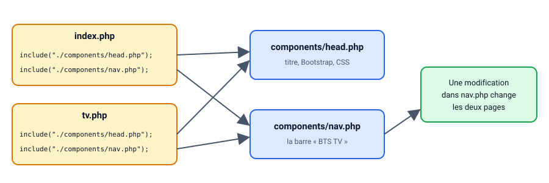
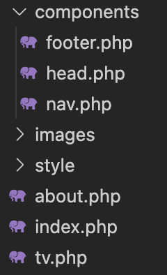
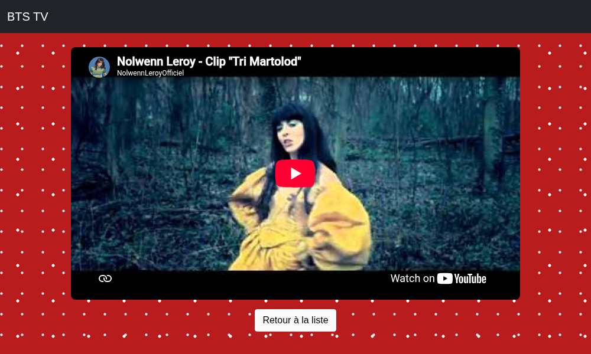
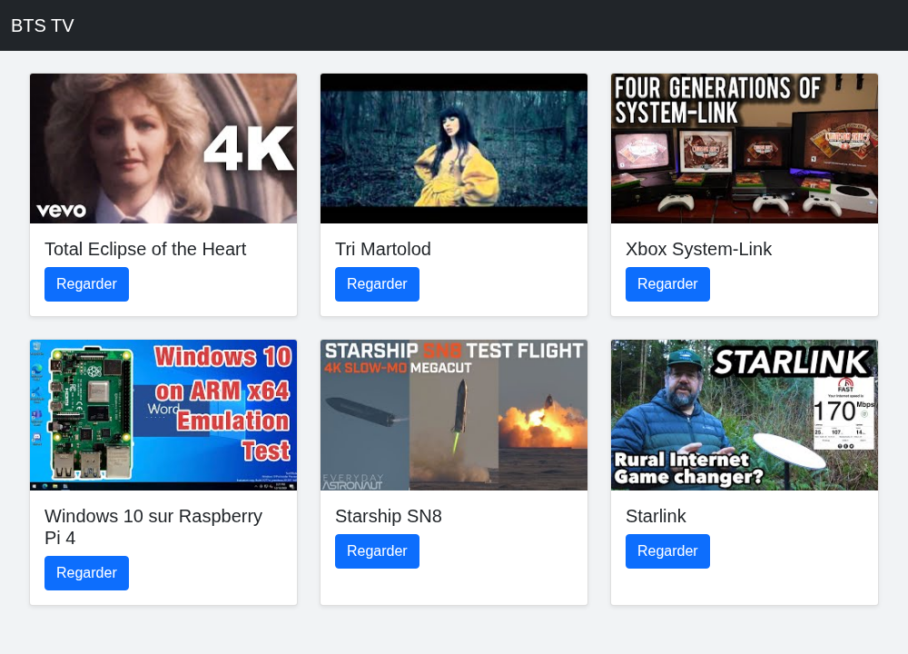

# Le passage de paramètres

Nous allons illustrer le passage de paramètres grâce à la BTS TV. Ce TP va nous permettre de mieux comprendre l'intérêt des paramètres.

Nous allons produire le code qui va nous permettre de réaliser les deux pages suivantes :

<iframe width="560" height="315" src="https://www.youtube-nocookie.com/embed/sGStM92OIG0" frameborder="0" allow="accelerometer; autoplay; clipboard-write; encrypted-media; gyroscope; picture-in-picture" allowfullscreen></iframe>

L'objectif de ce code est d'illustrer le passage de paramètres entre deux pages via un paramètre GET. Celui-ci contiendra :

- Deux pages
- Responsive
- Un paramètre (?id=...)

::: details Sommaire
[[toc]]
:::

## Les slides

Avant de commencer, un tour rapide des compétences du jour : une page générique, les paramètres GET et la génération de liens en boucle.

<ClientOnly>
<SlidesDeck src="php_tp_param" />
</ClientOnly>

## Prérequis

- Le [TP 1.2 : Utiliser des includes et une librairie](./tp1.2.md) terminé (Bootstrap, `include`, `$_GET`).
- Les boucles vues au [TP 1.1](./tp1.1.md).
- WAMP / XAMPP démarré.

## Objectifs

À la fin de ce TP vous saurez :

- transmettre une information d'une page à une autre avec un paramètre `GET` ;
- écrire une page générique qui change de contenu selon le paramètre reçu ;
- regrouper le code commun à plusieurs pages (`<head>`, `<nav>`) dans des fichiers inclus ;
- utiliser un second paramètre pour personnaliser l'apparence d'une page ;
- générer une liste de liens à partir d'un tableau et d'une boucle.

## Rappel sur les paramètres

| Variables | Usage                                                                                                           |
| --------- | --------------------------------------------------------------------------------------------------------------- |
| `$_GET`   | Contiens les paramètres envoyés dans l'URL.                                                                     |
|           | `index.php?prenom=valentin`, `prenom` est donc un paramètre et `valentin` la valeur.                            |
|           | Vous pouvez avoir plusieurs paramètres avec le caractère `&`. <br> Ex. `index.php?nom=brosseau&prenom=valentin` |

```php
// Exemple $_GET Contiendra
array(
    "prenom" => "valentin",
    "nom" => "brosseau",
);

echo $_GET['nom']; // Affichera brosseau
echo $_GET['prenom']; // Affichera valentin

echo $_GET['nom'] . " " . $_GET['prenom']; // Affichera brosseau valentin
```

Dans la BTS TV, c'est exactement ce mécanisme qui relie les deux pages : chaque lien de `index.php` porte l'identifiant de la vidéo, et `tv.php` le lit dans `$_GET` pour afficher le bon lecteur.

![Sur index.php, la card « Tri Martolod » pointe vers tv.php?id=jTuBnZrLbq0 ; au clic le navigateur demande cette adresse, tv.php lit $id dans $_GET['id'] et l'utilise dans l'adresse de l'iframe YouTube](./res/tp-param_lien_id.svg)

## Évolution 0

Nous allons nous servir des `includes` pour « organiser » notre code. L'idée derrière cette organisation est simple, évitée de multiplier le code identique entre différentes pages. Si vous regardez votre code, vous allez rapidement remarquer que certains éléments sont identiques sur les deux pages :

- le `<nav>`
- le `<head>`

Nous avons en PHP la possibilité de « sortir » les éléments en question pour les inclure ou ça est nécessaire. Par exemple, pour le `<nav>` je vous propose de créer un fichier `nav.php` dans un dossier nommé `components`. Dans mon cas le fichier contiendra **uniquement**:

```php
<nav class="navbar navbar-expand-lg navbar-dark bg-dark">
    <div class="container-fluid">
        <a class="navbar-brand" href="/">BTS TV</a>
    </div>
</nav>
```

Puis pour l'utiliser, il vous suffira de le mettre à l'endroit où vous souhaitez l'afficher :

```php
<body>
    <?php include("./components/nav.php"); ?>

<!-- La suite de votre code -->
```

::: tip Hé oui !
C'est effectivement aussi simple que ça. N'oubliez pas, 50% de votre travail repose sur votre bonne organisation !
:::

Je vous laisse faire de même pour la partie `head` de votre site.

Pour résumer, les deux pages incluent les mêmes fichiers :



::: tip Point de contrôle
Ce découpage ne doit rien changer à l'écran. La page `tv.php?id=jTuBnZrLbq0` s'affiche toujours avec sa barre « BTS TV » et sa vidéo :


:::

::: tip Bon ok…
Un petit indice pour la suite, votre structure de dossier ressemblera à :

:::

## Évolution 1

Je vous propose comme évolution d'ajouter un paramètre. Celui-ci devra nous permettre la personnalisation du thème de la page `tv.php` (celle affichant les vidéos). Pour ça nous allons :

- Ajouter un paramètre `&bg=noel` ou `&bg=brick`, etc.
- Utiliser le paramètre pour personnaliser le thème de la page. (Le paramètre doit être utilisé en tant que `class`).

::: tip Point de contrôle
Avec l'adresse `tv.php?id=jTuBnZrLbq0&bg=noel`, la balise `<body>` reçoit la classe `noel` et le fond de la page change (ici un fond rouge enneigé, à vous de choisir le vôtre) :


:::

## Évolution 2

### Une CSS du jour

Ajouter une CSS qui s'affichera uniquement aujourd'hui. Celle-ci doit modifier l'apparence de votre site Internet.

### Des vidéos de saison

Afficher une sélection de vidéo (`card`) en fonction de la période de l'année. Par exemple 4 vidéos sur le thème de Noël pendant la période de Noël.

## Évolution 3

La dernière grosse évolution à réaliser dans ce site, je vous propose de rendre dynamique la liste des vidéos sur la page d'`index.php`. Pour ça :

- Ajouter un tableau `array`.
- Faire une boucle (`foreach`, `for`, `while`).

_Exemple simple **à ne pas recopier**_

```php
$videos = array("lcOxhH8N3Bo", "jTuBnZrLbq0", "i1iIaSbK9bg", "MTaHw-S6IDo", "KfMCApWc5xE", "igtN49I1CtM");

foreach ($videos as $id) {
    echo "- <a href='tv.php?id=" . $id . "'>Video " . $id . "</a>";
}
```

::: tip Attention
Le code précédent est **un exemple** ! Il faut le modifier/l'adapter pour afficher les cards tels que c'était demandé initialement.
:::

::: tip Point de contrôle
Une fois la boucle en place, la page d'accueil n'a plus aucune card écrite à la main : elles sont toutes générées à partir du tableau, chacune avec son lien `tv.php?id=…`.


:::

## Conclusion

Dans ce TP, vous avez :

- relié deux pages grâce à un paramètre `GET` (`tv.php?id=…`) ;
- écrit une page `tv.php` générique, qui affiche la vidéo demandée ;
- sorti le `<head>` et le `<nav>` dans des fichiers inclus par les deux pages ;
- personnalisé le thème avec un second paramètre (`&bg=…`) ;
- généré les cards de la page d'accueil à partir d'un tableau et d'une boucle.

La suite ? [Évaluation 1 : Ma page profil dynamique](./eval1.md), pour valider les bases, puis [TP 2 : Les formulaires et la première table](./tp2.md).

👋 Si vous avez des questions, n'hésitez pas.
